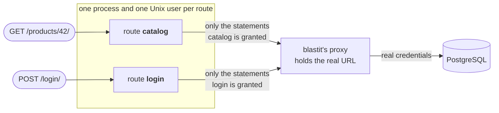

# blastit

**A WSGI server that keeps the blast radius of a security bug small.**

In a typical Python web app, every view runs in the same process, with the
same database credentials and the same rights. One exploitable bug in the
least important page — a template injection, a deserialisation flaw, a
vulnerable dependency — and the attacker holds everything the whole app
holds: every table, every secret in the environment.

blastit serves the same app, unchanged, but splits it up:

* **Each view runs in its own sandbox.** You group your URLs into *routes*;
  every route gets its own process under its own Unix user. A compromised
  route can't read another one's memory, signal it, or borrow its rights.
* **Views use private resources without knowing their secrets.** The real
  database URL never reaches your code. Your app sees an ordinary
  `DATABASE_URL`, which points at a local proxy run by blastit. Only that
  proxy holds the credentials.
* **Each route gets only the privileges it needs.** The proxy lets every route
  run only the SQL statements the manifest grants it. The product page can
  read products; it can't read password hashes, and it can't `DROP TABLE`. A
  route that doesn't need the network can't open an outbound connection.



Your framework doesn't know any of this happens. It gets ordinary WSGI
requests and routes them itself. All blastit adds is one file,
`blastit.toml`, which says which URLs belong to which route and what each
route may do.

> **Status: pre-release.** blastit runs a real Django app end to end on
> DigitalOcean App Platform in CI, but it hasn't had a stable release, and the
> manifest format may still change. Linux only.

## What it looks like

A route for the public catalogue, one for logging in, and a catch-all:

```toml
version = 1

# The app's DATABASE_URL is the real one at startup; blastit takes it, and
# hands the app a URL to its own proxy instead.
[proxy.db]
protocol = "postgresql"
input = { url = "DATABASE_URL" }

[[route]]
name = "catalog"
path = ['/products/', '/products/[0-9]+/']
methods = ["GET", "HEAD"]
[route.db]
queries = [
  'SELECT "shop_product"."id", "shop_product"."name", "shop_product"."price" FROM "shop_product" WHERE "shop_product"."id" = $1 LIMIT 21',
  'SELECT "shop_product"."id", "shop_product"."name", "shop_product"."price" FROM "shop_product" ORDER BY "shop_product"."name" ASC',
]

[[route]]
name = "login"
path = ['/login/']
[route.db]
transaction_control = true
queries = [
  'SELECT "auth_user"."id", "auth_user"."password", "auth_user"."username" FROM "auth_user" WHERE "auth_user"."username" = $1 LIMIT 21',
  'UPDATE "auth_user" SET "last_login" = $1 WHERE "auth_user"."id" = $2',
]

[[route]]
name = "fallback"     # everything else: no database at all
path = ['.*']
```

If the catalogue page is compromised, the attacker can list products. That's
it. Each refusal is logged as one JSON line that names the route and the
statement it was refused:

```json
{"ts":"2026-10-25T14:02:12.007Z","level":"warn","event":"sql.denied","component":"dbproxy","route":"catalog","proxy":"db","kind":"parse","sqlstate":"42501","sql":"SELECT \"auth_user\".\"password\" FROM \"auth_user\""}
```

## Quick start

### 1. Install

blastit is on PyPI: wheels for Linux, CPython 3.13 and 3.14 (x86_64 and
aarch64), and an sdist that builds the same wheel from source for anything
else.

With uv:

```console
$ uv add blastit
$ uv run blastit                     # or .venv/bin/blastit, or python -m blastit
```

With pip:

```console
$ pip install blastit
```

Every commit to `develop` is also published as `0.1.0.dev<build>` on
[blastit's own package index](https://offworldnexus.github.io/blastit/simple/) —
for something newer than the last release, or to test a fix that isn't released
yet. `v0.1.0` is the first release, so until that tag exists this is the only
index that has blastit on it.

With uv, pointing at that index:

```toml
# pyproject.toml
[[tool.uv.index]]
name = "blastit"
url = "https://offworldnexus.github.io/blastit/simple/"
explicit = true

[tool.uv.sources]
blastit = { index = "blastit" }
```

```console
$ uv add --prerelease allow blastit
```

With pip, from that index:

```console
$ pip install --pre blastit --extra-index-url https://offworldnexus.github.io/blastit/simple/
```

Like granian, blastit is a compiled extension plus a `blastit` command written
in Python, so it runs on the interpreter of the environment it's installed in:
your virtualenv and its packages are simply there. To build a wheel yourself,
run `scripts/build-wheel.sh` (Rust 1.88+ and uv).

Configuration is still environment variables only (`BLASTIT_APP`,
`BLASTIT_MANIFEST`, `PORT`, …), and it still wants to be PID 1 in the
container. Two things to know before you start it:

* it has to run as **root**: init binds the port, then drops every other
  process to its own unprivileged user (see the Dockerfile below). Start it
  as root directly (`USER root`), not through `sudo`: App Platform sets
  `no_new_privs`, which stops `sudo`, and blastit only ever drops privileges;
* the project directory — and therefore the `.venv` with blastit and the app's
  dependencies in it — has to stay **readable by the sandbox users**. Routes run
  as `BLASTIT_UID_BASE + 1000 + i`, and blastit drops to `UID_BASE + 3` before
  it `execve`s its own database proxy, so a project inside a `0700` directory
  hides both from those users. `/app`, `/srv/app` or an ordinary checkout are
  fine.

### 2. Django

Two settings make Django's SQL checkable:

```python
# settings.py
DATABASES["default"]["CONN_MAX_AGE"] = 0  # request threads don't outlive their request
DATABASES["default"].setdefault("OPTIONS", {})["server_side_binding"] = True
# Parameters travel separately from the SQL text, so a statement's text is
# the same on every request and can be allowed exactly.
```

Write `blastit.toml` next to `manage.py` (see above), then run blastit as root
in the container. It binds the port and then drops every process to its own
unprivileged user:

```dockerfile
FROM python:3.13-slim
WORKDIR /app
COPY . .
RUN pip install -r requirements.txt

RUN pip install --pre blastit --extra-index-url https://offworldnexus.github.io/blastit/simple/

ENV BLASTIT_APP=myproject.wsgi:application \
    BLASTIT_MANIFEST=/app/blastit.toml \
    BLASTIT_PRELOAD=myproject.urls \
    PORT=8000
CMD ["blastit"]
```

`BLASTIT_PRELOAD` imports your URLconf before the processes are forked, so
that every route shares the same loaded code instead of loading it again on
its first request.

### 3. FastAPI

blastit speaks WSGI. FastAPI is ASGI, so run it through
[a2wsgi](https://github.com/abersheeran/a2wsgi). a2wsgi starts an event-loop
thread, and blastit forks its processes from a single-threaded parent, so
create the adapter lazily, inside each process:

```python
# myproject/wsgi.py
import threading

from a2wsgi import ASGIMiddleware

from myproject.main import app

_lock = threading.Lock()
_wsgi = None


def application(environ, start_response):
    global _wsgi
    if _wsgi is None:
        with _lock:
            if _wsgi is None:
                _wsgi = ASGIMiddleware(app)
    return _wsgi(environ, start_response)
```

With SQLAlchemy, use psycopg 3 (`postgresql+psycopg://`), which sends
parameters separately by default, and don't pool connections across requests
(`poolclass=NullPool`). Then set `BLASTIT_APP=myproject.wsgi:application`, as
for Django. (CI covers the Django path; this one isn't in CI yet.)

### 4. Fill in the grants

You don't write the SQL by hand. Run the app under blastit, use it, and read
the `sql.denied` lines: each one is a statement a route ran and wasn't granted
yet. If it belongs there, copy it into the route. If it doesn't, you just
found a route that does more than you thought.

#### Fill in the grants with your test suite

Denials in production are the truth — that's what actually ran. But each pass
only reveals the *first* denial of each request, because a denied statement
aborts the request, so filling the manifest in that way is one deploy per
statement. Your test suite already makes most of those requests. blastit ships
a pytest plugin that watches it and tells you the difference, **before** the
deploy:

```console
$ uv run pytest --blastit-manifest blastit.toml
...
blastit: 412 requests, 977 statements, 38/41 routes exercised — report in blastit-report.json
blastit: route product-list: 3 statement(s) missing (see blastit-report.json)
blastit: route checkout: needs transaction_control = true
blastit: route search: 2 grant(s) unused
blastit: route queue opens outbound connections (redis:6379, amqp:5672) but has no egress = true
blastit: 4 unrouted request(s): GET /robots.txt, GET /favicon.ico (see blastit-report.json)
blastit: 2 connection-setup statement(s) some routes do not grant: put them in a group attached to every route (see blastit-report.json)
blastit: 2 route(s) never exercised: webhooks, admin
======================= 1513 passed, 12 skipped in 84.20s =======================
```

The options, when the defaults do not fit:

```
--blastit-manifest PATH        the blastit.toml to diff against; without it the
                               plugin does nothing at all (or `blastit_manifest`
                               in pytest.ini / pyproject.toml)
--blastit-report PATH          where the JSON report goes (default
                               blastit-report.json, relative to where pytest runs)
--blastit-proxy ALIAS=PROXY    maps a database alias to a manifest proxy, when
                               the manifest declares more than one postgresql
                               proxy (repeat it per alias)
--blastit-strict               fail the session when anything is missing,
                               unrouted, needing transaction_control or egress,
                               not granted in every route, unreadable, or worth a
                               warning from the plugin itself
--blastit-live-server          serve pytest-django's live_server through blastit
                               itself, so real front-end traffic is checked
                               against the manifest (needs root, or passwordless
                               sudo)
--blastit-live-app MODULE:ATTR  the WSGI callable that server serves (default:
                               WSGI_APPLICATION, or <package>.wsgi:application)
```

The plugin is inert unless you ask for it, and it needs
[pytest-django](https://pytest-django.readthedocs.io/) and psycopg 3 with
server-side binding (`DATABASES[...]["OPTIONS"]["server_side_binding"] = True`,
§6). It works under pytest-xdist too: every worker reports what it saw, and the
controller merges them into one report. Set the manifest in `pytest.ini` or
`pyproject.toml` if you would rather not repeat the option:

```ini
[pytest]
blastit_manifest = blastit.toml
```

`blastit-report.json` has the detail the summary only counts, per route:

```json
{
  "name": "product-list",
  "requests": 26,
  "needs_transaction_control": false,
  "egress": {
    "observed": [
      {"target": "redis:6379", "host": "redis", "port": 6379, "family": "AF_INET",
       "count": 26, "tests": ["shop/tests/test_catalog.py::test_on_sale"]}
    ],
    "needed": false
  },
  "proxies": [
    {
      "name": "db",
      "observed": 51,
      "missing": [
        {
          "sql": "SELECT \"shop_product\".\"id\", \"shop_product\".\"name\" FROM \"shop_product\" WHERE \"shop_product\".\"on_sale\" = $? LIMIT 21",
          "count": 9,
          "wire_sql": "SELECT \"shop_product\".\"id\", \"shop_product\".\"name\" FROM \"shop_product\" WHERE \"shop_product\".\"on_sale\" = $1 LIMIT 21",
          "tests": ["shop/tests/test_catalog.py::test_on_sale"],
          "paths": ["/products/on-sale/"]
        }
      ],
      "unused": ["SELECT \"shop_product\".\"id\" FROM \"shop_product\" LIMIT 21"],
      "transaction_control": {"observed": false, "granted": false, "needed": false}
    }
  ]
}
```

and, at the top level, the statements every connection runs:

```json
"connection_setup": {
  "statements": [
    {"sql": "SELECT set_config('TimeZone', $?, false)", "proxy": "db", "count": 26,
     "wire_sql": "SELECT set_config('TimeZone', $1, false)",
     "ungranted_in": ["product-list", "search"], "granted_in": 36}
  ],
  "ungranted": 1
}
```

How to read it:

* **`missing`** — statements the suite executed that no grant allows. `sql` is
  the *normalised* text (the exact form the manifest comparison reads), so you
  can paste it into the route's `queries` as it is; `wire_sql` is one raw
  occurrence with its `$1`, `$2`… placeholders; `tests` and `paths` name up to
  five examples, so you can find the code that sent it. A statement the tests
  never sent can still be missing in production — the report is a lower bound.
  Placeholders are compared as `$?`, and so are the shapes a live query changes
  on every call: an `IN ($1)` grant fits an `IN` list of any length, and one
  grant fits a run of `VALUES (…)` rows (a single row is a shape of its own).
* **`unused`** — grants that nothing matched. Either dead code, or a request
  your suite doesn't make yet.
* **`unused_global`** — the same idea for the grants a **global** group
  (`groups = […]` at the top level) hands to every route at once. A statement
  such a group grants is not one route's grant, so counting it as unused per
  route would repeat one dead grant once per route; it is reported here, once,
  and only when no route matched it. Same for a global group's `tables` grant.
* **`needs_transaction_control`** — the route ran `BEGIN`/`COMMIT` or a
  savepoint (a nested `transaction.atomic()`, or `ATOMIC_REQUESTS` on the
  alias) and the route's grant does not allow transaction control. Add
  `transaction_control = true`; do *not* try to grant a savepoint, its name
  changes on every request. psycopg's own `BEGIN`/`COMMIT` are captured too, so
  this is seen even when no cursor of the request sends one — a transaction that
  was already open when the request began (pytest-django's `django_db`, an outer
  `atomic()`) is not the route's and is not counted.
* **`unrouted`** — paths blastit would answer `404` for before Django ever saw
  them. Either add a route for them (a catch-all `path = ['.*']` is the usual
  answer, so the app renders its own 404s) or stop requesting them.
* **`unexercised_routes`** — routes nothing hit: their grants are unproven, not
  proven wrong.
* **`egress`** — the outbound connections the route tried to open, with the
  destination, how often and an example test, and `needed` when the route has no
  `egress = true` (§7.3), which is what the seccomp filter would refuse. Mocked
  HTTP clients — pytest-httpx, `responses`, a stub transport — never open a
  socket, so the list is a **lower bound**: a route it says nothing about can
  still need `egress = true` in production.
* **`connection_setup`** — the statements psycopg runs as a connection is
  established: `SET`s of your own (a `connection_created` receiver, a
  middleware), Django's `set_config('TimeZone', …)`, a `TypeInfo.fetch` a
  backend does at connect. None of them goes through a request's cursors, and
  under blastit **every request opens its own connection** (`CONN_MAX_AGE = 0`),
  so they run on every route in production — put them in a group attached to
  every route (`groups = ["connection"]` at the top level). `ungranted_in` names
  the routes that would refuse them today; a route with no grant for that proxy
  gets no listener and never runs them, so it is not listed.
* **`unrecognised`** — statements the plugin could not read, counted rather than
  dropped. psycopg's t-string queries (`t"SELECT {name}"`) have no text before
  they are rendered, so nothing can be compared to a grant; report them to
  whoever wrote the query.
* **`plugin_warnings`** — what the plugin itself could not do, most importantly
  an alias that does not set `server_side_binding = True`: psycopg then inlines
  the parameters and the `$n` text in the report is one the plugin made up,
  not the text dbproxy would check.
* `--blastit-strict` fails the run on any of the above, for a CI job that keeps
  the manifest from rotting. Add the `missing` statements, re-run until it is
  clean, and deploy.

Two statements cannot be granted, and the report cannot hide it:

* a savepoint's name (`SAVEPOINT "s140234_x1"`) is made per request: the fix is
  `transaction_control = true` on the route, not a grant;
* a named cursor — `QuerySet.iterator()`, i.e. Django's `chunked_cursor()` — sends
  `DECLARE "_django_curs_140234_sync_1" CURSOR FOR …`, then `FETCH` and `CLOSE`
  with the same generated name, so no grant can match them. Turn server-side
  cursors off for the routes that use them
  (`DATABASES[...]["DISABLE_SERVER_SIDE_CURSORS"] = True`) or accept that they
  will be denied under blastit.

### Front-end traffic, served by blastit itself

The plugin sees the requests *your test process* makes. A suite that drives a
live server — Playwright against `live_server`, a browser, `requests` to a URL —
makes its traffic somewhere else: in a server process of its own, where the
plugin cannot look, and where the paths nobody asserts on are exactly the ones
that surprise a deployment. `blastit_live_server` closes that gap. It starts the
real `blastit` binary on a free port, with your manifest and your *test*
database, and hands you the URL:

```python
from urllib.request import urlopen


def test_notes_page(blastit_live_server):
    with urlopen(f"{blastit_live_server.url}/notes/") as response:
        assert response.status == 200
```

Suite already written against `live_server`? Run it with
`--blastit-live-server` and `live_server` *is* blastit's, tests untouched (or
alias it in your `conftest.py`: `from blastit.pytest_plugin import
blastit_live_server as live_server`). On teardown the server's log is folded
into the report: every `request` it served and every `sql.denied` it wrote, so a
grant the front end needs and your tests never exercised shows up as a missing
statement like any other.

It runs blastit, so it needs what blastit needs: **root, or passwordless
sudo** (view uids, listeners, `/run/blastit`). Without either it skips, with the
reason, rather than failing your suite. It preloads your root URLconf (§6) and
serves your project where it lives when the view uids can read it there; when
they cannot — pytest's own temporary directories are private — it serves a copy
in a temporary directory it creates and removes, and changes no mode of your
checkout.

That log says what was *denied*, never what *ran*, so a route only it saw
reports no unused grants: the report never calls a grant dead when nothing
observed whether it was used.

Read the report, add the grants, repeat until
`blastit: the manifest covers every request that was made`. The denial logs stay
the source of truth in production — the tests only make the requests they make —
but by the time the app is deployed the manifest is already most of the way
there instead of a deploy per statement.

#### Fold the denials from production

The test suite only makes the requests it makes; production makes the rest — a
404's redirect lookup, a query whose shape depends on the data, a code path no
test covers. Every one of those is a `sql.denied` line in the log, and
`blastit-manifest fold` turns them into the grants your manifest is missing:

```console
$ blastit-manifest fold app.log --manifest blastit.toml          # the TOML to paste
$ blastit-manifest fold app.log --manifest blastit.toml --write  # or write it
$ blastit-manifest fold app.log --manifest blastit.toml --prefer-tables
$ blastit-manifest fold app.log --manifest blastit.toml --allow-dangerous
```

Without `--write` nothing is touched: it prints the grant to add, with the
reason dbproxy gave as a comment. With it, the statements go inside the route's
existing `queries = [ … ]` (or a `[route.<proxy>.tables]` section is added under
the grant), and the rest of the file — comments, order, everything — stays where
it was. `--prefer-tables` adds the smallest table grant covering the denials
instead, and keeps whatever a table grant cannot describe (a system catalogue,
an unknown function, a `SET`) as an exact query, saying why.

It never adds a grant to an `unrestricted` route (there is nothing left to grant
there), it skips what your manifest already allows, and it compares statements
with blastit's own normaliser — so what it writes is what dbproxy matches.
`python -m blastit.fold` does the same where only the package is importable.

Two things it refuses, because a `queries` entry is trusted as it is:

* a statement whose *kind* a grant is not an allowlist for — DDL, `SET` and
  `RESET` (`SET ROLE` above all), `COPY`, `DO`, `CALL`, `LOCK`, `GRANT`,
  `REVOKE`, `TRUNCATE`, `VACUUM`, `LISTEN`/`NOTIFY`, the transaction commands,
  and a text holding more than one statement (split it first);
* a statement calling a function outside blastit's safe set — `set_config`,
  `pg_read_file`, `lo_import`, `pg_terminate_backend`, an extension's function:
  blastit compares the text and runs what it matches, so granting one as an
  exact `queries` entry runs that function with the app's privileges. Give the
  route a table grant instead (which checks functions), or say
  `--allow-dangerous` if that is really what you want.

Either way it says what it refused and why, on stderr, and writes nothing of
it.

### Rootless

blastit asks the kernel which privileges it has before it does anything, so it
can run as an unprivileged user holding only what the boot needs instead of root:
`cap_setuid`, `cap_setgid`, `cap_chown`, `cap_fowner`, `cap_dac_override` and
`cap_kill`, plus `cap_setpcap` when the container can give it (without it, the
children keep their bounding set and the boot says so). Its first event says which
mode it chose, so a deployment that *thinks* it granted a capability finds out at
boot rather than at the first request:

```json
{"event":"boot","stage":"stage0","seccomp":true,"privilege":"capabilities",
 "bounding_set":"dropped",
 "capabilities":["cap_chown","cap_dac_override","cap_fowner","cap_kill","cap_setgid","cap_setuid","cap_setpcap"]}
```

The capabilities go on a **dedicated copy** of the file init starts from, never on
the interpreter or binary the rest of the image runs: a file capability turns any
process of its owner's uid that can run it into init (`setuid(0)`). The copy is
`0500`, owned by that uid, sits next to the original (CPython finds its stdlib and
its venv from the executable's own path) and is what the entrypoint starts.

**That uid is therefore a dedicated one**: no worker, migration, sidecar or shell
may run as it, because it is the only uid that can run the copy — a debug shell of
it would be init. The boot warns (it does not refuse) when another process of that
uid is already running, and the e2e runs its worker and migrations on a uid of
their own, checks that uid is refused the copy, and checks that the *shared*
interpreter grants nothing:

```console
# a wheel install: `blastit` is a console script, so its interpreter is the file
$ interpreter="$(readlink -f "$(command -v python)")"
$ sudo cp "$interpreter" "$interpreter-init"
$ sudo chown 1000:1000 "$interpreter-init" && sudo chmod 0500 "$interpreter-init"
$ sudo setcap 'cap_chown,cap_dac_override,cap_fowner,cap_kill,cap_setgid,cap_setuid,cap_setpcap+ep' \
      "$interpreter-init"
$ "$interpreter-init" -m blastit

# a standalone install: the same, and `BLASTIT_EXEC` names the capability-free
# copy `--role=dbproxy` runs (it cannot be the capable file: a child's empty
# bounding set makes the kernel refuse that `execve`)
$ sudo cp /usr/local/bin/blastit /usr/local/bin/blastit-init
$ sudo chown 1000:1000 /usr/local/bin/blastit-init && sudo chmod 0500 /usr/local/bin/blastit-init
$ sudo setcap 'cap_chown,cap_dac_override,cap_fowner,cap_kill,cap_setgid,cap_setuid,cap_setpcap+ep' \
      /usr/local/bin/blastit-init
$ BLASTIT_EXEC=/usr/local/bin/blastit /usr/local/bin/blastit-init
```

`BLASTIT_EXEC`'s target is checked at boot: owned by root or by init's uid,
writable by neither group nor others, in a directory that is not either — a uid
that could replace that binary would decide what dbproxy, the process holding the
real credentials, runs next. `/tmp` is the usual trap, and the boot refuses it by
name.

Docker's `--cap-add` does **not** give capabilities to a `--user` process — it
only limits the container's bounding set — so a deployment either gives them to
the copy with `setcap`, or passes them as ambient capabilities from a launcher
that starts as root (the spelling that works where `no_new_privs` is set on the
container, since the kernel then ignores file capabilities):

```console
$ setpriv --reuid=1000 --regid=1000 --init-groups \
      --inh-caps +setuid,+setgid,+chown,+fowner,+dac_override,+kill,+setpcap \
      --ambient-caps +setuid,+setgid,+chown,+fowner,+dac_override,+kill,+setpcap \
      blastit
```

Two things a rootless deployment provides itself:

* a runtime directory the service user owns — `/run/blastit`, for example
  `--tmpfs /run/blastit:mode=0700,uid=1000,gid=1000` — because `/run` belongs
  to root;
* a service uid that is not one of the layout's (`BLASTIT_UID_BASE`): the boot
  refuses a uid that the layout hands to another process.

`e2e/rootless/` is a working example: PostgreSQL and the demo app in two
containers, the app under `user:` with `cap_drop: [ALL]` and only those
`cap_add`s, driven by `e2e/rootless/run.py` — locally, or on a DigitalOcean
Droplet it creates and destroys. On App Platform, which sets `no_new_privs`,
starting as root stays the way (§10).

## What you get, and what you don't

| If this is compromised… | …the attacker gets | …and cannot |
|---|---|---|
| one route | that route's granted statements, its scratch directory, the network only if the route has `egress = true` | run any other statement, read the database credentials, touch other routes' processes |
| the HTTP front end | the raw bytes of requests in flight | reach the database, run Python |

blastit doesn't protect against code that runs when your app is *imported*:
that happens before the sandboxes exist. And it only sandboxes what goes
through its proxies; other secrets in the environment (an API key for a
third-party service, say) are still visible to every route.

## Configuration

Everything is configured through environment variables: `BLASTIT_APP`,
`BLASTIT_MANIFEST`, `PORT`, worker budgets, timeouts, log format
(`BLASTIT_LOG_FORMAT=pretty` for humans). The full list is in
[`ARCHITECTURE.md` §8.2](ARCHITECTURE.md#82-configuration-reference).

### Pick a preset

Two deployments were measured end to end, and each has a name:

```console
$ blastit --preset digitalocean-paas     # DigitalOcean App Platform
$ blastit --preset compose-traefik       # Docker Compose behind Traefik
```

A preset is a set of **defaults**: anything you set yourself — every `BLASTIT_*`
variable, and `PORT` — still wins, so adding one to a deployment that already
configures blastit by hand changes nothing it named. (`BLASTIT_PRESET=NAME` is the
same thing for a process you do not start yourself.) `blastit --help` lists them
with a one-line description, and the `boot` event says which one is in force,
which settings it supplied and which of them you overrode. Each preset also says
what it assumes — root or capabilities, and *who can reach the port* — and the
boot warns when the first of those does not hold. For anything else, the
variables in [`ARCHITECTURE.md` §8.2](ARCHITECTURE.md#82-configuration-reference)
are the whole story.

## Learn more

* [`ARCHITECTURE.md`](ARCHITECTURE.md): the design, the security model, and
  what it relies on.
* [`ROADMAP.md`](ROADMAP.md): what's built and what's next.
* [`e2e/`](e2e/): the Django demo that CI runs under blastit, in Docker and on
  App Platform, to prove all of the above.
* [`docs/spikes/`](docs/spikes/): what was measured on the target platform.

## Development

```console
$ cargo fmt --all -- --check
$ cargo clippy --workspace --all-targets -- -D warnings
$ cargo test --workspace
```

`develop` is the only long-lived branch. Each roadmap step lands as one pull
request from a `feature/<step>-<slug>` branch; CI must be green before merging.
