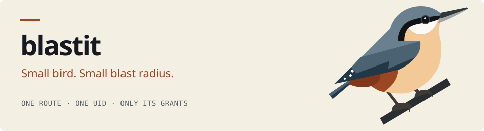

<picture>
  <source media="(prefers-color-scheme: dark)" srcset=".github/brand/header-dark.svg">
  <source media="(prefers-color-scheme: light)" srcset=".github/brand/header-light.svg">
  
</picture>

<p align="center">
  <a href="https://offworldnexus.github.io/blastit/">Documentation</a> · <a href="ARCHITECTURE.md">Architecture</a> · <a href="LICENSE">Apache 2.0</a>
</p>

**A WSGI server that keeps the blast radius of a security bug small.** Each route
runs in its own process under its own Unix user, talks to a local proxy instead of
the real database, and may run only the SQL its manifest grants it — so one
exploitable bug in the least important page is worth that page, not the app.
Linux, CPython 3.13+, PostgreSQL.

## Try it

```console
$ uv init --app && uv add blastit
```

```python title="hello.py"
def application(environ, start_response):
    start_response("200 OK", [("Content-Type", "text/plain")])
    return [b"hello from blastit\n"]
```

```toml title="blastit.toml"
version = 1
app = "hello:application"

[[route]]
name = "hello"
path = ['.*']
```

```console
$ uv run blastit dev
  blastit dev · single-uid simulation · 127.0.0.1:8080
  Not a sandbox. Production `blastit` refuses to run like this.
  http · scheduler · dbproxy · 1 route
```

```console
$ curl localhost:8080/whatever
hello from blastit
```

The server keeps the terminal; `curl` goes in another one.

For this hello world: no `sudo`, no `chmod`, no environment variables. `blastit
dev` finds `./blastit.toml`, runs the app as you, and says so in the banner.

## Three places it has to work

| Where | Command | What it gives you |
|---|---|---|
| Your laptop | `blastit dev` | the real process topology, unprivileged |
| CI | `blastit check` | proof no request, grant or route was forgotten |
| Production | `blastit` / `--preset …` | real uids and capabilities, or it refuses to start |

**Read the documentation →**
[Local](https://offworldnexus.github.io/blastit/local/) ·
[CI/CD](https://offworldnexus.github.io/blastit/ci/) ·
[Deployments](https://offworldnexus.github.io/blastit/deploy/) ·
[Reference](https://offworldnexus.github.io/blastit/reference/cli/)

## License

Apache 2.0 — see [`LICENSE`](LICENSE).
