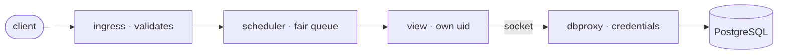

<picture>
  <source media="(prefers-color-scheme: dark)" srcset=".github/brand/header-dark.svg">
  <source media="(prefers-color-scheme: light)" srcset=".github/brand/header-light.svg">
  
</picture>

<p align="center">
  <a href="https://offworldnexus.github.io/blastit/">Documentation</a> · <a href="ARCHITECTURE.md">Architecture</a> · <a href="LICENSE">Apache 2.0</a>
</p>

**A zero-trust harness that keeps the blast radius of a security bug small.** It
serves a Python WSGI app, a PHP front controller or a static site unchanged, and
splits it into one `view` per route: each route runs in its own process under its
own Unix user, talks to a local proxy instead of the real database, and may run
only the SQL its `Blastfile` grants it. One exploitable bug in the least
important page is worth that page, not the app. Linux; CPython 3.13+ or the
host's NTS `libphp` (8.3, 8.4, 8.5); PostgreSQL.



## Try it

```console
$ uv init --app && uv add blastit
```

```python title="hello.py"
def application(environ, start_response):
    start_response("200 OK", [("Content-Type", "text/plain")])
    return [b"hello from blastit\n"]
```

```text title="Blastfile"
app "hello"

entrypoint python "hello:application"

view hello GET "/*" {}
```

```console
$ uv run blastit dev
  blastit dev · single-uid simulation · http://127.0.0.1:8080
  Not a sandbox. Production `blastit` refuses to run like this.
  http · scheduler · dbproxy · 1 route
  view  hello  GET, HEAD  /.*
```

```console
$ curl localhost:8080/whatever
hello from blastit
```

The server keeps the terminal; `curl` goes in another one. One line swaps the
runtime: `entrypoint php "public/index.php"` embeds the host's NTS `libphp`, and
a `Blastfile` with no `entrypoint` plus a `static` mount serves built assets.

## What `blastit check` prints

`check` runs your suite through the real route proxies and names every gap in the
`Blastfile`'s own words: the `view`, the statement, and the line that fixes it.

```text title="a failing run — three of its six findings"
blastit check: 4 requests, 2 statements, 3/4 views, 2 proxies
  view catalog: 1 statement not granted on proxy db
    SELECT "shop_product"."price" FROM "shop_product" WHERE "shop_product"."id" = $?
      fix: add it to view catalog postgres
  view upload: takes a body and declares no ingress validation; observed application/x-www-form-urlencoded
      fix: write `body form`
  proxy analytics: declared, 0 statements observed
      fix: remove `proxy analytics` or add the call that uses it
blastit check: 6 problems · `--json` for the machine-readable list
```

A clean run is one line — `blastit check: 412 requests, 977 statements, 3/3
views, clean` — and that is the deploy gate. `--json` is the same document for an
agent.

## Three places it has to work

| Where | Command | What it gives you |
|---|---|---|
| Your laptop | `blastit dev` | the real process topology, unprivileged |
| CI | `blastit check` | proof no request, grant or view was forgotten |
| Production | `blastit` / `--preset …` | real uids and capabilities, or it refuses to start |

This documentation site is served the same way: `make docs-serve` builds it with
Zensical and hands it to a freshly built `blastit dev` (`PORT=8080`).

**Read the documentation →**
[Local](https://offworldnexus.github.io/blastit/local/) ·
[CI/CD](https://offworldnexus.github.io/blastit/ci/) ·
[Deployments](https://offworldnexus.github.io/blastit/deploy/) ·
[Reference](https://offworldnexus.github.io/blastit/reference/cli/)

## License

Apache 2.0 — see [`LICENSE`](LICENSE).
