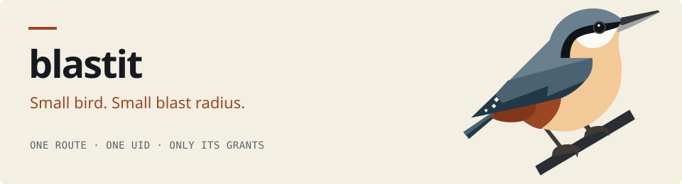

<picture>
  <source media="(prefers-color-scheme: dark)" srcset=".github/brand/header-dark.svg">
  <source media="(prefers-color-scheme: light)" srcset=".github/brand/header-light.svg">
  
</picture>

<p align="center">
  <a href="https://offworldnexus.github.io/blastit/">Documentation</a> · <a href="ARCHITECTURE.md">Architecture</a> · <a href="LICENSE">Apache 2.0</a>
</p>

**A WSGI server that keeps the blast radius of a security bug small.** Each route
runs in its own process under its own Unix user, talks to a local proxy instead of
the real database, and may run only the SQL its manifest grants it — so one
exploitable bug in the least important page is worth that page, not the app.

## Get started

`uv add` adds to a project, so `uv init` one first; with pip, skip both. In a
container, run blastit as root directly rather than through `sudo`.

```console
$ uv init && uv add blastit       # or: pip install blastit
```

```python title="hello.py"
def application(environ, start_response):
    start_response("200 OK", [("Content-Type", "text/plain")])
    return [b"hello from blastit\n"]
```

```toml title="blastit.toml"
version = 1
[[route]]
name = "hello"
path = ['.*']
```

```console
$ sudo env BLASTIT_APP=hello:application BLASTIT_MANIFEST=$PWD/blastit.toml \
           PORT=8080 .venv/bin/blastit
```

**Read the documentation →**
[framework guide](https://offworldnexus.github.io/blastit/frameworks/) ·
[infra guide](https://offworldnexus.github.io/blastit/infra/) ·
[reference](https://offworldnexus.github.io/blastit/reference/settings/)

## License

Apache 2.0 — see [`LICENSE`](LICENSE).
