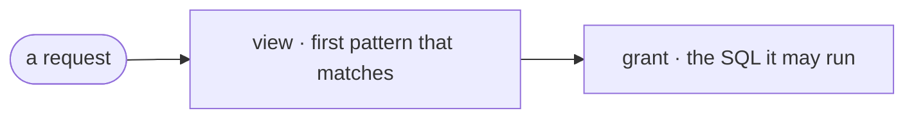

# The Blastfile

`./Blastfile` is Blastit's whole routing table and permission model: one plain-text
file, no `version` header, no `=` between a keyword and its value. It is read from
the working directory (`BLASTIT_MANIFEST` names another path; no upward search).

```console
$ blastit dev        # your machine, no root
$ blastit check
$ blastit fmt --check
```

## The file

=== "Python (WSGI)"
    ```text title="Blastfile"
    app "shop"

    entrypoint python "shop.wsgi:application"

    postgres $DATABASE_URL

    view products GET "/products/{id:int}" {
        postgres {
            select products(id, name, price)
        }
    }

    view checkout POST "/checkout" {
        body json
        postgres {
            insert orders(customer_id, total)
        }
    }
    ```

=== "PHP"
    ```text title="Blastfile"
    app "shop"

    entrypoint php "public/index.php"

    view app GET "/*" {
    }
    ```

=== "Static & SPA"
    ```text title="Blastfile"
    static "/" {
        root "public"
        fallback "index.html"
        immutable "/assets/*"
    }
    ```

`entrypoint` is declared once at top level and every runtime declares itself there;
grants nest inside the `view` that may run them. Views are tried in the order
written, so a specific pattern goes above a catch-all.



## Formatting { #formatting }

!!! note "What `fmt` rewrites"

    One directive per line, one-line blocks expanded; `blastit fmt --check` prints the
    diff and exits `1` in CI.

## Local development

`DATABASE_URL` is the app's normal libpq URL; the real password stays with Blastit,
which hands the app a local socket URL ([Local development](local.md)).

=== "Python (WSGI)"
    ```console
    $ uv add blastit
    $ blastit dev
    ```

=== "PHP"
    ```console
    $ blastit dev              # the archive, plus the host's NTS libphp
    ```

=== "Static & SPA"
    ```console
    $ blastit dev              # the release archive; no language runtime
    ```

It binds `127.0.0.1:8080` (`--port` moves it) and reloads every view on save.
`blastit dev --learn` allows what the file does not cover and records it: stop with
`Ctrl-C`, read `git diff Blastfile`, then run `blastit check`. It adds views and their
exact statements, never a `body` codec, and refuses an inlined value — bind it, learn again.

## CI/CD

One unprivileged command proves nothing your suite exercised was left out:

=== "Python (WSGI)"
    ```console
    $ blastit check
    ```

=== "PHP"
    ```console
    $ blastit fmt --check      # parses and is canonical: the gate
    $ blastit check            # manifest + every `root`; exit 2 without pytest
    ```

=== "Static & SPA"
    ```console
    $ blastit check
    ```

`fmt --check` is the gate for a front controller: the file parses and is canonical.
`check` parses it and audits every `root`, then exits `2` without a pytest suite, so the
HTTP smoke run in [CI/CD](ci.md) is what proves a PHP app answers. An all-static file
audits its roots instead. Exit `0` clean, `1` findings, `2` could not start, `3` suite
failed; `--json` adds one finding per problem and the `fix:` node it edits
([the reference](reference/blastfile.md#blastit-check)).

## Where next

* [Local development](local.md) — PostgreSQL, `--learn`, a denial.
* [CI/CD](ci.md) — the same gate in a runner.
* [Deployments](deploy/index.md) — production refuses to start on one uid.
* [Blastfile reference](reference/blastfile.md) · [CLI reference](reference/cli.md).
