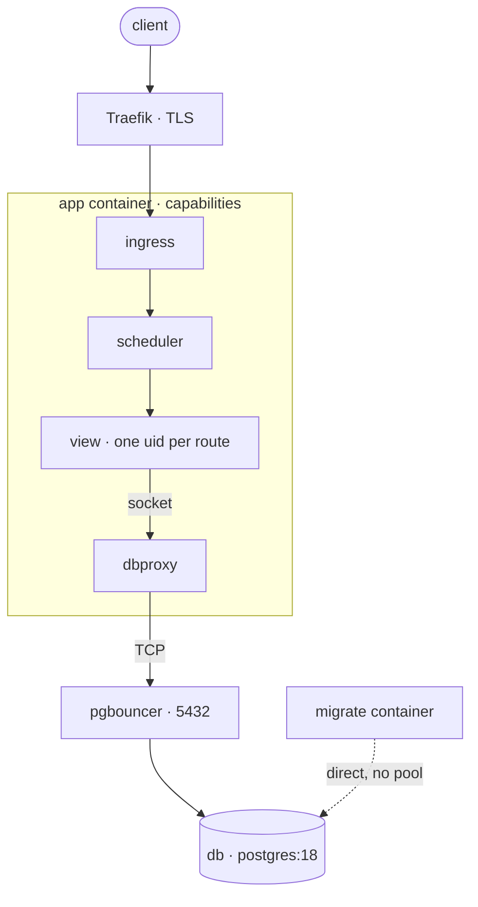

# Docker Compose behind Traefik

Compose gives the rootless path: a dedicated uid with file capabilities, PgBouncer on the bridge
network, Traefik at the edge.

```console
$ blastit --preset compose-traefik
```

That is the boot, not a print: without root or the capabilities it exits `1`, naming the missing
`cap_*` and pointing at `blastit dev`. The stack sets `BLASTIT_PRESET` instead.

## What the preset sets

| Setting | Value | Why |
|---|---|---|
| `BLASTIT_CLIENT_IP_HEADER` | `x-forwarded-for` | already the default; Traefik appends what it saw, and `*` reads the rightmost entry |
| `BLASTIT_TRUSTED_PROXIES` | `*` | no untrusted peer can reach Blastit's port |
| `BLASTIT_FAIR_QUEUING` | `on` | one burst must not starve the others |
| `BLASTIT_LOG_FORMAT` | `json` | already the default; stdout is the container's log |
| *(assumption)* | `capabilities` | the rootless deployment: a dedicated uid with the capability set |

## The topology



Each container hop is a bridge network, not the internet; the
[model](index.md#the-topology) is unchanged inside the box.

## Preset defaults

| Thing | Value | Why |
|---|---|---|
| app container | `user: 10000`, the capability set, `mem_limit: 1g` | a file-capability copy turns every process of that uid into init, so the uid is the app's alone |
| runtime directory | `tmpfs /run/blastit`, mode `0700`, owned by 10000 | `/run` belongs to root, and a rootless init cannot create its own |
| pool | PgBouncer, `transaction`, `DEFAULT_POOL_SIZE=20`, `MAX_CLIENT_CONN=100`, `MAX_PREPARED_STATEMENTS=200` | 20 server connections for up to 100 clients, and prepared statements are rewritten rather than refused |
| pool auth | `scram-sha-256` | the image's `md5` default fails against PostgreSQL 18's SCRAM passwords |
| migrate | its own container, `user: 10001`, the owner role on `db:5432` | a migration bug cannot run the capable copy |
| grant | a one-shot `postgres:18` after `migrate` completes | the tables must exist before `GRANT … ON ALL TABLES` |
| TLS | Traefik `:443` with `tls: {}`; ACME or your own certificate | the router redirects `:80`; until you add a resolver it serves Traefik's self-signed certificate |
| database TLS | `sslmode=disable` on the bridge | for a network database use `verify-full` **and** a `ca_cert` |
| health | `pg_isready` on PgBouncer's own port, `/_blastit/health` for the app | `app` never dials a pool that is not listening, and the image ships no `HEALTHCHECK` |

## The steps

### 1. Traefik

```yaml title="dynamic.yml"
http:
  routers:
    app:
      rule: Host(`shop.example.com`)
      entryPoints: [web]
      service: app
      middlewares: [redirect-to-tls]
    app-tls:
      rule: Host(`shop.example.com`)
      entryPoints: [websecure]
      service: app
      tls: {}
  middlewares:
    redirect-to-tls:
      redirectScheme: { scheme: https }
  services:
    app:
      loadBalancer:
        servers:
          - url: http://app:8080
```

Mount this as `dynamic.yml` and name it in the provider:
`--providers.file.filename=/etc/traefik/dynamic.yml`. (`traefik.yml` is the static file; Traefik
exits if a dynamic document is there.) `shop.example.com` is your host — change it in both rules —
and `REPLACE_WITH_REGISTRY` is yours in every `image:` line.

### 2. Values

Create `.env` and git-ignore it before the first build; every `${...:?}` is in it:

```dotenv title=".env"
DB_OWNER_PASSWORD=REPLACE_WITH_OWNER_PASSWORD
DB_PASSWORD=REPLACE_WITH_APP_PASSWORD
DJANGO_SECRET_KEY=REPLACE_WITH_50_CHAR_SECRET
TAG=REPLACE_WITH_GIT_SHA
```

`openssl rand -hex 16` twice fills the passwords and `openssl rand -base64 50` the key; `TAG` is
`git rev-parse --short HEAD`. Compose reads `./.env` itself, so export `TAG` only so the build tags
the image the stack pulls. Never commit the file.

### 3. Grants

```sql title="db/grants.sql"
-- Broad backstop: narrow it to one GRANT per table and verb as routes grow.
DO $$ BEGIN
  CREATE ROLE app LOGIN NOSUPERUSER NOCREATEDB NOCREATEROLE;
EXCEPTION WHEN duplicate_object THEN NULL; END $$;
ALTER ROLE app PASSWORD :'pw';
-- The zone the app expects; every pooled session inherits it.
ALTER ROLE app SET timezone = 'UTC';
GRANT CONNECT ON DATABASE shop TO app;
GRANT USAGE ON SCHEMA public TO app;
GRANT SELECT, INSERT, UPDATE, DELETE ON ALL TABLES IN SCHEMA public TO app;
GRANT USAGE, SELECT ON ALL SEQUENCES IN SCHEMA public TO app;
-- Tables a later migration adds:
ALTER DEFAULT PRIVILEGES IN SCHEMA public GRANT SELECT, INSERT, UPDATE, DELETE ON TABLES TO app;
```

### 4. The image { #rootless }

Docker's `cap_add` only sets the container's *bounding* set: a non-root `user:` process gets **no**
capabilities from it, so the image puts file capabilities on a dedicated copy of what init starts
from. One image serves every interface:

```dockerfile title="Dockerfile"
# One image serves every interface: the package brings `blastit` and its shims,
# `python3.13` runs a WSGI view, and the distro's NTS `libphp` runs a front
# controller. A static-only app drops the python and libphp packages below.
FROM debian:trixie-slim

RUN apt-get update && apt-get install -y --no-install-recommends \
        ca-certificates curl libcap2-bin libphp-embed php-pgsql python3.13 python3.13-venv \
    && rm -rf /var/lib/apt/lists/*
RUN curl -fsSL https://offworldnexus.github.io/blastit/install.sh | sh

WORKDIR /app
COPY requirements.txt .
RUN python3.13 -m venv .venv && .venv/bin/pip install --no-cache-dir -r requirements.txt
COPY . .

# `chown` clears a file capability, so nothing re-owns the file after `setcap`.
ARG BLASTIT_UID=10000
RUN useradd --uid "$BLASTIT_UID" --user-group --create-home --shell /usr/sbin/nologin blastit \
    && lib=/usr/share/blastit/lib \
    && cp "$lib/blastit" "$lib/blastit-init" \
    && chown "$BLASTIT_UID:$BLASTIT_UID" "$lib/blastit-init" \
    && chmod 0500 "$lib/blastit-init" \
    && setcap 'cap_chown,cap_dac_override,cap_fowner,cap_kill,cap_setgid,cap_setuid,cap_setpcap+ep' \
         "$lib/blastit-init"

ENV PYTHONUNBUFFERED=1
EXPOSE 8080
```

A file with capabilities turns any process of that uid into init: Blastit refuses a deployment
where a *shared* interpreter carries them ([security model](../security.md#the-mechanisms)). The
copy sits beside the installed shims in `/usr/share/blastit/lib`, so it is the only capable file
and `entrypoint php` still finds them. `python3.13` is there for a WSGI view; a static-only app
drops it and `libphp` from the `apt-get` line and the rest is unchanged.

### 5. Compose

Start from the [Django guide](../frameworks/python/django.md#manifest)'s `Blastfile`, with every
view's grants filled in — an empty `postgres {}` denies every statement. A split store (with
`ca_cert`) is for a TLS-verified network database. Deploy only a file `blastit check` passes
([CI/CD](../ci.md#what-it-fails-on)), and have `settings.py` read the host:
`ALLOWED_HOSTS = [os.environ["ALLOWED_HOST"]]`.

```yaml title="compose.yaml"
name: shop

x-app-env: &app-env
  # The pool's host, not `db`.
  DATABASE_URL: postgresql://app:${DB_PASSWORD:?}@pgbouncer:5432/shop?sslmode=disable
  # Must equal `Host(...)` in dynamic.yml: Django answers 400 otherwise.
  ALLOWED_HOST: shop.example.com
  DJANGO_SECRET_KEY: ${DJANGO_SECRET_KEY:?}
  BLASTIT_PRESET: compose-traefik
  BLASTIT_VIEW_MEM_ESTIMATE: 140MiB  # one view; ~7 in 1 GB

services:
  db:
    image: postgres:18
    environment:
      POSTGRES_USER: owner
      POSTGRES_PASSWORD: ${DB_OWNER_PASSWORD:?}
      POSTGRES_DB: shop
    healthcheck: { test: ["CMD", "pg_isready", "-U", "owner"], retries: 60 }
    volumes:
      - pgdata:/var/lib/postgresql

  pgbouncer:
    image: edoburu/pgbouncer:v1.26.1-p0
    environment:
      DB_HOST: db
      DB_USER: app
      DB_PASSWORD: ${DB_PASSWORD:?}
      DB_NAME: shop
      # md5 (the image default) fails against PostgreSQL 18's SCRAM passwords.
      AUTH_TYPE: scram-sha-256
      POOL_MODE: transaction
      MAX_PREPARED_STATEMENTS: "200"
      DEFAULT_POOL_SIZE: "20"
      MAX_CLIENT_CONN: "100"
    healthcheck:
      test: ["CMD", "pg_isready", "-h", "127.0.0.1", "-p", "5432", "-U", "app", "-d", "shop"]
      retries: 60
    depends_on:
      db: { condition: service_healthy }

  migrate:
    image: registry.example.com/shop:${TAG:?}
    # Not init's uid: a migration bug cannot run the capable copy.
    user: "10001:10001"
    environment:
      DATABASE_URL: postgresql://owner:${DB_OWNER_PASSWORD:?}@db:5432/shop?sslmode=disable
      DJANGO_SECRET_KEY: ${DJANGO_SECRET_KEY:?}
    command: ["sh", "-c", "python manage.py migrate -v0"]
    depends_on:
      db: { condition: service_healthy }

  # Creates the non-owner `app` role and grants it the union of your manifest's
  # grants, once the tables exist.
  grant:
    image: postgres:18
    environment:
      OWNER_URL: postgresql://owner:${DB_OWNER_PASSWORD:?}@db:5432/shop?sslmode=disable
      APP_PASSWORD: ${DB_PASSWORD:?}
    command: ["sh", "-c", "psql \"$$OWNER_URL\" -v ON_ERROR_STOP=1 -v pw=\"$$APP_PASSWORD\" -f /grants.sql"]
    volumes: ["./db/grants.sql:/grants.sql:ro"]
    depends_on:
      migrate: { condition: service_completed_successfully }

  app:
    image: registry.example.com/shop:${TAG:?}
    user: "10000:10000"
    cap_drop: [ALL]
    cap_add: [CHOWN, DAC_OVERRIDE, FOWNER, KILL, SETGID, SETPCAP, SETUID]
    mem_limit: 1g
    tmpfs:
      # /run belongs to root; this is the runtime directory, owned by init's uid.
      - /run/blastit:mode=0700,uid=10000,gid=10000
    environment: *app-env
    command: ["/usr/share/blastit/lib/blastit-init"]
    expose: ["8080"]
    depends_on:
      grant: { condition: service_completed_successfully }
      pgbouncer: { condition: service_healthy }

  traefik:
    image: traefik:v3.7.16
    command:
      - --entryPoints.web.address=:80
      - --entryPoints.websecure.address=:443
      - --providers.file.filename=/etc/traefik/dynamic.yml
    volumes:
      - ./dynamic.yml:/etc/traefik/dynamic.yml:ro
    ports: ["80:80", "443:443"]
    depends_on: [app]

volumes:
  pgdata:
```

`user:` is the dedicated uid that can run the capable copy, and `command:` names that copy —
`["/usr/share/blastit/lib/blastit-init"]` for every interface. The app's
`DATABASE_URL` names `pgbouncer`; `migrate` and `grant` name `db` — never swap the two.

### 6. Build and start

```console
$ TAG=$(git rev-parse --short HEAD)
$ docker build -t registry.example.com/shop:$TAG . && docker push registry.example.com/shop:$TAG
$ docker compose up -d
$ docker compose logs app | head -1
{"event":"boot","stage":"stage0","seccomp":true,"privilege":"capabilities","bounding_set":"dropped"}
```

The boot line is trimmed (`ts`, `level`, `component` and `preset` elided). If nothing appears, run
`docker compose logs grant`: a grant job that aborts stops `app` from starting.

## Before the first deploy

Publish no port for the app and keep foreign containers off its network: the preset trusts every
peer (`*`), so Traefik must be the only way in ([client address](anything-else.md#client-ip-header)).
`BLASTIT_MAX_WORKERS` × instances must fit the pool's client limit, and the app's role must not own
the tables it reads. Then [measure the client address](index.md#measure-your-ingress) through Traefik.

## Where next

Verify it with [the client-address check](index.md#measure-your-ingress), then read
[fair queuing](fair-queuing.md). Splitting the same app? [DigitalOcean](digitalocean-paas.md).
