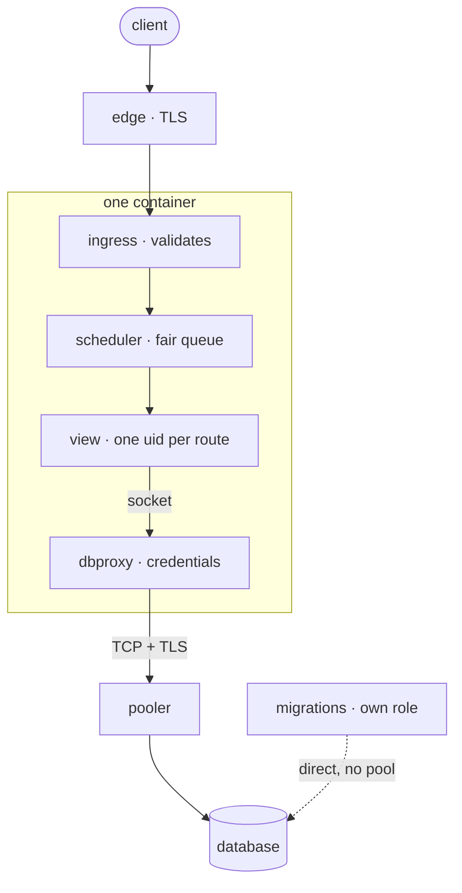

# Deployments

Production Blastit is not `blastit dev`: every route runs under its own uid, and
the process **refuses to start** without root or the capability set, and without a
seccomp filter. There is no single-uid fallback.

## What you are deploying

**One container.** `blastit` is PID 1 and your framework runs inside it: one view
process per route namespace, forked from `blastit` on demand, under that route's
uid.

**Blastit is the front door.** The ingress takes the connection and decodes the
body, the scheduler admits the request and owns the worker budget, the view runs
your code. Nothing reaches your app before the first two are done.

**Credentials never enter your app's memory.** Each route gets its own socket to
a proxy; `dbproxy` holds the real role, the password and the allowlist of what
the route may run. Your app's `DATABASE_URL` points at a local socket, not at the
database.

## A pooler in front of the database { #pooler }

A pool keeps a small set of server connections and shares them: sixteen workers
per instance take most of a 1 GB cluster's ~22 backends, and a second instance
would exhaust them. So there are two URLs, and swapping them is the failure this
page is about — only the app's `DATABASE_URL` names the pool, while migrations and
grants name the database on its direct port, as a role of their own, because DDL
and session state do not survive transaction pooling. Sizing and the session zone:
[the pooler](anything-else.md#pooler).

## The topology

The edge speaks plain HTTP/1.1 to Blastit, a view dials no TCP socket unless its
route sets `egress = true`, and only `dbproxy` reaches the database. `postgresql`
is 0.2.0's only proxy protocol.

## Fair queuing is part of the model

The scheduler, not the framework, decides what runs next. Every request is charged
the CPU it actually cost, and the queue is ordered by client flow instead of by
arrival — so one client cannot starve the rest: a scraper's export burst queues
behind other people's landing pages. A full queue answers `503` with `Retry-After`.
Both presets turn it on; [fair queuing](fair-queuing.md) has the flows and knobs.

## The choices you make

| Choice | The options | Decided in |
|---|---|---|
| Preset or by hand | `digitalocean-paas`, `compose-traefik`, or your platform's own values | [App Platform](digitalocean-paas.md) · [Compose](compose-traefik.md) · [anywhere else](anything-else.md) |
| Root or capabilities | the container starts as root, or a dedicated uid carries the capability set | [root or rootless](anything-else.md#root-or-rootless) |
| Pooler or direct | a pool in transaction mode, session mode for prepared statements, advisory locks or `LISTEN`, or workers straight to the database | [the pooler](anything-else.md#pooler) |
| How peers reach the port | publish nothing and trust every peer, or name the addresses your ingress connects from | [client address](anything-else.md#client-ip-header) |
| Where migrations run | a job or step outside Blastit, as its own role, on the database's direct URL | [migrations](anything-else.md#migrations) |
| Where TLS ends | at the edge: Blastit speaks HTTP/1.1 only, has no TLS, and answers `501` to `Upgrade` | [edge and TLS](anything-else.md#edge-and-tls) |

A preset is defaults, not a mode: any `BLASTIT_*` you set wins, even an empty
one, and the deploy files choose it with `BLASTIT_PRESET`.

## Verify the client address { #measure-your-ingress }

Fair queuing, `remote_addr` and every log line key on it, and a preset can only
guess which header your edge writes. After the first deploy, forge one and read
`remote_addr` back: [the check and the lever](anything-else.md#client-ip-header).

## Where next

- [DigitalOcean App Platform](digitalocean-paas.md): root, a managed cluster and pool, `do-connecting-ip`.
- [Docker Compose behind Traefik](compose-traefik.md): capabilities, PgBouncer, `X-Forwarded-For`.
- [Anywhere else](anything-else.md): every lever, plus Docker, systemd and Kubernetes.
- [Fair queuing](fair-queuing.md): what happens to a burst under load.
