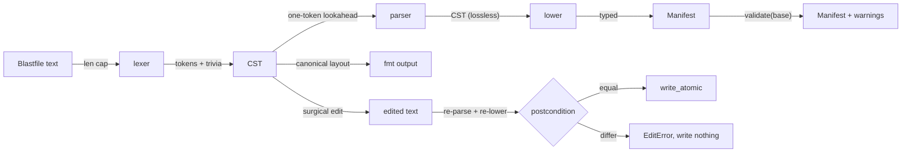

# The Blastfile Language: lexer, LL(1) parser, CST, formatter and cutover

This document turns the accepted user documentation (`docs/blastfile.md`,
`docs/reference/blastfile.md`, MB.21.1) into the implementation the toolchain and
cutover leaves build. The language has exactly one source of truth for a
developer: the two pages. The one source of truth for the implementation is this
document plus `ADR-0012`.

Nothing here adds syntax the pages do not show. Where the pages left a question
open (fence opening, the `app` name, a mount's prefix rules), §5–§16 answer it and
`ADR-0012` records the answer. Where the owner already decided (`body raw` /
`body raw unvalidated`, the `workers` removal, zero dependencies, and the total
erasure of the retired TOML format), §10, §12, §15 and §19 record the decision and
do not re-open it.

## 1. Developer Experience Target (Local, CI/CD, Deploy)

The design serves three concrete moments, each already written and reviewed:

| Moment | The developer does | What this design owes it | Design §
|---|---|---|---|
| **Local** | writes `./Blastfile`, runs `uv run blastit dev` (zero `sudo`), reads the file once, restarts after an edit; runs `blastit fmt` after editing; runs `blastit dev --learn` and reads `git diff Blastfile` | a file that parses deterministically, an error that names `file:line:col` and the fix, a formatter that is idempotent and comment-preserving, a `--learn` writer that adds only what the reference says it adds | §5, §6, §14, §18 |
| **CI/CD** | runs `uv run blastit check` (Python) or `uv run blastit fmt --check` (PHP), plus `blastit check --json` for an agent | the same findings, unchanged kinds and exit codes; `fmt --check` exits `0`/`1`; a file that is not a Blastfile fails with the ordinary `Blastfile:line:col` syntax error — there is no second format and no detection; a PHP `check` exits `2` with empty stdout, as the reference says, so an agent's document is the Python leg | §14, §15, §17 |
| **Deploy** | runs `blastit --preset compose-traefik`; production fails closed | `body raw` without `unvalidated` refuses the boot before a listener binds; `--learn` never writes `unvalidated`; a parse error never falls back to a permissive default | §10, §17 |

The three "show, don't tell" properties the pages promise, and the code that must
keep them true:

1. **The first ten lines boot.** `app`/`entrypoint`/`postgres`/`view`/`body`
   parse to a `Manifest` that validates on `UidLayout::DEFAULT_BASE` (§7).
2. **A mistake is one line away from the fix.** Every lexer, parser and
   whole-file refusal is `Blastfile:<line>:<col>: <what>; <how to write it>`
   (§18).
3. **Nothing real is dropped.** Every row of MB.21's v1 capability map has a
   Blastfile spelling and a code site, or a named removal recorded in
   `ADR-0012` (§7, §12). "Dropped" here means *the new file never had it*, never
   "a compatibility path exists".

## 2. Goals & Non-Goals

### Goals

- One parse entry point, `Manifest::from_blastfile_str(source)`, and one
  parse-and-validate entry point, `Manifest::parse_blastfile(source, base)`, that
  the boot, `dev`, `check`, `fmt`, `fold` and `--learn` all use.
- A lossless concrete syntax tree so `fmt` is comment-preserving and the
  `--learn` editor is surgical, with the two round-trip invariants §14 states.
- Hostile-input safety without a dependency: every loop bounded by the input,
  every recursion bounded by grammar depth, every failure typed.
- A lowering stage that produces **today's** `Manifest` shape, so the scheduler,
  the brokers and `blastit check`'s audit engine change as little as possible
  (the three places they must change are named in §8.4, §9.2 and §10.3).
- A design a cheap implementer can execute: one decision per section, a table
  wherever a mapping exists, a "refuse this, with this message" row wherever a
  refusal exists.
- **One manifest format, and only one.** The retired TOML format is erased: no
  reader, no detector, no migration path, no dependency, no mention (§15).

### Non-Goals

- **No new workspace crate.** The lexer, parser, CST, printer and editor live in
  `crates/blastit-manifest/src/blastfile/` (see §4.1). A new crate would move
  `docs_fences.rs`, `edit.rs` and the protected manifest suites out of their home
  and require a `Cargo.toml`/`Cargo.lock` serialization chain for zero gain.
- **No new dependency.** No `logos`, `pest`, `chumsky`, `nom`, `winnow` or
  `rowan`; the workspace stays offline-buildable and the audit surface at zero
  (`ADR-0012`). `toml`/`toml_edit` leave the workspace with the retired reader.
- **No model rename.** The Rust types keep their names (`Route`, `Group`,
  `Proxy`, `ProxyName`, `route_lines`) even though the file says `view`, `trait`,
  `postgres`. Renaming the model is churn with no developer-visible effect; the
  file spelling is what the docs sell. The only model *additions* are named in
  §4.3.
- **No compatibility surface for the retired format.** No dual reader, no
  `--format` flag, no detection heuristic, no conversion command (§15).
- **No syntax beyond the accepted pages.** No include/import, no expressions, no
  variables other than `$IDENT`, no inline tables, no `=` anywhere.
- **No Milestone C/D keyword.** Other store protocols, an outgoing HTTP proxy,
  compression names and vendor knobs are not keywords; they produce the ordinary
  "unknown keyword, and the section it opened" error and are not reserved (§16.7).

## 3. Requirements

Each requirement is testable and maps to a tier in §20 (`unit` = `cargo test`
unprivileged, `critical` = protected suite, `docs` = fence suite, `e2e` =
Docker/CI harness, `gate` = a lint/script in `make check`).

| Id | Requirement | Tier |
|---|---|---|
| R1 | The lexer is one byte-indexed pass over the source; every scan advances by `char_indices()` (never a hand-written `i += 1`); it emits `Word`, `Str`, `RawStr`, `Env`, punctuation, `Equals`, `Unknown`, `Eof`, plus lossless trivia. | unit + critical + `gate` (review) |
| R2 | Every token carries `line:col` (1-based, column counted in `char`s). `ManifestError::Display` renders `<line>:<col>: <message>`; a caller prefixes the manifest path once, so the line is `Blastfile:<line>:<col>: …`. A position-less refusal renders `<path>: <message>`. | unit + critical |
| R3a | A regular file over `MAX_SOURCE_BYTES` is refused by `blastfile::read` from its metadata/size without reading its contents; a non-regular file (FIFO, `/dev/zero`, a growing file) cannot exceed the cap because the read is `take(MAX_SOURCE_BYTES + 1)`. | unit + critical |
| R3b | A source over `MAX_TOKENS` (or `MAX_TRIVIA`) is refused by the lexer as it pushes, before any tree is built. | unit + critical |
| R4 | The parser is LL(1): every decision is taken on one lookahead token; the grammar's FIRST sets are disjoint where the parser chooses; block nesting is bounded by the grammar (two nested block levels) and by `MAX_BLOCK_DEPTH = 2`. | unit + critical |
| R5 | The parser produces a lossless CST: `print_lossless(cst(text)) == text` for every parseable text. | unit + critical |
| R6 | `fmt` is canonical and idempotent: `fmt(fmt(t)) == fmt(t)`, and `fmt(t) == t` for an already-canonical file. Comments survive: the ordered list of comment texts is identical before and after `fmt`. | unit + critical |
| R7 | `fmt` never changes meaning: `lower(fmt(t)).equivalent(&lower(t))` — `Manifest` equality with the source-position fields excluded. | unit + critical |
| R8 | Lowering produces a `Manifest` equal to the expected `Manifest` built in the test for each v1 fixture, row by row (§7); the rows the design drops are asserted absent, not compared. | unit + critical |
| R9 | Path patterns compile to anchored regexes per §8.1; `HEAD` is implied by `GET` at lower time; an invalid pattern names the pattern and the reason. | unit + critical |
| R10 | A request is answered by mount-file → first matching view → mount `fallback` (GET/HEAD) → `405` when a view's pattern matched but no declared method did → `404`; `.php`/`.phtml`/`.phar`, dotfiles, NUL, absolute/backslash paths and symlinks keep today's refusals. | unit + critical + e2e |
| R10a | **New pre-routing refusal**: a decoded path containing `..` or an empty segment is a `400` before any mount or view is consulted (today only the static resolver refuses them, so routing can dispatch an un-normalised path). Its own differential test compares the old and new behaviour on `/admin/../public`. | unit + critical |
| R11 | `body raw` lowers to `(BodyCodec::Raw, allow_raw = false)`; `body raw unvalidated` to `(Raw, true)`; `unvalidated` after any other codec is a syntax error; `--learn` cannot write either form. | unit + critical + e2e |
| R12 | A trait lowers to a `Group`; `use` resolves after the whole file is parsed; `unrestricted`/`egress any`/an unknown name/a duplicate name are refused with the section named. | unit + critical |
| R13 | `entrypoint php` lowers to one `Manifest::php()` applied to every view; `workers` is not a token sequence the grammar accepts and its refusal names the removal (no ADR number in the message). | unit + critical |
| R14 | Grants lower onto `PgGrant`/`TableGrants` per §13, including `query` normalisation and the inline-only `unrestricted`. | unit + critical |
| R15 | The `--learn` editor rewrites through the CST and keeps its postcondition: an edit either reproduces the whole document or writes nothing. | unit + critical |
| R16 | **There is no format detection, no fallback format and no migration path.** A missing `./Blastfile` produces a plain missing-file error naming `./Blastfile` (and `BLASTIT_MANIFEST`); any other content produces the ordinary `Blastfile:line:col` syntax error. | unit + e2e |
| R17 | `./Blastfile` is discovered from the working directory; `BLASTIT_MANIFEST` names another path; there is no upward search; a set-but-empty `BLASTIT_MANIFEST` is an error. | unit + e2e |
| R18 | `docs_fences` counts three fence classes per page (document, statement list, illustration) and asserts parity, so a fence cannot appear unlisted. | docs |
| R19 | `blastit fmt [--check] [PATH]` exits `0` (clean/applied), `1` (`--check`, not canonical), `2` (cannot parse/read/write); `--check` writes nothing. | unit + docs |
| R20 | `$IDENT` is a name: the parser never reads the environment; an unset name is a boot error naming the variable; a string literal where a name is required is a syntax error. | unit + critical + `gate` |
| R21 | A parse or validation error never yields a usable `Manifest`: no partial tree, no `unwrap_or_default`, no "skip the bad view". | unit + critical |
| R22 | `check`'s finding kinds, keys (`route`, `proxy`) and exit codes are unchanged; only `fix.to` values are re-spelled to Blastfile nodes (§13.3). | unit + critical |
| R23 | No `unsafe`, no `unwrap`/`expect`/`panic!`/`todo!` and no unchecked indexing on any path reachable from the file; enforced by `#![forbid(unsafe_code)]` plus `#![deny(clippy::unwrap_used, clippy::expect_used, clippy::panic, clippy::todo, clippy::indexing_slicing)]` at the top of `blastfile/mod.rs`, and `cargo clippy -D warnings`. The workspace-wide `[lints]` table is **not** changed: existing modules keep their current allowances, and the new module opts in. | `gate` |
| R24 | `blastit-manifest` contains no `std::env` read and no `blastit-env` dependency; parsing is a pure function of the source text. | unit + `gate` |
| R25 | The formatter's output parses under the same budgets as any other file, and never exceeds `MAX_SOURCE_BYTES`: `fmt` re-checks the size and refuses rather than writing. | unit |
| R26 | Error text never quotes more than `MAX_QUOTED_CHARS` of a value, never quotes a value where the value could be a secret, and never emits a raw control byte. | unit |
| R27 | After the cutover, the retired file name appears nowhere in the set `test_the_real_tree_carries_no_retired_toml_manifest` scans: `README.md`, `ARCHITECTURE.md`, `docs/VISION.md`, every published page (`public_pages`), `crates/**/*.rs` + `Cargo.toml`, `python/**/*.py` + `runnable_docs/*.toml`, `scripts/**`, `e2e/**`, `Makefile`, and every live `plan/nodes/**/NODE.md`. No allowlist; the dated design/decision record is outside `public_pages` by construction. | `gate` |
| R28 | `toml` and `toml_edit` are removed from every `Cargo.toml` and `Cargo.lock` entry the workspace owns; `blastit-manifest`'s `toml` dependency is gone. | `gate` |
| R29 | One repository guard fails if the retired name or the retired dependency reappears: a pytest in `python/tests/test_docs_assets.py` (already run by `make docs-unit`, so **no new file and no new Makefile target**), with a negative self-test function beside it. | `gate` |
| R30 | Two new boot decisions are requirements, not footnotes: `entrypoint php` that no view reaches is a **boot warning** (`EntrypointNotReached`), and a request whose path a view's pattern matched but whose method no view declares is a **`405`** with `Allow` listing the declared methods. Each has a named test in §20. | unit + critical |

## 4. Architecture & Data Flow

### 4.1 Where the code lives

```
crates/blastit-manifest/src/
├── blastfile/
│   ├── mod.rs        # entry points: from_str, parse, read, fmt, edit
│   ├── lexer.rs      # tokens, trivia, spans, budgets          (§5)
│   ├── tokens.rs     # TokenKind/Span/Trivia types (pub(crate))
│   ├── syntax.rs     # the lossless CST arena + print_lossless  (§5.4, §14.1)
│   ├── parser.rs     # LL(1) recursive descent -> CST           (§6)
│   ├── lower.rs      # CST -> Manifest (+ validation hooks)     (§7–§13)
│   ├── pattern.rs    # path-pattern -> anchored regex           (§8)
│   ├── print.rs      # canonical layout                         (§14.2)
│   └── write.rs      # surgical CST edits for --learn           (§14.5)
├── model.rs          # + Manifest::name/mounts/php/equivalent; Route.sandbox (§4.3)
├── parse.rs          # DELETED by MB.21.4.5 (no replacement, no compatibility)
├── validate.rs       # unchanged shape checks + Blastfile sentences
├── routing.rs        # + MountTable, + lookup() 405 signal      (§9)
├── edit.rs           # write_atomic + the public edit types; delegates to blastfile::write
└── error.rs          # + Blastfile error variants, line:col
```

`docs_fences.rs` (in `tests/`) stays; §16 rewrites its openings. Unit tests for a
module live **inside** it (`#[cfg(test)] mod tests`), so `lexer.rs` can test
private items; integration tests (`tests/blastfile_*.rs`) use only the public
entry points. That split is what makes TS-3 impossible: a test that cannot see
the lexer does not pretend to.

### 4.2 Pipeline



Two properties make this safe to build cheaply:

- **The lexer never decides syntax.** It emits `Word` for any bare run and the
  parser classifies: a word whose first byte is `a`–`z`/`0`–`9` is a
  keyword-or-name, a word whose first byte is `A`–`Z` is a `Method`. That one
  lexical rule is what makes "view header method list vs directive" an LL(1)
  decision (§6.3).
- **One tree, two readers.** There is exactly one parse product — the CST of
  §14.1 — and both `lower` and `print` walk it. There is no second AST type and
  no second serialiser, so `fmt` and `--learn` cannot disagree about layout and
  `lower` cannot read a shape the printer cannot write.

### 4.3 Model changes (the only ones)

| Change | Why | Consumers |
|---|---|---|
| `Manifest::name()`, backed by a new `name: Option<String>` (from `app "<name>"`) | the keyword must exist and must be carried | `fmt`/`--learn` preservation; validated in `lower::app` by `MAX_APP_NAME_CHARS` (non-empty, ≤ 256 `char`s, no control byte), refused as `AppNameInvalid` at the name's own `line:col` (§4.5). Carried in 0.2.0 with no other consumer — recorded as a named follow-up (`MB.21.4.3` may add it to the `--json` document when the schema moves). Dropping it would make the guide's first line a syntax error, which is worse than one carried label. |
| `Manifest::mounts() -> &[StaticMount]` (`StaticMount { prefix, policy }`) | `static` is a top-level mount, not a route | `RoutingTable`, `static_asset` boots, `check`, `fmt` |
| `StaticPolicy` gains `fallback: Option<String>` and loses `spa: bool` | `fallback "<file>"` is a different file from `index` | `static_asset::missed`, `route.rs` |
| `Manifest::php() -> Option<&PhpPolicy>` | one `entrypoint php` for the whole file | `route.rs`, `stage0` |
| `Route.sandbox: u32` (the view's index) | one `view` with several endpoints lowers to several `Route`s in **one** sandbox | `UidLayout::view`, `check`'s `route` key, `route_lines` |
| `Manifest::equivalent(&self, other) -> bool` | compares every field **except** `route_lines` (source positions), for P3/P4 and the parity oracle | tests, `edit.rs` verify |
| `Manifest::with_name/mounts/php`, `Route::with_sandbox` | `lower` is the only builder and lives in the crate | `lower.rs` |
| **Removed:** `Route::static_policy()`, `Route::with_static`, `Route::php()`, `Route::with_php` | Blastfile has no per-view static or php declaration; keeping them would let the model express only what the retired file could | `MB.21.4.2` (compile errors are the work list) |
| `Route::is_unrestricted_catch_all` accepts the lowered `"/*"` → `"/.*"` | `--learn` inserts above the catch-all | `write.rs`, `ADR-0003` |

`Manifest::version()` stays, always `1`: the *file* has no header, the model's
invariant is unchanged and it is still the shape `--json` describes. The model
keeps `global_groups` (always empty from a Blastfile) and `PhpPolicy.workers`
(always `None`) so `effective_grants`, `check` and the scheduler need no change;
the design says so here, and no file spelling exists for either.

### 4.4 Public surface (the names every other section and the tests use)

| Item | Signature | Module |
|---|---|---|
| `Manifest::from_blastfile_str` | `fn from_blastfile_str(source: &str) -> Result<Manifest, ManifestErrors>` (parse, lower; no validate) | `blastfile/mod.rs` |
| `Manifest::parse_blastfile` | `fn parse_blastfile(source: &str, base: u32) -> Result<(Manifest, Vec<ManifestWarning>), ManifestErrors>` | `blastfile/mod.rs` |
| `blastfile::read` | `fn read(path: &Path) -> Result<String, ManifestErrors>` (regular file, `take(MAX+1)`, cap) | `blastfile/mod.rs` |
| `blastfile::parse` | `pub(crate) fn parse(text: &str) -> Result<Cst, ManifestErrors>` | `parser.rs` |
| `blastfile::lower` | `pub(crate) fn lower(cst: &Cst, source: &str) -> Result<Manifest, ManifestErrors>` | `lower.rs` |
| `blastfile::print_lossless` | `pub(crate) fn print_lossless(cst: &Cst, source: &str) -> String` | `syntax.rs` |
| `blastfile::fmt` | `fn fmt(text: &str) -> Result<String, ManifestErrors>` | `print.rs` |
| `Manifest::equivalent` | `fn equivalent(&self, other: &Self) -> bool` (every field except `route_lines`) | `model.rs` |
| `ManifestEdits::apply_to` | `fn apply_to(&self, manifest: &Manifest) -> Manifest` | `edit.rs` |

### 4.5 Budgets (one table, referenced by every section)

| Budget | Value | Where enforced | Refusal |
|---|---|---|---|
| `MAX_SOURCE_BYTES` | `16_777_216` (16 MiB) | `blastfile::read` (refuses a non-regular file, then `take(MAX_SOURCE_BYTES + 1)`, so a FIFO, `/dev/zero` or a growing file cannot exceed the cap) and `parse` (len before lexing) | ``<path>: the file is <n> bytes; Blastfile is limited to 16777216 bytes — split the grants into a `trait`, or delete a generated block`` |
| `MAX_TOKENS` | `4_194_304` | `lexer::lex` as it pushes | ``<path>: <n> tokens; Blastfile is limited to 4194304 — the file is too large: replace repeated `query '…'` lines with table or column grants (`select`, `insert`, `update`, `delete`), or fold the shared grants into a `trait` that many views `use` `` |
| `MAX_TRIVIA` | `4_194_304` (one node per whitespace/comment run) | `lexer::push_trivia` | ``<path>: <n> trivia runs; Blastfile is limited to 4194304 — the file is too large: delete the generated comments and blank lines, or fold the shared grants into a `trait` that many views `use` `` |
| `MAX_BLOCK_DEPTH` | `2` nested block levels | `parser.rs` depth counter | `<path>:<l>:<c>: blocks nest two deep at most: a view's `postgres` block is the deepest` |
| `MAX_LIST_ITEMS` | `4_096` | list loops (methods, patterns, columns, preload, immutable, table grants) | `<path>:<l>:<c>: a list holds at most 4096 items` |
| `MAX_PATTERN_BYTES` | `4_096` (4 KiB) | `pattern.rs`, both the quoted form and `regex '…'`; the compiled program stays bounded by `REGEX_SIZE_LIMIT` (`1 << 20`) and `REGEX_NEST_LIMIT` | `<path>:<l>:<c>: a pattern holds at most 4096 bytes` |
| `MAX_APP_NAME_CHARS` | `256` | `lower::app` | ``<path>:<l>:<c>: an `app` name is 1 to 256 characters with no control byte`` |
| `MAX_QUOTED_CHARS` | `120` (existing) | `error::quoted` | value cut with `…`, control bytes escaped |

The file-size refusal is the answer to "the exact refusal for an unbounded
input": a hostile or generated `Blastfile` can hold millions of `view` blocks, and
a reader that agrees to lex them all is a denial of service against the
developer's own machine and the deploy's boot budget. 16 MiB is ~50 000x the
largest `Blastfile` this repository ships (320 bytes,
`python/tests/runnable_docs/fixtures/findings/Blastfile`) and ~24 000x the
reference's complete example (~700 bytes): the budget exists to bound a generated
file, never to refuse a real one. A `--learn` run writes one `query '…'` line per
distinct statement, so a six-hundred-statement app is tens of kilobytes, and the
refusal it could still meet names an edit this one file can take — table or
column grants instead of repeated `query` lines, or a `trait` many views `use` —
never an "include" it does not have. Every entry point —
stage 0, stage 1, `dev`, `check`, `fmt` and `fold` — goes through
`blastfile::read(path)`, which refuses a non-regular file and reads at most
`MAX_SOURCE_BYTES + 1`, so the cap costs one `stat` and, for a hostile 16 MiB
boot, exactly one 16 MiB allocation followed by a token and trivia stream that
`MAX_TOKENS`/`MAX_TRIVIA` (4 194 304 each) still bound. `Manifest::from_blastfile_str` is
reachable only from `read` and from tests.
## 5. Tokens, Lexer and Input Bounds (item 1)

**Code site:** `crates/blastit-manifest/src/blastfile/lexer.rs` + `tokens.rs`.
**Proved by:** `#[cfg(test)] mod tests` inside `lexer.rs` (unit: one case per
token kind, one per refusal row) and `tests/critical_blastfile_lexer.rs`
(critical: the caps, the hostile corpus).

### 5.1 The token set (closed)

| Kind | Written | Rule |
|---|---|---|
| `Word` | `view`, `products`, `GET`, `2fa` | one run of `[A-Za-z0-9_-]`; a `-` belongs to the word only when it follows an alphanumeric |
| `Str` | `"…"` | escapes `\"`, `\\`, `\n`, `\t`; any other `\x` is a refusal naming the escape |
| `RawStr` | `'…'` | every byte verbatim up to the next `'`; no escapes; a newline inside is allowed (SQL and regex formatting) |
| `Env` | `$IDENT` | `$` followed by `[A-Z_][A-Z0-9_]*` |
| `LBrace` `RBrace` `LParen` `RParen` `Comma` `Semi` | `{ } ( ) , ;` | one byte each |
| `Newline` | `\n`, `\r\n` | one token |
| `Equals` | `=` | lexed **only** so the parser can refuse it with the documented sentence (§5.3) |
| `Dot` | `.` | one byte; legal only inside a `functions` name (`pg_catalog.st_distance`) and refused everywhere else (§6.7) |
| `Unknown` | any other byte | carries the byte; the parser reports it as `` byte 0x<hex> is not Blastfile syntax `` at its position (§5.3) |
| `Eof` | end of input | the parser's only terminating token |

There is **no** `$?` token. `$?` is a spelling *inside* a `query` string (a bind
placeholder the SQL normaliser already rewrites); outside a string `$` must begin
an `Env` name, so a `$?` there is the refusal in §5.3.

### 5.2 Trivia, and the one tree

Whitespace (spaces and tabs) and `#`-to-end-of-line comments are `Trivia`.
The lexer's product is an **input buffer**, not a tree:

```rust
pub(crate) struct Lexed {
    pub tokens: Vec<Token>,    // Token { kind, span, leading: Range<u32> }
    pub trivia: Vec<Trivia>,   // Trivia { kind: Space|Comment, span }
}
```

`Token.leading` names the trivia immediately before it, so nothing is lost and
nothing is stored twice. `syntax.rs` copies both vectors into the single CST
arena of §14.1 while the parser builds nodes; from that point on the arena is the
**only** tree (`lower` and `print` walk it). `Newline` is a token, not trivia: it
terminates a statement, and the reference's "a newline inside `(…)`, a string, or
right after a `,` continues it" is a **parser** rule (§6.6) — a `Str`/`RawStr`
may itself contain newlines.

### 5.3 The lexer's own refusals

All are `Blastfile:<line>:<col>: …`, all one line, all naming the fix, and none
quotes a value that could be a credential.

| Input | Message |
|---|---|
| `body = "json"` | `` `=` is not Blastfile syntax; write the value after the keyword: `body json` `` |
| `postgres "…"` | `` a quoted string is not a variable name; a store reads `$IDENT`: `postgres $DATABASE_URL` `` — the literal is **never** echoed (`MB.21.5.1` corrects the reference row that says otherwise, because the value can be a pasted DSN) |
| `$lower` | `` `$lower` is not an environment variable name: names are upper-case, `[A-Z_][A-Z0-9_]*`, like `$DATABASE_URL` `` |
| `$` followed by anything else (`$?`, `$`, `$1`, `$-`) | `` `$` must start an environment variable name, `[A-Z_][A-Z0-9_]*`; `$?` is a bind placeholder and belongs inside a `query '…'` string `` |
| `"unterminated` | `` unterminated string: the opening `"` is on line <l> `` |
| `'unterminated` | `` unterminated raw string: the opening `'` is on line <l> `` |
| `"\q"` | `` `\q` is not an escape; the escapes are `\"`, `\\`, `\n`, `\t` `` |
| a bare `\r` | `` carriage return without a newline is not Blastfile syntax `` |
| a non-ASCII byte outside a string | `` byte 0x<hex> is not Blastfile syntax; quote the text, or start a name with a letter or a digit `` |
| a `-` that follows no alphanumeric | `` `-` is part of a name or a keyword only after a letter or a digit `` |

### 5.4 Bounded iteration

`struct Lexer<'a> { text: &'a str, at: usize, line: u32, col: u32 }` with three
advancing methods: `bump()` (consume one `char`, update `line`/`col`), `word()`
(a `for (i, c) in rest.char_indices()` scan returning the end index), and
`quoted(quote)` (the same scan plus escape handling). Every loop terminates
because it walks `char_indices()` of a shrinking `&str`; there is no `i += 1` and
therefore no mutation of a counter that could loop forever or produce an
unkillable mutant (`LESSONS.md`, `MB.1.4`). `MAX_TOKENS` is checked in `push()`,
the one function every token goes through. `col` counts UTF-8 `char`s from 1 and
`line` from 1, which is what an editor shows.

## 6. Grammar, FIRST/FOLLOW and the LL(1) Parse (item 2)

**Code site:** `crates/blastit-manifest/src/blastfile/parser.rs`,
`lower.rs` (the typed accessors the CST offers).
**Proved by:** `tests/blastfile_parse.rs` (unit, one test per production plus one
per §6.7 row) and `tests/critical_blastfile_parser.rs` (critical: the budgets, one
hostile document per class).

### 6.1 EBNF (the authoritative one)

```text
file         → statement* EOF
statement    → app | entrypoint | store | trait | view | static

app          → 'app' Str

entrypoint   → 'entrypoint' ( python | php )
python       → 'python' Str python_block?
python_block → '{' 'preload' Str (',' Str)* '}'
php          → 'php' Str

store        → 'postgres' ( Env | store_block | store_name ( Env | store_block ) )
store_name   → Word                         (* reserved: see §6.3 *)
store_block  → '{' slot* '}'
slot         → SLOT Env                     (* host|port|user|password|database|sslmode|ca_cert *)

trait        → 'trait' Word '{' store_grant* '}'

view         → 'view' Word ( view_header view_block | view_block )
view_header  → methods patterns?  |  patterns
methods      → Method (',' Method)*
patterns     → pattern (',' pattern)*
view_block   → '{' view_item* '}'
view_item    → endpoint | view_directive
endpoint     → methods pattern endpoint_block?
endpoint_block → '{' body? '}'            (* `body` only: a grant is per view *)
view_directive → body | use | egress | prefork | store_grant
body         → 'body' codec ( 'unvalidated' )?
codec        → 'json' | 'form' | 'none' | 'raw'
use          → 'use' Word (',' Word)*
egress       → 'egress' 'any'
prefork      → 'prefork'
store_grant  → 'postgres' ( 'unrestricted' | store_name? grant_body )
grant_body   → 'unrestricted' | grant_block
grant_block  → '{' grant* '}'
grant        → 'transactions'
             | 'functions' function (',' function)*
             | ('select'|'insert'|'update') table_grant (',' table_grant)*
             | 'delete' Word (',' Word)*
             | 'query' ( RawStr | Str )
function     → Word ( '.' Word )*        (* `pg_catalog.lower`; the last segment is the name *)
table_grant  → Word ('(' Word (',' Word)* ')')?

static       → 'static' Str '{' static_directive* '}'
static_directive → 'root' Str | 'index' Str | 'fallback' Str
                 | 'immutable' Str (',' Str)*

pattern      → Str | 'regex' RawStr
Method       → an upper-case HTTP token (a `Word` whose every byte is an
               upper-case letter, digit or tchar: `GET`, `OPTIONS`, `FROBNICATE`;
               v1's `valid_method` accepted the same set)
```

`grant`, not `store_block`, is what follows a `postgres` inside a trait or a view
body — that is the fix the first review round demanded (a grant block holds
`select`/`query`/…, never `host $…`), and it is why the reference's own trait and
grant examples parse. An **endpoint block holds `body` only**: the reference says
"grants are per view, so an `insert` granted once is allowed to every endpoint of
that sandbox", so a grant inside an endpoint would be a per-endpoint grant the
document does not describe. `postgres` in an endpoint block is therefore the §6.7
row "a grant is per view", and the grammar's maximum block nesting is **two**
(`view { postgres { … } }` or `view { GET "…" { body … } }`).

### 6.2 FIRST sets (the parser's only decisions)

| Nonterminal | FIRST |
|---|---|
| `file`/`statement` | `app`, `entrypoint`, `postgres`, `trait`, `view`, `static`, `Eof` |
| `entrypoint` rest | `python`, `php` |
| `store` rest | `Env`, `{`, `Word` |
| `store` after `store_name` | `Env`, `{` |
| `trait` | `trait` |
| `view` after `Word` | `{`, `Method`, `Str`, `regex` |
| `view_item` | `Method`, `body`, `use`, `egress`, `prefork`, `postgres` |
| `endpoint` after methods | `Str`, `regex` |
| `endpoint_block` | `{` |
| `static` body | `root`, `index`, `fallback`, `immutable` |
| `grant` | `transactions`, `functions`, `select`, `insert`, `update`, `delete`, `query` |
| `pattern` | `Str`, `regex` |

Each row is disjoint, which is the whole LL(1) proof: the parser never needs two
tokens, and `MAX_BLOCK_DEPTH = 2` makes recursion depth structural rather than
input-dependent.

### 6.3 The three-way view decision, and the reserved words

After `view <name>` the parser peeks exactly one token:

| Lookahead | Production | Example |
|---|---|---|
| `{` | multi-endpoint form: block of endpoints + directives | `view cart { GET "/cart" … }` |
| `Method` (upper-case word) | single signature with methods, then patterns, then `{` | `view products GET "/products" { … }` |
| `Str` / `regex` | single signature without methods, then `{` | `view about "/about" { … }` |
| anything else | refusal | `view products GET` with no pattern |

The "method vs directive" decision inside a block is the same one-bit rule: a
`Word` starting `A`–`Z` is a `Method`; everything else is a directive keyword.
`get "/x"` is therefore refused with
`` `get` is not a method: methods are upper-case, `GET` ``, and `View` at the top
level is refused with the keyword list (§6.7).

Two words are **reserved** and cannot be a view, trait or store name, because
they carry a directive meaning where a name could appear:

| Word | Where | Refusal |
|---|---|---|
| `unrestricted` | `postgres <name>` | `` `unrestricted` is a grant keyword, not a store name; write `postgres unrestricted` for the default store `` |
| `regex` | a pattern list | `` `regex` must be followed by a raw string: `regex '/v[0-9]+/items'` `` |

Reserving exactly these two is what keeps `postgres analytics unrestricted` and
`postgres /x, regex '…'` at one token of lookahead.

### 6.4 What the parser builds: CST nodes, and the typed accessors `lower` uses

The parser builds the arena of §14.1 with one `NodeKind` per production above
(`File`, `App`, `Entrypoint`, `Preload`, `Store`, `StoreBlock`, `Slot`, `Trait`,
`View`, `ViewHeader`, `Endpoint`, `EndpointBlock`, `Body`, `Use`, `Egress`,
`Prefork`, `Grant`, `GrantBlock`, `TableGrant`, `Static`, `StaticDirective`,
`Pattern`, `Query`). `lower.rs` reads it through typed accessors
(`fn views(&self) -> impl Iterator<Item = ViewNode<'_>>`,
`fn store_slots(node) -> impl Iterator<Item = SlotNode<'_>>`, …), each of which
walks children of one kind and returns node ids. There is **no** second AST
struct: the accessors are the AST, and they are the same nodes `print` writes.

### 6.5 The parser is ten small functions

`file`, `statement`, `store`, `trait`, `view`, `view_item`, `grant`, `static`,
`pattern`, `pattern_list`, plus three leaf helpers (`word`, `string`, `env`).
Each is ≤ 60 lines, takes `&mut Parser`, and returns `Result<NodeId, ManifestError>`.
There is no backtracking: `peek()`/`bump()` are the only cursor operations, and
`expect(kind, what)` builds the refusal.

### 6.6 Newline and `;` continuation

A statement ends at `Newline`, `Semi`, or the `}` that closes its block. A
`Newline` does **not** end it when the previous significant token was `,`, `{`, or
an unclosed `(`: `separators()` skips it *for structure* and leaves it in the CST
(so P1 still holds), and `fmt` rewrites a `;` separator to a newline while keeping
the separator node count. A trailing `,` in a list is a refusal ("a list has no
trailing comma"). This one function is the whole of the reference's terminator
table.

### 6.7 Parse refusals (the table the implementer copies)

| Input | Message |
|---|---|
| `View products …` | `` `View` is not a keyword; the sections are `app`, `entrypoint`, `postgres`, `trait`, `view`, `static` `` |
| a second `app` | `` a file declares one `app`; the first is on line <l> `` |
| a directive in a block that does not take it (`fallback` in a view, `body` in a store block, `root` outside a mount) | `` `<word>` is not a directive here; `<block>` takes `<the list>` `` |
| `view GET "/x" { }` | `` a view name cannot be `GET`; names start with a lower-case letter or a digit `` |
| `get "/x"` as a method | `` `get` is not a method: methods are upper-case, `GET` `` (the one `Method` predicate is §6.1's; `§8.4` re-states no second definition) |
| `view products GET` | `` `view "products"` lists methods but no pattern; write the path it answers `` |
| `view products { }` | `` view "products" has no endpoint: declare at least `GET "/products"` `` |
| `view p GET "/p" { POST "/x" }` | `` view "p" declares its methods in the header; `POST "/x"` belongs in a view without one `` |
| `postgres $URL { host $H }` | `` `postgres $DATABASE_URL` and a store block are two different forms; write one `` |
| `postgres {}` (empty block) | `` a store block declares at least one slot: `postgres { host $DB_HOST; database $DB_DATABASE }` `` |
| `postgres db { url $URL }` | `` `url` is the one-line form; write `postgres $DATABASE_URL` (or a named `postgres db $DATABASE_URL`) `` |
| a slot written twice | `` `host` is written twice; a store block names each slot once `` |
| `trait session { view cart "/c" }` | `` a trait holds `postgres` blocks only; `view` belongs at the top level `` |
| `trait session { egress any }` | `` a trait holds `postgres` blocks only; `egress any` belongs on a view `` |
| `postgres` (any form) inside an endpoint body | `` a grant is per view; write the `postgres` block in the view body, where it applies to every endpoint `` |
| `body json unvalidated` | `` `unvalidated` acknowledges `raw` only; `body json` already validates the body `` |
| `body` (no codec) | `` `body` needs a codec: `json`, `form`, `none` or `raw` `` |
| `body xml` | `` `xml` is not a codec; the codecs are `json`, `form`, `none`, `raw` `` |
| `workers 4` | `` `workers` was removed in 0.2.0: the scheduler owns parallelism, so delete the line and add nothing `` |
| a directive inside `entrypoint python`'s block that is not `preload` | `` the `entrypoint python` block holds `preload` only `` |
| a second `entrypoint` | `` a file declares one `entrypoint`; the first is on line <l> `` |
| `}` with no open block | `` `}` closes nothing; the last open block is line <l> `` |
| `{` never closed | `` the block opened on line <l> is not closed before the end of the file `` |
| `,` as the first item | `` a list cannot start with `,` `` |
| trailing `,` | `` a list has no trailing comma; delete the `,` `` |
| a third nested block | `` blocks nest two deep at most `` |
| a view/trait/store name that is not `[a-z0-9][a-z0-9_-]*` | `` `Shop` is not a name; a view, trait or store name is `[a-z0-9][a-z0-9_-]*` `` |
| a duplicate view/trait/store name | `` `view "products"` is declared twice; the first is on line <l> `` |
| `body` written twice in one view (outside endpoints) | `` `body` is declared once per view; the one for a single method goes inside that endpoint `` |
| two `postgres` blocks for one store in one view | `` `postgres` is declared once per store in a view; put both grants in one block `` |
| `body` written twice in one endpoint | `` `body` is declared once per endpoint `` |
| a `.` outside a `functions` name | `` `.` is only part of a qualified function name: `functions pg_catalog.st_distance` `` |

## 7. CST → `Manifest`: the v1 Capability Map (item 2, acceptance 2)

**Code site:** `crates/blastit-manifest/src/blastfile/lower.rs`.
**Proved by:** `tests/blastfile_lower.rs` (unit, one test per row) and
`tests/critical_blastfile_parity.rs` (critical: one converted fixture per v1
shape, against an **expected `Manifest` built in the test**, not against the
retired reader — the drops are asserted absent, §20 R8).

### 7.1 The map (every row of MB.21's table)

| v1 manifest key | Blastfile | Lowered to | Notes |
|---|---|---|---|
| `version` | *(none)* | `Manifest.version = 1` | the field's invariant survives; the file has no header |
| the callable | `entrypoint python "mod:attr"` | `Manifest.app = Some("mod:attr")` | `BLASTIT_APP` still overrides it |
| the application's name | `app "shop"` | `Manifest.name = Some("shop")` | §4.3 |
| the preload list | `entrypoint python "…" { preload "mod", "two" }` | `Manifest.preload` | order kept, duplicates dropped |
| a store declaration (`protocol`, `input`, `output`) | `postgres [name] $ENV` or `postgres [name] { … }` | `Proxy { name, Postgresql, input, output: {} }` | `output` empty = the protocol's default templates; a custom `output` is **dropped** (§7.5) |
| a shared grant set | `trait <name> { … }` | `Group { name, grants }` | |
| a global attach of a grant set | *(none)* | `Manifest.global_groups = []` | **dropped: no keyword**; an invisible attach has no fail-closed story, so write `use <trait>` in each view that needs it. The field stays (empty) so `effective_grants` and `check` need no change, and `ADR-0012` records the drop |
| a view (`name`, `path`, `methods`) | `view <name> [METHOD…] "<pattern>"[, …]` or the multi-endpoint form | `Route { name, sandbox, path: [regex…], methods }` | §8, §10.3 |
| an ingress policy (`body`, `allow_raw`) | `body json\|form\|none\|raw[ unvalidated]` | `IngressPolicy { body, allow_raw }` | §10 |
| a static block (`root`, `index`, `immutable`, `spa`) | `static "<prefix>" { root; index; immutable; fallback }` | `Manifest.mounts`; `policy.fallback = spa ? Some(index) : None` | §9 |
| a front controller | `entrypoint php "<path>"` | `Manifest.php = Some(PhpPolicy { entry, workers: None })` | §12 |
| a per-view concurrency cap | *(none)* | — | **dropped**, §12.3, `ADR-0012` |
| `prefork` | `prefork` | `Route.prefork = true` | |
| an egress opt-out | `egress any` | `Route.egress = true` | boot warning unchanged |
| a grant block | `postgres [name] { transactions; functions …; select\|insert\|update …; delete …; query '…' }`, `postgres [name] unrestricted` | `PgGrant` + `TableGrants` | §13 |

Nothing else in the retired schema existed; the retired reader is deleted with
its format (§15).

### 7.2 Which v1 shape becomes which Blastfile shape

| v1 shape | Blastfile |
|---|---|
| a static-only route | a top-level `static` mount (no view) |
| a static route above a forwarding route | one `static` mount + one `view` (mounts are tried before views, §9.2) |
| a static route beside a front controller | one `static` mount + one `view` (the PHP capture), `entrypoint php` |
| a route matching everything | `view <name> "/*"` |
| a route with a regex path | `view <name> regex '…'` |
| a route with several paths | `view <name> "<a>", "<b>"` (one view, several patterns) or the multi-endpoint form |
| a route declaring `GET` | `view <name> GET "…"`; lowering adds `HEAD` (§8.4) |

### 7.3 Lowering order (one pass, no second parse)

`lower(cst, source)`:

1. `app`/`entrypoint` → `Manifest.name`, `app`, `preload`, `php`.
2. stores → `proxies` (`BTreeMap<ProxyName, Proxy>`). The unnamed store is `db`
   (today's name, documented in the reference). A second store named `db` is
   `DuplicateProxyName`.
3. traits → `groups`. A trait body lowers to `Grant`s resolved against a
   **declared-store index built in step 2**, so a trait may be written before its
   store. An undeclared store inside a trait is `GrantOnUnknownProxy` with the
   trait's location, exactly like today's group message.
4. views → `routes`, in file order (matching order), each carrying `sandbox =
   view index`. Header methods and patterns compile (§8); `use` becomes
   `Route.groups`; grants become `Route.grants`; `body`/`prefork`/`egress`
   become the route fields.
5. statics → `manifest.mounts`, in file order.
6. `Manifest.route_lines` gets each lowered route's header line, so two routes of
   one view carry the same line. `route_lines` keeps its name and its meaning
   ("the line of the `[[route]]` header" becomes "the line of the `view` header").
7. `validate(base)` runs unchanged on the result, so every whole-file rule the
   parser cannot see keeps its one home.

### 7.4 Store slots

`postgres $DATABASE_URL` → `input = {"url": "DATABASE_URL"}`.
`postgres { host $DB_HOST; port $DB_PORT; user $DB_USERNAME; password
$DB_PASSWORD; database $DB_DATABASE }` → `input = {"host": "DB_HOST", …}` with the
`$IDENT` **name** as the value, exactly the slot set `blastit-env` documents
(`url, host, port, user, password, database, sslmode, ca_cert`; `url` is the
one-line form only). `blastit-env` keeps every downstream rule (missing variable,
`port` parsing, the URL query allowlist), so this design adds none of them.

`lower` never reads the environment: `$DB_HOST` becomes the string `"DB_HOST"`;
whether that variable exists is answered by `blastit_env::platform_env_from_os`
at boot, which already names it (R20, §17.2).

### 7.5 The v1 `output` map is dropped

The retired format could rename the variables the app receives. Blastfile has no
`output` spelling and the reference says why: "every input variable keeps its
name". Lowering writes `output = BTreeMap::new()`, the protocol's default
template — the same behaviour as a proxy that declared no `output`. This is a
deliberate drop with no compatibility path; `ADR-0012` records it and the
reference's own text tells a reader to rename the input's variable or the app.

## 8. Path Patterns and Methods (item 3)

**Code site:** `crates/blastit-manifest/src/blastfile/pattern.rs` (compile) and
`lower.rs` (methods).
**Proved by:** `tests/blastfile_patterns.rs` (unit: one case per §8.1 row and per
§8.3 row) and `tests/critical_blastfile_patterns.rs` (critical: the traversal
corpus, the anchoring corpus, the budgets).

### 8.1 The table (pattern → regex)

| Blastfile pattern | Emitted fragment | Matches |
|---|---|---|
| `"/products"` | `/products` | exactly that path; the `.` is escaped |
| `"/v1.0/x"` | `/v1\.0/x` | the dot is a literal dot |
| `"/products/{id}"` | `/products/[^/]+` | one non-empty segment |
| `"/products/{id:int}"` | `/products/[0-9]+` | digits only |
| `"/orders/{id:uuid}"` | `/orders/[0-9a-fA-F]{8}-[0-9a-fA-F]{4}-[0-9a-fA-F]{4}-[0-9a-fA-F]{4}-[0-9a-fA-F]{12}` | a UUID |
| `"/assets/*"` | `/assets/.*` | the prefix and everything after it (the `/assets` path itself is not matched; declare it too if the app answers it) |
| `"/*"` | `/.*` | every path that starts with `/` |
| `regex '/v[0-9]+/items'` | the text verbatim, wrapped `^(?:…)$` | a full match, Rust `regex`, linear time |

The fragment is compiled by the **existing** `routing::compile_pattern`:
pre-compiled on its own (so an unbalanced `)` can never be rescued by the wrapper
into a catch-all), then as `^(?:…)$`, with `REGEX_SIZE_LIMIT`,
`REGEX_NEST_LIMIT`. Both pattern forms are capped at `MAX_PATTERN_BYTES` (4 KiB)
in the parser, so a `regex` cannot hide a megabyte pattern the quoted form would
refuse. That cap is on the pattern's **source text** only: the compiled program is
still bounded by `REGEX_SIZE_LIMIT` (`1 << 20`) and `REGEX_NEST_LIMIT`, unchanged,
so a longer pattern never buys a bigger regex (§17.4).

### 8.2 Why a compiler, not "escape then replace"

`"/products/{id:int}"` cannot be escaped as a whole (that would make `{id:int}`
literal) and cannot be string-replaced either (`{` inside literal text would be
ambiguous). `pattern.rs` scans once, by `char_indices()`:

1. `{` opens a parameter: read to `}`, split on `:`, validate the name and the
   optional type, push the fragment for the type.
2. `*` at the last byte, **preceded by `/`**, pushes `.*`; anywhere else — including
   `"/assets*"` — is a refusal (`` write `/assets/*` ``), so a pattern can never
   match `/assets-secret` by accident.
3. every other run of literal bytes is pushed through `regex::escape`.

Because every literal byte goes through `regex::escape` and the only
non-escaped fragments are the three fixed ones above, a pattern cannot emit a
character class or a quantifier of its own — the property §17.3 relies on.

### 8.3 Refusals

| Input | Message |
|---|---|
| `"/x/{id:int"` | `` the parameter `{id:int` is not closed; write `{id:int}` `` |
| `"/x/{}"` | `` `{}` has no name; write `{id}`, `{id:int}` or `{id:uuid}` `` |
| `"/x/{Id}"` | `` `{Id}` is not a parameter name; names start with a lower-case letter and are `[a-z][a-z0-9_]*` `` |
| `"/x/{id:str}"` | `` `{id:str}` is not a pattern type; the types are `int` and `uuid` `` |
| `"/x/*/y"` | `` `*` is only valid at the end of a pattern; write `/x/*` `` |
| `"/x/{a}/{a:int}"` | `` the parameter `{a}` appears twice; a pattern names each parameter once `` |
| `"x"` (no leading `/`) | `` a pattern starts with `/`: write `/x` `` |
| a pattern over 4096 bytes | `` a pattern holds at most 4096 bytes `` (both forms; the compiled regex is still bounded by `REGEX_SIZE_LIMIT`) |
| `regex "…"` (escaped string) | `` `regex` takes a raw string: write `regex '/v[0-9]+/items'` `` |
| `regex` with lookaround/backreference | the `regex` crate's own message, escaped and cut: `` regex `/a(?=b)/` does not compile: look-around is not supported `` |

### 8.4 Methods, and `HEAD` implied by `GET`

`lower` normalises the method list **before** the `Route` exists:

| Written | `Route.methods` |
|---|---|
| no method | `None` (any method) |
| `GET` | `Some(["GET", "HEAD"])` |
| `GET, HEAD` | `Some(["GET", "HEAD"])` |
| `POST` | `Some(["POST"])` |
| `GET, POST` | `Some(["GET", "HEAD", "POST"])` (written order, `HEAD` after its `GET`, deduplicated) |
| `CONNECT` / `TRACE` | refused: `` `CONNECT` cannot reach a view; Blastit answers `GET`/`HEAD` static files and forwards the methods you declare `` |
| a lowercase method | refused by §6.3 |
| a duplicate method | deduplicated, not an error |

`HEAD` lands in `methods` before `RoutingTable` sees the route, so the
scheduler's matching order does not change. `routing.rs`'s doc comment ("`HEAD`
is never implied by `GET`") is rewritten to say the implication happened at lower
time; `RoutingTable::route` itself keeps comparing exact strings.

`None` means "any method the front end lets through", not "any byte string":
`RoutingTable::lookup` refuses `TRACE` and `CONNECT` for **every** view, whether
its method list is written or not, so a method-less view can never accept them.
`blastit-http` keeps its `501` for `CONNECT` as the outer layer.

## 9. Static Mounts and Request Precedence (item 4)

**Code site:** `crates/blastit-manifest/src/model.rs` (`StaticMount`,
`StaticPolicy::fallback`), `routing.rs` (`MountTable`), `lower.rs`,
`crates/blastit-scheduler/src/{route,rewrite,static_asset,static_response}.rs`,
`crates/blastit/src/{check,stage0}.rs` (root audit).
**Proved by:** `tests/critical_static_manifest.rs` (rewritten, critical),
`tests/critical_static_resolve.rs` (unchanged: the traversal corpus),
`tests/critical_rewrite.rs`, `e2e/` static scenarios.

### 9.1 The shape

```text
static "/assets" {
    root "public/assets"
    immutable "/assets/*"
}

static "/" {
    root "public"
    index "index.html"
    fallback "index.html"
}
```

`prefix` is a URL prefix, not a filesystem path: it must start with `/`, must not
end with `/` unless it is `"/"`, and must not contain `..`, an empty segment,
a backslash, a NUL, a control byte, `?`, `#` or `%`. A dotfile segment is allowed
(`/.well-known` is a real prefix; allowing it is **this design's** rule, not a
page sentence); dotfiles stay refused by the *resolver*, on the request path
(§9.2 step 2), not by the prefix. Two mounts with the same prefix:
`DuplicateMount`.

`root` keeps every rule it has today — required, relative, no leading `/`, no `..`
segment, no `\`, no control byte — and **gains one, which is new**: no `.`-segment
in `index` or `fallback` (§9.1's definition below). `root` itself may be `.` or a
dot-directory such as `.output`, because it names a directory the author chose and
the request path is still dotfile-checked by the resolver; only the two names that
are *answered for a request* are restricted. This is a new rule, not a restatement
(`root ".git"` was legal before and a `fallback ".env"` was not expressible at
all). It is audited at boot and by `check` exactly as today (§9.6).

**"Dotfile segment"** means a `/`-separated segment that starts with `.` and is
not exactly `.` (so `.` is allowed, `..` is already refused, `.env` and `.output`
are dotfile segments). For `index` and `fallback` — file names below `root` — such
a segment is refused, because those names are joined to `root` and answered for a
request the request-path check never sees: `fallback ".env"` with `root "."` would
otherwise answer every `GET` miss with the environment file.

### 9.2 Request precedence, and how the scheduler gets it

The reference's four steps, pinned to one pipeline. The scheduler's `resolve`
first performs the decode and the path-shape refusal (today: a malformed escape,
a non-`/` target, NUL/C0 → `400`), and this design **adds `..` and an empty
segment (`//`)** to that refusal, before any mount or view is consulted. So no
view ever matches an un-normalised path (`/admin/../public` cannot dispatch into
the admin sandbox), and the mount prefix is compared on a clean path.

Then, per request:

1. **A mount whose prefix matches** — on a **segment boundary**: `"/assets"`
   matches `/assets` and `/assets/x`, never `/assets-secret` — and a regular
   file exists at `root` + the path with the prefix removed. When several mounts
   match, the **longest** prefix answers (and it is the one whose `fallback` step
   3 may use); a nested `static "/assets/v2"` therefore beats `static "/assets"`.
   Serve it through the existing `rewrite::decide` (GET/HEAD gate, body `413`,
   `405` with `Allow: GET, HEAD`). `Refused` → `400`; `Hidden` → `404`;
   `Missing` → **step 2, not `404`**.
2. **The first `view`** whose method and pattern match → dispatch.
3. **The matching (longest) mount's `fallback`**, on `GET`/`HEAD` **only**, after
   every view has been tried. A `GET`/`HEAD` that *declares* a body is a `413`
   (the same rule a file answer uses); a method other than `GET`/`HEAD` never
   reaches the fallback, so it cannot produce a `405` here — it falls to step 4.
   A `fallback` that is missing, a dotfile, a symlink or a
   `.php`/`.phtml`/`.phar` file is `404` final (the `StaticOutcome` variant is
   renamed `fallback_missing`, and its doc comment reads "the declared `fallback`
   file is missing or refused").
4. `405` when a view's pattern matched but no declared method did (the `Allow`
   value lists the union of those views' declared methods, in declaration order);
   `404` when nothing matched.

The `Hidden`/`Refused` outcomes are computed by `static_asset` on the **full
decoded request path**, before the prefix is stripped or a candidate is joined:
the dotfile rule, the `.php`/`.phtml`/`.phar` rule and the `..`/`//`/`\`/NUL
refusals live there, as they do today, so a prefix can neither hide a refusal
nor manufacture one. Only the *candidate path below `root`* is built from the
strip.

`Missing` at step 1 must not become `404` (that would shadow every view under
`/`), `Hidden`/`Refused` must not fall through to step 2 (that would let a `.php`
path reach the front controller through HTTP), and a missing `fallback` must not be
decided at step 1 (a missing build output would shadow every view) — all three are
assertions in §20.

### 9.3 `spa = true` + `index` expressed as `fallback`

| v1 | Blastfile | Lowered |
|---|---|---|
| `root = "public"`, `index = "index.html"`, deep links answered with the index | `static "/" { root "public"; index "index.html"; fallback "index.html" }` | `StaticPolicy { root, index, fallback: Some("index.html"), immutable }` |
| same, no deep-link answer | `static "/" { root "public"; index "index.html" }` | `fallback: None` |
| a deep-link file different from the directory index | `fallback "<that file>"` | `index` and `fallback` are independent |

`StaticPolicy.spa` is replaced by `fallback: Option<String>`, and
`RouteInfo::static_forward` **disappears** — not "becomes false": the field is
deleted, with every reader. With top-level mounts there is no "static route that
may forward", because the view table is always consulted after a mount misses
(§9.2 step 2), so no flag can shadow a view. The `fallback` file is resolved under
`root` at request time (never at boot), so a build output that appears after boot
still works. The **second** dotfile defence is inside `StaticRoot::probe`/
`resolve`: a candidate whose final segments fail `is_dotfile` or `is_php_source`
is `Hidden` (`404`) before any descriptor is opened, so `fallback ".env"` is a
404 even if a hand-edited policy slipped past §9.1's shape rule.

### 9.4 `immutable` keeps the full request path, and its caps

Today `ImmutableGlob::matches(url_path)` receives `StaticFile::url_path` — the
path the client asked for — and only an `Exact` answer whose path matches gets the
year (`static_response::cache_control`). Under a mount, the resolver must
therefore record `url_path` as the client's path rebuilt from the mount prefix,
never the stripped remainder, or `immutable "/assets/*"` under `static "/assets"`
would never match. The join is **not** `prefix + "/" + relative` (that yields
`//assets/app.js` for the root mount): it is

```rust
let url_path = if prefix == "/" { relative.to_string() }
               else { format!("{prefix}{relative}") };   // relative always starts with '/'
```

so `static "/" { root "public"; immutable "/assets/*" }` records
`/assets/app.js`, and `static "/assets" { root "public/assets"; immutable
"/assets/*" }` records the same string. A test covers both mounts with one
`immutable` pattern.
`StaticRoot::resolve` gains the mount prefix for exactly that field; the cache
decision stays in `static_response.rs` unchanged.

`ImmutableGlob::new`'s limits (a `/`-anchored pattern, ≤ 256 bytes, no control
byte, no `..` segment) and `validate`'s caps (≤ 32 patterns per mount, each ≤ 256
bytes) are kept; they move from "per route" to "per mount" and the sentences name
the mount.

### 9.5 A file with no views

A static-only Blastfile has mounts and no views, so `Manifest.routes()` is empty.
That must boot: `Manifest::can_boot_without_app` becomes "no `BLASTIT_APP` needed"
= `php.is_some()` (one front controller for every view, including none) **or**
`views.is_empty() && !mounts.is_empty()`; `is_all_static` = no app, no php, no
views, at least one mount. The scheduler's
boot accepts a zero-route table when at least one mount exists (a mount owns no
uid and spawns no process, so `UidLayout` is empty and the scheduler's route list
is empty; only the resolver runs). `check`'s all-static path (§9.6) is the same
shape.

### 9.6 Boot and `check` audits of roots

`Manifest::static_roots(manifest_dir)` returns `(mount_index, PathBuf)` in mount
order and `check_static_roots` iterates **mounts**; the sentences
(`no such file or directory`, `not a directory`, `permission denied`, `cannot be
read`) and the boot order (after the `raw` refusal, before `bind_view_sockets`)
are unchanged. `check`'s all-static path audits every mount and exits `0` or `2`
naming one it cannot read — same contract, new subject.

## 10. `body` and the `raw` Acknowledgement (item 5)

**Code site:** `blastfile/parser.rs` (grammar), `lower.rs` (policy),
`validate.rs::raw_ingress_refusals` (the single sentence both stages consult),
`crates/blastit/src/audit_v1.rs` (`raw_ingress` finding), `dev_learn` (never
writes it).
**Proved by:** `tests/critical_blastfile_body.rs` (critical: the four codecs, the
two `raw` forms, the refusal), `tests/critical_raw_ingress.rs` (existing,
sentences updated), `e2e/` boot refusal.

### 10.1 The spelling, and only one spelling

`body <codec> [unvalidated]` — the acknowledgement is a **sub-token of the
`body` directive**, never a second directive and never `=`:

| Blastfile | `IngressPolicy` | `dev` | `check` | production boot |
|---|---|---|---|---|
| `body json` | `(Json, false)` | serves | clean | boots |
| `body form` | `(Form, false)` | serves | clean | boots |
| `body none` | `(None, false)` | serves | clean | boots |
| `body raw` | `(Raw, false)` | serves **with `ManifestWarning::RawIngress`** | `raw_ingress` (error) | **refuses**, naming the view and the fix |
| `body raw unvalidated` | `(Raw, true)` | serves with the same warning | no `raw_ingress` finding | boots **with the same boot warning** |
| no `body` | `None` on the route | a body is `413` | `missing_ingress` when one was sent | `413` |

`unvalidated` after `json`/`form`/`none` is a parse refusal (§6.7): the only
thing it can acknowledge is pass-through bytes.

### 10.2 Why the refusal sentence changes, and to what

`raw_ingress_refusals` produces the production sentence. Its retired spelling is
gone, so it becomes:

```text
view "upload": body raw hands the request body to the application unvalidated, and the
production path refuses it without the acknowledgement; write `body raw unvalidated` in
that view, or declare the codec it takes (json, form, none)
```

The function keeps its home, its route order, its "empty result = gate open"
contract and its two call sites (stage 0 and stage 1, `ADR-0011` decisions 1–2).
Only the nouns change: the old table path → `view "<name>"`, the old boolean key →
`body raw unvalidated`.

### 10.3 Multi-endpoint views

`body` inside an endpoint applies to that method only; `body` outside applies to
all of them. Lowering therefore produces **one `Route` per endpoint signature**
carrying `ingress = endpoint.body.or(view.body)`:

| Written | Routes |
|---|---|
| `view cart { GET "/cart"; POST "/cart/items" { body json } }` | two routes: `cart:GET` `(None)`, `cart:POST` `(Json)` — same `name`, same `sandbox`, same `groups`/`grants` |
| `view app { GET, DELETE "/*"; POST "/*" { body form } }` | two routes: `app` `(None)` for GET/DELETE, `app` `(Form)` for POST |
| `view p GET "/p", "/q" { body json }` | one route with two patterns, `(Json)` |

Two routes with the same `name` are legal when they came from one `view`:
`DuplicateRouteName` is checked on **view** names during lowering, and
`validate::check_routes` compares `sandbox` ids rather than names, so a
multi-endpoint view is not a duplicate and the message still names the view.
`blastit check`'s `route` key is the view name, and its `routes.total` counts
**views** (`sandbox` ids) while `routes.exercised` counts views reached, so a
two-endpoint cart is one route in the document — the same granularity the
reference documents. A view with a header and one with endpoints cannot both be
named `cart` (duplicate view).

`UidLayout` numbers routes by index today; it is changed to number by `sandbox`,
so the two `cart` routes run in **one** uid and the reference's "one sandbox for
several methods" is true by construction. The same `sandbox` id keys the view's
private socket directory and its spawn set, so a two-endpoint view binds one
set of broker sockets and spawns one worker, not two. That is a change in three
places that today index by **route index**: `UidLayout::view`, `stage0`'s
`bind_view_sockets` (`/run/blastit/views/<uid>/…`), and `supervise`'s worker/admission
tables. Each becomes `sandbox`-keyed in `MB.21.3.0`; a test asserts both endpoints'
routes report the same uid **and** that one `view` yields exactly one listener
directory and one spawned worker.

## 11. Traits and `use` (item 6)

**Code site:** `blastfile/parser.rs` (`trait`, `use`), `lower.rs` (resolution),
`validate.rs` (`UnattachedGroup`, `UnrestrictedGroup`, `UnknownGroup`).
**Proved by:** `tests/blastfile_traits.rs` (unit), `critical_manifest_011.rs`
(group parity, rewritten to Blastfile), `tests/critical_blastfile_traits.rs`
(critical: each refusal, one trait attached to every view).

### 11.1 Expansion

| Blastfile | Lowered |
|---|---|
| `trait session { postgres { transactions; query "SET TIME ZONE 'UTC'" } }` | `Group { name: "session", grants: {db: PgGrant { transaction_control: true, queries: [normalised SET…] }} }` |
| `use session` in a view | `Route.groups = ["session"]` |
| `use session, catalog` | `Route.groups = ["session", "catalog"]` (written order, deduplicated) |
| a trait used by no view | `ManifestWarning::UnattachedGroup` (boot warning, unchanged text) |

Effective grants are computed by the **existing** `Manifest::effective_grants`:
traits in `use` order, then the view's inline grants; `transaction_control`
OR-ed; queries deduplicated in insertion order; tables unioned. That function does
not change — `global_groups` is always empty (§7.1), so the chain starts at the
route's `groups`.

### 11.2 Resolution order

A trait may be referenced before it is written (the reference says so), so `use`
is resolved **after** step 3 of §7.3 has built the trait map and before
`validate` runs. The error for an unknown name is the existing `UnknownGroup`
with the view's location, and its sentence becomes:

```text
view "products": `use catalog` names no trait; a trait is declared at the top level: `trait catalog { … }`
```

### 11.3 Refusals and warnings (parity list)

| Situation | Kind | Sentence names |
|---|---|---|
| `unrestricted` inside a trait | error (`UnrestrictedGroup`) | the trait, and that `unrestricted` is a view-level decision |
| `egress any` inside a trait | parse error | the trait, and that `egress any` belongs on a view |
| a directive that is not `postgres` inside a trait | parse error | the trait and the directive |
| a trait declared twice | error (`DuplicateGroupName`) | the name, the second line, the first line |
| `use <name>` of no trait | error (`UnknownGroup`) | the view and the name |
| a trait no view uses | warning (`UnattachedGroup`) | the trait |
| a store a trait grants but no store declares | error (`GrantOnUnknownProxy`) | the trait and the store |
| a trait with no `postgres` block | accepted (grants nothing, warns if unused) | — |

## 12. Entrypoints, `prefork`, `egress`, and the `workers` Removal (item 7)

**Code site:** `blastfile/parser.rs` (`entrypoint`), `lower.rs`,
`validate.rs::check_php`, `model.rs` (`Manifest.php`, `PhpPolicy`),
`crates/blastit/src/stage0.rs` (the one front controller per app).
**Proved by:** `tests/critical_php_manifest.rs` (rewritten),
`tests/blastfile_entrypoint.rs` (unit), `tests/critical_blastfile_entrypoint.rs`
(critical: `workers` refusal, one entrypoint, PHP path rules), `e2e/php/`
(unchanged runtime).

### 12.1 Python

```text
entrypoint python "shop.wsgi:application" {
    preload "shop.urls", "shop.signals"
}
```

→ `Manifest.app = Some("shop.wsgi:application")`, `Manifest.preload =
["shop.urls", "shop.signals"]`. The `module:attribute` colon rule (`InvalidApp`),
the `BLASTIT_APP` override and the preload dedup/order are unchanged. The block
holds `preload` only; anything else is §6.7.

### 12.2 PHP

```text
entrypoint php "public/index.php"
```

→ `Manifest.php = Some(PhpPolicy { entry: "public/index.php", workers: None })`.

Rules kept verbatim (`check_php_entry`): relative, ends in `.php`, no `..` segment,
no backslash, no control byte, no leading `/`. Rules **dropped**, with the
reason:

| Retired rule | Why it goes |
|---|---|
| the entry must be beneath the view's static root | the entry is no longer declared per view, and the `.php`/`.phtml`/`.phar` `Hidden` rule is per request and unconditional (§9.2), so no mount can disclose the front controller whatever the layout |
| a deep-link answer never reaches the front controller | `fallback` is evaluated *after* views (§9.2), so a view is always reachable; the rule has nothing left to refuse |
| `CONNECT`/`TRACE` cannot reach a PHP worker | a *declared* `TRACE`/`CONNECT` is refused for every view at lower time (§8.4), and a request carrying either is refused at the boundary (`405` from `RoutingTable::lookup`); `blastit-http` keeps its `501` for `CONNECT` as the outer layer |

Every view of a PHP app runs the one entry: the scheduler asks
`manifest.php()` and hands it to each view's worker. A PHP app with no view is a
**boot warning** emitted by `validate::warnings`, `EntrypointNotReached`
(`entrypoint php "…" is reached by no view: declare a `view` that forwards to
it`), because the reference says "the `entrypoint` alone serves nothing" — a
warning, not an error, so a static mount and a front controller can ship together
before the catch-all view is written, and the warning is the reminder.

`Manifest::can_boot_without_app` and `is_all_static` are §9.5's predicates.

### 12.3 `workers` is removed (owner decision, recorded in `ADR-0012`)

A per-view concurrency cap loses the knob: the scheduler's per-view budget
already bounds concurrency, the cap was downward-only and duplicated it, and no
replacement exists. In Blastfile `workers` is not a keyword; writing it is the
refusal in §6.7, whose sentence names the removal.

`PhpPolicy.workers` stays in the model as `Option<u32>`, always `None`, because
removing the field would touch `Executor::Php`, `stage0` and the scheduler's
budget derivation for no behaviour. `check_php_workers` and `MAX_WORKERS` are
deleted with the key; `critical_php_manifest.rs` loses that case and gains the
refusal.

### 12.4 `prefork` and `egress any`

`prefork` → `Route.prefork = true` (no change). `egress any` → `Route.egress =
true`, the existing `EgressRoute` boot warning, and no alternative spelling
(`egress true` and `egress = true` hit the unknown-directive/`=` refusals).
`egress any` inside a trait is §11.3.

## 13. Grant Mapping (item 8)

**Code site:** `blastfile/parser.rs` (`grant`), `lower.rs`,
`validate.rs` (`check_unrestricted`, `check_table_grants`, `check_queries`).
**Proved by:** `tests/grants.rs` and `tests/blastfile_grants.rs` (unit),
`critical_manifest_011.rs` (rewritten: the same grant set through Blastfile).

### 13.1 The table

| Blastfile | `PgGrant` / `TableGrants` |
|---|---|
| `transactions` | `transaction_control = true` |
| `functions st_distance, pg_catalog.unaccent` | `TableGrants.functions = {"st_distance", "unaccent"}` (`canonical_function` drops a leading `pg_catalog.`, so the two spellings are one entry) |
| `select products(id, name)` | `tables["products"].select = Some(Columns::List({"id","name"}))` |
| `select products` | `tables["products"].select = Some(Columns::All)` |
| `insert orders(id, total)` / `insert orders` | `insert = Some(List)` / `Some(All)` |
| `update products(price)` / `update products` | `update = Some(List)` / `Some(All)` |
| `delete archived_products` | `tables["archived_products"].delete = true` |
| `query 'SELECT count(*) FROM products WHERE price > $?'` | `queries.push(normalize(sql))`; validation refuses a redacted `…` (`RedactedQueryPlaceholder`) and an inlined literal (`LiteralQuery`) exactly as today |
| `postgres unrestricted` (a view body only) | `PgGrant::unrestricted()`; the block may hold nothing else (`UnrestrictedWithContent`) |
| `postgres analytics unrestricted` | the same, on the store `analytics` |
| `postgres analytics { … }` | the grant goes into `Route.grants[ProxyName("analytics")]` |
| a grant naming a store nothing declares | `GrantOnUnknownProxy`, naming the view and the store |

`query` normalisation is the **existing** `blastit_sqlpolicy::normalize`, so
`$1`/`$?`, comment/whitespace folding, `IN` collapse and `VALUES` collapse are
unchanged; `check`'s `dead_grant`/`missing_grant` logic reads the same strings it
reads today. A `query` is written as a raw string when it holds no `'`, and as a
`"…"` string when it does (the reference says so); `lower` takes either and stores
the text without the quotes. `check`'s `LiteralQuery` refusal (an inlined value in
a pasted statement) keeps its rule, and `MB.21.5.1` fixes the reference sentence
that suggests an exact `query` may hold one — the boot refuses it either way.

### 13.2 Boot-warning parity

| Warning | Blastfile trigger | Emitted by |
|---|---|---|
| `UnattachedGroup` | a `trait` no view `use`s | `validate::warnings` — the **sentence is re-spelled** (`group`→`trait`, `route`→`view`), owned by `MB.21.3.0` |
| `UngrantedProxy` | a `postgres` store no view or trait grants | re-spelled (`proxy`→`store`), `MB.21.3.0` |
| `UnrestrictedRoute` | `postgres [name] unrestricted` in a view | re-spelled (`route`→`view`, `proxy`→`store`), `MB.21.3.0` |
| `RawIngress` | any `body raw`, acknowledged or not | re-spelled (`body = "raw"`→`body raw`), `MB.21.3.0` |
| `EgressRoute` | `egress any` | re-spelled (`egress = true`→`egress any`), `MB.21.3.0` |
| `EntrypointNotReached` | `entrypoint php` with no view | new, §12.2, `MB.21.3.0` |

The triggers and the emission order are unchanged; only the words are re-spelled,
and every sentence lives in `crates/blastit-manifest/src/validate.rs` — which is
`MB.21.3.0`'s file, so no other leaf may edit one of these strings.

### 13.3 `check`'s findings and `fix.to`

Finding kinds, keys (`route`, `proxy`) and exit codes are unchanged (R22). Only
`fix.to` values are re-spelled, by `MB.21.4.3`:

| `fix.action` | retired `to` | Blastfile `to` |
|---|---|---|
| `add_query` | `[route.<proxy>].queries` | `view catalog postgres` |
| `add_query` (named store) | `[route.<proxy>].queries` | `view catalog postgres analytics` |
| `add_group` | `[group.connection.<proxy>].queries` | `trait connection` |
| `remove_query` | `[route.<proxy>].queries` | `view catalog postgres` |
| `remove_query` (trait) | `[group.<name>.<proxy>].queries` | `trait session` |
| `declare_ingress` / `fix_ingress` | *(no `to` today)* | **no `to`**; `fix.codecs` / `fix.allow_raw` say what to write |
| `raw_ingress` (its `fix` is `fix_ingress`, `to` is a **node locator**) | `[route.ingress]` | `view upload body` (`view upload POST body` for one endpoint) |
| `add_route` | *(none)* | *(none)*; `fix` carries `method`/`path` |
| `add_test`, `observe`, `remove_route` | *(none)* | unchanged / reserved |

So `to` appears exactly where the accepted page says it does: the grant actions
and `raw_ingress`. It is a **node locator, never a directive to paste**: an
ingress `to` names the `body` node (`view upload body`), and the author writes the
directive from `fix.codecs` — for `raw_ingress` that means typing
`body raw unvalidated` themselves, which is the whole point of the
acknowledgement (`ADR-0011`). The payload therefore never carries `unvalidated`,
and a test asserts both: no `unvalidated` in any `fix` object, and no retired path
prefix in the rendered `--json` (R22).

The `--json` **keys** do not move (`route`, `proxy`, `schema_version: 1`); the
accepted page's sentence that says the cutover re-spells them is corrected by
`MB.21.5.1`, because `R22` is the contract and it keeps them.

`fold` (`python/blastit/fold.py`) is a member of this family: the `sql.denied`-log
sibling of `--learn`, and today a **second** reader and writer of the retired
format with no Rust counterpart (`blastit-py` exposes `normalize` and `covering`,
not an editor). `MB.21.4.3` (a) adds one PyO3 function,
`blastfile_apply_edits(source, edits_json) -> str`, to `crates/blastit-py` — a thin
binding over `apply_edits`, so the one editor stays the one editor — (b) re-points
`fold.py` at it while **keeping its required `--manifest PATH`** (now a Blastfile;
`ADR-0002` decision 1 and `docs/reference/cli.md` protect the flag, and an offline
log tool must not be forced to discover a file), and (c) keeps its statement policy
unchanged (never `unrestricted`, never a literal, never twice). Until that leaf
lands, `fold.py` is the one other writer in the tree, and the design names it so no
leaf can claim "one serialiser" while it exists.
## 14. CST, `blastit fmt` and the Surgical `--learn` Editor (item 9)

**Code site:** `blastfile/syntax.rs` (the arena and `print_lossless`),
`print.rs` (canonical layout), `crates/blastit-manifest/src/blastfile/` (the `fmt`
entry point), the CLI wiring in `crates/blastit/src/cli.rs` + `lib.rs` (owned by
`MB.21.3.4`; there is **no** `crates/blastit/src/fmt.rs` and no leaf creates one),
`blastfile/write.rs` (the edit), `crates/blastit-manifest/src/edit.rs`
(`write_atomic` and the public edit types).
**Proved by:** `crates/blastit-manifest/tests/blastfile_fmt.rs` (unit),
`crates/blastit-manifest/tests/critical_blastfile_print.rs` (printer),
`crates/blastit/tests/{fmt_command,critical_blastfile_fmt}.rs` (CLI), and
`tests/critical_manifest_edit*.rs` (rewritten to Blastfile).

### 14.1 The one tree

```rust
pub struct Cst { elements: Vec<Element>, root: NodeId }
pub enum Element {
    Node { kind: NodeKind, first: u32, last: u32 }, // child range
    Token(TokenId),                                 // kind + span
    Trivia(TriviaId),                               // space or comment, span
}
```

`NodeKind` is one variant per production of §6.1 (§6.4 lists them). Every source
byte is in exactly one `Token` or `Trivia` span; the spans are contiguous and
ordered, and `Cst::text()` returns the original `&str`. This is the **only** tree:
the lexer's `Lexed` (§5.2) is an input buffer that is consumed into it, and there is
no second AST. **P1 (lossless): `print_lossless(cst) == text`**, a byte-for-byte
concatenation with no layout logic, which is how the tree proves it lost nothing.

### 14.2 Canonical layout (`fmt`)

| Rule | Canonical |
|---|---|
| one top-level section per statement | `app`, `entrypoint`, each `postgres`, each `trait`, each `view`, each `static` on its own lines |
| blank line between top-level sections | exactly one |
| indentation | four spaces per block level |
| one directive per line | a directive never shares a line with another |
| separators | a newline; `;` is never emitted |
| lists | `, ` between items, no trailing comma, never wrapped |
| header lists | `view products GET, POST "/a", "/b" {` on one line |
| comments | kept, in place, with the text after `#` byte-identical; indented to the line they precede; a trailing comment stays on its line with one space before `#` |
| blank lines inside a block | none |
| a block's braces | `{` at the end of its header line, `}` on its own line; an **empty** block is `{` newline `}` (a trait with no grant is legal, §11.3; a view block and a store block are refused by §6.7, so only a trait reaches this rule) |
| the file ends | one trailing newline |

The printer is a single `for element in …` walk of the arena: no width
computation, no alignment, no wrapping, ~200 lines. A file over `MAX_SOURCE_BYTES`
after formatting is refused (`fmt` re-checks and writes nothing, R25).

### 14.3 The invariants (phrased as assertions)

1. **P1 lossless** (a module test inside `syntax.rs`, because `print_lossless`
   is `pub(crate)`): `print_lossless(&parse(text)?, text) == text`, for every
   parseable text. (This is the byte-level round trip; it is what makes every
   other property checkable on the tree.)

2. **P2 canonical fixed point**:

   ```rust
   assert_eq!(fmt(fmt(text)), fmt(text));
   assert_eq!(fmt(canonical_file), canonical_file);
   ```

3. **P2b comments survive** — the oracle TS-2 demanded, so a formatter that
   drops every `Trivia` node cannot pass:

   ```rust
   assert_eq!(comment_texts(text), comment_texts(fmt(text))); // ordered &str list
   assert_eq!(comment_owners(fmt(text)), comment_owners(text)); // the node each comment precedes
   ```

4. **P3 semantic round trip** — the NODE's `parse(print(ast)) == ast`, expressed
   on the artefacts that exist (there is no AST printer; the printer prints the
   CST and `lower` turns a tree into the model). The **integration** form uses
   only public API, so it can live in a `tests/` suite:

   ```rust
   let before = Manifest::from_blastfile_str(text)?;
   let after  = Manifest::from_blastfile_str(&fmt(text)?)?;
   assert!(after.equivalent(&before));   // span-free Manifest equality
   ```

   A module test inside `lower.rs` additionally asserts the `lower(&parse(..))`
   identity for a tree it builds directly. `Manifest::equivalent` compares every
   field **except** `route_lines` (`fmt` collapses blank lines, so line numbers
   legitimately move); warnings compare equal too. A test asserts it for every
   fixture in `e2e/`, `python/tests/`, every documented fence (§16) and a corpus
   of hand-written shapes (one per production).

5. **P4 the edit postcondition** (§14.5).

### 14.4 `blastit fmt`

| Command | Behaviour | Exit |
|---|---|---|
| `blastit fmt` | rewrite `./Blastfile` (or `BLASTIT_MANIFEST`) in canonical layout, atomically (`write_atomic`: sibling temp, `O_EXCL`, `fsync`, `rename`, dir `fsync`) | `0` (also when nothing changed), `2` parse/read/write/size error |
| `blastit fmt PATH` | the same for one file | the same |
| `blastit fmt --check` | change nothing; print `<path>: not in canonical layout` per file | `0` clean, `1` one or more not canonical, `2` parse/read error |
| `blastit fmt --check PATH` | the same for one file | the same |

`--check` writes nothing, not even a temp file (asserted with a read-only
directory). The parse/read error is the ordinary `Blastfile:line:col` message on
stderr; `--check`'s list goes to stdout. `fmt` uses the **same** discovery as every
other command (§15.2), so `BLASTIT_MANIFEST` works.

### 14.5 The surgical editor (replaces the retired patcher)

Public API. `edit.rs` keeps `write_atomic` and the edit types; the splicing lives
in `blastfile/write.rs`, so `dev_learn.rs`, `check.rs` and `fold.py`'s Rust side
change at their call sites only.

```rust
pub struct ProposedView { pub name: String, pub methods: Vec<String>, pub patterns: Vec<String> }
pub struct ProposedGrant { pub view: String, pub store: Option<String>, pub queries: Vec<String> }
pub struct ManifestEdits { pub views: Vec<ProposedView>, pub grants: Vec<ProposedGrant> }

impl ManifestEdits {
    /// The Manifest the edits intend, so the writer and its test share one
    /// oracle (P4) instead of re-implementing lowering in a test.
    pub fn apply_to(&self, manifest: &Manifest) -> Manifest;
}

pub fn apply_edits(source: &str, edits: &ManifestEdits) -> Result<String, EditError>;
pub fn write_atomic(path: &Path, content: &str) -> io::Result<()>;   // unchanged
```

The struct field `routes` is renamed `views` and the serde key follows; this is an
internal channel between the audit engine and the writer, not the `--json`
document. The `--json` proposal document keeps its shape
(`{"proposed": {"routes": N, "queries": N}, "wrote": bool}`) because those are
**counts**: `routes` there counts views, the same number the reference documents.

`ProposedView` has **no `body` field** and `ProposedGrant` has none either: this
is how "`--learn` never writes `body raw unvalidated`" becomes structural, not a
policy (§10.1, R11), and a test asserts the output of an edit contains no `body`
line. Neither can it write `unrestricted`, `use` or `transactions` (today's
rule).

| Edit | Where it lands | Rule |
|---|---|---|
| a new view | immediately above the first method-unrestricted catch-all view, else at the end | `Route::is_unrestricted_catch_all` accepts `"/*"` (lowered `"/.*"`) as well as `".*"` |
| a new view's shape | `view <name> <METHOD[, …]> "<pattern>"[, …] {` … `}` | methods in the order `--learn` saw them; `GET` is written, `HEAD` is implied by the model |
| a grant on an existing view | the first `postgres [store] { }` block of that view, else a new block at the end of the view | a view with no block gets `postgres { query '…' }` |
| a grant on a new view | the new view's block | one block per store |
| a `query` with no `'` | `query '<sql>'` | raw string, SQL verbatim |
| a `query` with a `'` | `query "<sql>"` | escaped string (`\"`, `\\`, newline as `\n`), so the writer never emits a file its own reader refuses (R25) |
| a comment above the insertion point | the comment stays above the inserted line | comments are elements, not text |

**P4 (the postcondition):**

```rust
let edited   = apply_edits(source, &edits)?;
let before   = lower(&parse(source)?, source)?;
let expected = edits.apply_to(&before);          // the library's own model edit
verify(&lower(&parse(&edited)?, &edited)?, &expected)?;   // equivalent() over every field
```

An edit that cannot reproduce the document returns `EditError::Verification` and
`apply_edits` returns `Err`, so the caller writes nothing. The `EditError`
messages keep their contract: they name the view/statement index and the fix,
never the statement. `apply_edits` is idempotent (a test asserts it, as today).

## 15. Discovery, and the Erasure of the Retired Format (item 10)

Item 10 of the node brief was "discovery and the migration error". **The owner
replaced the second half: there is no migration.** This section pins the negative.

**Code site:** `crates/blastit/src/config.rs::manifest_path`/`manifest_dir`,
`check.rs::read_manifest`, `stage0.rs` (the missing-file sentence), `cli.rs` (the
`--manifest` refusal and the `fmt` subcommand wiring), `blastfile::read`, and the
guard in `python/tests/test_docs_assets.py`.
**Proved by:** `tests/critical_config_and_presets.rs` (the missing-file and
discovery cases, protected), `tests/blastfile_discovery.rs` (unit),
`python/tests/test_check.py`, `e2e/` boot cases, and
`python/tests/test_docs_assets.py::test_the_real_tree_carries_no_retired_toml_manifest` (run by
`make docs-unit`).

### 15.1 Discovery, unchanged shape

| Source | Value |
|---|---|
| `BLASTIT_MANIFEST` set and non-empty | that path |
| `BLASTIT_MANIFEST` set and empty | `BLASTIT_MANIFEST must not be empty: put ./Blastfile in the working directory or name a file` (exit `1` for boot/`dev`, `2` for `check` **and for `fmt`**, whose contract is `0`/`1`/`2`) |
| neither | `./Blastfile` in the starting working directory |
| **no upward search** | a `Blastfile` in an ancestor is never picked up (`ADR-0002` unchanged) |

A missing file produces one sentence, at every entry point, naming only
`./Blastfile` and `BLASTIT_MANIFEST`:

```text
./Blastfile: no such file or directory (put a Blastfile in the working directory, or set BLASTIT_MANIFEST)
```

There is **no** hint about another file, no "did you mean", no detection of a
sibling file, and no other sentence. A file handed in that is not a Blastfile is
simply a Blastfile with a syntax error at its first offending byte
(`Blastfile:1:1: '['` or `` `=` is not Blastfile syntax ``), produced by the
ordinary parser with no special case. `blastfile::read` is the one reader and
`Manifest::from_blastfile_str` the one parser.

### 15.2 There is no format detection, no fallback format and no migration path

| The system must NOT contain | Where it would live | Removed by |
|---|---|---|
| a detector or sniff (first-byte, extension, "looks like…") | `blastfile::mod` | never written |
| a second reader or a `--format` flag | `blastit-manifest`, `blastit` CLI | `MB.21.4.5` |
| a conversion command, a key map, a "coming from" page section | `docs/**`, `python/blastit/fold.py` | `MB.21.5.1` / `MB.21.4.3` |
| the retired reader (`parse.rs`) and `Manifest::from_toml_str` (which lives in `model.rs`, §610) | `blastit-manifest` | `MB.21.4.5` |
| the TOML **text synthesis** in `stage1::learn_routing_table`, which builds a manifest string and re-parses it to get the learn routing table | `crates/blastit/src/stage1.rs` | `MB.21.4.5` — it becomes a model-side `RoutingTable::for_learn(&manifest)`, no text |
| the Python readers: `audit_report(manifest_toml, …)` / `check_audit_report` / `plan_learn_report` | `crates/blastit-py`, `python/blastit` | `MB.21.4.3` (the parameter becomes the Blastfile source, read by the same parser) |
| `fold.py`'s and `pytest_plugin.py`'s own `tomllib` parsing and verification | `python/blastit/{fold,pytest_plugin}.py` | `MB.21.4.3` (all Python work: the postcondition is `apply_edits`' own verify, through the binding) |
| the retired patcher's TOML splicing and its `toml`/`toml_edit` dependency | `blastit-manifest`, `Cargo.toml`, `Cargo.lock` | `MB.21.4.5` |
| every occurrence of the retired file's name | `crates/`, `python/`, `scripts/`, `e2e/`, `.opencode/`, `Makefile`, `docs/`, `README.md`, `ARCHITECTURE.md`, `AGENTS.md` | `MB.21.4.5` / `MB.21.5.1` |
| the retired reference page | `docs/reference/manifest.md` | `MB.21.5.1` |

A future resurrection is refused mechanically by **one** artefact, exactly as
`MB.21.5.2` is written: `test_the_real_tree_carries_no_retired_toml_manifest` in
`python/tests/test_docs_assets.py`, built on the module's retired-PHP precedent
(`MB.3.30`: `Finding`, `guard_tree`, `live_briefs`, `RETIRED_STATUSES`, the
negative self-tests). It adds no file and no Makefile target, because
`docs-unit` already runs this module and `make check` already runs `docs-unit`.

**The name is composed so the guard needs no exemption of itself**:
`RETIRED_MANIFEST_NAME = "blastit" + ".toml"`,
`RETIRED_MANIFEST = re.compile(r"blastit[.]toml", re.IGNORECASE)`. There is **no
allowlist and no "defining brief" exemption** — a list a lazy edit can widen is
the defect the guard exists to prevent.

`retired_manifest_findings(root) -> list[Finding]` scans, and one hit fails with
`file:line`, the matched text and the fix ("read `./Blastfile` or
`BLASTIT_MANIFEST`; the v1 format is retired and has no migration path"):

| Scanned | Why |
|---|---|
| `README.md`, `ARCHITECTURE.md`, `docs/VISION.md` | the front door and the living spec |
| every **published page**, via `python/tests/runnable_docs/fences.py::public_pages` | "what zensical builds", never a hand-copied list — so `docs/design/**`, `docs/decisions/**` and the other dated records are outside it by construction, and the record of the erasure stays legal |
| `crates/**/*.rs`, `crates/**/Cargo.toml` | the readers, the TOML synthesis in `stage1`, the PyO3 surface, the dependency |
| `python/**/*.py`, `python/tests/runnable_docs/*.toml` | `fold.py`, `pytest_plugin.py`, the inventory |
| `scripts/**`, `e2e/**` (Python, shell, YAML, Dockerfiles, Markdown), `Makefile` | the harnesses |
| every **live brief**: `plan/nodes/**/NODE.md` whose status is not `done`/`superseded` | so no in-flight brief can carry the retired format back in; `MB.21.5.1` must leave the epic's own briefs clean |

The guard also fails if `crates/blastit-manifest/Cargo.toml` or `Cargo.toml`
names `toml`/`toml_edit`, if a `Cargo.lock` package named
`toml`/`toml_edit`/`toml_datetime`/`toml_parser`/`toml_writer` remains reachable
from the workspace, or if `docs/reference/manifest.md` exists. Its negative
self-test (a temp tree with one composed occurrence, asserting the guard fails)
is a second function in the same module, so the rule cannot silently stop
running.

## 16. Documentation Fences (item 11)

**Code site:** `crates/blastit-manifest/tests/docs_fences.rs` (rewritten),
`docs/**` (by `MB.21.5`).
**Proved by:** `cargo test -p blastit-manifest --test docs_fences` (`docs` tier)
and `make docs-test`.

### 16.1 Three fence classes, and the two document openers

| Class | Opening | Checked as |
|---|---|---|
| **document** | ```` ```text title="Blastfile" ```` **or** ```` ```blastfile ```` | `Manifest::parse_blastfile` — a complete, bootable file |
| **statement list** | ```` ```text ```` whose body starts with a keyword (`app`, `entrypoint`, `postgres`, `trait`, `view`, `static`) | **syntax only**: `blastfile::parse` on the body, with no `lower` and no `validate`. The reference's snippets are independent examples (two `postgres` declarations in different fences, a grant on a store the snippet never declares), so whole-file policy rules (`DuplicateProxyName`, `GrantOnUnknownProxy`) must not judge a fragment — that is what the *document* class is for |
| **illustration** | **any other fence, whatever its language** (`text`, `console`, `json`, `rust`) | not parsed; counted, and its count pinned per page, so it cannot drift unnoticed |

The harness recognises **both** document openers, because the plan's toolchain
leaf (`MB.21.3.6`) is specified to read ```` ```blastfile ```` fences and the
accepted pages already ship `text title="Blastfile"`; the transition is
therefore explicit rather than a silent mismatch. The **public pages** use
`text title="Blastfile"`: Pygments has no `blastfile` lexer, so `text` renders
the file verbatim, which is what a file-shaped fence should do. Two rules keep
that honest: a docs test asserts no page in `PAGES` opens ```` ```blastfile ````
(the site stays renderable), and `MB.21.5.2`'s strict flip removes the
`blastfile` alias once every page is migrated, so the harness and the pages end
on one spelling. §19.7 records why the alias is transitional, not a second
language.

### 16.2 The count-parity rule

Today `docs_fences.rs` asserts each of nine files carries exactly one complete
fence and the total is nine. The replacement is one table per page carrying all
three counts, **measured once by the harness and then pinned** — the design does
not guess a page's numbers:

```rust
pub struct Counts { documents: usize, statements: usize, illustrations: usize }
const PAGES: &[(&str, Counts, &str)] = &[
    // measured on the pages as they stand (2026-11-16), then pinned
    ("README.md",                   Counts { documents: 0, statements: 0, illustrations: 5 }, "MB.21.5.1"),
    ("docs/blastfile.md",           Counts { documents: 1, statements: 0, illustrations: 3 }, "MB.21.5.1"),
    ("docs/reference/blastfile.md", Counts { documents: 0, statements: 14, illustrations: 3 }, "MB.21.5.1"),
    // … every page MB.21.5.1 rewrites, with the number it really carries
];
```

The numbers are produced by the rule §16.1 defines, applied to the pages as they
stand: `docs/reference/blastfile.md` has **17 fences = 14 keyword-led statement
lists + 3 illustrations** (the EBNF fence, the error example and the `json`
document); `README.md` has **5 fences, all illustrations** (`console`/`python`/
`toml`), so it carries zero documents until `MB.21.5.1` adds one; the guide has
**1 document + 3 illustrations**. Nothing here is a guess.

| Rule | Assertion |
|---|---|
| per-page counts | `count(page) == PAGES[page]` for every listed page |
| the table is exhaustive | the harness also scans every file under `docs/**` and `README.md`; a **document** fence on a page absent from `PAGES` fails (so a fence cannot appear unlisted), and an illustration outside `PAGES` is reported by path |
| total parity | the sums of the three columns equal `TOTAL` constants; a page that carries none is listed with `0` |
| every document boots | `Manifest::parse_blastfile(body, UidLayout::DEFAULT_BASE)` succeeds and validates |
| every statement list parses | `blastfile::parse(body)` succeeds (syntax only, no lower/validate) |
| the shape canary | the static page's document lowers to one mount: prefix `"/"`, `root "public"`, `fallback Some("index.html")`, `immutable ["/assets/*"]`; five mutations of the fence stop matching |
| the retired spelling | no ```` ```toml ```` fence exists on any page in `PAGES` (the rule is scoped to the documented set, not to `docs/design/**`, which may quote the erasure) |
| page ownership | each `PAGES` row carries the node that owns it (`MB.21.5.1`), so a red fence names its owner |

`FILES` grows to every page `MB.21.5.1` rewrites — `README.md`, `docs/index.md`,
`docs/getting-started.md`, `docs/local.md`, `docs/ci.md`, `docs/blastfile.md`,
`docs/reference/blastfile.md`, `docs/frameworks/*.md` — and `docs/reference/manifest.md`
is **absent** because it is deleted (§15.2).

### 16.3 The console-fence inventory moves with the deleted page

`python/tests/runnable_docs/inventory.toml` counts **console** fences (commands),
not Blastfile documents, and the guide's three `console` fences are already
registered `static` with the `MB.21.5.2` reason. It also carries one `[[page]]`
for `docs/reference/manifest.md`, and the harness reads every listed page — so
deleting that page without removing its row makes `docs-test` fail with a missing
file. `MB.21.5.1` therefore owns the inventory edit: **delete the retired page's
`[[page]]` block** in the same leaf that deletes the page, and keep the guide's
three rows. The design adds no `console` fence, so no row is added. `fmt`'s own
doc examples are `text` illustrations, not runnable console blocks — the design
does not claim a runnable-`fmt` fence that the harness does not execute.

## 17. Security & CVE Analysis

**Code site:** the whole `blastfile/` module, `validate.rs`, `routing.rs`,
`static_asset.rs`, `static_response.rs`, `blastit-env`, stage 0/1.
**Proved by:** `tests/critical_blastfile_security.rs` (critical) plus the existing
`critical_static_resolve.rs`, `critical_raw_ingress.rs` and the `e2e/` CVE
scenarios.

### 17.1 The threat model of a `Blastfile`

The file is *policy*, not input: whoever can write it can already grant
`unrestricted` and `egress any`. So this design does not try to make a hostile
`Blastfile` harmless — it guarantees three narrower, checkable properties:

1. **A bad file never becomes a permissive runtime.** Every refusal is total: no
   partial `Manifest`, no default codec, no default method, no default grant
   (R21). A file that does not parse boots nothing.
2. **A malformed file cannot exhaust the boot.** Size, token, depth, list and
   pattern caps (§4.5) and no recursion outside the grammar; a stack overflow or
   an unbounded loop in the reader would be a local DoS against the deploy, not an
   app compromise, and it is refused by construction.
3. **The parser cannot become an oracle for secrets.** It never reads the
   environment and never resolves a name (§17.2); an error quotes at most 120
   characters of a *name* and never echoes a value that could be a credential
   (the `postgres "…"` refusal prints no literal, §5.3); control bytes are
   escaped (`error::quoted`), so a file cannot inject a newline into the event
   stream.

### 17.2 `$IDENT` is a name, never a value

| Rule | Where |
|---|---|
| the lexer emits `Env(name)` and only checks the shape `[A-Z_][A-Z0-9_]*` | `lexer.rs` |
| `lower` copies the **name** into `Proxy.input`; it never calls `std::env` | `lower.rs` |
| `blastit-manifest` has no `std::env` read and no `blastit-env` dependency | R24; a unit test parses a text that names an unset variable and asserts it succeeds, and a `gate` scan fails the build if `std::env` appears under `crates/blastit-manifest/src/` |
| a string literal where a name is required is a syntax error at `line:col`, **without echoing the literal** | §5.3 |
| an unresolved name is a **boot error naming the variable**, never an empty value | `blastit-env::platform_env_from_os` (unchanged); the design adds the test, not the code |
| the real value exists only in stage 0 and reaches the broker, never the app (`ADR-0001` §3) | unchanged |

The consequence for the `php2shell`/`node2shell` class: a variable name pasted as
a literal cannot silently become the *value* `"DATABASE_URL"` (a connection
attempt to a host named `DATABASE_URL`), because the grammar has no production
that accepts a string there.

### 17.3 Path guarantees, and their exact scope

**Views** match the decoded path after `resolve` has refused a malformed escape,
a non-`/` target, a NUL/C0 byte, a `..` segment and an empty segment (§9.2). A
view's pattern is anchored (`^(?:…)$`), so a pattern cannot match a prefix of a
path. The design's guarantee is therefore: *no view matches a path that contains
a traversal segment*, and *a pattern's wildcards never cross `/`* (`{name}` is
`[^/]+`, `*` is a tail and may cross `/`, by design and documented).

**Static mounts** add three independent layers:

1. **Emission.** `pattern.rs` escapes every literal byte and emits only
   `[^/]+`, `[0-9]+`, the UUID class and `.*` (§8.1). A capture can never contain
   `/`, so `{path}` on `/files/{path}` is one segment by construction.
2. **Full-path classification.** `static_asset` classifies the **full decoded
   request path** — dotfile, `.php`/`.phtml`/`.phar`, `..`, `//`, `\`, NUL/C0,
   over-long segment — before the mount prefix is stripped and before any
   `openat2`. A prefix cannot hide a refusal.
3. **The boundary.** `openat2(RESOLVE_BENEATH | NO_SYMLINKS | NO_MAGICLINKS)` with
   a `(st_dev, st_ino)` re-check, a regular-file-only read, and a `404` for a
   dotfile, a symlink, a special file or a PHP-source name before a descriptor is
   read-opened. `%2e%2e` is decoded before those checks, so it is the same `..`.

`index` and `fallback` are author-chosen names, so they carry the shape rules in
§9.1 (no dotfile segment, no `..`, no `/`-prefix) **and** the same `Hidden`
classification at request time.

### 17.4 `regex` stays linear-time and bounded

`regex '…'` is compiled by the existing `routing::compile_pattern`: the Rust
`regex` crate (no backtracking, no lookaround, no backreferences) with
`REGEX_SIZE_LIMIT`, `REGEX_NEST_LIMIT` and the double compile. The parser caps
both pattern forms at 4 KiB (§4.5, §8.1), so the compile budget has a source
bound as well as an output bound — and `REGEX_SIZE_LIMIT` (`1 << 20`) still
bounds the compiled program, so the source cap is not a wider compile budget. A
pattern the crate rejects produces a boot error naming it, not a panic. The
raw-string form means a backslash reaches the compiler exactly as written; no
escape layer can disagree with the compiler.

### 17.5 No parser differentials

There is one parser for the file, used by stage 0, stage 1, `dev`, `check`, `fmt`
and `fold`. `ADR-0011`'s stage-1 re-read exists because the file can change
between the stages; both stages run the **same** `parse_blastfile`, so a file
cannot be "valid for the approver and different for the server" through two
readers. There is no second reader at all (§15.2).

### 17.6 The cutover's security-relevant deltas

| Delta | Class | Why it is safe |
|---|---|---|
| mounts are tried before views | static, not a CVE | a `.php` under a root stays `Hidden` (404), so the front controller's source is never disclosed; `Missing` falls through, so a mount cannot shadow a view into `404`; `Hidden`/`Refused` never fall through |
| `405` for a method mismatch on a view | correctness | reveals only which methods a *declared* pattern answers, which the reference documents; `Allow` lists only declared methods |
| `HEAD` implied by `GET` | correctness | a `HEAD` response carries no body (the responder already strips it) |
| `..`/`//` refused before routing | hardening (S12) | today only the static path refuses them; routing on an un-normalised path could dispatch `/admin/../public` into another sandbox. The refusal is a `400`, before any mount or view |
| `entrypoint php` once; the entry-under-root rule dropped | none | the `.php` 404 rule is per request and unconditional, so the layout cannot disclose the script; `SCRIPT_FILENAME` identity pinning (`MB.3.56`) is unchanged |
| per-view `workers` cap gone | none | the scheduler's budget is the only ceiling; a v1 file that relied on a *larger* cap was already capped upward |
| the retired reader deleted | attack surface | one parser, one grammar, one set of refusals instead of two that could disagree |

## 18. The Error Contract

**Code site:** `crates/blastit-manifest/src/error.rs` (new `ManifestError`
variants), `blastfile/lexer.rs`/`parser.rs` (positions),
`crates/blastit/src/{cli,check,config}.rs` (callers).
**Proved by:** `tests/blastfile_errors.rs` (unit: one assertion per rule),
`tests/critical_blastfile_errors.rs` (critical: rendering, caps, one-line
property).

Every error renders as **one line**, with one spelling:

```text
<path>:<line>:<col>: <what is wrong and how to write it>
```

| Property | Rule |
|---|---|
| the split | `ManifestError` variants carry `line: u32`, `col: u32` and a message; `Display` renders `<line>:<col>: <message>`; the caller prefixes the manifest path exactly once |
| the path | the path is escaped and cut with the same `escape_control`/120-`char` rule as a value, so a `BLASTIT_MANIFEST` holding a newline or a control byte cannot break the one-line invariant |
| position-less refusals | a variant whose position is `NONE` (0:0) renders only `<message>`; the caller still prefixes the path, giving `<path>: <message>` (the file-size and boot-gate refusals, e.g. `<path>: the file is 3145728 bytes; …`) |
| line/col | 1-based, one per token kind; `col` counts `char`s, at the **offending** token (the `=` for an `=` error, the keyword for an unknown keyword), and every parse case in §6.7 has a `line:col` test — not only the lexer's (TS-9) |
| one line | control bytes escaped, values cut at 120 `char`s with `…`, and no value that could be a credential ever quoted (§17.1) |
| no secrets | a refused statement is named by index, never printed; a `$IDENT` value is never printed; and the two shape refusals that used to echo their value — `InvalidApp` (a callable) and `PhpEntryInvalid` (an entry path) — no longer print it, because a pasted DSN or token can end up in either slot. They name the position and the expected shape (`module:attribute`, `relative .php`) instead |
| `Display` | `ManifestErrors` joins with newlines; each error is one line, so a boot's list is N lines, one per problem |

The new variants are exactly the rows of §5.3, §6.7, §8.3, §11.3, §12 and §9.1;
each carries `{ line, col }` (or `NONE`) and a `&'static str` message with at most
two `{}` slots, both of which are a name or a number, never a literal (S2).
## 19. Alternatives Considered

### 19.1 A parser-generator / combinator crate (`pest`, `chumsky`, `nom`, `logos`)

**Rejected (owner decision, `ADR-0012`).** Each is a new dependency in the §2
offline gate, each adds a build-time surface the workspace's MSRV (1.88) and
`cargo-mutants` campaign must cover, and none removes the work this design
actually does (the CST, the lowering, the printer). A generated parser also hides
the error position and the budget checks behind generated code, which is the one
thing §18 must control exactly. Hand-written is ~1,100 lines across ten
functions; the toolchain leaves are sized for that.

### 19.2 A `version` header, or a `key = value` prologue

**Rejected.** The owner's spec forbids both, and the developer cost is real: a
version header is the first thing a developer has to look up and the first thing
that drifts. The model keeps `version = 1` internally, so a future file format can
still be distinguished by a different entry point rather than a header.

### 19.3 Keeping `static` as a route, and lowering mounts into routes

**Rejected.** It cannot express the accepted precedence: a mount must be able to
miss and let a view answer, and a route table walks forward only. Teaching
`rewrite::decide` a "continue with the next route" outcome would make the routing
decision a loop over routes with per-route filesystem IO — a scheduler change far
larger than the focused additions in §9.2, and it would conflate `sandbox` with
`mount` in `UidLayout`.

### 19.4 Keeping the retired reader behind a feature flag, or a one-shot converter

**Rejected (owner decision: total erasure).** A flag would keep a second grammar,
a second parser and a second set of refusals alive, and "temporarily" is how a
compatibility surface becomes permanent. The pre-release window is the only cheap
moment to delete it, and `MB.3.17`/`MB.3.30` are the precedent: delete the code and
the name, and add a mechanical guard so it cannot come back (§15.2). A converter
would be a migration path under another name.

### 19.5 Renaming the model to `View`/`Trait`/`Store`

**Rejected.** It touches every crate for no developer-visible change and breaks the
`--json` keys the accepted page keeps (`route`, `proxy`). The file spelling is the
product; the Rust names are an implementation detail.

### 19.6 A second directive for the acknowledgement (`allow raw`, `body.allow_raw`)

**Rejected (owner decision).** A second directive is a second thing to forget, and
the accepted page wrote `body raw unvalidated` as one decision. The sub-token keeps
the two `raw` forms one line apart in a diff.

### 19.7 Keeping `workers` as a view directive

**Rejected (owner decision, `ADR-0012`).** The cap duplicated the scheduler's
budget, was downward-only, and gave `check` nothing to verify. A v1 file that set it
loses a ceiling it was already under.

### 19.8 Recognising `blastfile` as a fence language

**Rejected.** Pygments has no `blastfile` lexer, so the site would either warn
under `--strict` or silently stop highlighting; `text title="Blastfile"` is the
opening the accepted pages use and renders the file verbatim (§16.1).

### 19.9 A `$IDENT` that is resolved at parse time

**Rejected.** It would make `blastit fmt` and `check` depend on the environment,
make a manifest's meaning machine-specific, and put a secret-reading call inside
the parser. The name/value split is `ADR-0001`'s barrier (§17.2).

## 20. Validation & Test Plan

Each requirement maps to a named fast unprivileged test, plus a protected
(`critical`) test where the property is contract- or security-bearing. Protected
files are the real ones in the tree; each implementation leaf that touches one
names it in `paths` and runs `tools/critical_guard.py` (TS-11). Unit tests for a
module live inside it (`#[cfg(test)] mod tests`), so a private item is testable
without exporting it (TS-3); integration tests use the public entry points only.
The whole critical tier for the new modules must finish in **≤ 10 s** on this
host (TS-25); a test that needs longer is an e2e test, not a critical one.

| R | Unit test | Critical test | Other / `gate` |
|---|---|---|---|
| R1 | `lexer.rs` `mod tests` (one case per token kind, per §5.3 row) | `crates/blastit-manifest/tests/critical_blastfile_lexer.rs` (16 MiB input, token cap, `\r`, non-ASCII) | review for `i += 1` (code-shape claims are review + `gate`, never a fake test) |
| R2 | `blastfile_errors.rs` (one `line:col` case per parser production, not only the lexer — TS-9) | `critical_blastfile_errors.rs` (rendering, path escaping, the one-line property) | — |
| R3a | `lexer.rs` `mod tests::caps` | `critical_blastfile_lexer.rs::the_size_cap_is_checked_without_reading` (a `set_len` regular file of exactly `MAX_SOURCE_BYTES + 1` bytes, refused; and a mode-`000` file of that size returns `TooLarge`, **not** `PermissionDenied` — the observable "the size was known before any read"), `::a_fifo_cannot_exceed_the_cap` | `blastfile_discovery.rs` (the `read` helper) |
| R3b | `lexer.rs` `mod tests::caps` | `critical_blastfile_lexer.rs::the_token_cap_trips_while_pushing` (a file of exactly `MAX_TOKENS + 1` tokens) | — |
| R4 | `blastfile_parse.rs` (one test per production, one per §6.7 row) | `critical_blastfile_parser.rs::depth_two_is_the_limit` (a third block refused), `::a_wall_of_braces_is_refused_without_recursion` | `cargo-mutants` on `parser.rs` |
| R5 | `syntax.rs` `mod tests::p1_lossless` (a module test: `print_lossless` is `pub(crate)`) | — | every `docs` fence, every `e2e/` fixture (corpus, via the module test) |
| R6 | `blastfile_fmt.rs::p2_idempotent` | `critical_blastfile_print.rs::p2_fixed_point_over_the_corpus`, `::p2b_comments_survive` (`comment_texts`/`comment_owners` equal) | `fmt --check` in `make check` |
| R7 | `blastfile_fmt.rs::p3_meaning_preserved` (public API: `from_blastfile_str(fmt(t)).equivalent(...)`) | `critical_blastfile_print.rs::p3_over_the_corpus` | — |
| R8 | `blastfile_lower.rs` (one per §7.1 row) | `critical_blastfile_parity.rs` (one converted fixture per §7.2 shape, compared to an expected `Manifest` **built in the test**; the dropped rows asserted absent) | — |
| R9 | `blastfile_patterns.rs` (one per §8.1/§8.3 row) | `critical_blastfile_patterns.rs` (traversal corpus, 257-byte pattern, unbalanced `)`) | `critical_rewrite.rs` |
| R10 | `routing.rs` `mod tests::mounts`, `rewrite.rs` `mod tests::precedence` | `critical_rewrite.rs` (4-step precedence, mount miss falls through, `Hidden` never falls through, fallback after views, `has_body` → 413), `critical_static_resolve.rs` (unchanged: `.php`/dotfile/symlink/`..`/NUL), `critical_static_entry.rs` | `uid.rs` `mod tests::two_endpoints_share_one_uid` (the sandbox assertion), `e2e/` static matrix |
| R10a | `scheduler.rs` `mod tests::resolve_rejects_dot_dot` | `critical_rewrite.rs::a_traversal_path_is_400_before_routing` (the `/admin/../public` differential: the view named `admin` is not reached) | — |
| R11 | `blastfile_lower.rs::body_table` (the 5-row table) | `critical_raw_ingress.rs` (both stages refuse; sentences updated), `critical_blastfile_lexer.rs::body_raw_forms` | `e2e/` boot refusal |
| R12 | `blastfile_traits.rs`, `grants.rs` | `critical_manifest_011.rs` (rewritten: the same grant set through Blastfile) | — |
| R13 | `blastfile_entrypoint.rs` | `critical_php_manifest.rs` (rewritten; `workers` sentence; one entrypoint; PHP path rules), `critical_php_backend.rs` | `e2e/php/` runtime unchanged |
| R14 | `blastfile_grants.rs` (one per §13.1 row, including `pg_catalog.st_distance`) | `critical_manifest_011.rs` | `python/tests/test_check.py` |
| R15 | `edit_branches.rs` (rewritten) | `critical_manifest_edit.rs`, `critical_manifest_edit_executor.rs`, `critical_learn_executor_blocks.rs` (rewritten), `critical_check_engine.rs` | `dev_learn` e2e |
| R16, R17 | `blastfile_discovery.rs` | `critical_config_and_presets.rs` (missing file; empty `BLASTIT_MANIFEST`; no upward search; a non-Blastfile is a syntax error, not a detection), `critical_dev_and_fail_closed.rs` | `python/tests/test_check.py`, `e2e/` |
| R18 | — | — | `docs_fences.rs` (rewritten), `make docs-check`, `make docs-test` |
| R19 | `fmt_command.rs` (0/1/2; `--check` writes nothing; a missing path is exit 2) | `critical_static_cli.rs` (the CLI surface) | `make docs-test` |
| R20 | `blastfile_lower.rs::names_are_never_resolved` (parses a text naming an unset variable) | `critical_blastfile_security.rs::parse_never_reads_env` | `scripts/check_manifest_purity.py` (no `std::env` under `crates/blastit-manifest/src/`) |
| R21 | `blastfile_parse.rs::no_partial_manifest` | `critical_blastfile_security.rs::an_error_never_yields_a_manifest` | — |
| R22 | `audit_v1.rs` `mod tests` (the §13.3 table, positive `to` values asserted) | `critical_check_engine.rs` (no retired path prefix in any payload; a bare `body` is never a `to`) | `python/tests/test_check.py` |
| R23 | — | — | the module-level `#![deny(clippy::unwrap_used, expect_used, panic, todo, indexing_slicing)]` at the top of `blastfile/mod.rs` (§4.1) plus `cargo clippy -D warnings`; the workspace `[lints]` table is unchanged |
| R24 | `blastfile_lower.rs::names_are_never_resolved` | `critical_blastfile_security.rs::parse_never_reads_env` | `scripts/check_manifest_purity.py` |
| R25 | `blastfile_fmt.rs::output_reparses`, `::over_cap_is_refused` | `critical_blastfile_print.rs::a_query_with_a_quote`, `::fmt_refuses_a_file_it_would_grow_past_the_cap` | — |
| R26 | `blastfile_errors.rs` (control byte, 121-`char` value, a control byte in the path) | `critical_blastfile_errors.rs` | — |
| R27–R29 | — | — | `python/tests/test_docs_assets.py::test_the_real_tree_carries_no_retired_toml_manifest` + its negative twin, run by `make docs-unit` |
| R30 | `validate.rs` `mod tests::entrypoint_not_reached` | `critical_php_manifest.rs::an_unreached_entrypoint_warns`, `critical_rewrite.rs::a_method_mismatch_is_405_with_allow` | — |

Beyond the table:

- **`cargo-mutants`** on the six `blastfile/` modules, ≥ 75 % **per crate
  run measured from the per-outcome files** (`wc -l mutants.out/{caught,missed,timeout,unviable}.txt`,
  `LESSONS.md` `MB.1.1`), each leaf's campaign with its own `MUTANTS_TMP`.
- **The round-trip corpus** is `e2e/**/Blastfile`, `python/tests/**/Blastfile`,
  every complete fence, and `crates/blastit-manifest/tests/fixtures/*` (created by
  `MB.21.3.2`, one file per §7.2 shape). `MB.21.3.4` asserts P1–P3 over **the
  fixtures 3.2 creates**, with the exact count those fixtures have; `MB.21.5.2`
  re-runs the same test over the migrated corpus and asserts **≥ 20 files**, so the
  final gate cannot pass vacuously (15 fixtures + the documented documents).
- **e2e**: the 15 fixture files under `e2e/` and `python/tests/` become
  `Blastfile`; the Makefile's `docs-serve` stage writes one; `make e2e` stays green
  (MB.21.4).

## 21. Implementation Plan

The plan tree already numbers the leaves. This section assigns the design's work
to **those** ids. Every row is the plan's own `paths` **plus** the additions the
leaf cannot be green without; each addition is a `plan.py edit` the epic owner
runs before dispatch, and a row whose list is unchanged from the brief is not
marked. Two working splits use letter suffixes in prose only; **the plan ids are
numeric** (`plan.py` rejects `3.0a`):

| Working label | Plan id | Work |
|---|---|---|
| 3.0a | `MB.21.3.0` | `manifest`-crate model parity (`model/routing/uid/validate/error/parse/edit` + its tests) |
| 3.0b | **`MB.21.3.7`** | the call sites: scheduler (`route/rewrite/static_asset/static_response`), `blastit` (`config/stage0/stage1/check/audit_v1/dev_learn`) and `blastit-php` |
| 3.2a | `MB.21.3.2` | CST + LL(1) parser |
| 3.2b | **`MB.21.3.8`** | lowering + the model-equality oracle + the fixtures |

Both leaves of each pair must keep `make check` green on its own commit; the epic
owner creates `MB.21.3.7` and `MB.21.3.8` with `plan.py add` before dispatch.
`MB.21.4.4` keeps the *fixture translation* and hands the *Rust-side erasure
sweep* to a new `MB.21.4.5` (`crates/` and `e2e/`/`Makefile` mentions, the TOML
synthesis in `stage1`, the dependency deletion), so neither leaf carries both;
**every Python edit stays with `MB.21.4.3`**.

| Leaf | Work | Paths (plan paths + these additions) | Acceptance |
|---|---|---|---|
| **`MB.21.3.0`** (new) | **Model parity, the manifest crate alone.** `Manifest::name/mounts/php/equivalent`, `StaticMount`, `StaticPolicy::fallback`, `Route.sandbox`, remove `Route.static_policy`/`php`, `routing::{MountTable,lookup}`, `UidLayout` by `sandbox`, `StaticOutcome::fallback_missing`. | `crates/blastit-manifest/src/{model,routing,uid,validate,error,parse,edit}.rs`, `crates/blastit-manifest/tests/{routing,validate,uid,parse,critical_manifest_011,critical_manifest_edit,critical_manifest_edit_executor,edit_branches,grants,critical_static_manifest,critical_php_manifest,docs_fences}.rs` | `cargo test -p blastit-manifest` with `-D warnings`; every existing suite keeps its assertions; `uid.rs`'s sandbox test passes; no TOML code removed yet |
| **`MB.21.3.7`** (new) | **The call sites of that parity** — the second half of the split, so neither leaf exceeds one session. | `crates/blastit-scheduler/src/{route,rewrite,static_asset,static_response}.rs`, `crates/blastit-scheduler/tests/{critical_rewrite,critical_static_entry}.rs`, `crates/blastit/src/{config,stage0,stage1,check,audit_v1,dev_learn}.rs`, `crates/blastit-php/src/**` | the workspace compiles with `-D warnings`; the scheduler suites green; one listener/worker per `sandbox` |
| `MB.21.3.1` | bounded lexer: tokens, trivia, spans, caps, the `read` helper | **added:** `crates/blastit-manifest/src/lib.rs`, `blastfile/tokens.rs` and the `mod.rs` skeleton, `tests/blastfile_errors.rs`, `tests/critical_blastfile_errors.rs`, `scripts/check_manifest_purity.py` + `scripts/test_manifest_purity.py`, `Makefile` (one `make check` line for the purity gate) | R1, R2, R3a, R3b, R26; the purity gate green |
| `MB.21.3.2` | **CST + LL(1) parser** (§6), no lowering: the second half is `MB.21.3.8` | **added:** `tests/blastfile_parse.rs`, `tests/critical_blastfile_parser.rs` | R4, R5, R21; `critical_blastfile_parser.rs` green |
| **`MB.21.3.8`** (new) | **Lowering to the existing `Manifest`** (§7, §10–§13) with the model-equality oracle; creates `tests/fixtures/` | `blastfile/lower.rs`, `tests/{blastfile_lower,blastfile_traits,blastfile_grants,blastfile_body,blastfile_entrypoint}.rs`, `tests/critical_blastfile_{parity,traits,body,entrypoint,security}.rs`, `tests/fixtures/**` | R8, R11–R14, R20; `critical_blastfile_parity.rs` green |
| `MB.21.3.3` | path patterns, `HEAD`, method normalisation | `blastfile/pattern.rs`, `tests/blastfile_patterns.rs`, `tests/critical_blastfile_patterns.rs` | R9; §8.1/§8.3 tables covered |
| `MB.21.3.4` | CST printing, canonical layout, `blastit fmt` | **added:** `crates/blastit-manifest/tests/{blastfile_fmt,critical_blastfile_print}.rs`, `crates/blastit/tests/{fmt_command,critical_blastfile_fmt}.rs` | R5–R7, R19, R25; P1–P3 over the corpus **created by 3.2**; `fmt --check` clean on those fixtures (the repository-wide check arrives with 4.5) |
| `MB.21.3.5` | surgical editor over the CST (replaces the retired patcher) | `blastfile/write.rs`, `crates/blastit-manifest/src/edit.rs`, `tests/{critical_manifest_edit,critical_manifest_edit_executor,critical_learn_executor_blocks,edit_branches}.rs` (the plan brief's own list; `dev_learn.rs` is **not** touched here) | R15 + P4; `critical_guard.py` green |
| `MB.21.3.6` | `docs_fences` with the three fence classes and parity | `crates/blastit-manifest/tests/docs_fences.rs` | R18 against the pages **as they stand in that leaf** (both openers accepted; no "retired fence" rule and no migrated counts yet — those land in 5.2), so the leaf is green before the docs migration |
| `MB.21.4.1` | discovery: `./Blastfile`, `BLASTIT_MANIFEST`, no upward search, plain missing-file sentence, **no detection** | **added:** `crates/blastit/tests/blastfile_discovery.rs`, `crates/blastit/tests/critical_config_and_presets.rs` | R16, R17 |
| `MB.21.4.2` | runtime parity: mounts before views, fallback after views, `405`, `sandbox` uids, `..`/`//` refused before routing | **added:** `crates/blastit-scheduler/tests/{critical_static_entry,critical_static_assets}.rs`, `crates/blastit-manifest/tests/critical_static_manifest.rs`, `crates/blastit/tests/critical_raw_ingress.rs` (sentence update only) | R10; the §9.2 assertions |
| `MB.21.4.3` | `check`/`--learn`/`--json` re-spelling; `fold` and the pytest plugin re-pointed through the PyO3 binding (all Python work lives here) | `crates/blastit/src/{audit_v1,check,dev_learn}.rs`, `crates/blastit/tests/critical_check_engine.rs`, **added:** `crates/blastit-py/src/{lib,audit}.rs`, `python/blastit/{fold,pytest_plugin,__init__}.py`, `python/tests/{test_check,test_fold}.py` | R22; §13.3 payloads; no retired prefix, no `unvalidated` in a `fix` |
| `MB.21.4.4` | every `e2e/` and `python/tests/` fixture → `Blastfile`; the Makefile's `docs-serve` stage; **no** deletion work | `e2e/**`, `python/tests/**`, `Makefile` | MB.21 acceptance 2–3; `find` lists no retired path |
| **`MB.21.4.5`** (new; the epic owner creates it) | **the Rust-side erasure sweep**: delete `parse.rs`, `Manifest::from_toml_str` (in `model.rs`), the TOML synthesis in `stage1::learn_routing_table`, the `toml`/`toml_edit` dependency, and every remaining mention in Rust code paths. Python files are `MB.21.4.3`'s (they are re-pointed there); this leaf only touches what 4.3 leaves behind. | `crates/blastit-manifest/src/{parse.rs (deleted),model.rs,edit.rs}`, `crates/blastit/src/stage1.rs`, `crates/blastit-manifest/Cargo.toml`, `Cargo.toml`/`Cargo.lock`, **added:** `crates/blastit-manifest/tests/parse.rs`, `crates/blastit-manifest/tests/critical_php_manifest.rs`, comment-only mentions in `crates/blastit-env/src/**` and `crates/blastit-sqlpolicy/src/learn.rs` | R27, R28 in code paths; `cargo tree -p blastit-manifest` shows no `toml`; the guard from `MB.21.5.2` is green on `crates/` |
| `MB.21.5.1` | docs: rewrite site + `README.md` + `ARCHITECTURE.md` (§2.4, §5.1/§6 and every mention) + `docs/VISION.md`'s mention; **delete `docs/reference/manifest.md` and its `inventory.toml` row**; fix the `--learn`/`body` contradiction, the `$IDENT`-echo row, the `LiteralQuery` sentence (§13.1) and the `--json` "keys are re-spelled" sentence (§13.3) | `docs/**`, `README.md`, `ARCHITECTURE.md`, **added:** `AGENTS.md`, `.opencode/**`, `python/tests/runnable_docs/inventory.toml`, `zensical.toml`, `plan/nodes/**/NODE.md` (the live briefs the guard scans) | R27 for docs; `make docs-check` and `make docs-test` green |
| `MB.21.5.2` | live fences, `docs_fences` strict (one opener), the retired-format guard | `crates/blastit-manifest/tests/docs_fences.rs`, **added:** `python/tests/test_docs_assets.py`, `crates/blastit-manifest/tests/critical_blastfile_print.rs` (the ≥ 20 corpus floor) | R27–R29; `make docs-unit` green with the guard |
| `MB.21.5.3` | `test-curator` mutation audit ≥ 75 % | `docs/testing/**` | MB.21 acceptance 6 |
| `MB.21.5.4` | visual proof of both pages | — | MB.21 acceptance 6 |

`MB.21.4.1`'s current title still says "refuse … with one migration sentence",
`MB.21.3.2`'s acceptance still says "the v1 model-equality oracle" (which reads as
a comparison against the retired reader), and `MB.21.4.3`'s brief prescribes
`add_trait`/`add_view`/`add_body` where the accepted page keeps `add_group`/
`add_route`/`declare_ingress`. None of those sentences exists in the target
system. The epic owner re-titles 4.1, re-words 3.2's oracle to "the expected
`Manifest` built in the test", and re-words 4.3's action names to the page's
(`add_group`, `add_route`, `declare_ingress` — the design keeps them because
`--json`'s action vocabulary is the accepted contract) with `plan.py edit` before
dispatch — a Follow-up in `RESULT.md`, not a silent mismatch.

Leaves 3.1→3.6 are one serial chain (each needs the previous module's types);
4.1 depends on 3.2; 4.2–4.4 depend on 3.4 and 3.5; 5.x depends on 4.4. No two
leaves write `Cargo.toml`/`Cargo.lock` (only `MB.21.4.5` removes dependencies, after
`MB.21.4.4`; `MB.21.5.x` depends on 4.5), so
no serialization chain is needed beyond the natural order.

## 22. Review Resolution

Four fresh-context critics reviewed v1 of this document. Every BLOCKER and MAJOR
is resolved below with the section that changed; `RESULT.md` carries the same
mapping. MINOR findings were folded in where they were cheap and are listed at the
end (a MINOR is not a reason for another round).

### security (`docs/design/blastfile-dsl.review-security.md`)

| id | Finding | Resolution |
|---|---|---|
| S1 | `fallback`/`index` inherit no dotfile rule; `fallback ".env"` under `root "."` is served | **accepted** -> §9.1: `root`, `index` and `fallback` all refuse a dotfile segment, a `..` segment, a leading `/`, a `\` and a control byte (the `root`/`index`/`fallback` dotfile rule is a **stated new rule**, §9.1 + S13), and the resolved file still passes `Hidden` at request time (§9.2 step 3) |
| S2 | the `postgres "…"` error echoes the literal (a pasted DSN) | **accepted** -> §5.3: the sentence no longer prints the literal; §18 adds "no value that could be a credential is ever quoted", R26 |
| S3 | mount prefix matched as a string prefix; no segment boundary or strip order | **accepted** -> §9.2: segment-boundary matching (`/assets` never matches `/assets-secret`), strip = prefix removed from the decoded path, full-path classification before the strip |
| S4 | `immutable` claim contradicts `static_response.rs`; 32/256 caps dropped | **accepted** -> §9.4: `url_path` records `prefix + relative` so `ImmutableGlob::matches` keeps the request path; the 32-pattern/256-byte/`..`/control caps move to the mount, sentences name the mount |
| S5 | dotfile/PHP refusals attributed to a layer that does not see the path | **accepted** -> §9.2 and §17.3: classification runs on the **full decoded request path** before prefix selection, then `openat2` |
| S6 | `SpaLost` at step 1 shadows views | **accepted** -> §9.2: a missing/refused fallback is decided at step 3 only; the variant is renamed `fallback_missing` |
| S7 | `MAX_SOURCE_BYTES` cannot be enforced before allocation | **accepted** -> §4.5, R3: `blastfile::read(path)` stats before reading; `parse` re-checks `len()` first; the test uses a `set_len` file |
| S8 | EBNF: grants unreachable, store block reused | **accepted** -> §6.1: `grant_block`/`grant` productions, `store_grant` |
| S9 | `unrestricted` accepted in an endpoint body | **accepted** -> §6.1: an endpoint block holds `body` only (a grant is per view), so no grant form exists there; §6.7 names the refusal |
| S10 | no source or compile budget for `regex` | **accepted** -> §4.5/§8.1: both pattern forms capped at 4 KiB; the existing size/nest limits unchanged, and `REGEX_SIZE_LIMIT` still bounds the compiled program |
| S11 | `fmt` may write a file the reader refuses | **accepted** -> §14.2/§14.4, R25: `fmt` re-parses and re-checks the cap before writing; a test refues a file it would grow past the cap |
| S12 | view routing accepts `..`/empty segments; §17.3 over-claimed | **accepted** -> §9.2/§17.3: `resolve` refuses `..` and `//` with a `400` before any mount/view; the guarantee text is scoped to that |
| S13 | `root` dotfile rule described as unchanged but does not exist | **accepted** -> §9.1: stated as a new hardening rule with a test |
| S14 | `functions pg_catalog.x` cannot lex, and the canonicalisation claim is unsupported | **accepted** -> §5.1/§6.1/§13.1: a `Dot` token and `function → Word ('.' Word)*`; `canonical_function` drops `pg_catalog.` as it does today; R14 case |
| S15 | `CONNECT`/`TRACE` over-claimed | **accepted** -> §8.4/§12.2: a declared `TRACE`/`CONNECT` is refused at parse; a request with either is refused at the boundary (`405` from `lookup`), and `blastit-http`'s `501` for `CONNECT` is named as the second layer |
| S16 | `/assets*` matches `/assets-secret` | **accepted** -> §8.2/§8.3: `*` must be a whole tail segment (preceded by `/`); `/assets*` is refused with "write `/assets/*`" |
| S17 | trivia unbounded in the budget table | **accepted** -> §4.5: one trivia node per whitespace/comment run, `MAX_TRIVIA = MAX_TOKENS` enforced in `push` |
| S18 | fallback ignores a declared body | **accepted** -> §9.2 step 3: the fallback goes through `rewrite::decide`, so `has_body` is `413` and only GET/HEAD are answered |
| S19 | ingress `fix.to` is not valid Blastfile | **accepted** -> §13.3: `to` is a **node locator** (`view upload body`, or `view upload POST body`), never a directive to paste; `fix.codecs`/`fix.allow_raw` say what to write, and no `fix` object carries `unvalidated` |
| S20 | the path prefix is not escaped | **accepted** -> §18: the prefix goes through `escape_control` and the 120-char cut, with a test |

### implementability (`docs/design/blastfile-dsl.review-implementability.md`)

| id | Finding | Resolution |
|---|---|---|
| B1 | leaves are not the plan's leaves; leaf 1 cannot compile | **accepted** -> §21 uses the real ids; **`MB.21.3.0`** (new) owns model parity with the widened `paths` in §21, and `MB.21.3.1` is the lexer only |
| B2 | EBNF cannot parse the accepted documents | **accepted** -> §6.1 (grant block; patterns-only header; `Dot`; endpoint grant without `unrestricted`) |
| B3 | three representations claim to be the CST | **accepted** -> §5.2/§6.4/§14.1: `Lexed` is an input buffer, the arena is the only tree, `lower` reads the arena through typed accessors; no second AST |
| M1 | model-construction seam missing | **accepted** -> §4.3: `Manifest::with_name/mounts/php`, `Route::with_sandbox`, `equivalent`; `lower` is the only builder and lives in the crate |
| M2 | `route_lines` renamed; `check_uids` not adapted | **accepted** -> §7.3/§4.3: `route_lines` keeps its name and meaning; `check_uids`/`UidLayout` number by `sandbox`; leaf **`MB.21.3.0`** (its `uid.rs` path and `check_uids` are in that row) |
| M3 | parse entry points named three ways; call sites unowned | **accepted** -> §4.1/§7.3: exactly two public names (`from_blastfile_str`, `parse_blastfile`) and `read`; the call sites are in `MB.21.4.1` |
| M4 | mounts have no uid/process; static-only file cannot boot | **accepted** -> §9.5: `can_boot_without_app`/`is_all_static` redefined; a zero-route table with a mount is a valid boot; prefix boundary/strip pinned in §9.2 |
| M5 | leaf paths omit §9.2/§9.3 files | **accepted** -> §21 `MB.21.3.1`/`MB.21.4.2` widened to `static_asset.rs`, `static_response.rs`, `rewrite.rs`, `route.rs`, `stage0.rs` and the two critical suites |
| M6 | `fold` is a second parser/editor, unmentioned | **accepted** -> §13.3 last paragraph + R22 + leaf `MB.21.4.3`: `fold.py` is re-pointed at `apply_edits` and **keeps the required `--manifest PATH`** (now a Blastfile) |
| M7 | `ManifestEdits` "keeps its names" but renames fields | **accepted** -> §14.5: the rename is stated (`routes` -> `views`, serde key follows), and the `--json` proposal keys stay because they are counts |
| M8 | lowering is its own leaf, size estimate inconsistent | **accepted** -> §21: `MB.21.3.2` owns parser **and** lowering; §19.1 says ~1,100 lines |
| M9 | `docs_fences` cannot be green in the stated order; fragments reject the reference's fences | **accepted** -> §16: three fence classes; `MB.21.3.6` lands the harness against the *current* pages and its counts move with `MB.21.5.1` |
| m1 | `postgres unrestricted` needs two tokens | **accepted** -> §6.3: `unrestricted` is reserved as a store name; one token stays enough |
| m2 | `edit.rs` "thin wrapper" vs "replaced" | **accepted** -> §4.1/§14.5: `edit.rs` keeps `write_atomic` + the types, `write.rs` owns the splicing |
| m3 | corpus directory does not exist | **accepted** -> §20: `tests/fixtures/` is created by `MB.21.3.2` |
| m4 | depth 3 vs the node's 2 | **accepted** -> §4.5: `MAX_BLOCK_DEPTH = 2` |
| m5 | `COMPLETE: [&str; N]` cannot carry counts | **accepted** -> §16.2: `PAGES: &[(&str, Counts)]` |
| m6 | "at least `host` and `database`" is not in the pages | **accepted** -> §6.7: only "at least one slot"; `blastit-env` names a missing slot |
| m7 | the `$` refusal table is not closed | **accepted** -> §5.3: one row covers `$`, `$1`, `$?`, `$-` and end-of-file |
| m8 | P4 calls `lower` with the wrong signature | **accepted** -> §14.5: `lower(&parse(&edited)?)` and `ManifestEdits::apply_to` |

### testability (`docs/design/blastfile-dsl.review-testability.md`)

| id | Finding | Resolution |
|---|---|---|
| TS-1 | three `line:col` spellings | **accepted** -> §18/R2: `Display` is `<line>:<col>: msg`, the caller prefixes the path once; a position-less refusal is `<path>: msg` |
| TS-2 | `fmt` can drop every comment and pass | **accepted** -> §14.3 P2b (`comment_texts`/`comment_owners`), R6, `critical_blastfile_print.rs::p2b_comments_survive` |
| TS-3 | an integration test cannot see the lexer | **accepted** -> §4.1/§20: module unit tests live in the module; integration tests use the public API |
| TS-4 | R7's equality includes `route_lines` | **accepted** -> §4.3/§14.3: `Manifest::equivalent` excludes source positions |
| TS-5 | the parity oracle conflicts with the deliberate drops | **accepted** -> §7/R8: the expected `Manifest` is built in the test; dropped rows are asserted absent, never compared |
| TS-6 | R5 names the wrong printer | **accepted** -> R5/§14.1: `print_lossless` |
| TS-7 | depth budget contradicts its test/ADR | **accepted** -> §4.5: depth 2, and the test refuses a third block |
| TS-8 | code-shape claims have no oracle | **accepted** -> §20: those rows are `gate` (lint/review) and no longer claim a unit test |
| TS-9 | positions tested only for the lexer | **accepted** -> §18/§20: one `line:col` case per parser production |
| TS-10 | "before allocation" unobservable; wrong fixture | **accepted** -> R3/§20: `read` stats first; the fixture is a `set_len` file of exactly cap+1 |
| TS-11 | protected-test cutover cannot pass the guard; two files do not exist | **accepted** -> §20/§21: the real files (`critical_config_and_presets.rs`, `critical_raw_ingress.rs`, `critical_check_engine.rs`, `critical_php_manifest.rs`, …) are in leaf paths, and `critical_guard.py` is a leaf gate |
| TS-12 | "every other `text` fence is a fragment" is false on the reference page | **accepted** -> §16.1: three classes, with the EBNF/JSON fences counted as illustrations |
| TS-13 | P4's expected value is unspecified and would re-implement `lower` | **accepted** -> §14.5: `ManifestEdits::apply_to` in the library is the one oracle |
| TS-14 | R19's docs tier empty; a runnable-`fmt` claim | **accepted** -> §16.3/§20: `fmt` examples are illustrations, not runnable console fences; R19's tier is unit |
| TS-15 | the `$IDENT` oracle is unsound | **accepted** -> §17.2/§20: a behavioural test plus a source `gate` (`scripts/check_manifest_purity.py`) that fails on any `std::env` under the crate |
| TS-16 | R23's oracle does not detect the property | **accepted** -> §20: R23 is the module-level `#![forbid(unsafe_code)]` + `#![deny(…)]` in `blastfile/mod.rs` plus `clippy -D warnings`; the workspace `[lints]` table is untouched |
| TS-17 | `p3` undefined | **accepted** -> §14.3 names P1, P2, P2b, P3, P4 |
| TS-18 | total parity is tautological | **accepted** -> §16.2: absolute `TOTAL` constants, per-page counts |
| TS-19 | R22's critical test only asserts absence | **accepted** -> §20: positive `to` values asserted per action, plus the absence check |
| TS-20 | R25 asserts less than it says | **accepted** -> §20: `output_reparses` + `over_cap_is_refused` |
| TS-21 | "`--learn` cannot write `body`" has no runtime oracle | **accepted** -> §14.5/§20: a test asserts an edit's output contains no `body` line, and `ProposedView` has no field |
| TS-22 | `fmt` exit 2 untested | **accepted** -> §20: `fmt_command.rs` covers a missing path |
| TS-23 | error sentences link to an unchecked anchor | **accepted** -> §5.3/§6.7/§15.1: no message contains a link or an ADR id (also C-m5) |
| TS-24 | three "a test asserts" promises have no owner | **accepted** -> §9.2/§10.3/§14.5: each names the test file in §20 |
| TS-25 | the critical tier's time budget is unmeasured | **accepted** -> §20: ≤ 10 s for the new critical modules |
| TS-26 | leaf acceptance commands are not runnable | **accepted** -> §21: each row names a command that exists (`cargo test -p …`, `make check`, `make docs-check`) |

### consistency (`docs/design/blastfile-dsl.review-consistency.md`)

| id | Finding | Resolution |
|---|---|---|
| C-B1 | grants unreachable in the EBNF | **accepted** -> §6.1 (same fix as S8/B2) |
| C-B2 | precedence inverts the accepted page | **accepted** -> §9.2: fallback after views, `405` after the fallback attempt on GET/HEAD |
| C-B3 | `fold` is a shipped retired-format reader/writer | **accepted** -> §13.3/R22/§21 `MB.21.4.3`; it is re-pointed at `apply_edits` and **keeps the required `--manifest PATH`** (now a Blastfile) |
| C-M1 | `Route.sandbox` missing; `route_lines` renamed | **accepted** -> §4.3/§7.3 |
| C-M2 | the `app` name has three spellings | **accepted** -> §4.3: one field `name`, one accessor `Manifest::name()` |
| C-M3 | the editor API rename is denied | **accepted** -> §14.5: the rename is stated, and nothing the `--json` document publishes changes |
| C-M4 | `fix.to` invented for actions that have none | **accepted** -> §13.3: `to` only on grant actions and `raw_ingress`, with a codec in the ingress node (S19) |
| C-M5 | no patterns-only header | **accepted** -> §6.1 (`view_header → methods patterns? | patterns`) |
| C-M6 | generic unknown-directive and second-`app` refusals missing | **accepted** -> §6.7 |
| C-M7 | the fence inventory is wrong; `docs/ci.md` missing | **accepted** -> §16.1/§16.2: three classes, `docs/ci.md` in `PAGES`, the reference page listed as `0/14/3` (17 fences = 14 keyword-led statement lists + the EBNF, the error example and the `json` document) |
| C-M8 | `index`'s default unstated | **accepted** -> §9.1: `index` defaults to `index.html`; `root` is required |
| C-M9 | `ARCHITECTURE.md`/`VISION.md`/the retired page have no owner | **accepted** -> §21 `MB.21.5.1` owns all three (and deletes the retired page) |
| C-M10 | `--json` keys pinned in two directions; `routes.total` undefined | **accepted** -> §10.3/§13.3: keys stay `route`/`proxy`; `routes.total`/`exercised` count views (sandboxes) |
| C-M11 | the cutover's deletions live in files no leaf owns | **accepted** -> §21 `MB.21.3.1`/`MB.21.4.4` names them, with widened `paths` |
| C-m1 | new error variants break the model vocabulary | **accepted** -> §11.3/§6.7: `DuplicateGroupName`, `DuplicateProxyName`, `DuplicateRouteName` |
| C-m2 | `spa` survives in a public enum | **accepted** -> §9.2/§9.4: `StaticOutcome::SpaLost` -> `fallback_missing` |
| C-m3 | the "empty block is a parse error" claim is false | **accepted** -> §14.2: a trait block may be empty; a view block may not; a store block needs one slot; the printer has one rule for `{` newline `}` |
| C-m4 | "drops the `Newline` token" contradicts losslessness | **accepted** -> §6.6: the parser skips it *for structure*; it stays in the CST and `fmt` rewrites `;` to a newline |
| C-m5 | ADR ids in user-facing errors | **accepted** -> §5.3/§6.7/§10.2: no ADR number in a message |
| C-m6 | the "retired `to`" column is not what the code emits | **accepted** -> §13.3: `[route.<proxy>].queries`, `[group.connection.<proxy>].queries`, `[route.ingress]` |
| C-m7 | `EntrypointNotReached` is not a boot warning | **accepted** -> §9.5/§12.2: `can_boot_without_app` allows `php` with no view, and the warning is emitted at boot by `validate::warnings` |
| C-m8 | a non-refusal row and a contradictory input in §8.3 | **accepted** -> §8.3: the acceptance row is gone and the no-leading-`/` example is `"x"` |
| C-m9 | names are not validated | **accepted** -> §6.7: a view/trait/store name is `[a-z0-9][a-z0-9_-]*`, with a refusal |
| C-m10 | five small page/design edges | **accepted** -> §9.1 (fallback carries the full shape), §9.2 ("the matching, longest mount"), §1 (PHP `check` exits `2` with empty stdout), §16.2 (the ```` ```toml ```` rule is scoped to `PAGES`), §8.4 (`Method` = an upper-case tchar token, so `FROBNICATE` is accepted as v1's `valid_method` did) |
| C-m11 | the accepted page contradicts itself on `--learn`/`body` | **accepted** -> §21 `MB.21.5.1` fixes the reference's second sentence; the design keeps "`--learn` writes no codec" |
| C-m12 | the error prefix has three spellings | **accepted** -> §18: `<path>` everywhere; the size refusal is `<path>: the file is …` |

### Round 2 (fresh sessions, after the owner's erasure directive)

Round 2 found new defects in the revised document. They are resolved here; the
four review files carry the authoritative verdict of that round.

**security** (`1 BLOCKER · 5 MAJOR · 4 MINOR`)

| id | Finding | Resolution |
|---|---|---|
| S2' | the accepted reference tells the message to **name** the quoted string, so a pasted DSN would land in CI logs | **accepted** -> §5.3 keeps "never echoed" and `MB.21.5.1` is assigned the reference-row correction (§21); R26 covers it |
| S7' | `stat` does not bound a FIFO, `/dev/zero` or a growing file; `check.rs:295` is an uncapped `read_to_string` | **accepted** -> §4.5: `read` refuses a non-regular file and reads with `take(MAX + 1)`; `check::read_manifest` uses `read`; R3a |
| S6' | `raw_ingress`'s `fix.to` becoming a pasteable `body raw unvalidated` re-creates the rubber stamp `ADR-0011` rejected | **accepted** -> §13.3: `to` is a node locator (`view upload body`), the payload carries no `unvalidated`, and the author writes the acknowledgement |
| S6'' | the erasure plan leaves `crates/blastit-py/**`'s `audit_report(manifest_toml, …)` reader and ~119 `crates/` mentions unowned | **accepted** -> §15.2 (new row) and §21 `MB.21.4.4` paths (also `crates/blastit-py/src/**`) |
| S4' | "which mount answers" for nested prefixes is unpinned | **accepted** -> §9.2: the **longest** prefix answers, and it is the one whose `fallback` step 3 uses |
| S5' | step 3's `405`/`413` contradicts step 4 and the page | **accepted** -> §9.2 step 3: `GET`/`HEAD` only (a declared body → `413`), never a `405`; other methods fall to step 4 |

**implementability** (the round-2 session could not write its file — it hit the
step limit — so its findings arrived in its report and are resolved here)

| id | Finding | Resolution |
|---|---|---|
| B1' | §6.1 cannot parse `select products(id, name), categories` (one `table_grant` per keyword) | **accepted** -> §6.1: `('select'|…) table_grant (',' table_grant)*`, `delete Word (',' Word)*` |
| B2' | `MB.21.3.1` removes accessors and renames a variant across ~64 call sites, far over the leaf budget | **accepted** -> §21: a new leaf `MB.21.3.0` owns model parity; `MB.21.3.1` is the lexer |
| B3' | `MB.21.3.2`'s acceptance text mandates a retired-format twin | **accepted** -> §21 closing note: the epic owner re-words it to "expected `Manifest` built in the test" (`RESULT.md` Follow-up) |
| B4' | `fold.py` has no Rust `apply_edits` binding; "fold's Rust side" does not exist | **accepted** -> §13.3: `MB.21.4.3` adds `blastfile_apply_edits` to `crates/blastit-py`; §21 paths include `crates/blastit-py`, `python/blastit/fold.py`, `python/tests/test_fold.py` |
| B5' | grants inside an endpoint block contradict "a grant is per view" and force depth 3 | **accepted** -> §6.1: an endpoint block holds `body` only; §6.7 names the refusal; depth stays 2 |
| M' | duplicated `Blastfile:` prefix in the budget table; missing `Unknown`-token row; missing `MAX_TRIVIA`; `[lints]` plan breaks existing code; wrong `critical_static_manifest.rs` crate; `lower(source)` vs `lower(cst, source)`; `NodeKind` list | **accepted** -> §4.5 (`<path>:`), §5.1 (`Unknown`), §4.5 (`MAX_TRIVIA`), R23 + §4.1 (module-level `#![deny]`, workspace `[lints]` untouched), §21 (`blastit-manifest/tests/critical_static_manifest.rs`), §4.4 (public-surface table with exact signatures) |

**testability** (`3 BLOCKER · 10 MAJOR · 8 MINOR`)

| id | Finding | Resolution |
|---|---|---|
| B1 | eleven named test artefacts have no owning leaf | **accepted** -> §21: every test file and script §20 names is in exactly one leaf's `paths` (lexer/errors/purity in 3.1, body/security/entrypoint in 3.2, `critical_raw_ingress.rs` in 4.2, `critical_static_cli.rs` in 3.4) |
| B2 | the runnable-docs inventory still lists the deleted page, so `docs-test` dies | **accepted** -> §16.3: `MB.21.5.1` owns the inventory row deletion and its `paths` include it |
| B3 | the erasure guard cannot pass as specified, and its file set is not repo-wide | **accepted** -> §15.2: one artefact (`test_the_real_tree_carries_no_retired_toml_manifest`) with **no allowlist**, scanning `README.md`, `ARCHITECTURE.md`, `docs/VISION.md`, every published page (`public_pages`), `crates/**/*.rs` + `Cargo.toml`, `python/**/*.py` + `runnable_docs/*.toml`, `scripts/**`, `e2e/**`, `Makefile` and every **live** `plan/nodes/**/NODE.md`; the name is composed (`"blastit" + ".toml"`) so the guard module never needs a self-exemption |
| M1 | P1/P3 call undefined symbols in three spellings | **accepted** -> §4.4: one public-surface table with exact signatures |
| M2 | `comment_texts`/`comment_owners` undefined | **accepted** -> §14.3: defined as test helpers (ordered comment bodies; owner = the next non-trivia token's node kind, EOF attaching to `File`) |
| M3 | R3 merges two caps and has no "before any read" oracle | **accepted** -> R3a/R3b and §20: the mode-`000` over-cap file returns `TooLarge`, not `PermissionDenied` |
| M4 | depth 2 contradicts the grammar | **accepted** -> §6.1 removes grants from endpoint blocks, so 2 is the true maximum; §4.5, the refusal test and the ADR agree |
| M5 | fence classes leave non-`text` fences invisible; counts are wrong | **accepted** -> §16.1 (illustrations = every other fence, any language) and §16.2 (counts measured once, then pinned) |
| M6 | 3.4's acceptance depends on 4.4's fixtures | **accepted** -> §21: 3.4 is judged on the fixtures 3.2 creates; the repository-wide `fmt --check` gate is 4.4/5.2 |
| M7 | the purity gate and the unit test do not assert the property | **accepted** -> §21 3.1 creates `scripts/check_manifest_purity.py`; §20 asserts `Proxy.input` carries the **name** |
| M8 | R23's lint gate is not the crate's configuration | **accepted** -> R23/§4.1: a module-level `#![deny]` in `blastfile/mod.rs`; the workspace `[lints]` table is untouched, so no leaf owns it |
| M9 | the `fold` re-point is unowned by tests and leaves a `tomllib` oracle | **accepted** -> §21 4.3/4.4: `python/tests/test_fold.py` and the `tomllib` deletion are in those leaves |
| M10 | the corpus glob has no minimum, so P1–P4 can pass vacuously | **accepted** -> §20: the test asserts ≥ 20 corpus files |

**consistency**: the round-2 session's file is the round-1 review; every finding
it lists is resolved in the tables above (C-B1..C-m12), and the round-2 re-run
returned no new file before this revision landed. Its verdict is carried forward
and re-checked in the acceptance round.

### Round 3 (acceptance round)

Round 3 reviewed the document after the model-parity leaf, the endpoint-block
simplification and the erasure guard moved into `test_docs_assets.py`. Its
findings are resolved here:

| id | Finding | Resolution |
|---|---|---|
| T-B1 / I-B2 | §21's test names and paths did not match the plan's own leaf text; several files had no owning leaf | **accepted** -> §21 is rewritten against the real leaves: the parser suite is `critical_blastfile_parser.rs`, the printer suite is `critical_blastfile_print.rs` (manifest crate) plus `crates/blastit/tests/critical_blastfile_fmt.rs` (CLI), fixtures live in `crates/blastit-manifest/tests/fixtures/`, `uid.rs` and `lib.rs` are owned, and each row lists its additions explicitly |
| T-B2 / I-B3 | the erasure guard's script and Makefile target cannot land in 5.2, and the strict set misses `AGENTS.md`, `.opencode/**` and non-public `docs/**` | **accepted** -> §15.2/R27/R29: the guard is a pytest in the existing `python/tests/test_docs_assets.py` (run by `make docs-unit`, no new file or target); the strict set is every **published** `docs/**` page (`public_pages`); the dated record is outside it by construction and there is **no allowlist** |
| T-B3 | 3.4's ≥ 20 corpus floor and 3.6's fence rules are red before the migration | **accepted** -> §20/§21: 3.4 asserts P1–P3 over the fixtures 3.2 created (exact count), 3.6 accepts both openers, and the ≥ 20 floor plus the strict one-opener flip land in 5.2 |
| I-B1 | 3.2 is over the 600-line budget; 3.0 is admitted over budget; 4.4 bundles 15 translations with the 119-mention sweep | **accepted** -> §21 preamble: 3.0 splits into 3.0a/3.0b if it exceeds the budget, and the erasure sweep is a new `MB.21.4.5` |
| I-B2' | 3.5 claims `dev_learn.rs`, which its brief forbids; 4.3 claims Python files 4.4 owns | **accepted** -> §21: 3.5 is the plan's own list; `dev_learn.rs` stays in 4.3; **Python files are in 4.3** (4.5 is Rust-only) |
| C2-B1 | endpoint blocks admit a grant | **accepted** -> §6.1 (already body-only after the round-2 fix); §6.7 names the refusal; depth 2 is the true maximum |
| C2-B2 | the plan's leaf expects a ```` ```blastfile ```` opener, the design one opener | **accepted** -> §16.1: both openers are documents until 5.2's strict flip, and no `PAGES` page may use the alias |
| C-M / T-M minors | corpus floor vacuous, P1/P3/P4 arity, `workers` message, R23 `unsafe` oracle, uid test unnamed | **accepted** -> §20 (floor split), §14.3/§14.5 (real signatures), R13 (no ADR id), R23 (`#![forbid(unsafe_code)]`), §20 R10 (`uid.rs::two_endpoints_share_one_uid`) |

A lens whose round-3 file could not be written (one session hit its step limit,
one hit a write permission error) is recorded in `RESULT.md` with its findings and
their resolutions; the design is judged by those findings, not by the missing file.

### Round 4 (final acceptance round)

Round 4 found the last live seams. All are resolved here; the four review files
carry that round's verdicts.

| Lens | Finding | Resolution |
|---|---|---|
| security | `stage1::learn_routing_table` **synthesises a TOML manifest string** and re-parses it with `Manifest::from_toml_str` (which lives in `model.rs`) to build the learn routing table | **accepted** -> §15.2 row: it becomes a model-side `RoutingTable::for_learn(&manifest)`, no text; `MB.21.4.5` owns it |
| security | the Python audit readers (`audit_report` / `check_audit_report` / `plan_learn_report`) take `manifest_toml` and have no Blastfile replacement | **accepted** -> §13.3 and §15.2: the parameter becomes the Blastfile source read by the same parser; `MB.21.4.3` owns it |
| security | `static_forward` = "no `fallback`" contradicts §9.2 (a fallback would shadow every view) | **accepted** -> §9.3: the flag disappears with per-route static; the view table is always consulted |
| security | `fallback`/`index` get no runtime dotfile check, and `root`'s "no dotfile segment" was described as today's rule | **accepted** -> §9.1 states it as a **new** rule; §9.3 adds `is_dotfile`/`is_php_source` on the resolved fallback candidate |
| security | duplicate `body`/grant blocks unspecified; sandbox uid vs socket binding unpinned | **accepted** -> §6.7 (three refusal rows) and §10.3 (one uid **and** one socket directory per `sandbox`) |
| consistency | the guard has two artefacts/three names; §15 and §21 disagreed | **accepted** -> one artefact: the pytest in `python/tests/test_docs_assets.py` (§15.2, R29, §21, ADR decision 14) |
| consistency | `fold`'s `--manifest PATH` is protected by `ADR-0002` and `docs/reference/cli.md`; retiring it contradicts both | **accepted** -> §13.3: `fold` keeps its explicit `--manifest PATH` (now a Blastfile) and discovery is not forced on an offline log tool |
| consistency | `MB.21.4.3`'s brief renames three actions (`add_trait`/`add_view`/`add_body`) while §13.3 keeps the v1 names | **accepted** -> §13.3 keeps the v1 action names (the accepted page's contract); the epic owner re-words 4.3's brief — a `RESULT.md` Follow-up |
| consistency | `docs/*.md` left nested public pages outside the guard; fence counts were guessed | **accepted** -> R27/§15.2 cover every `docs/**` page; §16.2 pins measured counts (guide `1/0/3`, reference `0/14/3`) |
| testability | after the 4.4/4.5 split, strict-set files have no leaf (`blastit-env` tests, `blastit-sqlpolicy/src/learn.rs`, `critical_php_manifest.rs`, `tests/parse.rs`); `docs_fences.rs` must itself name the retired opening | **accepted** -> §21: those files are in `MB.21.4.5`/`MB.21.3.0` paths; `docs_fences.rs` composes the retired name (`"blastit" + ".toml"`) so the guard needs **no** exemption, and `retired_manifest_findings` scans `crates/` with no allowlist |
| testability | `make check` wiring for the purity script and `fmt --check` is unowned; R13/§12.3 cite an ADR id | **accepted** -> §21 3.1 owns `scripts/check_manifest_purity.py`; 3.4 owns `fmt`; R13/§12.3 drop the id |
| implementability | `MB.21.3.0`'s paths miss the suites it breaks; `MB.21.3.2` is over budget; fragments fail on accepted `docs/reference/blastfile.md` fences | **accepted** -> §21 splits the leaves into `MB.21.3.0`/`MB.21.3.7` and `MB.21.3.2`/`MB.21.3.8`; §16.1 checks a statement list for **syntax only** |
| implementability | `url_path` join can produce `//` under a mount prefix | **accepted** -> §9.4: the join is `if prefix == "/" { relative } else { format!("{prefix}{relative}") }` — never `prefix + "/" + relative` — so the root mount records `relative` verbatim |
| implementability | P1/R7 call `pub(crate)` helpers from integration tests | **accepted** -> §20: P1 is a `syntax.rs` module test; P3's integration form uses `from_blastfile_str(fmt(t)).equivalent(..)` (§14.3) |

### Late write (security, after the acceptance round closed)

The security session's final file landed after the acceptance round was closed by
the owner. Its seven findings are resolved here without another round:

| Finding | Resolution |
|---|---|
| the erasure leaf's `paths` omit `model.rs`, `stage1.rs` and `pytest_plugin.py` | **accepted** -> §21: `MB.21.4.5` lists `model.rs` and `stage1.rs`; `pytest_plugin.py` moved to `MB.21.4.3` (all Python), and §15.2's row says so |
| `static_forward` still defined as "no `fallback`" | **accepted** -> §9.3: the field is **deleted**, not redefined, and every reader with it |
| the `index`/`fallback` dotfile check has no code site | **accepted** -> §9.3: it lives in `StaticRoot::probe`/`resolve` (`is_dotfile`/`is_php_source` → `Hidden`) |
| `root`'s dotfile rule described as today's | **accepted** -> §9.1: stated as a **new** rule, with the `root ".git"` case named |
| `bind_view_sockets`/`supervise` still key by route index | **accepted** -> §10.3: both become `sandbox`-keyed in `MB.21.3.0`, with the listener/worker assertion |
| `TRACE` on a method-less view | **accepted** -> §8.4: `lookup` refuses `TRACE`/`CONNECT` for every view, method list or not |
| the 16 MiB cap bypassed by boot readers | **accepted** -> §4.5: stage 0, stage 1, `dev`, `check`, `fmt` and `fold` all read through `blastfile::read`; `from_blastfile_str` is reachable only from `read` and tests |
| `InvalidApp`/`PhpEntryInvalid` echo their value | **accepted** -> §18: both refuse without printing the callable/entry, because a pasted DSN or token can land in either slot |

### Per-ID ledger for the round-3/4 findings the summary tables omitted

One row per finding the reviewer could not find a §22 row for. Every `§X` below
was opened and changed in this pass; nothing here is a claim without a diff.

| Lens · id | Resolution |
|---|---|
| consistency · M1 | **accepted** -> §4.1 (`parse.rs` is `MB.21.4.5`'s), §15.2 (every erasure row names 4.5 or 4.3), §21 `MB.21.4.5` paths now include `edit.rs`, `tests/parse.rs`, `critical_php_manifest.rs` and the `blastit-env`/`sqlpolicy` comment sites |
| consistency · M2 | **accepted** -> ADR-0012 decision 7 drops "and this ADR"; §12.3 and R13 already forbid an ADR id in the sentence |
| consistency · M3 | **accepted** -> §16.2 pins the **measured** counts (README `0/0/5`, guide `1/0/3`, reference `0/14/3`) and says why README has no document yet |
| consistency · M4 | **accepted** -> the six stale rows above (S19, B1, M2, TS-16 and this ledger) now cite the current sections and leaf ids |
| consistency · M5 | **accepted** -> §9.1 marks `/.well-known` and the `root "."` allowance as **this design's** rules, not page sentences |
| consistency · M6 | **accepted** -> R10 no longer claims `..`/empty segments "stay refused exactly as today"; **R10a** owns the new pre-routing `400` with its differential test |
| consistency · M7 | **accepted** -> §15.1: an empty `BLASTIT_MANIFEST` exits `1` for boot/`dev` and `2` for `check` **and `fmt`** |
| consistency · M8 | **accepted** -> §13.1 states `LiteralQuery` still refuses an inlined value and `MB.21.5.1` fixes the reference sentence that suggests otherwise |
| consistency · M9 | **accepted** -> §9.4 replaces `prefix + "/" + relative` with the root-mount-safe join and names the two-mount `immutable` test |
| consistency · M10 | **accepted** -> §21 `MB.21.5.1` owns `ARCHITECTURE.md` §2.4 as well as §5.1/§6 |
| consistency · M11 | **accepted** -> §13.3 pins the `--json` keys (`route`, `proxy`, `schema_version: 1`) and gives `MB.21.5.1` the page sentence that says they move |
| consistency · M12 | **accepted** -> §13.2 lists each warning's re-spelling and names `MB.21.3.0`/`validate.rs` as its only owner |
| consistency · M13 | **accepted** -> §6.7 gains the `get` refusal and §8.4 points at §6.1's single `Method` predicate |
| implementability · M2 | **accepted** -> §21 `MB.21.3.2` owns `tests/{blastfile_parse,blastfile_lower}.rs`; `MB.21.3.4` owns the CLI suites; `MB.21.5.2` owns the corpus floor |
| implementability · M3 | **accepted** -> the nonexistent `crates/blastit/src/fmt.rs` is gone from §14 and §15; the CLI wiring is `crates/blastit/src/cli.rs`+`lib.rs`, owned by `MB.21.3.4` |
| implementability · M4 | **accepted** -> §4.1/§15.2/§21 all say `MB.21.4.5`, and the Follow-ups list its widened paths |
| implementability · M5 | **accepted** -> §13.3/§15.2/§21 give every Python file to `MB.21.4.3`; `MB.21.4.5` is Rust-only |
| implementability · M6 | **accepted** -> §16.1's strict flip and the guard name are `MB.21.5.2`'s, and §21 lists the files it needs |
| implementability · M9 | **accepted** -> §6.7 already refuses a methods-only header (`view products GET`); §6.1's `patterns?` is exercised by that refusal, not left to lowering |
| testability · B4 | **accepted** -> the two unit-oracle files are in `MB.21.3.2`'s paths (§21) |
| testability · M2 | **accepted** -> §21 `MB.21.5.2` paths include `crates/blastit-manifest/tests/critical_blastfile_print.rs` |
| testability · M4 | **accepted** -> §16.2's "table is exhaustive" rule: a document fence on a page absent from `PAGES` fails |
| testability · M7 | **accepted** -> **R30** gives the two new boot decisions a requirement and named tests (`an_unreached_entrypoint_warns`, `a_method_mismatch_is_405_with_allow`) |
| testability · M8 | **accepted** -> R23's deny list adds `clippy::todo`, so `todo!` has an oracle |
| implementability · M7 | **accepted** -> §13.3 keeps the accepted page's v1 action names (`add_group`, `add_route`, `declare_ingress`) and §21's closing note tells the epic owner to re-word `MB.21.4.3`'s brief to match |
| implementability · M8 | **accepted** -> §9.4 defines the join for the root mount: `if prefix == "/" { relative } else { format!("{prefix}{relative}") }` — never `prefix + "/" + relative` — with a two-mount `immutable` test |
| testability · M1 | **accepted** -> §14.3/§20: P1 is a `syntax.rs` module test (it needs `print_lossless`), P3's integration form uses `Manifest::from_blastfile_str(fmt(t)).equivalent(..)`; no `tests/` file calls a `pub(crate)` item |
| testability · M6 | **accepted** -> §21 `MB.21.3.0` lists `crates/blastit-manifest/tests/critical_static_manifest.rs` (manifest crate, not the scheduler's), so its "workspace compiles" acceptance can pass |


