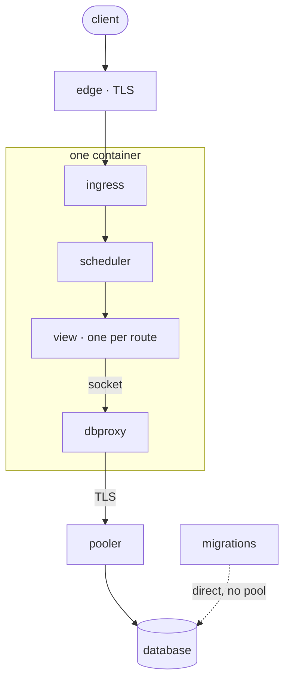

# Review — deployments restructure, lens `dx`

Reviewed at `release/0.2.0` (worktree `.worktrees/release-0.2.0`):

| Page | Lines |
|---|---|
| `docs/deploy/index.md` | 91 |
| `docs/deploy/digitalocean-paas.md` | 206 |
| `docs/deploy/compose-traefik.md` | 305 |
| `docs/deploy/anything-else.md` (reference) | 275 |
| `docs/deploy/fair-queuing.md` (reference) | 54 |
| `docs/reference/settings.md` (reference) | 196 |
| `docs/frameworks/index.md`, `docs/frameworks/django.md`, `docs/ci.md` (house style) | 117 / 118 / 167 |

Verified, not guessed: `make docs-check` → **green** ("No issues found"), so every anchor in
the set resolves, including the five frozen ones (`index#pooler`,
`index#measure-your-ingress`, `anything-else#root-or-rootless`,
`anything-else#memory-and-process-caps`, `compose-traefik#rootless`).
`uv run --no-project e2e/docs_deploy.py` → **red, 34/42** (see B1).

**The 60-second test.** Yes for the index: one container, `blastit` as PID 1, one uid per
route, ingress → scheduler → view, credentials only in `dbproxy`, a pool between `dbproxy`
and the database, fairness at admission, then six named decisions. That is the model the
owner asked for, and the preset pages are recognisably the same picture with their own
values. Two paragraphs still make a reader scroll back (M4 and the L55 reference back to it)
and one sentence is false (M5).

**Step/command counts.** Local: 0 `sudo`, 0 `setcap` in any doc flow — pass.
Deploy/DigitalOcean: 6 steps, ~10 shell commands, 4 tools (`doctl`, `docker`, `psql`,
`openssl`), 5 places with a console alternative to the command (m15).
Deploy/Compose: 6 steps, 3 commands, **6 files** to write (`dynamic.yml`, `.env`,
`compose.yaml`, `db/grants.sql`, `Dockerfile`, no manifest of its own).
CI/CD: untouched by all three pages — neither preset page ever says "deploy only a manifest
`blastit check` passes" (M2).

---

## BLOCKER

### B1. The pages' own promise test is red, and it gates the whole e2e run

`e2e/docs_deploy.py:221-259` (`index_checks`) still asserts the *old* index: `SHOW TimeZone`,
`It must print exactly 'UTC'`, `export APP_URL=…`, `psql "$APP_URL" -c …`, and
`e2e/docs_deploy.py:201` still requires `ALTER ROLE app SET timezone = 'UTC'` on the
DigitalOcean page. The restructure moved that content to
`anything-else.md#session-state` (L100-119), and `e2e/run.py:106-111` runs this check
**before Docker** and returns 1 on failure — so `make e2e` aborts on a documentation
regression, not a container one.

```
FAIL  index: the session zone is read on the direct port, not guessed
FAIL  index: `APP_URL` is exported before the command that reads it
…  (5 more index promises, 1 digitalocean promise)
docs_deploy: 34/42 documented pooler promises hold
```

**Replace:** retarget `index_checks` at the pages that now own the claims — the two-URL rule
(`compose-traefik.md` / `digitalocean-paas.md`, already covered) and the session zone at
`anything-else.md#session-state` (assert `ALTER ROLE app SET timezone = 'UTC'` and
`SHOW TimeZone` there); drop the `APP_URL` export-order promise, or move it with the snippet
if the snippet moves back. Either re-add `ALTER ROLE app SET timezone = 'UTC'` to the DO
`grants.sql` (harmless, and the roles are created right there) or delete that single
assertion. Do not leave the gate red: it is the only executable check this node has.

### B2. `ALLOWED_HOST` is an environment variable no documented app change reads, so the first deploy 400s on every request

`compose-traefik.md:126-127` sets `ALLOWED_HOST: shop.example.com` and `:222-223` promises
"`ALLOWED_HOST` must equal the `Host(...)` in `dynamic.yml`, or Django answers `400`".
`digitalocean-paas.md:173-174` sets `ALLOWED_HOST: ${APP_DOMAIN}`. But Django reads
`ALLOWED_HOSTS` (plural, a list), and the only page that mentions it,
`frameworks/django.md:87`, says "name the host in `ALLOWED_HOSTS`" — statically, with no
`os.environ` wiring. No page shows `ALLOWED_HOSTS = [os.environ["ALLOWED_HOST"]]`, and the
reference app sidesteps it (`e2e/demo/demo/settings.py:9` is `["*"]`), so nothing catches it.
A reader who follows either page with the project the page tells them to use gets
`DisallowedHost` → `400` on every request, with a log line that names neither page.

**Replace:** in step 1 of both pages (the manifest + app step), one line:

> `myshop/settings.py` reads the host from the same variable: `ALLOWED_HOSTS = [os.environ["ALLOWED_HOST"]]`.

and add the same line to `frameworks/django.md#4-ingress` as a follow-up (the guide is the
right long-term home; the deploy page is where the reader hits it).

---

## MAJOR

### M1. Both preset pages open with a command that does not do what the page implies

`digitalocean-paas.md:6-8` and `compose-traefik.md:6-8`:

```console
$ blastit --preset digitalocean-paas
```

`--preset` is a stage-0 production flag (`crates/blastit/src/cli.rs:107-137`): it boots the
privileged process, needs a manifest and root/capabilities + seccomp, and prints events. On
a laptop it fails with the unprivileged-production error (`docs/troubleshooting.md:10`,
`init runs as uid … and is missing cap_…`). It is also **never used by the deployment**: the
DO page sets `BLASTIT_PRESET: digitalocean-paas` (`:177`), the Compose page sets it in
`x-app-env` (`:129`), and `index.md:77-78` correctly says "the deploy files choose it with
`BLASTIT_PRESET`". So the page's first instruction contradicts its own step files and the
index, with no expected output to tell success from failure.

**Replace** (both pages) with the value the deployment actually sets, plus one clause naming
the flag's real use:

```console
BLASTIT_PRESET=digitalocean-paas   # in app.yaml, below; --preset NAME is for a hand-run boot
```

### M2. Neither preset page names the manifest gate, and both tell you to deploy a manifest that denies every statement

`digitalocean-paas.md:65-68` — "In the Django guide's `[proxy.db]`, change only the `input`
line" — and `compose-traefik.md:116-118` — "The manifest is the Django guide's" — point at
`frameworks/django.md:13-34`, whose routes carry `queries = []`. Per
`frameworks/index.md:61-62`, `queries = []` is "a listener that denies everything (`42501`)".
The reader therefore gets a running container whose every database statement is refused, and
no page in the deploy set mentions `blastit check`, `--learn`, or "deploy only a manifest
that passes". CI is the missing third environment in these three pages.

**Replace:** in step 1 of both pages, one line after the manifest sentence:

> Deploy only a manifest `blastit check` passes — the guide's `queries = []` denies every
> statement ([CI/CD](../ci.md#what-it-fails-on)).

### M3. The index's fair-queuing paragraph promises the wrong thing

`index.md:60-63`: "the queue is ordered by client flow instead of arrival, and **a heavy
route cannot starve a light one**: an export burst queues behind a landing page instead of
in front of it." Flows are clients, not routes: `fair-queuing.md:11-14` (`/24`/`/56` outer
flows, headers and cookies for inner ones) and `:3-5` ("one user hammering export"). As
written, a reader concludes a *route* is protected and that the scheduler is route-fair —
the exact misreading that leads to turning fair queuing off. It is the paragraph that
defines what fair queuing promises, so the error is load-bearing.

**Replace:**

> The scheduler, not the framework, decides what runs next. Every request is charged the CPU
> it actually cost, and the queue is ordered by client flow instead of by arrival — so one
> client cannot starve the rest: a scraper's export burst queues behind other people's
> landing pages. A full queue answers `503` with `Retry-After`.

### M4. The index's pooler paragraph is the page's only scroll-back: nine concepts, and arithmetic that lives on another page

`index.md:22-29` asks the reader to hold, before anything has been explained: 16 workers, a
1 GB cluster, ~22 backends, a second instance, transaction pooling, DDL, session state, a
direct port, and a role of their own — then ends with "the settings are in [the pooler]"
(*another* page). `index.md:55-56` then refers back to it: "another line in the connection
budget" is meaningless without L24. `index.md:77-78` (preset precedence) is also three
screens from the page that shows `BLASTIT_PRESET`.

**Replace** `index.md:22-29` with (the anchor must stay):

> A pool keeps a small set of server connections and shares them: sixteen workers per
> instance do not fit a 1 GB cluster's ~22 backends, and a second instance would exhaust
> them. So there are two URLs, and swapping them is the failure this page is about: the app
> names the pool, while migrations connect to the database's direct port as their own role,
> because DDL and session state do not survive transaction pooling. Sizing and the session
> zone: [the pooler](anything-else.md#pooler).

and cut `index.md:55-56` to "`postgresql` is 0.2.0's only proxy protocol." — the socket and
connection-budget aside is preset arithmetic, already in `anything-else.md#pooler`.

### M5. "A view never opens a TCP connection" is false

`index.md:54-55`: "a view never opens a TCP connection, and only `dbproxy` reaches the
database." `anything-else.md:131-133` and `frameworks/index.md:110-111`: a route with
`egress = true` opens **any** IPv4/IPv6 address and port, cloud metadata included. On the
page that teaches the trust boundary, this is the sentence an operator quotes to a security
reviewer.

**Replace:** "a view dials no TCP socket unless its route sets `egress = true`, and only
`dbproxy` reaches the database."

### M6. "What this platform does not do for you" is the same three items on both pages, and its middle item is a link instead of an action

`digitalocean-paas.md:192-202` and `compose-traefik.md:290-300`: items 2 and 3 are
near-verbatim copies (item 2 is identical, word for word), and both pages then duplicate
`index.md:70-75`'s decisions. Item 2 is the worst line in the set: "Keep the role non-owner
and the pool sized. Both are decisions, not defaults: [the pooler] has the arithmetic and
the session-zone trap, `dead_grant` included." — three topics, zero instructions, and
`dead_grant` is a `check` finding kind the reader has not met in a deploy guide.

**Replace:** make it one index section, "What no preset does for you", with a platform column
as the only per-page difference; and in item 2 give one action: "`BLASTIT_MAX_WORKERS` ×
instances must fit the pool's client limit, and the app's role must not own the tables it
reads." Keep item 1 per page (it carries real platform text) and item 3 only where it names
a different header.

### M7. Compose loads `.env` three ways and the page contradicts itself about which one

`compose-traefik.md:110-112` — "Load the file into your shell (`set -a; . ./.env; set +a`)
so the build and `up` share it." — versus `:288` — "`--env-file .env` supplies all four
values, so none reaches your shell history" — versus `:283`
`docker compose --env-file .env up -d`. Compose v2 already reads `./.env` for
interpolation, so the flag is redundant; and "none reaches your shell history" is not what
sourcing a file does (it puts the secrets in every command's environment in that terminal).
The two sentences are a contradiction the reader must resolve before `up`.

**Replace:** step 2 ends "`TAG` is the only value the shell needs: `export TAG=$(git
rev-parse --short HEAD)`. Compose reads `./.env` itself — never commit it, never `source`
it." Step 6 becomes:

```console
$ docker build -t registry.example.com/shop:$TAG . && docker push registry.example.com/shop:$TAG
$ docker compose up -d
```

### M8. Compose's `grants.sql` grants on a table nobody creates, and the failure is an app that never starts

`compose-traefik.md:241` — `GRANT SELECT, INSERT, UPDATE, DELETE ON shop_product TO app;` —
with the page's own admission in `:229-232` ("replace `shop_product` (a table this repo does
not create) or the job aborts the deploy before the app starts"). The `grant` service runs
with `ON_ERROR_STOP=1` (`:184`), `app` depends on `grant` completing (`:201-203`), and the
verification command in step 6 (`:284-285`) prints the app's first log line — which is empty
when the grant job failed. The page documents its own footgun but not the recovery.

**Replace** the executable part of `db/grants.sql` with what works on an empty schema, using
the same model as the DO page (`digitalocean-paas.md:118-123`): `CREATE ROLE app …`,
`ALTER ROLE app SET timezone = 'UTC'`, `GRANT CONNECT`, `GRANT USAGE ON SCHEMA public`, then
`ALTER DEFAULT PRIVILEGES IN SCHEMA public GRANT SELECT, INSERT, UPDATE, DELETE ON TABLES TO app;`
(the owner runs it and creates the tables, so it takes effect on them), and one commented
per-table example below for narrowing later. Then add one line under step 6: "no line?
`docker compose logs grant` — the grant job aborts the deploy before `app` starts."

### M9. Both diagrams are too wide to read at 375 px

`index.md:33-51`, `digitalocean-paas.md:24-42`, `compose-traefik.md:27-45`. The syntax is
valid Mermaid (quoted labels, `-. text .->`, the `[("…")]` cylinder, `subgraph` membership by
declaration), and Zensical emits the block for the browser, so `make docs-check` **cannot**
catch a typo — it ships green. The DX problem is size: 8 nodes, labels up to 40 characters
over two lines ("edge · TLS ends here<br/>adds the client address", "pool shop-pool ·
25061<br/>transaction, 18 server connections"), and the `migrate → db` side branch makes
`pooler` and `migrate` share a rank, so the intrinsic width is ~3 nodes (~700-900 px). At
340 px of content the labels render at 6-7 px — the diagram is decoration, not the model.
Most of the label text is already in the paragraph beneath it (`index.md:53-56`) or in the
values table.

**Replace** the index diagram with (same for the preset pages, swapping only `edge`, `pooler`
and `migrate` for the platform's own names — keep `pool 25061`, not its mode and count):



Longest label is 21 characters and the widest rank is 2 nodes — readable at 375 px without
zooming.

### M10. "Where next" on both preset pages sends the reader to the other platform

`digitalocean-paas.md:204-206` ("The same model behind Traefik, rootless") and
`compose-traefik.md:302-305` ("The same model with root and a managed cluster"). A reader who
has just deployed needs to verify it, not to learn a second platform. The one action they
must take now is the client-address measurement, which the page knows is a guess until
measured (`:200-202`, `:298-300`) but buries three screens up.

**Replace:** "## Where next — Verify it: [measure the client address](index.md#measure-your-ingress)
on the first real request, then read [fair queuing](fair-queuing.md) for the knobs.
Splitting the same app across platforms? [Docker Compose](compose-traefik.md)."

### M11. The DigitalOcean `ca_cert` reason is inverted, so the reader may delete the verification they were told to add

`digitalocean-paas.md:65-68` says to add `ca_cert = "DATABASE_CA_CERT"` — "the CA is read
only for `verify-full`, not for DO's `require`" — and `:56` repeats it. Shipping behaviour:
`sslmode=require` **with** a `ca_cert` upgrades to full verification
(`crates/blastit-dbproxy/src/upstream.rs:81-86`:
`Self::Require => match ca { Some(ca) => options(Some(ca), VerifyMode::Full) … }`), and only
`verify-full` *requires* one. So the action is right and the reason is backwards: a reader
who believes the sentence removes `ca_cert` and silently loses certificate verification,
while the page never states what `sslmode` the pool bindable carries.

**Replace:** "the pool bindable ends in `sslmode=require`; naming `ca_cert` makes blastit
verify the pool's certificate against DO's CA. Drop it only if you accept an unverified TLS
leg to the pool."

---

## MINOR

- **m1** `digitalocean-paas.md:47`, `compose-traefik.md:50` — "What we thought the config
  would be" reads as the guess you later corrected, not the shape you are deploying. Rename
  to "The values behind it".
- **m2** `compose-traefik.md:12-18`, `digitalocean-paas.md:12-18` — the preset tables list
  settings already at their default (`BLASTIT_LOG_FORMAT=json`; in the Compose case also
  `BLASTIT_CLIENT_IP_HEADER=x-forwarded-for`) with a "why" that explains a no-op (`stdout is
  the container's log`). Mark those "(already the default)" or move them to one sentence
  below the table, so the table shows the two values the preset actually changes.
- **m3** Two facts appear in **both** tables on each page (client address, and
  privilege/root-vs-capabilities): `digitalocean-paas.md:14,18` vs `:57,58`;
  `compose-traefik.md:14,18` vs `:54,61`. Keep them in the preset table and delete the
  values-table rows.
- **m4** `index.md:3-6` opens on mechanisms (WASM gate, root, the capability set, seccomp)
  before the model. Cut to: "Production `blastit` runs each route under its own uid and
  **refuses to start** without root or the capability set — there is no single-uid fallback."
  Seccomp is already in the choices table and `anything-else.md#root-or-rootless`.
- **m5** `index.md:75` — the "Where TLS ends" row is not "the options": it states the
  decision. Reword to "the edge terminates TLS; Blastit speaks HTTP/1.1, has no TLS and
  answers `501` to `Upgrade`".
- **m6** `digitalocean-paas.md:79-84,91,105-106` mixes three placeholder dialects in one
  page: `<password>`/`<host>`/`<id>`/`<hex>` inside quotes, `REPLACE_WITH_*` in the YAML, and
  bare `yourregistry`. Pick `REPLACE_WITH_*` and say once "replace every `REPLACE_WITH_*`".
- **m7** `digitalocean-paas.md:99-101` reads as if `doadmin`'s password is the one you
  generate: "`OWNER_URL` is on **Connection Details**, and the password is hex
  (`openssl rand -hex 24`)". Name the two roles: "`OWNER_URL` is `doadmin`'s, copied from
  **Connection Details**; `MIGRATOR_PASSWORD` is yours (`openssl rand -hex 24`) because it is
  pasted into a URL."
- **m8** `digitalocean-paas.md:94-95` — "every step below takes `"$CLUSTER_ID"`" is false
  (steps 5 and 6 do not). "Steps 3 and 4 take `"$CLUSTER_ID"`".
- **m9** `compose-traefik.md:95`, `:126-127`, `:222-223` — the "`ALLOWED_HOST` must equal
  `Host(...)`" rule is stated three times in one page, and `:220-223` re-states comments the
  YAML already carries (`:124-125`, `:143-144`). State it once at the file, delete the recap.
- **m10** `compose-traefik.md:195-203` — the app has no health check while
  `digitalocean-paas.md:59,170` demonstrates the health contract. One line, using the
  any-doc recipe (`anything-else.md:160-162`; a slim image has no `curl`):
  `healthcheck: { test: ["CMD", "python", "-c", "import urllib.request;urllib.request.urlopen('http://127.0.0.1:8080/_blastit/health')"] }`.
  Or a comment saying plainly that Traefik forwards as soon as the container is up.
- **m11** `compose-traefik.md:14` — "Traefik always adds its own observation" is unclear;
  "Traefik appends what it saw; `*` trusts the peer and reads the rightmost entry".
- **m12** `compose-traefik.md:23` links `../reference/settings.md#client-address` while
  `:294` links `anything-else.md#client-ip-header`, and the DO page uses the latter (`:196`).
  One target for one topic: `anything-else.md#client-ip-header`.
- **m13** `index.md:71`, `digitalocean-paas.md:58`, `compose-traefik.md:18,54` — "seven
  capabilities" in four places. The count lives where the reader types them
  (`anything-else.md:36,48-51`, `compose-traefik.md:193`); elsewhere say "the capability
  set".
- **m14** `digitalocean-paas.md:129-132` teaches transaction pooling (session state, advisory
  locks, `LISTEN`, temp tables) a second time after `anything-else.md:96-98` and
  `settings.md:165-175`. Keep one sentence — "transaction mode: no session state, so
  migrations and any `SET` stay off the pool" — and the `doctl` line.
- **m15** `digitalocean-paas.md:90-95,134-136` give a console path *and* the `doctl`
  equivalent for two of the six steps; `compose-traefik.md` gives one way throughout. Either
  is fine, but pick one and keep the other as a one-line parenthetical, or the reader has to
  decide five times.
- **m16** `index.md:77-78` (preset precedence) is stated verbatim again at
  `digitalocean-paas.md:20` and `compose-traefik.md:20`. Keep the index sentence and link it
  from the two pages, or drop it from the index and keep the copy where the reader sets
  `BLASTIT_PRESET`.

---

## Verdict

This **is** the model the owner asked for: the index is a topology + trust-boundary +
decision set, not a procedure, and both preset pages are the same picture with their own
values (the "everything inside the box is the model unchanged" line is the right device). The
dedupe of the `SHOW TimeZone` / `set_config` / `dead_grant` material into
`anything-else.md#session-state` is a clear win, the frozen anchors are intact,
`make docs-check` is green, and nothing in the set asks for `sudo`. The single biggest
remaining DX defect is that **the happy path does not run**: both preset pages start from the
Django guide's manifest and env, yet they never name the two app-side gates that make that
pair work — `ALLOWED_HOSTS` reading `ALLOWED_HOST` (so every request is a `400`) and a
`blastit check`-clean manifest (so every statement is `42501`, because the guide's
`queries = []`). Until those two sentences exist in step 1 of each page, the pages describe a
deployment the reader cannot reach; fix them, re-point `e2e/docs_deploy.py` at the pages that
now own those claims, and this set is ready.
