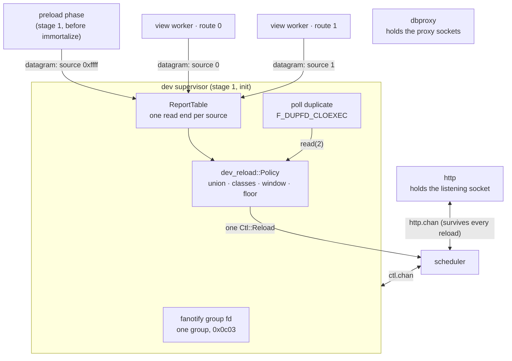

# `blastit dev` live reload: one unprivileged file-handle group, exact loaded-file tracking, one all-views reload

Ground truth is `docs/research/2026-11-16-dev-fanotify-reload.md` (cited below as
"research §N"). Its measured constants are reproduced here unchanged; nothing in this
document re-derives them. Where the research's §3 table still speaks of per-route
selection, the epic and the accepted DX replaced it with one reload unit — §6 reconciles
the two, once, and says which wins.

## 1. Developer Experience Target (Local, CI/CD, Deploy)

This design exists to make four accepted pages true, verbatim, with no new config key and
no new `Blastfile` field.

**Local — `docs/local.md` `## Start`.**

> Edits reload your views, all together. `--no-reload` turns that off.
>
> | You save | Blastit |
> |---|---|
> | a view, a shared module, an editable package or template, even outside the project | reloads every view together |
> | `./Blastfile` or a `preload` module | re-reads what changed, then reloads the whole topology |
> | *any of these* | keeps `:8080` up: no restart, no second terminal |

Every row is delivered by one mechanism: the union of the files the `preload` phase and
every view worker reported is the watched set; any tracked change sends one `Ctl::Reload`
and retires every active view's idle workers together. A file outside the working
directory is watched because it was *loaded*, not because it is under a root. `:8080`
stays up because the listening socket lives in the `http` process for the whole run and is
never closed, re-bound, or handed to a replacement process; a `Blastfile`/`preload` save
re-runs the preload cycle behind it, and a `postgres { query … }` edit is applied in the
same save — dbproxy's allowlist is refreshed before the views retire (§4.8), so the page's
denial fix works without a restart. No `sudo`, no capability, no new variable, no second
terminal.

**Local — `docs/reference/cli.md` `## blastit dev`.**

| Flag | Default | What it does |
|---|---|---|
| `--no-reload` | reload on | turn live reload off: nothing is watched, and no `dev.reload.unavailable` is printed |

`--no-reload` is the only knob. Off means zero watcher fds, zero marks, zero reporting
sockets, zero audit hooks and neither reload event — not "a watcher that ignores events".
It is the only user-facing knob; the `--dev-reload`, `--dev-adopt-fd`, `--dev-policy-fd` and `--dev-reload-since` tokens are internal to stage 1 (and `--dbproxy-policy-fd` to dbproxy) and never appear in `--help`. It is a `dev` argument only; `check`, `test` and production have no such flag and no path
that constructs the feature. The page's sentence "Reload is on by default in `dev` only
and needs the host kernel to allow it: a container profile that denies it gets one warning
at boot, and serving continues" is the failure ladder of §4.7.

**Local — `docs/reference/log-events.md`.**

| Event | Level | Fields |
|---|---|---|
| `dev.reload` | `info` | `routes` (every route serving after the reload), `files` (absolute paths), `reason` (`loaded`, `preload`, `blastfile`, `overflow`) |
| `dev.reload.unavailable` | `warn` | `errno` (symbolic, `"EPERM"`), `filesystem` (type, `"overlayfs"`) |

plus `reload` in `process.retired`'s `reason` list. §4.9 freezes the payload and both
encodings; the names, levels, field domains and the four `reason` words are exactly the
page's.

**Local — `docs/troubleshooting.md`.**

> `reload disabled` … `EPERM` (`dev.reload.unavailable`) → live reload is not permitted
> here: a container security profile, an older kernel, or a filesystem without file
> handles. The server serves either way; …

The human line keeps the words `reload disabled` and shows the errno; §4.7 is its one
template. The `filesystem` value names the **filesystem**; the errno distinguishes the
three causes (`ENOSYS` kernel, `EPERM` profile, `EOPNOTSUPP` filesystem), which is what the
page's single row lists.

**CI/CD — `blastit check` / `blastit test`.**

Reload is a `dev` convenience off the request path. `check` and `test` never create a
group, never install a hook, never open a reporting socket and never read `--no-reload`
(the flag is rejected outside `dev`). The completeness audit therefore sees exactly the
same wire traffic as before; §7 T17 makes that a test, not a promise.

**Deployments — production `blastit`.**

Production has no reload at all: no group, no marks, no audit hook, no reporting socket,
no `fanotify_*` call, `crates/blastit-sys/src/seccomp.rs` byte-identical. The production
fail-closed rule (real capabilities + seccomp or exit) is untouched: this feature adds no
privilege requirement and no filter rule, and a `dev` boot still prints
`"privilege": "unprivileged-dev"`.

## 2. Goals & Non-Goals

**Goals.**

1. Saving a file the app actually loaded reloads every view together, by default, in
   `blastit dev`, with no `sudo`, no config key and no new `Blastfile` field.
2. One watcher: an unprivileged file-handle group (`FAN_REPORT_DFID_NAME`, marks per
   directory, `AT_HANDLE_FID` handles). Exactly one group per dev boot, created only in
   the `dev` supervisor.
3. One reload unit: the union of the `preload` phase's and every view worker's loaded
   files; one `Ctl::Reload` with no route payload; every active view's idle workers retire
   together with reason `reload`.
4. `./Blastfile` and `preload` changes re-read and re-run the cycle without dropping
   `:8080` or its accepted connections, and an intermediate invalid `Blastfile` keeps the
   server serving.
5. Every failure degrades to "serve without reload" with one warning; the process never
   crashes and never opens a second kind of watch.
6. The policy is tested deterministically: two seams (the watcher, the clock), zero
   sleeps deciding a verdict.

**Non-Goals.**

- No `--watch <dir>`, no per-route override, no "restart one view" escape hatch, no config
  file, no stat-polling mode in `0.2.0`.
- No Node/JVM/static-asset reload: a static file is read per request, so nothing needs
  restarting.
- No non-Linux host, no second watcher, no watch crate.
- No change to the `view.chan` frame vocabulary, to any ingress gate or to any broker
  protocol; `ctl.chan` gains one frame, each `dev` view gains one dev-only fd, and no new
  dependency (`Cargo.toml` and `Cargo.lock` stay byte-identical for the whole epic).
- No hot-swap of the database proxy's **sockets**: its allowlist is refreshed on a save
  (§4.8), but a change to the listener set waits for a restart.

## 3. Requirements (R1..R16)

| # | Requirement (testable) |
|---|---|
| R1 | The watcher is constructed only on the `dev` supervisor path. `--no-reload` yields zero fds, zero marks, zero hooks, zero reload events; production, `check` and `test` never construct it. |
| R2 | One **live** group per image: `fanotify_init(0x0c03, O_RDONLY)` in the supervisor, never in a view. A reload image creates its own only after the previous one died with the previous image (both its descriptors are close-on-exec); two groups are never open at once. |
| R3 | The mark mask is exactly `FAN_CLOSE_WRITE\|FAN_MOVED_TO\|FAN_MOVED_FROM\|FAN_CREATE\|FAN_DELETE\|FAN_ONDIR\|FAN_EVENT_ON_CHILD`; `FAN_MODIFY`, `FAN_RENAME`, `FAN_REPORT_TARGET_FID` and `FAN_CLASS_CONTENT` are never requested. |
| R4 | The read buffer is 16 KiB and `#[repr(C, align(8))]`; the name area is `hdr.len - 20 - handle_bytes`, read to the first NUL; info records are a chain bounded by `event_len`. |
| R5 | The handle table is keyed `(fsid [u32;2], handle_type i32, handle bytes)`; the probe is `name_to_handle_at` with `AT_HANDLE_FID`, `flags = 0` on kernels without it; `open_by_handle_at` is never called. |
| R6 | The watched set is the union of the `preload` phase's and every view worker's reported loaded files, plus the manifest path. A path under the skip list is in the union only as a report (never marked, never a trigger); a framework cache directory **is** marked, but every event under one is dropped before the union lookup, so it can never trigger a reload. Reports arrive on dev-only `AF_UNIX SOCK_DGRAM` sockets; the supervisor attributes each datagram to its source by the fd it arrived on. |
| R7 | Any tracked change fires one `Ctl::Reload` (`0x45`, empty payload, no route) after a 50 ms quiet / 250 ms max window subject to a 500 ms floor; `FAN_Q_OVERFLOW` fires one reload cycle with reason `overflow`. |
| R8 | On `Ctl::Reload` the scheduler retires every active view whose request count in flight is zero with reason `reload`, marks the rest stale, and never admits a new request to a stale view. A view mid-request is never `SIGKILL`ed by init on this path. |
| R9 | The `:8080` listening socket is never closed, re-bound, or moved to another process; every accepted connection survives. The proxy processes and their socket paths and ports are never re-bound. |
| R10 | A `./Blastfile` change, a file of a `preload` module, or any file the boot imported before the fork is validated before anything is torn down. An invalid `Blastfile` saves one error line and keeps the previous topology serving; a valid one emits `dev.reload` naming every route serving after the reload, refreshes dbproxy's allowlist over the dev-only policy socket, retires all views, then re-execs stage 1 with `:8080`, `http` and dbproxy adopted. A grant edit applies; a change to the proxy listener set emits one `manifest.warning` and waits for a restart. Under `--learn` the manifest cycle is skipped with one warning (the tally must survive). |
| R11 | The two events and the retire reason match `MB.23.1`'s contract exactly (§1, §4.9): names, levels, fields, `reason` words, symbolic `errno`, filesystem type, and `reload` as a `string32` retire reason. |
| R12 | Debounce and the floor are a function of two injected values (events, `Instant`); the policy tests use a fake watcher and a test clock and contain no `sleep`. |
| R13 | The failure ladder is `ENOSYS`, `EPERM`, `EINVAL`, `EOPNOTSUPP`, `ENOSPC`, `EMFILE`: one `dev.reload.unavailable`, then serve; `ENOSPC` keeps the marks already placed. No retry loop, no second watcher. |
| R14 | A view never holds the group fd and never marks: the supervisor's is `FAN_CLOEXEC` and no view's `keep` list names it. A view can only write its own reporting datagram, and a forged one can add paths to the watched set — bounded by §4.10 and only ever causing reloads — never a read, a mark outside the union, or a privilege. A reported path that is not a real file or directory at the moment it is reported is dropped. |
| R15 | Every budget is enforced and named: path count, path length, batch size, marks, one group. `MB.23.6` audits them. |
| R16 | No new dependency; no raw syscall numbers; no hand-written fanotify structs; `unsafe` only in `blastit-sys` with `// SAFETY:` and no `unwrap`/`expect`/indexing on event bytes. |

## 4. Architecture & Data Flow

### 4.1 Who holds what, and the boot order



- The **group fd** exists only in the supervisor. It is `FAN_CLOEXEC`, so it never
  survives the reload `execve` and never reaches a view. The polling descriptor is a
  **`F_DUPFD_CLOEXEC` clone** (`OwnedFd::try_clone`), so it dies with the image exactly like
  the group; without that, a duplicate without `FD_CLOEXEC` would survive every reload and
  keep the old group (and its marks) alive until `max_user_groups` (128) ran out. One group
  per boot image, one generation at a time.
- The **reporting socket** of a view is one `socketpair(AF_UNIX, SOCK_DGRAM |
  SOCK_CLOEXEC | SOCK_NONBLOCK)`. The supervisor's read end is *owned* by the
  `ReportTable` (see §4.4); the write end is in the child's `keep` list (`child.rs`) and
  reaches the worker as `ViewConfig::loaded_fd`: `spawn_now` puts the write end in
  `ChildIo.keep`, `zygote.rs` moves it into the view's `ViewConfig`, `blastit_view::serve`
  hands the raw number to the runtime, and the Python side stores it in the globals dict as
  `blastit_loaded_fd` — never through the environment. Stage 0 strips every `BLASTIT_*`
  variable from a view; this design introduces no variable at all, so there is nothing extra
  to strip.
- The **listening socket** is in `http` (unchanged from today) and nowhere else. It is never
  closed, re-bound or handed to a replacement process, so accepted connections keep their
  byte stream across a manifest/preload reload. A reload never restarts `http`, so the
  supervisor keeps no copy of the socket.
- **dbproxy** is untouched by every reload; its sockets and ports are never re-bound
  (§4.8).

**Boot order** (`dev`, reload on; each step is skipped entirely under `--no-reload`):

1. adopt the runtime root; read `filesystem_type(root)` once (`None` becomes `"unknown"`);
2. `Watcher::new()` and `mark_dir` for the manifest's parent and the app root; a failure
   here is the §4.7 ladder (one event, no watcher);
3. open the preload report socket, register source `0xffff`, install the preload phase's
   `open` hook gated on the report fd being present;
4. import the app, import `preload`, run `BLASTIT_WARMUP`, harvest, send the preload batch;
5. mark the parents the preload batch just added, print the boot line
   `reload: on (N directories)`;
6. immortalize the heap, `gc.freeze()`, and fork views lazily as today.

Every later source (a view) registers at `spawn_now`, before the fork; `reap_children`
revokes it. The union is therefore complete before the first request and grows only from
reports the supervisor has already marked.

### 4.2 Seam 1 — `ReloadWatcher`

One trait, one real implementation, one fake. It lives in
`crates/blastit/src/dev_reload.rs`; the real implementation is
`blastit_sys::fanotify::Watcher` and is adapted there (a local trait, so the adapter is
legal in `blastit`).

```rust
/// The watcher seam. Exactly two operations: mark a directory, drain events.
pub trait ReloadWatcher {
    /// Mark `dir` (inode mark, immediate children only).
    fn mark_dir(&mut self, dir: &Path) -> io::Result<()>;
    /// Drain what the kernel has queued; `EAGAIN` is an empty, non-overflow readout.
    fn read(&mut self, out: &mut Vec<Event>) -> io::Result<Readout>;
}
```

`Event` and `Readout` are `blastit_sys::fanotify`'s:

```rust
pub struct Event { pub mask: u64, pub dir: PathBuf, pub name: Vec<u8> }
pub struct Readout { pub events: usize, pub overflow: bool, pub skipped: u32 }
```

The fake and `TestClock` are `#[cfg(any(test, debug_assertions))] pub` in `dev_reload.rs`
(one fake, ~40 lines): it records `mark_dir` calls and replays a scripted sequence of
`Vec<Event>`, `EAGAIN`, and an error. Both the unit tests and
`crates/blastit/tests/critical_dev_reload.rs` (a debug build) drive the policy with no
kernel and no sleeps; a release build carries neither.

**The real watcher's frozen surface** (`crates/blastit-sys/src/fanotify.rs`, `MB.23.3`).
Every fallible function returns `io::Result`, per `blastit-sys/src/lib.rs`'s rule; there is
no separate error enum, and the errno *is* the classification:

```rust
pub const INIT_FLAGS: u32 = 0x0c03;           // FAN_CLOEXEC|FAN_NONBLOCK|FAN_REPORT_DFID_NAME
pub const MARK_MASK: u64 = FAN_CLOSE_WRITE | FAN_MOVED_TO | FAN_MOVED_FROM
                         | FAN_CREATE | FAN_DELETE | FAN_ONDIR | FAN_EVENT_ON_CHILD;
pub const READ_BUF: usize = 16 * 1024;

#[repr(C, align(8))]
pub struct ReadBuffer([u8; READ_BUF]);         // the only read target

pub struct Watcher { /* OwnedFd + HashMap<HandleKey, PathBuf> + ReadBuffer */ }
impl Watcher {
    pub fn new() -> io::Result<Self>;                                  // 0x0c03, O_RDONLY
    pub fn mark_dir(&mut self, dir: &Path) -> io::Result<()>;
    pub fn read(&mut self, out: &mut Vec<Event>) -> io::Result<Readout>;
    pub fn fd(&self) -> BorrowedFd<'_>;
    pub const fn init_flags() -> u32;                                  // INIT_FLAGS
    pub const fn mark_mask() -> u64;                                   // MARK_MASK
    pub fn probe_flags() -> u32;                                       // AT_HANDLE_FID, else 0
}

/// The pure parse seam: no fd, no kernel, every record walked by `hdr.len`.
pub fn parse_records(buf: &[u8], out: &mut Vec<Event>) -> Result<Readout, ParseError>;
pub enum ParseError { ShortBuffer }            // the whole read is unusable (⇒ EINVAL)

pub fn filesystem_type(path: &Path) -> Option<&'static str>;           // statfs magic → "xfs" | "overlayfs" | "tmpfs" | "9p" | …
```

`parse_records` is the oracle T5 needs: it walks info records from `metadata_len` to
`event_len`, checks `hdr.len` against the remaining bytes before any slice, reads the name
area as `hdr.len - 20 - handle_bytes` to the first NUL, never indexes past `event_len`, and
**skips a malformed record** (`skipped += 1`) instead of panicking. `read` calls it and
maps `ShortBuffer` to `EINVAL` (research §1.2.3: a bug to fix, not to retry). The buffer's
size and alignment are asserted with `size_of`/`align_of` in the crate's own tests.

`io::Result` carries the classification: `new`/`mark_dir` fail with the ladder's errno, and
the policy names the cause from `err.raw_os_error()` and the filesystem from
`ReloadConfig::filesystem` (§4.5), so a fake can produce `EPERM` on any host and the
emitted event is byte-identical to the real one.

Measured constants, unchanged from the research (§1.1–§1.5):

| What | Value | Source |
|---|---|---|
| init flags | `0x0c03` (`FAN_CLOEXEC\|FAN_NONBLOCK\|FAN_REPORT_DFID_NAME`), `O_RDONLY` | research §1.1 |
| mark mask | `FAN_CLOSE_WRITE\|FAN_MOVED_TO\|FAN_MOVED_FROM\|FAN_CREATE\|FAN_DELETE\|FAN_ONDIR\|FAN_EVENT_ON_CHILD` | §1.6 |
| read buffer | 16 KiB, `#[repr(C, align(8))]` | §1.2.4 |
| name area | `hdr.len - 20 - handle_bytes`, stop at the first NUL | §1.2.1 |
| handle key | `(fsid [u32;2], handle_type i32, handle bytes)` | §1.4 |
| handle probe | `name_to_handle_at(AT_FDCWD, dir, AT_HANDLE_FID)`; `flags = 0` on kernels below 6.5 | §1.4.3 |
| path cap | 4096 bytes; longer paths are not tracked | design budget |
| skip list | `.git` `.hg` `.svn` `node_modules` `.venv` `venv` `__pycache__` `.mypy_cache` `.pytest_cache` `.ruff_cache` `.tox` `target` | §1.5 |
| cache dirs | `var/cache`, `storage/framework/views`, `.next`, `dist`: marked, never a trigger | §1.5 |

Never requested: `FAN_MODIFY`, `FAN_RENAME`, `FAN_REPORT_TARGET_FID`,
`FAN_CLASS_CONTENT`. Never called: `open_by_handle_at`. The types follow research §1.3
exactly: `c_uint` for init and mark flags, `u64` for event masks (`mask as u64` is the
portable read), one `as _` inside the mark wrapper for the gnu/musl signature split, and
no `cfg` in the public API.

### 4.3 Seam 2 — the clock

```rust
pub trait Clock { fn now(&mut self) -> Instant; }
pub struct SystemClock;                       // Instant::now()
#[cfg(any(test, debug_assertions))]
pub struct TestClock { base: Instant, at: Duration } // base + at, advanced by the test
```

`Policy` never calls `Instant::now()`. Every decision takes the observed `Instant` as a
parameter, so a test advances `TestClock` by exactly 49 ms, 50 ms, 250 ms or 500 ms and
asserts the fire/no-fire edge. `critical_dev_reload.rs` may use a bounded poll loop only to
wait for a real process to start, never to decide a debounce verdict.

### 4.4 The watched set — sources, codec, union

**Sources and their lifecycle.** `PRELOAD_SOURCE = 0xffff` is the `preload` phase (it
reports once, before the first view is forked). Every other source is a route index
(`u16`). The supervisor attributes a datagram by the **fd it arrived on**; the header's
`source` is a self-check only — a mismatch is logged once as a `manifest.warning` and the
datagram is dropped. A view holds only its own write end, so it can only speak as itself.

**Attribution is path-based.** An unprivileged listener receives `pid == 0` for every event
it did not itself cause (research §1.6), so no decision reads `event.pid`: a tracked change
is decided by the joined path, and a view's own cache or bytecode write is excluded by
path, never by identity. There is no per-process attribution anywhere in this design.

`ReportTable` owns the supervisor's read ends, keyed by the descriptor itself (never by a
raw number that could be reused):

```rust
pub enum Class { Loaded, Preload, Blastfile }
pub struct Entry { pub class: Class, pub pre_fork: bool }
pub enum Report {
    Applied { boot: bool, resync: bool, added: usize },
    Dropped(Drop),
}
pub enum Drop { Cap, Missing, NotUtf8, NotAbsolute, Mismatch }   // report-level drops; an event under a skip/cache path is ignored at lookup, never a drop

pub struct ReportTable { /* HashMap<RawFd, (OwnedFd, Source)> + per-source sets + union */ }
impl ReportTable {
    pub fn register(&mut self, end: OwnedFd, source: Source);
    pub fn revoke(&mut self, source: Source);          // closes the end, drops its set
    pub fn on_datagram(&mut self, fd: RawFd, bytes: &[u8], cfg: &ReloadConfig) -> Report;
    pub fn union(&self) -> &BTreeMap<PathBuf, Entry>;
    pub fn dirs_to_mark(&self) -> Vec<PathBuf>;        // parents + directories, minus skips
    pub fn sources(&self) -> impl Iterator<Item = RawFd> + '_;
}
```

`Applied` carries what the policy needs: `boot` (this batch replaces the set — it must not
arm the window), `resync` (it must), and how many paths were added. A report fd that
returns `POLLHUP`/`POLLERR` is `revoke`d in the same wakeup (the view is gone), so the poll
set never spins on a dead peer.

`spawn_now` creates the socketpair before the fork, passes the write end into the child,
closes it in the parent, and calls `register(read_end, source)`. `reap_children` calls
`revoke(source)` for every view it reaps — close and drop, so a later `socketpair` that
reuses the number can never inherit the old source. The preload source is registered at
boot and revoked when a reload cycle starts. There is exactly one read end per live source.

**Codec** (`crates/blastit-view/src/loaded.rs`, `MB.23.4`), little-endian, one datagram per
batch:

```text
batch  := u8 version (=1)
          u8 flags        bit0 boot, bit1 resync, bits 2..7 zero
          u16 source      0xffff = preload phase, else route index
          u32 seq         monotonic per source
          u16 count       number of paths in this datagram, 0..=64
          count * { u16 len, len * u8 }      len ≠ 0, no NUL, UTF-8
```

- `boot` (with `seq = 0`) **replaces** that source's set; `seq` otherwise must be the
  previous `+1`. A gap, a `resync`, or the first batch after a fork rebuilds the set.
- `resync` means "treat every path you already have from this source as changed": a
  `chdir`, a lost send, or a full socket. It arms the window exactly like an event — which
  is why the post-reload `boot` batch must **not** arm it (§7 T30).
- A path is UTF-8, absolute and at most 4096 bytes. The Python hook may not call `abspath`
  (research §2.1: +0.74 µs and an I/O-free rule), so a relative `open()` is made absolute at
  the sender's **flush**, by joining the process's cwd cached once at worker start;
  the supervisor drops a datagram path that is not absolute (`Drop::NotAbsolute`). Anything
  else non-UTF-8 or over-long is dropped at the sender and counted; the watched set is
  therefore UTF-8 and absolute only, which is also what the `files` field can represent.
- Chunks are **64-path** datagrams *and* at most 32 KiB encoded, whichever comes first.
  The 64-path bound is the research's measured safe batch (§2.3); the 32 KiB bound keeps a
  full 64 × 4096-byte batch (262 274 B, `EMSGSIZE` at 262 142 B) from ever being built,
  and stays under the measured ~40 KB in-flight ceiling. `EAGAIN` on send drops the batch
  and sets `resync` for the next one — a request never blocks on reporting.

**Union.** The supervisor keeps `HashMap<Source, BTreeSet<PathBuf>>` and a derived
`HashMap<PathBuf, Entry>` (class precedence `Blastfile` > `Preload` > `Loaded`). The
manifest path (`./Blastfile`, absolute) is always present as `Blastfile`. A path is
`Preload` **only** when it is the file (or namespace directory) of a module the manifest's
`preload` list names; every other path the boot imported before the first fork is `Loaded`
with `pre_fork = true`; a view's report is `Loaded`, `pre_fork = false`. `pre_fork` chooses
the *action* (§4.6: the boot heap is stale, so the cycle re-execs); the class chooses the
*reason word* (§4.9), which is why saving an ordinary module imported before the fork logs
`reason=loaded` and still re-execs. The first time a path enters the union it is
`symlink_metadata`d once: a path that does not exist or cannot be read is dropped
(`Drop::Missing`) and counted, never watched and never logged. The watched set is that
union and nothing else.

**Marks.** The supervisor marks the **parent directory of every union path** (and the
directory itself when the reported path is a directory — a namespace package — so its
children are seen), and the app root if it is not already one of those parents. A directory
already marked is not marked twice (the kernel merges masks; a duplicate `FAN_MARK_ADD` is a
no-op). A path under the skip list is never marked and is never a trigger; it may still be a
report (R6). A **framework cache directory** (`var/cache`, `storage/framework/views`,
`.next`, `dist`) *is* marked — an event there is observed — and every event under one is
dropped before the union lookup, so a cache write can never trigger the reload that would
rewrite it. Because a directory is marked the moment a union entry first names it, a tracked
file's parent is always marked before any event for that file could matter; a
`FAN_CREATE|FAN_ONDIR` for a directory nothing tracks therefore fires nothing on its own. A
union path whose parent is outside the app root (an editable install, a template elsewhere)
is watch-worthy precisely because it was loaded — that is the "even outside the project"
row of `docs/local.md`.

**What triggers.** An event is joined to `dir/name` and looked up in the union; a hit is a
tracked change. An untracked new file is **not** a tracked change and does not reload: the
first request that loads it reports it, and from then on it is watched. An event under a
skip or cache path is dropped before the lookup, so a worker writing a cache file can never
trigger the reload that would rewrite it (§4.8).

### 4.5 The debounce state machine

State: `Idle` or `Armed { first, last }`, plus `last_fire: Option<Instant>`.

```text
on tracked event at t:   if Idle { first = t } ; last = t ; accumulate path
deadline(now)         =  max(last_fire + 500 ms, min(last + 50 ms, first + 250 ms))
```

- 50 ms quiet: a save burst (an editor's temp-write + rename) coalesces into one fire.
- 250 ms max: a stream of saves cannot postpone the reload forever.
- 500 ms floor: two reloads are never closer than 500 ms, whatever arrives. The floor wins
  over the max wait when they disagree.
- `FAN_Q_OVERFLOW` sets the reason to `overflow` and arms the window at once (the floor
  still applies), so dropped events cost exactly one all-views reload.
- Firing takes the accumulated set, deduplicated and sorted, and clears it.
- The **action** is chosen by the union entry: any changed path with `class == Blastfile` or
  `pre_fork == true` takes the reload cycle (§4.6), everything else takes the all-views
  transaction. The **reason word** is chosen by the class: `blastfile` > `preload` >
  `loaded`, and any overflow in the window makes it `overflow` (which takes the cycle, since
  a dropped event may have been the `Blastfile` save). So an ordinary module imported before
  the fork logs `reason=loaded` and still re-execs — the field says what changed, not what
  the supervisor did (§4.9).

The module's frozen shape (`crates/blastit/src/dev_reload.rs`), enough for each leaf to be
written without guessing:

```rust
pub const PRELOAD_SOURCE: u16 = 0xffff;

pub struct ReloadConfig {
    pub root: PathBuf, pub manifest: PathBuf,
    pub filesystem: String,          // filesystem_type(&root), or "unknown"
    pub max_paths: usize, pub max_marks: usize,
}

pub struct Policy { /* ReportTable, window, last_fire, dead: bool, marking_stopped: bool */ }
impl Policy {
    pub fn new(cfg: ReloadConfig) -> Self;
    pub fn reports(&mut self) -> &mut ReportTable;
    pub fn pending_dirs(&mut self) -> Vec<PathBuf>;   // dirs_to_mark(), drained once
    pub fn stop_marking(&mut self);                  // the ENOSPC latch: keep what is marked
    pub fn observe(&mut self, events: &[Event], readout: Readout, now: Instant) -> Vec<Effect>;
    pub fn apply_report(&mut self, report: Report, paths: &[PathBuf], now: Instant) -> Vec<Effect>;
    pub fn reconcile(&mut self, since: SystemTime, now: Instant); // one-shot post-exec gap closure
    pub fn tick(&mut self, now: Instant) -> Vec<Effect>;
    pub fn next_deadline(&self) -> Option<Instant>;
    pub fn is_dead(&self) -> bool;
}
pub struct Fire { pub files: Vec<PathBuf>, pub reason: ReloadReason }
pub struct Unavailable { pub errno: i32, pub filesystem: String }
pub enum Effect { Reload(Fire), Unavailable(Unavailable), Stopped(Unavailable) }

pub struct Reload { /* Box<dyn ReloadWatcher>, poll dup, Policy, Box<dyn Clock> */ }
impl Reload {
    /// `poll` is a `F_DUPFD_CLOEXEC` clone of `watcher.fd()`, made by the supervisor
    /// before the box goes in, so the trait keeps two methods.
    pub fn boot(cfg: ReloadConfig, watcher: Box<dyn ReloadWatcher>, poll: OwnedFd,
                clock: Box<dyn Clock>) -> io::Result<Self>;   // marks the boot union, or Err
    pub fn poll_fds(&self, out: &mut Vec<RawFd>) -> usize;   // [watcher dup, view sources…]
    pub fn on_fd(&mut self, fd: RawFd, now: Instant) -> Vec<Effect>;
    pub fn tick(&mut self, now: Instant) -> Vec<Effect>;
    pub fn sync_marks(&mut self) -> MarkOutcome;             // pending_dirs → watcher.mark_dir
    pub fn next_deadline(&self) -> Option<Instant>;
}
pub enum MarkOutcome { Marked, Exhausted, Dead(Unavailable) }
```

`sync_marks` is on `Reload`, the only owner of the watcher: it drains
`Policy::pending_dirs()`, marks each through `ReloadWatcher::mark_dir`, and on `ENOSPC`
calls `Policy::stop_marking()` (keep what is marked) or on any other errno returns
`Dead`. `apply_report(report, paths, now)` is the entry point for a batch: `paths` is the
source's **whole** set after the batch (what `ReportTable` now holds for it), so `boot` and
`resync` both have a set to arm on and `apply_report` is the one function a policy test
calls after `ReportTable::on_datagram`. `reconcile(since)` is the one-shot gap closure after
a reload exec (§4.6 step 7): a union path whose mtime is `>= since` and `<=` the reconcile
instant is observed as a synthetic change (one `stat` per path, once), so a save that
landed while no watcher existed is not lost and a future mtime can never re-arm it.

`poll_fds` **appends** to the caller's vector and returns how many entries it added; the
supervisor records the first index, so a ready flag maps back to the descriptor it polled,
and `on_fd` decides from the descriptor whether it is the watcher dup or a report end. The
report fds change as views are born and reaped, which is why the poll set is rebuilt on
every wakeup (it already is); no `Source`/`Pipe` variant is involved.
`sync_marks` is called after every batch that changed the union; `Exhausted` is the
`ENOSPC` row (stop marking, keep what is marked, no event), `Dead` is the mid-run latch.

`Vec<Effect>` is bounded to two (an `ENOSPC` while marking can follow a fire); the
supervisor handles them in order. `Reload::boot`'s `Err` is the §4.7 ladder: one
`dev.reload.unavailable`, then the whole `Reload` is dropped (no fd, no marks, no
deadline). It is never retried.

### 4.6 The two reload transactions

**The all-views transaction (`reason=loaded`, no pre-fork file): no process is replaced
except views.**

1. `dev.reload` (info) is emitted with `routes` = every view route's name in manifest
   order, `files`, `reason`.
2. The supervisor sends **one** `Ctl::Reload` (`0x45`, empty payload) on `ctl.chan`.
3. The scheduler runs one transaction: for every live view, if `ready && inflight == 0`,
   retire it with `RetireReason::Reload`; otherwise set `View::stale = Some(Reload)`.
   `can_dispatch` and `reserve` require `stale.is_none()`, so no new request reaches a
   stale view; `retire_finished_views` retires it with the stored reason as soon as its
   last in-flight request ends. A route that was `spawning` when the reload arrived is
   retired the moment `SPAWNED` is handled. Queued requests stay queued and are admitted
   only to a fresh view.
4. `retire` fails nothing that is in flight: a request already dispatched finishes on the
   old version and only the *next* request sees the new one — a worker mid-request is never
   `SIGKILL`ed on this path. The scheduler's existing `stuck_threads` policy remains the
   only thing that can end a request that never returns.

**The reload cycle (`:8080` held): every `Blastfile`, `preload` or `overflow` change, and
any file the boot imported before the fork.**

0. **Under `--learn` the manifest cycle does not run.** A `blastfile`/`preload` change
   emits one `manifest.warning` ("the Blastfile changed; restart `blastit dev --learn` to
   apply it") and keeps the previous topology serving, because a re-exec would discard the
   one-pass tally that lives only in this image (`docs/local.md`'s "every view and
   statement" promise). `loaded` changes still reload views; the recorded tally is written
   on exit as today. No new flag, no silent difference.
1. **Validate before touching anything.** The supervisor re-reads the manifest
   (`read_manifest` + `parse_blastfile`) and, for a `preload` reason, compiles each changed
   preload module's source (`compile(source, path, "exec")`, no import). A `Blastfile`
   error or a syntax error emits **one** `manifest.warning` carrying the file's own
   `<path>:<line>:<col>: …` sentence and keeps the previous topology serving; no
   `dev.reload`, no retire, no exec, and the floor restarts from that moment. A valid save
   continues. For `overflow` the all-views transaction below always runs (the changed set
   is unknown); only the exec is skipped when the manifest no longer validates.
2. Emit one `dev.reload` (info). `routes` is the **new** manifest's view-route names, in
   order — "every route serving after the reload" — and `files`/`reason` as above. Then
   **refresh dbproxy's allowlist** (§4.8): one length-prefixed JSON document
   (`u32 len | bytes`, both little-endian, ≤ 1 MiB) over the dev-only policy socket `--dev-policy-fd`, a
   `socketpair(AF_UNIX, SOCK_STREAM | SOCK_CLOEXEC)` that stage 0 created and stage 1
   inherited. The document is
   `{"version":1,"route_policies":[{…RoutePolicySpec…}]}` — the exact `RoutePolicySpec`
   member names the crate already uses (`route`, `proxy`, `queries`, `transaction_control`,
   `unrestricted`, `tables`) — matched by `(route, proxy)`; `fd`/`uid` are not members
   (the boot's identity wins and the socket is never rebound). dbproxy replaces the map for
   **new** connections atomically (`Learning::replace_route_policies`, `Arc<Allowlist>`
   values behind the existing `Learning`) and answers with **one byte** (`0x00` swapped,
   `0x01` refused). The socket is `SOCK_STREAM | SOCK_CLOEXEC | SOCK_NONBLOCK`; the
   supervisor writes the length-prefixed document without blocking, then **waits for the
   ack through its poll set** (a `policy_ack` state with a 100 ms deadline) and only then
   sends `Ctl::Reload`. A timeout, `EAGAIN` past the deadline, or `0x01` leaves the old
   policy in force, emits one `manifest.warning` ("the new grants were not applied; restart
   blastit dev") and continues with the retirement — a dev save never blocks the supervisor
   and never fails silently. The document is built from the **new manifest's own pairs**,
   one entry for every `(route, proxy)` the new file declares or grants (`route_declares_proxy`,
   the same predicate `dev_view_sockets` uses), and is **authoritative**: dbproxy replaces
   the whole map, so a pair absent from the document evaluates against the empty allowlist
   and denies (exactly what `Learning::policy`'s `unwrap_or(&self.empty)` already does). A
   route that keeps `postgres {}` but empties its grants is therefore present with no
   queries and allows nothing; a route that drops the block is absent and denies — a
   removal can never fail open. The length-prefixed document is written through the poll
   set until complete (a short write on `O_NONBLOCK` waits for writability, still inside the
   100 ms deadline). The sockets themselves are fixed at
   boot, so a document that adds or removes a *listener* is applied only for the entries
   that exist and the supervisor emits one `manifest.warning` naming the restart (§4.8). The
   dbproxy configuration document gains two members: `policy_fd: Option<i32>` and
   `dev_policy: bool`, both set only by stage 0's `dev` path. The dbproxy end is carried by
   the existing `--dbproxy-*` argv family as `--dbproxy-policy-fd=N` (accepted only with
   `--role=dbproxy`; no `--dev-*` token reaches a role other than stage 1), the stage-1 end
   is `--dev-policy-fd=N` at boot and `"policy"` in the reload adoption document. A
   `--dbproxy-policy-fd` without `dev_policy: true` is a configuration error, so a
   production dbproxy can never acquire the channel.
3. Run the all-views transaction of the `loaded` case (one `Ctl::Reload`), and set
   `Supervisor::reloading = true`.
4. Wait for `views.is_empty()` (a state, not a sleep): a view mid-request finishes; the
   scheduler retires it at `DONE`. Nothing new is dispatched to an old view.
5. Stop the scheduler only: `kill(sched_pid, SIGTERM)`, the signal `signal_all` already
   sends at shutdown, which makes it drain (`done()`: no slots, empty queue) and exit.
   While `reloading` is set, `component_exit` treats the scheduler's `EXITED` as the
   expected stop and `ctl_closed` does not fail — that is the one gate, and it is the same
   flag for both. `http` keeps running with the listening socket and its accepted
   connections; dbproxy is untouched. The supervisor keeps the scheduler's end of
   `http.chan` open for the whole run, so that socket never loses its peer and no frame is
   torn. A debug-only seam, `BLASTIT_TEST_RELOAD_PAUSE`, makes this the deterministic
   sync point for T31: when set (debug builds only, declared in `scripts/check-no-test-seam.sh`
   beside `BLASTIT_TEST_SWAP_POINT`), the supervisor creates `<path>.ready` and waits for
   `<path>.go` (bounded) before the exec, so a test can save a tracked file precisely in the
   no-watcher window. A second debug-only seam, `BLASTIT_TEST_RELOAD_FAULT=read|mark`, makes
   the first `read`/`mark_dir` return `EIO` once, so T16 can drive the mid-run latch through
   the real supervisor (one `manifest.warning`, both fanotify fds closed, a later save
   silent); both names are declared in the same allowlist and compiled out of release builds.
6. `execve` the **stage-1 program prefix this image was started with**, not
   `/proc/self/exe`: `/proc/self/cmdline` up to the first `--stage=1` token (the standalone
   binary in the container, `python -I -m blastit` for a wheel), with at most 8 tokens,
   re-checked non-empty. Then `--stage=1`, `--config-fd=N` re-supplying the exact
   configuration bytes this image received (kept for this purpose), `--dev-root`,
   `--dev-host`, `--dev-reload=on`, `--dev-reload-since=<unix nanos>` (the instant the
   cycle began) and one **adoption document** on `--dev-adopt-fd`. `FD_CLOEXEC` is cleared
   on exactly the configuration pipe, the adoption pipe, the policy pipe when it is
   present, and every descriptor the document names; the listening socket is not among
   them because `http` already owns it. An `execve` that returns is a fatal reload error:
   the supervisor prints it and `_exit(1)` — there is nothing left to rebuild, and a
   half-started reload must not keep serving.

   The adoption document is UTF-8 JSON, at most 4096 bytes, and every descriptor it names
   must already be open in the new image; an unknown key, a missing key or a descriptor
   that is not open refuses the boot:

   ```json
   {"version":1,
    "http":{"pid":123,"stdout":5,"stderr":6,"events":7},
    "chan":8,
    "dbproxy":{"pid":124,"events":9,"stdout":10,"stderr":11},
    "learn":{"obs":12,"ctl":13},
    "policy":14}
   ```

   `learn` is present exactly when the original boot had `--learn`; `policy` is present
   exactly when reload is on (it is the stage-1 end of the dbproxy policy socket).
   `crates/blastit/src/dev_learn.rs` is **unchanged**: the new image calls the existing
   `Learn::adopt(obs, ctl)` with those descriptors, exactly as the first image did. The
   `--learn` tally itself lives only in the old image's `LearnRun`, which is why step 0
   skips the manifest cycle under `--learn` instead of pretending it can be carried. The
   supervisor's copy
   of the scheduler's `http.chan` end exists only on a `dev` boot with reload on; it can
   mask nothing, because a scheduler that dies while serving is already fatal to init in
   the same wakeup, and every other boot closes that end right after the fork as today.
7. The new image: adopts the runtime root, **does not bind** (`:8080` is still `http`'s),
   does **not** fork `http` or dbproxy, forks a new scheduler on the adopted `http.chan`
   end, imports the app and the preload modules again, runs the preload report, warms up,
   immortalizes, creates the private directory of any new route, and forks no view (lazy as
   always). No banner and no `boot`/`ready` event repeat; the reload line was already
   emitted by the old image. It then creates the group again (the old one died with the
   image) and watches the union its new reports produce. After the boot report it runs one
   `Policy::reconcile(reload_since)` (one `stat` per union path, once), so a save that
   landed while no watcher existed is observed as a change, and a future mtime cannot
   re-arm it.

The preload cycle therefore always runs on a fresh interpreter image — the only way to
re-import a module — while the listener, every accepted connection, the proxy sockets and
their ports survive. An import-time exception after the exec is a boot failure with the
boot's own sentence (`exit 1`), the same as a cold boot; the cheap, common half-saved file
is caught by step 1 before anything is torn down.

### 4.7 The failure ladder and the one warning

| Failure | errno | Disposition |
|---|---|---|
| no `CONFIG_FANOTIFY` / kernel too old | `ENOSYS` | one `dev.reload.unavailable`, serve |
| container profile denies the call, or no file-handle group | `EPERM` | one warning (names the container-profile cause), serve |
| bad flags (a future constant) | `EINVAL` | one warning, serve |
| filesystem without file handles (9p, some FUSE) | `EOPNOTSUPP` | one warning (names the filesystem and the host-bind-mount fix) |
| marks exhausted while marking | `ENOSPC` | one warning; stop marking, keep the marks already placed, keep watching them |
| groups exhausted | `EMFILE` | one warning, serve (one group makes this unreachable) |
| queue overflow while running | `FAN_Q_OVERFLOW` | one reload cycle, reason `overflow` |
| **any other `read`/`mark` error while running** | any | latch the watcher dead: close the group and the dup, clear the deadline, emit **one** `manifest.warning` (`live reload stopped: <errno>; restart blastit dev`), serve. Never retried. |

The boot warning is one event, emitted exactly once, built from
`Unavailable { errno: i32, filesystem: String }`. Its pretty line is:

```text
reload disabled: <cause clause> (<ERRNO> on <filesystem>); serving without live reload
```

with one cause clause per ladder row, so every errno the ladder lists has its own sentence:
`ENOSYS` — `fanotify is not available here: this kernel has no fanotify`; `EPERM` —
`fanotify is not permitted here: a container security profile`; `EINVAL` — `fanotify
refused this boot's flags: this kernel does not accept the file-handle group`; `EOPNOTSUPP`
— `this filesystem has no file handles: bind-mount the project from the host`; `ENOSPC` —
`no marks left: the reloads already marked keep working`; `EMFILE` — `no fanotify group is
left: close another one and restart`. The words `reload disabled` and the errno symbol are
always present; the JSON shape is `{"event":"dev.reload.unavailable","level":"warn",
"errno":"EPERM","filesystem":"overlayfs"}`. `errno` is the symbolic name; anything outside
the ladder renders `E<number>`. `--no-reload` emits neither event. A successful boot prints one
pretty-only line, `reload: on (N directories)`; it is not an event, so the machine contract
stays at two events. `EAGAIN`/`EINTR` are idle/retry-in-place and are never events.

### 4.8 Listener, proxies, and why the reload never triggers itself

- **Listener.** `bind_tcp` runs once per `blastit dev` run (in the first stage 1 image).
  `http` holds the accepting end for the whole run. A reload never closes, re-binds or
  re-creates it, so a keep-alive connection opened before a save still gets its next
  response after the save. `--port`/`--host` are boot arguments and do not change on a
  reload.
- **Proxies: grants apply on save, sockets do not move.** dbproxy is forked by stage 0 and
  adopted by stage 1; a reload never stops it and never re-binds a socket. Its
  **allowlist** is refreshed on a `Blastfile` save over the dev-only policy socket (§4.6
  step 2): one bounded JSON document carrying, per listener, `(route, proxy, queries,
  transaction_control, unrestricted, tables)`. New connections see the new grants; a
  connection opened before the swap keeps the grants it was admitted under, and the view
  that owns it is retired at its next `DONE`, so a **mid-request** view finishes with the
  old allowlist while every later connection uses the new one (§4.6 steps 3–4, S7). The
  page's denial fix
  — paste the normalised `query` into the view's `postgres` block and save — therefore
  works without a restart. The one thing a save cannot do is change the *listener set*
  (a route that gains a store, a new store): that needs a new socket, so it keeps the boot
  listeners and emits one `manifest.warning` naming the restart. Production never creates
  the policy socket and never reads it; the handler is idle without the fd.
- **Never triggered by itself.** Cache dirs are **marked but never trigger**: every event
  under one is dropped before the union lookup; `__pycache__` is on the skip list and `.pyc`
  paths are mapped to their `.py` at the sender (`source_from_cache`), so a bytecode write
  reports nothing; the runtime root and the reporting sockets are outside the union; a
  reload's own re-imports and re-renders write caches, which produce no trigger; and the
  post-reload `boot` batch replaces a set without arming the window. All four are pinned in
  §7 (T10, T30).

### 4.9 The observable surface, both encodings

`dev.reload` — `Component::Init`, level `info` (`EventKind::DevReload`):

```json
{"event":"dev.reload","level":"info","routes":["products","cart"],
 "files":["/srv/shop/app/views/cart.py"],"reason":"loaded"}
```

Both arrays are kept **whole and in order** only while the encoded event stays within
`MAX_EVENT_BYTES` (2048, `blastit-events`' documented bound): the encoder's array arm cuts
from the tail, whole entries only, and adds the array's name to `truncated`, exactly as
`string_slots` already cuts long strings. So a worst case is
`encoded_len <= 2048` by construction, `routes` is the set serving **after** the reload in
manifest order ("every route" up to the log's own bound), `files` is absolute paths in
sorted order, and `reason` is a closed enum, `as_str()` ∈
`loaded|preload|blastfile|overflow`. The *transaction* is never bounded by the log: every
route and every file still takes part.

`reason` names **what changed**, exactly as `docs/reference/log-events.md` freezes it:
`loaded` = a file the app loaded (including a module imported before the fork that is not on
the `preload` list — the action is still the cycle, §4.5); `preload` = a file of a module
the manifest's `preload` list names; `blastfile` = `./Blastfile`; `overflow` = events were
dropped. That keeps the committed page true and the wider pre-fork case explicit.

`dev.reload.unavailable` — `Component::Init`, level `warn`:

```json
{"event":"dev.reload.unavailable","level":"warn","errno":"EPERM","filesystem":"overlayfs"}
```

`process.retired`: the existing event, with `RetireReason::Reload` whose `as_str()` is
`reload`; on the wire a `RETIRE` still carries it as `reason string32`, so `Ctl::Retire`'s
encoding is unchanged and only the value set grows.

The event types are plain field holders, like the existing ones:

```rust
pub enum ReloadReason { Loaded, Preload, Blastfile, Overflow } // as_str(): "loaded" | …
pub struct DevReload { routes: Vec<String>, files: Vec<String>, reason: ReloadReason }
pub struct DevReloadUnavailable { errno: String, filesystem: String }
EventKind::DevReload(DevReload)                        // name() = "dev.reload",       info
EventKind::DevReloadUnavailable(DevReloadUnavailable)  // name() = "dev.reload.unavailable", warn
```

`json.rs` writes both arrays with `push_str_array` and gains the array-truncation arm;
`pretty.rs` prints `-  routes=3  reason=loaded  files=2`, and the unavailable event's pretty
arm is the §4.7 sentence.

`Ctl::Reload` — type code `0x45`, `id == 0`, **empty payload**, init → scheduler. The header (`u32 length | u8 type | u32 id`) and every payload are little-endian, as §3.1 already defines:

| Frame | Code | Payload | Direction |
|---|---|---|---|
| `SPAWN` | `0x40` | `route u32` | scheduler → init |
| `SPAWNED` | `0x41` | `route u32`, `pid u32` + `SCM_RIGHTS` | init → scheduler |
| `RETIRE` | `0x42` | `route u32`, `pid u32`, `reason string32` | scheduler → init |
| `EXITED` | `0x43` | `route u32`, `pid u32`, `status u8 + i32` | init → scheduler |
| `DRAIN` | `0x44` | empty | scheduler → init |
| `RELOAD` | `0x45` | empty | init → scheduler |

Nine sites must grow one arm each. Five are exhaustive `match`es and the compiler catches
their omission: `TypeCode::name`, `Frame::decode`'s ctl arm, `Ctl::type_code`,
`Ctl::write_payload`, and `supervise::on_ctl` (which must add `Ctl::Reload` to its "init is
the sender" arm). Four have a catch-all and would compile silently, so this list is the
contract: `TypeCode::from_code` (`0x45 => Ok(Self::Reload)`; without it every `RELOAD` is
`UnknownType`), `TypeCode::is_ctl` (without it `Ctl::decode`'s `debug_assert!` panics in
debug builds and the code is rejected in release), `Ctl::decode`'s payload side, and
`scheduler::on_ctl` (whose catch-all would otherwise turn a `Reload` into a protocol error;
it becomes `Ctl::Reload => self.reload_all()`, asserted by T21). `reader.finish()` already
rejects a payload on an empty-payload frame, and
`UnixCtl::finish_frame` already rejects a descriptor next to a message that carries none.
T13 asserts each of the frame-side sites, not just the round trip.

### 4.10 Budgets (`MB.23.6` audits these)

| Budget | Limit | On breach |
|---|---|---|
| tracked paths in the union | 16384 | new path dropped (`Drop::Cap`), one `manifest.warning` once |
| path length | 4096 bytes, UTF-8 | dropped at sender and at join (`Drop::NotUtf8`) |
| one datagram | 64 paths **and** 32 KiB encoded | split into more datagrams; `EAGAIN` → drop + `resync` |
| paths per source, per request | 8192 collected, 4 MiB bytes | stop collecting, send what was collected, set `resync` |
| marked directories | 8192, one group | `ENOSPC` ladder: stop marking, keep the marks |
| marked groups | exactly 1 per image | a second group is a design error, not a fallback |
| event arrays | whole entries until 2048 bytes | tail cut, `truncated` names the array |
| write to a reporting socket | never blocks (`SOCK_NONBLOCK`) | `EAGAIN` drops the batch and sets `resync` |
| policy document | 1 MiB, one write + one ack byte, 100 ms | old policy stays, one `manifest.warning`, retirement continues |

## 5. Security & CVE Analysis

Reload is **not on the request path**. No network byte reaches it; the only new parser
reads kernel-owned event records, and the only new sender is a dev view process writing to
an fd it already holds. The ingress/WASM gates, the stage-0 secret barrier, the brokers and
every protocol allowlist are unchanged, so `php2shell`, `node2shell`, polyglot payloads and
smuggling are exactly as defended — or as undefended — as before this epic. The security
work here is to prove the feature cannot *add* reach, and that every failure is inert.

| # | Threat | Why it cannot happen | Test |
|---|---|---|---|
| S1 | A view widens its reload reach | A view never holds the group fd (`FAN_CLOEXEC`, supervisor only, no view `keep` list names it) and `fanotify_mark` is never called outside the supervisor. Its only write is its own datagram; a forged one can add paths to the watched set, which is bounded (§4.10) and can only cause reloads — a self-inflicted dev-only effect, never a read, a mark outside the union, or a privilege. A reported path must exist as a file or directory when it is first reported. | §7 T14, T15 |
| S2 | A view forges another route's report | The supervisor attributes by the fd the datagram arrived on; the header's `source` is a self-check, a mismatch is dropped and logged once. A view holds only its own write end. | §7 T15 |
| S3 | The reporting channel leaks into the app or production | It is a dev-only `AF_UNIX SOCK_DGRAM` socketpair in the view's `ChildIo.keep` and `ViewConfig::loaded_fd`; no variable is introduced, no `BLASTIT_*` exists to strip, and stage 0's existing strip is untouched. The hook and the report fd exist only when `--dev-reload=on` **and** the fd is present (the `learn = dev_obs_fd.is_some()` shape); production and `check` have neither. The policy fd, the adopted `--learn` descriptors and the kept scheduler `http.chan` end are supervisor/dbproxy only and appear in no view `keep` list. | §7 T14, T16, T17 |
| S4 | Seccomp has to be widened | The view seccomp filter is a refusal list of syscall numbers; `write` is not on it, the socket is already connected, and the design adds no `socket()`/`socketpair()` call in a view. `seccomp.rs` stays byte-identical. | §7 T17 |
| S5 | Handle resolution needs privilege | `open_by_handle_at` is never called, so no `CAP_DAC_READ_SEARCH`; handles are compared as opaque bytes, never parsed. | §7 T3 |
| S6 | A crafted file name escapes the app root | Event names are bytes, joined to a directory that was itself marked from a loaded path and bounded to 4096 bytes; the joined path is only ever compared for exact membership in the union. Nothing is opened, followed or resolved from an event. A union path outside the root exists only because the app loaded it. | §7 T11 |
| S7 | A proxy policy silently widens or goes stale | dbproxy's allowlist is refreshed on every `Blastfile` save before the views retire (§4.6 step 2, §4.8); an unparsable document is refused whole and the old policy stays (fail-closed), and an existing session keeps its snapshot only until its view is retired. A listener-set change waits for a restart and says so. | §7 T18 |
| S8 | Self-inflicted writes loop | Paths under a cache dir (marked, so the event exists) and the skip list are dropped before the union lookup; `.pyc` maps to `.py`; the runtime root is outside the union. | §7 T10 |
| S9 | Content or secrets reach the log | The events carry route names and paths the app itself loaded, plus counts; no file content, no environment value, no header. The event stays under `MAX_EVENT_BYTES` with `truncated` naming what was cut. | §7 T12 |
| S10 | A failure crash-loops or silently drops to a second mechanism | Every boot failure maps to one `dev.reload.unavailable` and "serve without reload"; a mid-run watcher death maps to one `manifest.warning` (`live reload stopped`), and both keep serving. There is no retry loop and no second watcher. `ENOSPC` keeps the marks already placed. | §7 T8, T9 |

Additional invariants this design must not break:

- **Zero panics on event bytes.** The parse is a chain walk bounded by `event_len`, with
  `hdr.len` checked against the remaining buffer before any slice; a malformed record is
  **skipped and parsing continues at the next `event_len`** (`skipped += 1`, never an index
  panic), and `ParseError::ShortBuffer` — mapped to `EINVAL` — is raised only when the read
  buffer itself is unusable (research §1.2.3). All `unsafe` stays in `blastit-sys` with
  `// SAFETY:` proofs; no `unwrap`/`expect`/`todo!` outside `#[cfg(test)]`.
- **No unbounded growth.** Every table has the §4.10 ceiling, and a dropped entry is
  counted once, not logged per entry.
- **The event's `files` are paths the app named.** The union is built from the app's own
  reports and the manifest path; a reported path is dropped unless it exists as a file or
  directory when it is first reported (one `symlink_metadata`, off the hot path), so a log
  line cannot name something that was never there. This is a bound, not a trust boundary:
  in-process code can always name a file that exists, and `dev` is one UID and no sandbox.

## 6. Alternatives Considered

**Why not reload just that view?** Because a view is not a unit of code. Two routes
usually import the same `models.py`; retiring only the route whose worker reported the
change leaves the other route serving the old module in the immortal parent, and the two
responses then disagree — the exact bug the epic exists to prevent. The second failure mode
is `preload`: a preloaded module is imported before any route exists, belongs to no route,
and is mapped into every view's heap; there is no route to attribute its change to. A
dependency map would also have to remember files loaded *before* the fork (the preload
closure), files loaded lazily by a route that has since been retired, and the same file
imported under two names — three bookkeeping problems, each of which fails by serving a
mixed version, and each of which would need its own test. One unit has none of them: any
tracked change retires every view together, so mixed versions are unrepresentable.

**Reconciliation, once.** Research §3's table still describes choosing which routes to
restart and a per-route minimum interval, and its trigger list also includes "a `.py`/`.php`
not in any loaded set → all routes" and "template/config not in any loaded set → routes that
loaded a sibling". The epic's `# Context` and the accepted DX (`docs/local.md`,
`docs/reference/log-events.md`: "one reload of every view, never a subset") replaced that
with the single unit above. **The epic and the accepted DX win**, for every row of that
table: one unit, one `Ctl::Reload` with no route payload, one global 500 ms floor — and a
change to a file *no* report named is not a tracked change at all (§4.4), because nothing
loaded it and no view is serving an old copy of it. None of the research's measured
constants changes; only the scope they apply to does. Its per-route rows are deliberately
not reproduced here.

| Alternative | Why not |
|---|---|
| A per-route dependency map with selective single-view restarts | Mixed module versions across views; `preload` files belong to no route; extra bookkeeping for pre-fork and lazily-loaded files; rejected by the epic and recorded here and in `ADR-0014`. |
| The non-FID group(s) | Two distinct mechanisms, both impossible unprivileged: an init with **no** FID report flag (`FAN_CLASS_NOTIF` alone) is `EPERM` for a normal user, and a `FAN_REPORT_FID`-only group yields name-less `FID` records with `fd = FAN_NOFD`, so `event->fd` + `/proc/self/fd` resolution has nothing to resolve. File handles are the only path (research §1.1, §1.4). |
| `FAN_MARK_MOUNT` / `FAN_MARK_FILESYSTEM` | `EPERM` unprivileged (research §1.1). |
| Replacing PHP's plain file wrapper to observe `fopen` | `php_resolve_path` compares wrapper identity and `open_basedir` is enforced inside the plain opener; substituting it breaks include-path resolution and silently weakens the lockdown. `EG(included_files)` plus the compiled→source map already covers executed files (research §2.2). |
| `FAN_REPORT_FD_ERROR` | Linux 6.13+, admin-only where present, absent from `libc` on every target, and it only refines the `fd` field a file-handle group never sets (research §1.7). |
| A stat/mtime polling mode behind an environment variable | Not in `0.2.0`: one honest path plus a warning. It would be a second watcher, a second failure surface and a second set of tests, and the research could not verify 9p/virtiofs/NFS behaviour on the probe host. Deferred, recorded as rejected in `ADR-0014`. |
| Re-exec the stage-0 argv on a `Blastfile` change (research §3) | Stage 1's environment is the app environment: the stage-0 barrier deliberately removed every store input before the `execve` (ARCHITECTURE §4, §5), so a re-run of stage 0 cannot re-read the secrets dbproxy needs. The reload therefore re-execs stage 1 and *adopts* the live dbproxy, the runtime root and `http`; a manifest change re-runs the whole stage-1 boot (patterns, routes, ingress, preload, entrypoint, app), and the proxy allowlist is the one part that waits for a restart (§4.8). |
| Re-fork `http` and hand the listening fd to the new process | The socket survives, but every accepted keep-alive connection is reset with the process. Holding `http` across the reload keeps both the socket and its connections; the scheduler is the only component a manifest change replaces. |
| A `--watch <dir>` flag, a config key, or a per-route override | One default and one off switch is the whole documented surface; anything more is a knob nobody asked for, and every extra knob is a new way to be wrong. |

## 7. Validation & Critical Tests Plan

Every row names the file that owns it and the assertion that turns red on the regression it
is about. `critical_*` files are protected (`tools/critical_guard.py`); none may be
weakened, skipped or marked ignored. A row that needs a real kernel, a real interpreter, a
minimal PHP pair or a live database says where it runs; `make check` is offline, so a row
that needs a service runs in the target that provides it.

| # | Test | File | Proves |
|---|---|---|---|
| T1 | `init_flags_and_mark_mask_are_frozen` | `crates/blastit-sys/tests/critical_fanotify.rs` | `Watcher::init_flags() == 0x0c03`, `Watcher::mark_mask() == MARK_MASK`, and one behavioural twin per required bit: create-write-close carries `FAN_CLOSE_WRITE` (bits, never `==`), an atomic `rename` arrives as `FAN_MOVED_TO`, an unlink as `FAN_DELETE`, a `mkdir` as `FAN_CREATE\|FAN_ONDIR` |
| T2 | `modify_is_never_a_trigger` | `crates/blastit-sys/tests/critical_fanotify.rs` + `crates/blastit/src/dev_reload.rs` (unit) | a write without close delivers no event from a `MARK_MASK` group; a synthetic `Event { mask: FAN_MODIFY }` is ignored by the policy (the second half belongs to `dev_reload.rs`) |
| T3 | `probe_uses_at_handle_fid` | `crates/blastit-sys/tests/critical_fanotify.rs` | `Watcher::probe_flags()` is `AT_HANDLE_FID` on a kernel ≥ 6.5 and `0` below — red on **every** host on a `flags = 0` regression; when an unprivileged `unshare(CLONE_NEWUSER\|CLONE_NEWNS)` + overlay mount succeeds, the same test also asserts the dir handle is byte-equal to the event's and reports that leg |
| T4 | `handle_keys_compare_bytes_and_type` | `crates/blastit-sys/src/fanotify.rs` (unit) + `critical_fanotify.rs` | `HandleKey` values with equal bytes and different `handle_type`, and equal type with different bytes, are distinct (a pure unit test on the exported key type); one real tmpfs directory maps to one path |
| T5 | `parse_records_skips_malformed_records` | `crates/blastit-sys/src/fanotify.rs` (unit, `parse_records`) | a `hdr.len` beyond `event_len`, a short name area (`hdr.len - 20 - handle_bytes`), a missing NUL, an over-long name and a truncated chain each bump `skipped` without a panic, and the **valid** record that follows a malformed one still parses; `size_of::<ReadBuffer>() == 16 KiB`, `align_of == 8` |
| T6 | `atomic_save_is_one_reload` | `crates/blastit/src/dev_reload.rs` (unit, fake watcher) | temp-create + `FAN_MOVED_TO` on the tracked name inside one 50 ms window fires exactly once, with one file |
| T7 | `debounce_edges_and_floor` | `crates/blastit/src/dev_reload.rs` (unit, `TestClock`) | no fire at 49 ms quiet, fire at 50 ms; a continuous stream fires at 250 ms; two windows 400 ms apart fire **twice**, the second at the 500 ms floor; a burst inside one window fires once; zero `sleep` |
| T8 | `unavailable_errno_mapping_and_the_sentence` | `crates/blastit/src/dev_reload.rs` (unit) | `EPERM`/`ENOSYS`/`EINVAL`/`EOPNOTSUPP`/`ENOSPC`/`EMFILE` each produce exactly one `dev.reload.unavailable` with the symbolic `errno` and the configured filesystem; an unknown errno renders `E<number>`; the pretty line contains `reload disabled` and the symbol; a mid-run `EINVAL` produces one `Effect::Stopped` and no retry |
| T9 | `overflow_reloads_every_view_once` | `crates/blastit/src/dev_reload.rs` (unit) | a `Readout { overflow: true }` fires one `Fire` with reason `overflow` on the manifest-cycle path, subject to the floor; the real 16 384-event overflow is not forced in an integration test (a host race is not an oracle) |
| T10 | `reload_is_never_triggered_by_the_reload` | `crates/blastit/tests/critical_dev_reload.rs` | differential and terminal: a view writes a framework cache file (a cache directory is marked, so the event exists, but it is dropped before the lookup) and a `.pyc`, then one tracked edit is made; events are counted **to the events pipe's EOF at shutdown** and exactly one `dev.reload` exists, so a cache-triggered reload would make two |
| T11 | `untracked_skipped_and_missing_paths_do_not_fire` | `crates/blastit/src/dev_reload.rs` (unit) | `.git/`, `node_modules/`, a log file, a path outside the union and a 4097-byte path fire nothing; a relative path is `Drop::NotAbsolute` and a non-UTF-8 path `Drop::NotUtf8`, neither marked; a reported path that does not exist is `Drop::Missing` and is never marked; a file the app loaded outside the working directory fires |
| T12 | `event_arrays_fit_max_event_bytes` | `crates/blastit-events/src/json.rs` (unit) + `src/lib.rs` | a worst-case `DevReload` (64 × 4096-byte files, 64 × 256-byte routes) encodes to ≤ `MAX_EVENT_BYTES`; the tail is cut whole with `truncated: ["files"]`/`["routes"]`; a 65-route event keeps its first entries and names the truncation; `DevReload.files` is `Vec<String>`, so a non-UTF-8 path cannot be constructed into it |
| T13 | `ctl_reload_round_trip_and_arms` | `crates/blastit-frame/src/ctl.rs` + `src/frame.rs` (unit) | `0x45` encodes with `id == 0` and an empty payload; a payload-carrying `0x45` is refused by `reader.finish()`; `TypeCode::from_code(0x45)`, `name()`, `is_ctl()`, `Frame::decode`, `Ctl::{type_code, write_payload, decode}` and `scheduler::on_ctl` each have their arm (the last is T21) |
| T14 | `one_live_group_and_no_view_holds_an_fd` | `crates/blastit/tests/critical_dev_reload.rs` | across three saves the supervisor's `/proc/<pid>/fd` holds exactly **two** `anon_inode:fanotify` links (the group and its `F_DUPFD_CLOEXEC` clone — the old generation's are gone), no view holds one, each view holds exactly one reporting socket, and no view's fd table has the policy, adoption or `learn` descriptors |
| T15 | `forged_or_reused_sources_are_dropped` | `crates/blastit/src/dev_reload.rs` (unit) | a datagram whose `source` disagrees with the fd is dropped and logged once; a `seq` gap rebuilds that source's set; after `revoke(source)` a datagram on the reused number is dropped; a closed report end (`POLLHUP`) is revoked in the same wakeup; the 16 385th path is `Drop::Cap` with one warning and no mark |
| T16 | `no_reload_means_nothing_at_all` | `crates/blastit/tests/critical_dev_reload.rs` | `--no-reload` yields no `dev.reload`, no `dev.reload.unavailable`, no fanotify link, no reporting socket, no `blastit_loaded_fd`, no hook, and the old body after an edit; a failed-watcher boot emits exactly one warning and a later save exactly one, no second group appears, and a mid-run watcher error (driven by the debug-only `BLASTIT_TEST_RELOAD_FAULT=read` seam, which makes the real watcher return `EIO` once) emits exactly one `manifest.warning`, closes both fanotify fds and leaves a later save silent |
| T17 | `production_and_check_never_watch_or_hook` | `crates/blastit/tests/critical_dev_reload.rs` | a real unprivileged `blastit check` run and the production-mode fail-closed boot hold no `anon_inode:fanotify` link and no report socket, no worker's loader scope carries `blastit_loaded_fd`, and no audit hook is installed; the gate-host `strace` and the byte-identical `seccomp.rs` are `MB.23.6`'s |
| T18 | `a_grant_edit_applies_on_save` | `crates/blastit-dbproxy/src/learn.rs` (unit) + `crates/blastit/tests/critical_dev_reload.rs` | the unit half: `Learning::replace_route_policies` turns a denied statement into an allowed one, replaces the map (so an omitted pair denies) and refuses an unparsable document whole (old policy kept); the integration half runs under CI's `BLASTIT_TEST_PG_URL` `test` job and is the `docs/local.md` denial edit (denied → `200`, one `dev.reload`); a removal still denies, and a listener-set edit emits one `manifest.warning` and keeps serving |
| T19 | `shared_module_leaves_no_view_on_the_old_version` | `crates/blastit/tests/critical_dev_reload.rs` | one `dev.reload` names every route, every view pid changes, and both routes' next bodies are new — a test that fails if one view were restarted |
| T20 | `one_event_names_every_route_and_keeps_the_connection` | `crates/blastit/tests/critical_dev_reload.rs` | editing one view's file produces exactly one `dev.reload` whose `routes` is the full set, in order, and a keep-alive connection opened before the save gets its next response after it |
| T21 | `scheduler_reload_transaction` | `crates/blastit-scheduler/src/scheduler.rs` (unit) | `Ctl::Reload` reaches `reload_all` (not the protocol-error catch-all); idle views retire with `Reload`; a mid-request view is not retired until `DONE`; no dispatch to a stale view; a `SPAWNED` after the reload is retired at once; queued requests are served by the fresh view; `reload_all` is idempotent |
| T22 | `invalid_blastfile_survives` | `crates/blastit/tests/critical_dev_reload.rs` | a half-saved `Blastfile` prints one error line, answers `200`, emits no `dev.reload`; the next valid save reloads exactly once |
| T23 | `preload_edit_reruns_once_with_the_listener_accepting` | `crates/blastit/tests/critical_dev_reload.rs` | a `preload` edit emits one `dev.reload` reason `preload`, re-runs the preload cycle once, and a keep-alive connection opened before the save gets its next response on `:8080`; T35 covers the ordinary pre-fork module, which logs `loaded` |
| T24 | `python_origin_and_pyc_mapping` | `crates/blastit-view/src/runtime.rs` (unit, GIL harness) + `crates/blastit/tests/critical_loaded_files.rs` | the hook helper reports `__spec__.origin` (never `__file__` for a frozen module), maps `.pyc → .py` with `source_from_cache`, drops a legacy next-to-source `.pyc`; behaviourally, writing `__pycache__/x.pyc` fires zero reloads and editing `x.py` fires exactly one |
| T25 | `an_audit_hook_that_raises_never_aborts_open` | `crates/blastit/tests/critical_loaded_files.rs` | a hook that raises leaves the app's own `open` succeeding and the file created; the busy flag prevents recursion; a non-`str` path and a `None` mode are dropped |
| T26 | `php_included_files_reports_and_attributes` | `crates/blastit/tests/critical_loaded_files.rs`, compiled `#[cfg(feature = "php")]` | on a host with a pair, `EG(included_files)` (between `php_execute_script` and `php_request_shutdown`) reports the primary script, app code and the compiled artifact, and the compiled→source map attributes a template edit; on a host without one the suite prints the repo's no-pair line and `make rs-test-php` / `make rs-test-php-image` fail the job when that line appears (the `critical_php_embed` precedent), recording the minor from `PHP_MINOR` |
| T27 | `php_sink_is_optional_and_bounded` | `crates/blastit-php-sapi/tests/critical_file_sink.rs` | an absent `dlsym` sink is a no-op with no ABI bump, the sink struct and every `_Static_assert` are untouched; `len == 0`/`NULL` never form a slice; the ctx cell keeps the fat pointer alive for the request; the symbol is resolved through the **shim handle** in `loader.rs`, never `RTLD_DEFAULT` |
| T28 | `codec_round_trip_and_limits` | `crates/blastit-view/src/loaded.rs` (unit) | every field round-trips little-endian; 65 paths split at 64; 64 × 4096 bytes split at 32 KiB; a 0-length path, a `version != 1`, a truncated `len` and a trailing byte are refused |
| T29 | `docs_runnable_reload_fence` | `make docs-test` (`MB.23.6`) | the `$ blastit dev --no-reload` line of `docs/reference/cli.md`'s `dev-flags` fence boots, prints its port and stops on `SIGTERM`; it is already inventoried, so `MB.23.5` landing the flag turns the fence green and `MB.23.6` records `executed=True` |
| T30 | `post_reload_boot_report_does_not_rearm` | `crates/blastit/src/dev_reload.rs` (unit) | `Report::Applied { boot: true }` replaces a source's set with several paths and does not arm the window; `resync: true` does; one reload per quiet window, so reload → boot → reload is zero further fires |
| T31 | `save_during_a_reload_cycle_is_detected` | `crates/blastit/tests/critical_dev_reload.rs` | with the debug-only `BLASTIT_TEST_RELOAD_PAUSE` seam a preload save pauses the cycle after the scheduler stops; the test saves a tracked file, releases the pause, and asserts exactly one further `dev.reload` naming that file and the new body, with the listener answering — deleting `reconcile` makes it red |
| T32 | `budgets_drop_at_cap_plus_one` | `crates/blastit-view/src/loaded.rs` + `crates/blastit/src/dev_reload.rs` (unit) | the collector stops at 8192 paths / 4 MiB and sets `resync` (sender side, `loaded.rs`); the union drops the 16 385th path with one `Drop::Cap` warning and no mark, and 8 193 marks stop at `ENOSPC` while a change on an already-marked directory still fires (`dev_reload.rs`) |
| T33 | `blastfile_edit_applies_new_routes` | `crates/blastit/tests/critical_dev_reload.rs` | adding a route and saving emits one `dev.reload` with reason `blastfile` naming it in the new order, the new route answers `200`, a pre-save keep-alive still answers, the supervisor pid is **unchanged** (`execve` keeps it), and the `http`/dbproxy pids are unchanged while the scheduler pid changed |
| T34 | `learn_survives_a_blastfile_edit` | `crates/blastit/tests/critical_dev_reload.rs` | under `--learn`, a `Blastfile` edit emits one `manifest.warning`, applies no manifest cycle, keeps the run answering, and the tally written on `SIGTERM` still contains the statements observed before the edit |
| T35 | `ordinary_pre_fork_module_logs_loaded_and_reexecs` | `crates/blastit/tests/critical_dev_reload.rs` | saving a module the boot imported before the fork but that the manifest does not list in `preload` (the app module) emits one `dev.reload` with `reason=loaded`, still re-runs the cycle (the new body is served, `http`/dbproxy pids unchanged, supervisor pid unchanged), and a keep-alive connection survives; a `preload` module logs `preload` (T23) |
Requirement coverage: R1→T16/T17, R2→T14, R3→T1/T2, R4→T5, R5→T3/T4, R6→T11/T15/T28,
R7→T6/T7/T9/T13, R8→T21, R9→T18/T20/T23/T33/T35, R10→T22/T23/T33/T34/T35, R11→T12/T13, R12→T7,
R13→T8, R14→T14/T15/T16, R15→T11/T12/T28/T32, R16→T5/T28 (and `MB.23.6`'s `git diff
--quiet`).

## 8. Implementation Plan

Order: `MB.23.3` and `MB.23.4` are disjoint and run in parallel; `MB.23.5` lands after both;
`MB.23.6` audits. No leaf runs `cargo` while `MB.21.5.3` owns `target/`.

**Plan path additions required before dispatch.** The design names the exact set of files;
five of them are in the epic's `# Context` but not in the leaf's current `paths` list, so
the plan needs one line each before the leaf starts: `crates/blastit/src/stage1.rs` and
`crates/blastit/src/zygote.rs` for `MB.23.5`, `crates/blastit-view/src/{config,request}.rs`
for `MB.23.4`, and `crates/blastit-frame/src/frame.rs`,
`crates/blastit-events/src/{json,pretty}.rs` for `MB.23.5`. `MB.23.5` also needs
`crates/blastit/src/stage0.rs`, `crates/blastit-dbproxy/src/{lib,config}.rs` and
`ARCHITECTURE.md`. This is a plan-bookkeeping edit, not a second design pass: every
interface is frozen above.

### MB.23.3 — `blastit-sys`: the one watcher

Files: `crates/blastit-sys/src/fanotify.rs` (new), `crates/blastit-sys/src/lib.rs` (module
+ re-export), `crates/blastit-sys/tests/critical_fanotify.rs` (new),
`scripts/check-no-inotify.sh` (new), `Makefile` (the guard target), `docs/knowledge/
LESSONS.md` (the measured gotchas the implementer needs).

Builds the §4.2 surface: `Watcher::{new, mark_dir, read, fd}`, `INIT_FLAGS`, `MARK_MASK`,
`ReadBuffer`, `init_flags`, `mark_mask`, `probe_flags`, `filesystem_type`, `parse_records`;
`0x0c03` + `O_RDONLY`, the exact mark mask, the 16 KiB aligned buffer, the
`hdr.len - 20 - handle_bytes` name rule, the handle key, the `AT_HANDLE_FID` probe with
`flags = 0`, no `open_by_handle_at`, no raw syscall numbers, no hand-written struct. The
guard script has exactly three checks, each with its command: (1) `readelf --dyn-syms` (or
`nm -D`) on a named binary has no dynamic symbol with the banned prefix; (2)
`cargo tree -p blastit -e normal --locked` names no watch crate; (3) `grep -rn` for the
banned calls (`*_init`, `*_add_watch`, `*_rm_watch`) outside the script's own documented
allowlist is empty. It takes the binary as `$1`; the `Makefile` target builds
`target/debug/blastit` first, so `make check` never scans a missing file.

Acceptance: `cargo test -p blastit-sys --locked fanotify`, the critical file, then the
guard script against `target/debug/blastit`.

### MB.23.4 — reports: Python and PHP loaded files

Files: `crates/blastit-view/src/loaded.rs` (new: the codec),
`crates/blastit-view/src/lib.rs`, `crates/blastit-view/src/runtime.rs` (the `open` hook +
`sys.modules` harvest, with its unit tests), `crates/blastit-view/src/config.rs` (the
`loaded_fd` field), `crates/blastit-view/src/request.rs` (passing it to the runtime),
`crates/blastit-view/src/php.rs` (the request snapshot),
`crates/blastit/src/stage1.rs` (hook install before `import_callable`, harvest after
`BLASTIT_WARMUP`, the preload report), `crates/blastit/src/php_view.rs` (the worker sink
and its fd), `crates/blastit-php-sapi/c/blastit_php_sapi.c` (the `dlsym`-resolved sink),
`crates/blastit-php-sapi/c/include/blastit_php_abi_v1.h` (one new function declaration),
`crates/blastit-php-sapi/src/{lib,request,abi,loader}.rs`,
`crates/blastit-php-sapi/tests/critical_file_sink.rs`,
`crates/blastit/tests/critical_loaded_files.rs`.

Exactly research §2.1–§2.3: `__spec__.origin` resolution order, no `__file__` for frozen
modules, the `open`-only hook with `try/except BaseException` + `threading.local()` busy
flag + no `abspath`/`stat`/I/O/import inside it, `.pyc → .py`; `EG(included_files)` between
`php_execute_script` and `php_request_shutdown`, the optional sink, the compiled→source
map; one codec, 64-path / 32 KiB chunks, `EAGAIN` → drop + `resync`.

The PHP leg's CI witness needs three bookkeeping edits, all in 4b: `Makefile`'s
`PHP_SUITE_ARGS` gains `--test critical_loaded_files`, `e2e/php-sapi/Dockerfile` compiles
and records the third suite in `target/php-suite-executables` (the Makefile's `$# -ne 2`
check becomes `3`), and the no-pair line is the one `rs-test-php-image` refuses. Without
those, T26's pair oracle would never see the line.

The PHP sink is a **new exported function**, not a struct member:
`int32_t blastit_php_file_sink_install(void *ctx, int32_t (*included)(void *, const char *, size_t))`,
resolved through the **shim handle** the worker already opened in `loader.rs` (the same
`dlsym` wrapper, never `RTLD_DEFAULT` — the shim is `RTLD_LOCAL`, so only the handle can
see the symbol) and absent → no-op. `blastit_php_sink_v1`, its
`_Static_assert`s and `BLASTIT_PHP_ABI_VERSION` are untouched; the fd lives in the Rust
`ctx` (a `Sized` cell holding the fat pointer, handed to a closure, never returned — the
`LESSONS.md` rule), and `len == 0`/`NULL` never form a slice. `php_resolve_path`, the plain
file wrapper and `open_basedir` are not touched.

### MB.23.5 — wire it into `dev` (four ordered commits)

Files: `crates/blastit-frame/src/frame.rs` and `src/ctl.rs` (`0x45` at the nine receiver
sites), `crates/blastit-scheduler/src/ctl.rs` (the table + docs),
`crates/blastit-scheduler/src/scheduler.rs` (the transaction, `RetireReason::Reload`, the
adopted `http.chan` end), `crates/blastit-events/src/lib.rs` + `src/json.rs` + `src/pretty.rs`
(`DevReload`, `DevReloadUnavailable`, `ReloadReason`, `RetireReason::Reload`, the array
truncation arm), `crates/blastit/src/dev_reload.rs` (new: trait, clock, policy, union,
budgets, the reload cycle, the adoption document), `crates/blastit/src/cli.rs`
(`--no-reload`, `--dev-reload=on|off`, `--dev-adopt-fd`, `--dev-policy-fd`, `--dev-reload-since`),
`crates/blastit/src/supervise.rs` (the `Reload` field, its poll fds, the armed deadline,
`reloading`, the exec, the policy refresh), `crates/blastit/src/child.rs` (the report fd in
`keep`), `crates/blastit/src/zygote.rs` (the report fd into `ViewSpawn`/`serve`),
`crates/blastit/src/lib.rs` (module), `crates/blastit/src/stage1.rs` (adopt the document:
no bind, no `http`/dbproxy fork, the new scheduler on the inherited end; the hook gate;
create the new view directories; send the policy document), `crates/blastit/src/stage0.rs`
(the dev policy socketpair, `--dev-policy-fd` for stage 1 and `--dbproxy-policy-fd` for dbproxy;
**unchanged:** `crates/blastit/src/dev_learn.rs`, because the new image calls the existing
`Learn::adopt` with the adopted `learn` descriptors),
`crates/blastit-dbproxy/src/{learn,state,server,lib,config}.rs` (the `policy_fd`/`dev_policy` members in `config.rs`, the policy-reader task in
`lib.rs`, the `Learning::replace_route_policies` swap with `Arc<Allowlist>` values in
`learn.rs`, the `policy()` call sites in `learn.rs`/`state.rs`, the ack write in
`server.rs`), `ARCHITECTURE.md` (§3 channel table + rule, §3.1 frame table, §8.1 `reload`
reason), `crates/blastit/tests/critical_dev_reload.rs`, `crates/blastit/tests/common`,
`Makefile` and `scripts/check-no-test-seam.sh` (the debug-only
`BLASTIT_TEST_RELOAD_PAUSE` seam, declared beside `BLASTIT_TEST_SWAP_POINT`).

The internal CLI tokens are `--dev-reload=on|off`, `--dev-adopt-fd`, `--dev-policy-fd` and
`--dev-reload-since` (stage 1, in `DevOptions`/`Args` beside `--dev-obs-fd`, rejected unless
`--stage=1` + `--dev-root` by the existing `any_dev` gate) plus `--dbproxy-policy-fd` (the
dbproxy role only, its own `--dbproxy-*` family). None appears in `--help`; only
`--no-reload` is user-facing.

Four commits in order, so the workspace stays green between them: **5a** frame + scheduler
+ events (unit tests only); **5b-i** the policy, the union/codec wiring and the supervisor's
poll/deadline (`dev_reload.rs`, `supervise.rs`, `child.rs`, `zygote.rs`); **5b-ii** the
adoption document, the exec, the stage-1 adoption and the `--learn` skip (`cli.rs`,
`stage1.rs`); **5c** the dbproxy policy refresh and the stage-0 socket (`stage0.rs`,
dbproxy). `MB.23.4` splits the same way: **4a** the codec + Python report, **4b** the PHP
report and the sink. If a commit exceeds the ~650-line leaf budget, `5c` becomes
`MB.23.5.1` and `4b` becomes `MB.23.4.1` (the epic's Notes pre-authorize children), and
nothing in the design changes. `Boot order`, the `reloading` gate in
`component_exit`/`ctl_closed` (no `process.exited` at error level, no `shutdown` event), and
the one-line `ARCHITECTURE.md` amendment are part of 5b-ii.

### MB.23.6 — prove it and audit it

`make docs-test` (the `--no-reload` line executed), the symbol guard on the standalone
binary **and** the wheel extension, the production/`check` `strace` transcript (zero
`fanotify_init`/`fanotify_mark`), `cargo mutants` on `dev_reload.rs` at ≥ 75 %, the
determinism grep for `sleep(`, the xfs handle observation the critical test could not make,
and `docs/testing/AUDIT-MB.23.md`. Only the audit document is editable; a failing guard is a
new child of `MB.23`, never an edit here.

## 9. Review Resolution

Four fresh-context goldfish reviews ran against this document on disk, one lens each:
`docs/design/dev-fanotify-reload.review-{security,implementability,testability,
consistency}.md`. Every finding is recorded below as `accepted -> updated §X`,
`rejected -> reason`, or `deferred -> node`. Both `BLOCKER`s and all `MAJOR`s reshaped the
design, so all four lenses were re-run once against the revised document; the verdicts of
that second pass are the files on disk.

### Security

| Finding | Grade | Disposition |
|---|---|---|
| F1 a forged report can widen the watched set while R14/S1 claimed it could not | MAJOR | accepted → R14, §5 S1 and the §5 files bullet now state the true bound (no group fd, no mark, only reloads, caps), and §4.4 drops a reported path that does not exist (one `symlink_metadata`); T15 asserts the 16 385th path and a forged name |
| F2 the poll `dup` loses `FD_CLOEXEC`, so a group survives every reload | MAJOR | accepted → §4.1 clones with `F_DUPFD_CLOEXEC` (`OwnedFd::try_clone`), R2 says one live group per image, T14 counts the links across three saves |
| F3 no register/revoke for the per-view report fds | MAJOR | accepted → §4.4 freezes `ReportTable::{register,revoke}` keyed on the owned descriptor, `spawn_now`/`reap_children` call them, `Reload::poll_fds` replaces the singular accessor; T15 covers revoke and number reuse |
| F4 the Python audit hook had no gate in shared `stage1.rs` | MAJOR | accepted → §4.1 boot order and §5 S3 gate the hook and the report fd on `--dev-reload=on` **and** the fd being present; T16/T17 assert the absence in `--no-reload`, `check` and production |
| F5 no disposition for a mid-run `read`/`mark` error | MAJOR | accepted → §4.7 adds the latch row and `Effect::Stopped` (one `manifest.warning`, fd and deadline dropped, never retried); T8 asserts it |
| F6 "stricter than the edited file" overstated | MINOR | accepted → §4.8 states the boot policy exactly and both directions |
| F7 the report socket was blocking | MINOR | accepted → §4.1 adds `SOCK_NONBLOCK`; §4.10 budgets `EAGAIN` on it |
| F8 ADR Accepted over an In-review design; adoption list missed `learn` | MINOR | accepted → the ADR's Analysis line says the design is under review, and decision 4 adopts the `--learn` descriptors |

### Implementability

| Finding | Grade | Disposition |
|---|---|---|
| B1 the report-channel seam was unrepresentable (one socketpair per view vs one `reports_fd`) | BLOCKER | accepted → §4.4 freezes the registration lifecycle and `Reload::poll_fds`, which appends every source and returns the count; §4.1/§4.5 show the poll arithmetic |
| B2 `execve(/proc/self/exe)` is wrong for the wheel and the config/adopt path was undefined | BLOCKER | accepted → §4.6 step 6 execs the `/proc/self/cmdline` stage-1 prefix (validated, ≤ 8 tokens), re-supplies `--stage=1` and the kept configuration bytes, defines `--dev-reload=on` and `--dev-adopt-fd`, and freezes the adoption document |
| F3 the fd could not reach the Python worker; no `ViewConfig`/`serve` path | MAJOR | accepted → §4.1 names `ChildIo.keep` → `ViewConfig::loaded_fd` → `serve` → the `blastit_loaded_fd` global, and §8 adds `zygote.rs` and `blastit-view/src/{config,request}.rs` to the leaf's files |
| F4 receiver arms not enumerated | MAJOR | accepted → §4.9 lists all nine sites (five compiler-caught, four catch-alls) and names `frame.rs` in §8 |
| F5 teardown contradicted the fatal component paths | MAJOR | accepted → §4.6 step 5 names `kill(SIGTERM)`, the drain and the single `reloading` gate in `component_exit`/`ctl_closed`, and §8 repeats it |
| F6 `WatcherError` was undefined and contradicted the crate rule | MAJOR | accepted → §4.2 uses `io::Result` throughout, the errno is the classification, and `parse_records` gets the only typed error (`ParseError`) |
| F7 boot ordering unspecified; `Option` vs `String` filesystem | MAJOR | accepted → §4.1 numbers the boot order; `filesystem_type`'s `None` becomes `"unknown"` in `ReloadConfig::filesystem` |
| F8 the PHP sink contradicted the shim ABI | MAJOR | accepted → §8 specifies a new `dlsym`-resolved *function* (not a struct member); `blastit_php_sink_v1`, its `_Static_assert`s and the ABI version are untouched |
| F9 leaf sizing was false | MAJOR | accepted → §8 admits 23.5 is the largest, orders it as 5a/5b/5c and pre-authorizes `MB.23.5.1` for the dbproxy refresh; the <=650-line target is per commit |
| F10 the `stage1.rs` scope fix was left "pending" | MINOR | accepted → §8 makes the path additions a mandatory pre-dispatch list |
| F11 undefined `Report`/`Class`; `views=` vs `routes=`; `Option<Effect>` | MINOR | accepted → §4.4/§4.5 define the types, `pretty.rs` prints `routes=`, and `Vec<Effect>` (≤ 2) replaces the `Option` |
| F12 the guard script's checks were unnamed | MINOR | accepted → §8 gives the three commands and the build prerequisite |

### Testability

| Finding | Grade | Disposition |
|---|---|---|
| F1 no test could see `0x0c03` or the mark mask | MAJOR | accepted → §4.2 freezes `INIT_FLAGS`/`MARK_MASK`/`init_flags`/`mark_mask`; T1 asserts equality plus one behavioural twin per bit |
| F2 T5 had no parse seam | MAJOR | accepted → §4.2 freezes `parse_records`; T5 drives it, and asserts `size_of`/`align_of` of `ReadBuffer` |
| F3 T3 needed an overlay mount the gate host refuses | MAJOR | accepted → T3 always asserts `probe_flags()` (the regression oracle) and runs the overlay equality leg only when `unshare` + mount succeed |
| F4 T4 needed xfs | MAJOR | accepted → T4 is a tmpfs key test; the xfs observation moves to `MB.23.6`'s host record |
| F5 T24 had no observation channel | MAJOR | accepted → T24 is a GIL unit test in `runtime.rs` plus behavioural twins in `critical_loaded_files.rs` |
| F6 T26 passed green without `libphp` | MAJOR | accepted → T26 fails on the refusal branch in the PHP-enabled target and records the minor; the minor dimension is the image matrix's leg |
| F7 T10 was absence-over-time | MAJOR | accepted → T10 counts to the events pipe's EOF with a positive control |
| F8 no reload-during-reload row | MAJOR | accepted → T30 (post-reload `boot` does not re-arm) and T31 (a save during the cycle fires once) |
| F9 the event object could exceed `MAX_EVENT_BYTES` | MAJOR | accepted → §4.9 freezes whole-entry truncation to 2048 with `truncated`; T12 asserts the worst case and 65 routes |
| F10 three budgets were untested | MAJOR | accepted → T32 covers the union cap, marks and the collector |
| F11 the valid-`Blastfile` half had no row | MAJOR | accepted → T33 (new route, new order, adopted pids, keep-alive) and T20 gains the `loaded` keep-alive |
| F12 T2 gave `blastit-sys` work it cannot do | MINOR | accepted → the synthetic `FAN_MODIFY` case lives in `dev_reload.rs` |
| F13 T17's production half was vacuous | MINOR | accepted → T17 asserts the fd table, the loader scope and the hook on `check`; production strace stays with `MB.23.6` |
| F14 T29 was already covered and red until 23.5 | MINOR | accepted → T29 says exactly that (`MB.23.5` lands the flag, `MB.23.6` records the fence) |
| F15 T8 could not observe the single-boot rule | MINOR | accepted → T16 asserts one warning after a failed boot and no second group |

### Consistency

| Finding | Grade | Disposition |
|---|---|---|
| F1 a `Blastfile` grant edit silently did not apply, contradicting `local.md` | BLOCKER | accepted → §4.6 step 2, §4.8 and R10 add a dev-only dbproxy policy refresh over stage 0's `--dev-policy-fd`; the denial fix applies on save, a listener-set change still needs a restart, `--learn` keeps the tally |
| F2 `routes` capped at 64 against a page that says "all of them" | MAJOR | accepted → §4.9 replaces the count cap with whole-entry truncation to `MAX_EVENT_BYTES` and `truncated: ["routes"]`; T12 asserts it |
| F3 ADR status/analysis mismatch and the missing `learn` descriptors | MAJOR | accepted (status stays `Accepted` per the design brief) → the ADR records that the design is In review and adopts `learn` |
| F4 the view fd and `RELOAD` frame were not added to `ARCHITECTURE.md` | MAJOR | accepted → §8 adds `ARCHITECTURE.md` (§3, §3.1, §8.1) to `MB.23.5` |
| F5 the "loader scope like `--dev-obs-fd`" analogy was false | MAJOR | accepted → §4.1 names `ChildIo.keep`, `ViewConfig::loaded_fd` and `serve` |
| F6 `--learn` loses its tally across the exec | MAJOR | accepted → §4.6 step 0 skips the manifest cycle under `--learn` with one warning |
| F7 the scheduler stop would log an error and a `shutdown` | MAJOR | accepted → §4.6 step 5 and §8 put both behind `reloading`: no error-level `process.exited`, no `shutdown` event |
| F8 R6/§4.4/§4.10 disagreed about skipped paths in the union | MAJOR | accepted → R6 states it: a skipped or cached path may be *reported* (so it is in the union) but is never marked and never triggers |
| F9 "one group per boot" vs a group per image | MINOR | accepted → R2/§4.10 say one **live** group per image |
| F10 `filesystem` cannot name one of three causes | MINOR | accepted → §1 says the errno distinguishes the causes and `filesystem` names the filesystem |
| F11 a new boot line and `views=` vs `routes=` | MINOR | accepted in part → the pretty key is `routes=`; the boot line is **rejected** as a finding: it is a pretty status line like the banner, not an event, and no page freezes status lines |
| F12 "no protocol change" contradicted the new fd and frame | MINOR | accepted → §2 narrows the non-goal to `view.chan`, ingress and broker protocols |
| F13 the research's other superseded rows | MINOR | accepted → §6's reconciliation now covers the untracked-file and interval rows too |
| F14 the non-FID alternative conflated two mechanisms | MINOR | accepted → §6 names both (no report flag ⇒ `EPERM`; FID-only ⇒ `fd = FAN_NOFD`) |
| F15 README says `MB.23`, frontmatter `MB.23.2` | MINOR | rejected → the design brief fixes the README's Node column to the epic; the frontmatter names the leaf |
| F16 "never a re-import" contradicted decision 4 | MINOR | accepted → the ADR says a view save is a fork and a manifest/preload save re-imports once |

### Second pass (the one fresh re-run per lens)

The re-runs found real residue, all of it resolved in this document:

| Lens · finding | Grade | Disposition |
|---|---|---|
| S-F1 the policy write was blocking and unacknowledged | MAJOR | accepted → §4.6 step 2: `SOCK_NONBLOCK`, one write, a 1-byte ack awaited through the poll set with a 100 ms deadline, old policy + one `manifest.warning` on any failure; §4.10 budgets it |
| S-F2 policy/`learn`/`chan` fd ownership was not stated or tested; dbproxy accepted the fd anywhere | MAJOR | accepted → §4.6 step 2 adds `dev_policy: bool` (a production dbproxy refuses the fd), §5 S3 states none is in a view `keep` list, T14 enumerates them |
| S-F3 a closed report end had no disposition | MINOR | accepted → §4.4 revokes on `POLLHUP`/`POLLERR` in the same wakeup; T15 asserts it |
| S-F4 a boot listener omitted from the policy document | MINOR | accepted, then corrected in the resolution check: the document is built from the new manifest's own `(route, proxy)` pairs and is authoritative (whole-map replace, absent pair = deny), so neither an emptied grant nor a dropped block can fail open |
| S-F5 no disposition for a failed `execve` | MINOR | accepted → §4.6 step 6: it is a fatal reload error (`_exit(1)`), never a half-started reload |
| I-F1 the policy fd was missing from the adoption document and the CLOEXEC list | BLOCKER | accepted → §4.6 step 6 adds `"policy"` to the document and the policy pipe to the CLOEXEC list |
| I-F2 "the compiler catches four" was false | MAJOR | accepted → §4.9 lists all nine sites (five compiler-caught, four catch-all) and says only the catch-all four can drift silently; T13/T21 assert each |
| I-F3/F4 dbproxy files and the policy document's shape were wrong | MAJOR | accepted → §4.6 step 2 uses `route_policies` / `RoutePolicySpec`, §8 names `dbproxy/src/{learn,state,server,lib,config}.rs` and the `Arc<Allowlist>` swap |
| I-F5 R6 vs §4.4 on skip/cache paths | MAJOR | accepted → one definition: such a path may be a report (in the union) but is never marked and never a trigger; `Drop` is report-level only, and an ignored event is not a "drop" |
| I-F6 MB.23.4 and 5b were too large | MAJOR | accepted → §8 splits them into 4a/4b and 5a/5b-i/5b-ii/5c, with `MB.23.4.1`/`MB.23.5.1` pre-authorized |
| I-F7 the PHP sink needed `loader.rs` and the shim handle | MAJOR | accepted → §8 adds `loader.rs`; §8 resolves the symbol through the shim handle, never `RTLD_DEFAULT` |
| I-F8 `sync_marks` had no watcher | MINOR | accepted → it lives on `Reload`; `Policy` exposes `pending_dirs`/`stop_marking` |
| I-F9 the poll dup and the `--learn` CLI mapping were unstated | MINOR | accepted → §4.5 says the supervisor clones `watcher.fd()`; §8 names the internal tokens and their gate |
| T-F1 T33 asserted a changing supervisor pid | MAJOR | accepted → `execve` keeps the pid: T33 asserts it is unchanged and the scheduler pid changed |
| T-F2 T14 undercounted the fanotify links | MAJOR | accepted → exactly two (group + clone); T14 |
| T-F3 T7's floor expectation was wrong | MAJOR | accepted → two windows 400 ms apart fire twice, the second at the floor |
| T-F4 `on_datagram` could not express boot/resync/many paths | MAJOR | accepted → `Report::Applied { boot, resync, added }`; T30 |
| T-F5 T31 had no rule for a save during the cycle | MAJOR | accepted → §4.6 step 6/7 add `--dev-reload-since` and a one-shot `reconcile`; T31 asserts the body is fresh |
| T-F6 T32's collector cap is sender-side | MAJOR | accepted → the collector case moves to `loaded.rs`; the union/marks stay in `dev_reload.rs` |
| T-F7 T26 failed on the offline host and named no target | MAJOR | accepted → the `critical_php_embed` no-pair pattern, with `make rs-test-php` / `rs-test-php-image` as the failing witness |
| T-F8 `--learn` and `Drop::Missing` had no oracle | MAJOR | accepted → T34 and T11 |
| T-M1..T-M5 handle_type, a valid record after a bad one, the non-UTF-8 claim, the live-PG row, the latch warning | MINOR | accepted → T4/T5/T12/T18 (unit half + PG target)/T16 |
| C-F1 the ADR still said one group per boot | MAJOR | accepted → the ADR says one live group per image |
| C-F2 R6 and §4.4 still disagreed | MAJOR | accepted → §4.4 now says "never marked, never a trigger; it may still be a report" |
| C-F3 the policy fd was absent from the re-exec | MAJOR | accepted → §4.6 step 6 (same as I-F1) |
| C-F4 S10 claimed every failure is `dev.reload.unavailable` | MAJOR | accepted → S10 separates the boot event from the mid-run `manifest.warning` |
| C-F5 `--dev-reload` vs "the only knob" | MAJOR | accepted → §1 says `--no-reload` is the only user-facing knob; the `--dev-*` tokens are internal and absent from `--help` |
| C-F6 §9 claimed PASS while the files said FAIL | MAJOR | accepted → this section now records both passes, and the four files are the re-run plus this resolution check |
| C-M1..C-M5 | MINOR | accepted → the filesystem/errno sentence, `routes=` and the boot-line disposition, the narrowed protocol non-goal, the extended reconciliation, the two non-FID mechanisms, and the ADR's re-import sentence |

### Resolution check (the amendments each lens then verified)

- **Security S-F4, rewritten a second time.** `Manifest::effective_grants` filters empty
  grants (`blastit-manifest/src/model.rs:1010`), so "every surviving route as
  `effective_grants` gives it" was false and its omission rule was fail-open. §4.6 step 2
  now builds the document from the **new manifest's own `(route, proxy)` pairs**
  (`route_declares_proxy`, the `dev_view_sockets` predicate) and makes it **authoritative**:
  dbproxy replaces the whole map, so an emptied grant is a present entry with no queries
  and a dropped block is an absent pair — both deny. The short-write case is handled by
  writing through the poll set to completion inside the deadline.
- **Security's two residual MINORs.** A short write on `O_NONBLOCK` is looped through
  writability (§4.6 step 2); `Policy::reconcile` now takes only `mtime >= since && <= the
  reconcile instant`, so a future mtime cannot re-arm it (§4.5, §4.6 step 7).
- **Testability T-F5.** T31 was not differential. §4.6 step 5 adds the debug-only
  `BLASTIT_TEST_RELOAD_PAUSE` seam (declared in `scripts/check-no-test-seam.sh` beside
  `BLASTIT_TEST_SWAP_POINT`), and T31 pauses the cycle deterministically, saves, releases,
  and requires exactly one further `dev.reload` naming the file — deleting `reconcile` is
  red.
- **Testability T-F7.** The PHP pair oracle now names its carrier: `PHP_SUITE_ARGS` gains
  `--test critical_loaded_files`, `e2e/php-sapi/Dockerfile` records the third executable
  (the `$# -ne 2` check becomes `3`), and `rs-test-php-image` refuses the no-pair line
  (§8, 4b).
- **Testability T-M3/T-M4/T-M5 and T-F4.** `DevReload.files` is `Vec<String>` (§4.9);
  T18 names CI's `BLASTIT_TEST_PG_URL` `test` job and its unit half; T16 drives the mid-run
  latch through the debug-only `BLASTIT_TEST_RELOAD_FAULT=read|mark` seam (one
  `manifest.warning`, both fds closed, a later save silent); `Policy::apply_report(report,
  paths, now)` is the frozen entry point for a batch.
- **Consistency C-F6 and its minors.** The ADR's decision 4 adopts the dev policy socket;
  §1 names all four internal tokens (plus dbproxy's own), and the verdict paragraph below
  was rewritten after the last lens finished.

### Post-review MINOR sweep (the reviewer's nine)

The goldfish pass returned `PASS` with nine `MINOR`s; each is applied here, and the four
review files are unchanged because none was a `BLOCKER`/`MAJOR`.

| # | Finding | Disposition |
|---|---|---|
| 1 | Cache dirs were "never marked" against the epic's "marked but excluded from triggers" | accepted → one law in R6, §4.2's table, §4.4 *Marks* and §4.8: a cache directory **is marked** (its events are observed) and every event under one is dropped before the union lookup, so it can never trigger |
| 2 | `files` is absolute, but the Python hook may not call `abspath` | accepted → §4.4 codec bullet: the sender's flush joins a relative path once with the cwd cached at worker start, and the supervisor drops a non-absolute path (`Drop::NotAbsolute`); T11 asserts it |
| 3 | Attribution rule not stated once | accepted → §4.4 *Attribution is path-based*: unprivileged events carry `pid == 0`, no decision reads `event.pid`, a view's own writes are excluded by path |
| 4 | `dev_learn.rs` (an epic code site) never named | accepted → §4.6 step 6 and §8: the file is **unchanged**; the new image calls the existing `Learn::adopt(obs, ctl)` with the adopted descriptors, and the tally's non-transfer is why step 0 skips the cycle under `--learn` |
| 5 | The warning template had clauses for four of six ladder rows | accepted → §4.7 gives `ENOSYS`, `EPERM`, `EINVAL`, `EOPNOTSUPP`, `ENOSPC` and `EMFILE` one clause each, so "one warning sentence" holds for every row |
| 6 | Malformed-record rule disagreed (`EINVAL` vs skip-and-continue) | accepted → one rule in §4.2 and §5: skip that record and continue at the next `event_len`; `ParseError::ShortBuffer` (`EINVAL`) only when the read buffer itself is unusable |
| 7 | Site/commit counts disagreed | accepted → recounted against `frame.rs`/`ctl.rs`/`scheduler.rs`/`supervise.rs`: **nine** sites (five compiler-caught, four catch-alls), §8's heading says four commits, its file list says nine receiver sites, and the two §9 rows now say nine |
| 8 | "no connection outlives the swap" contradicted steps 3–4/S7; F9/F11 unresolved | accepted → §4.8 qualifies it (a connection opened before the swap keeps its grants until its view retires at `DONE`); F9 is resolved by the `ARCHITECTURE.md` entry in §8, F11 by §4.9's explicit little-endian header rule and §4.6 step 2's little-endian length prefix |
| 9 | `reason=preload` covered every pre-fork import | accepted → §4.4's `Entry.pre_fork` splits the **action** from the **word**: `reason=preload` only for a file of a module on the manifest's `preload` list; any other pre-fork import logs `loaded` and still takes the cycle; §4.5, §4.9's frozen-surface paragraph and T35 state it, and T23 keeps the `preload` case |

### Verdicts

Each lens ran fresh, re-ran once after the first pass's `BLOCKER`/`MAJOR` fixes, verified
the later amendments in its own review file's `## Resolution`, and passed. The goldfish
pass that followed returned `PASS` with nine `MINOR`s; all nine are applied in the table
above, and none needed a re-review. The four files on disk —
`dev-fanotify-reload.review-{security,implementability,testability,consistency}.md` — are
each lens's own record and end `VERDICT: PASS`, with zero `BLOCKER` and zero `MAJOR`.
