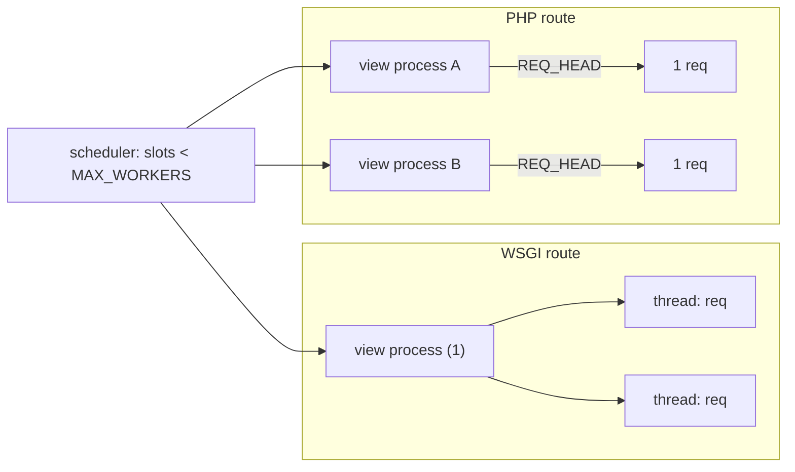
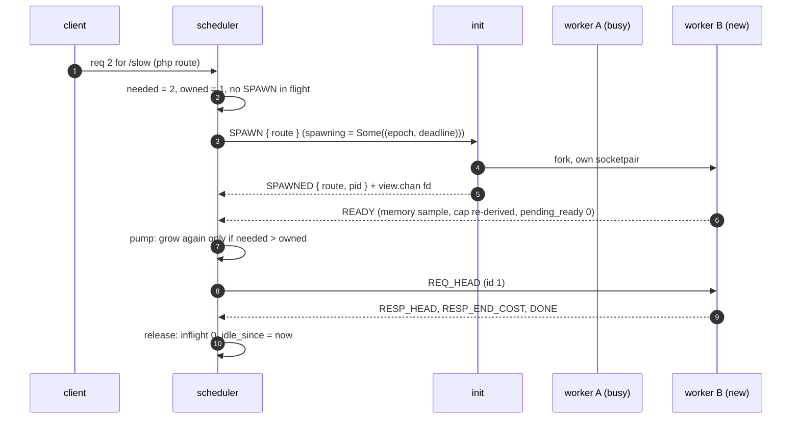

# Parallel views: a per-route view-process pool with `per_process_cap` (ADR-0015)

The accepted DX (`docs/design/parallel-views.review-dx.md`,
`docs/design/parallel-views.review-ai-ergonomics.md`, both `VERDICT: PASS`) says one PHP
route already serves concurrent requests in separate view processes. It does not: the
scheduler holds **at most one `View` per route** (`crates/blastit-scheduler/src/scheduler.rs:783`,
`can_dispatch` `:2217`, `reserve` `:2440`), so four concurrent 200 ms requests to one
`entrypoint php` route take ~800 ms while the same four to a Python route take ~200 ms.

This design turns that sentence into a data model: a **pool of view processes per route**,
each with its own concurrency ceiling (`per_process_cap`), forked on demand **one at a
time**, bounded by the budget that already exists, and retired by the rules that already
exist. It changes one wire message (`Ctl::Reload` `0x45`, which `ADR-0014` already
reserves), adds no dependency, adds no configuration key, and leaves the Python path
byte-identical in behaviour.

## 1. Developer Experience Target (Local, CI/CD, Deploy)

The design exists to make the sentences MB.24.1 landed true, verbatim, with nothing new to
learn.

**The accepted user-facing text (do not re-litigate).**

- `docs/how-it-works.md`: *"A route serves as many requests at once as the shared
  `BLASTIT_MAX_WORKERS` budget allows. Python threads each request inside its view process;
  PHP runs each concurrent request in its own view process, because NTS `libphp` runs one
  request per process"* (`[settings](reference/settings.md#admission-and-threads)`).
- `docs/frameworks/php/index.md` `## Concurrency`: *"Concurrent requests to one PHP route
  run in parallel in separate view processes, bounded by the shared `BLASTIT_MAX_WORKERS`
  budget … `BLASTIT_VIEW_MAX_WORKERS` caps one process, not the route; there is no daemon
  or socket between Blastit and PHP."*
- `docs/reference/settings.md#admission-and-threads` and
  `#view-process-lifecycle-and-memory` are the cited definitions.

**Local machine — zero `sudo`, zero flags, zero new keys.** Illustrative (the executable
form is the protected suite of §7):

```console
$ uv run blastit dev                     # unchanged: one PHP route, one Blastfile
$ for i in 1 2 3 4; do curl -s -o /dev/null -w '%{time_total}\n' \
      localhost:8080/slow & done; wait   # four 200 ms requests: one wave
```

What changes is the wall clock, not the steps. The developer writes nothing in the
`Blastfile` to turn this on, sets no `BLASTIT_*`, and gets the same `blastit dev` banner,
the same `request` events and the same `:8080`.

**CI/CD.** No new manifest surface means no new thing for `blastit check` to verify: the
four-way completeness contract (`docs/VISION.md`, rule 3) is untouched, and a route that
gains or loses a worker changes no grant, no query and no input rule. The proof of this
feature is a protected test, not a flag a user must remember (§7).

**Deployments.** Three bounds, all pre-existing, none of them a new lever:

1. `BLASTIT_MAX_WORKERS` — the budget a developer tunes, and the one number that gives a
   one-request-per-process route its process count.
2. the memory-derived live-process cap (`BLASTIT_MAX_VIEW_PROCESSES` when set, otherwise
   measured) — the number that makes a burst cost memory in proportion to its size.
3. the uid's `RLIMIT_NPROC` (`view_worker_cap() + VIEW_PROCESS_MARGIN`, already installed at
   `crates/blastit/src/php_view.rs:70-72,643,995`; never raised here) — a resource backstop
   inherited from the deployment, which binds only in a configuration that sets
   `BLASTIT_VIEW_MAX_WORKERS` far below `BLASTIT_MAX_WORKERS`. When it does bind, it costs
   one fork (§4.7), never a request: the siblings keep serving.

A fourth bound lives on the privileged side and is not a knob: `init` refuses a `SPAWN` when a
route already owns `view_worker_cap() + 16` children (§4.5), so the process that holds root or
`CAP_KILL` never forks purely on the scheduler's accounting.

`BLASTIT_VIEW_MAX_WORKERS` keeps exactly the meaning the accepted DX gives it — it caps
**one process**, and it adds no concurrent requests to a route (§4.1 explains why the
process count comes from the budget and not from this number). Production still fails
closed without privileges; nothing here is a mode.

**What must never appear on a user page, in a flag, or in an error message:** a per-route
`pool`/`workers`/`pm.max_children`-shaped knob (`workers` was removed, not deferred —
`ADR-0012` §7), a second PHP transport, a degraded or fallback mode, and any LRU/queue/
`idle_timeout` vocabulary in a *guide* (those are `ARCHITECTURE.md` §2.4/§8 concerns; the
reference page naming its own knobs is not a guide).

**The measured promise** (the epic's, restated so §7 can pin it):

| Scenario (one route, same `Blastfile`, same cap) | Today: one worker per route | After: pool | How it is measured |
|---|---|---|---|
| 4 concurrent 200 ms requests to an `entrypoint php` route | **≥ 800 ms** — the serialized floor of 4 × 200 ms, because the route has one worker whose `max_inflight()` is `1` (`crates/blastit-view/src/php.rs:10-17`) and the scheduler admits one request at a time to it (`scheduler.rs:2231,2445`) | **< 450 ms**, and at least 400 ms below the control | `critical_parallel_views::serialized_then_parallel_php`: a PHP `BLASTIT_MAX_WORKERS=1` control (`>= 800 ms`) and then, on a fresh boot, a four-wide warm-up burst followed by the measured four behind one barrier — clock started before the release, stopped after the fourth body, same four pids, no new `process.spawned` (§7) |
| the same 4 to a WSGI route | already < 450 ms (one process, four threads) | unchanged | same suite, second leg, measured in the same test function as its control |
| 8 concurrent requests, `BLASTIT_MAX_WORKERS=4` | ~1600 ms serialized | 4 distinct pids, all 8 `200`, 600–1000 ms | same suite, third leg |

Three honesty rules for that table. The `>= 800 ms` side is **not** trusted to arithmetic:
`MB.24.4` runs a control leg (`BLASTIT_MAX_WORKERS=1`) on the same host and asserts
`>= 800 ms`, and the parallel leg asserts `parallel <= control - 400 ms` as well as
`< 450 ms`, so deleting the pool cannot pass on a fast machine. The control runs the *new*
code, so it proves the fixture sleeps and the floor is real; the **pre-change** measurement
is recorded once, before the cap is wired, in `plan/nodes/MB/MB.24/MB.24.4/RESULT.md`.

What the 450 ms does **not** cover, stated because a PHP fork is not free: a `libphp` worker
`dlopen`s the library, runs `php_module_startup` and only then sends `READY`
(`crates/blastit/src/php_view.rs:20-29`, `ADR-0010` decision 2), so a *cold* route's first
workers pay a full PHP startup each, and §4.3's `fork → SPAWNED → READY` chain (kept until
the first memory measurement) puts those startups inside a burst. `prefork` alone does not
fix that for a four-wide burst — it warms exactly **one** worker, and the other three would
still start inside the window — so the measurement warms the width it measures:

1. the PHP fixture declares `prefork`, and
2. before `t0` the suite sends one **four-wide warm-up burst**: the same four concurrent
   200 ms requests, asserting four `200`s with their own markers and **four distinct pids**
   (so all four workers exist and are `READY`). That burst's wall time — which includes each
   new worker's `dlopen` + `php_module_startup` — is recorded in `MB.24.4/RESULT.md`, and it
   is *not* part of the 450 ms;
3. the measured leg then asserts the pid set is **unchanged** and `process.spawned` does not
   grow between `t0` and the last body, so the number cannot silently absorb a host's PHP
   startup speed.

A route with neither `prefork` nor warm traffic is slower on its first requests — that is
pre-existing cold-start behaviour, and `prefork` remains its lever; this pool does not pretend
to remove it.

**Documentation deltas this design owes (follow-ups; outside this node's paths).**

- `docs/reference/settings.md:68` still says "live request **threads**", and `:69` should
  read *"sizes one view process; it adds no concurrent requests to a route; also sizes its
  `RLIMIT_NPROC`"* (keeping the rlimit fact the page already states).
- `ARCHITECTURE.md` §2.4 (Admission and Lifecycle), §2.6 ("caps per view"), §8 Sizing and
  §8.2 ("per-view thread cap") need the pool sentence — §4.10 lists them.
- `crates/blastit-view/src/php.rs:9-14` still says *"The scheduler forks `1..=workers`"*,
  which becomes true only now and should say "one per concurrent request, up to the
  budget".
- The epic's third bullet and `MB.24.4`'s acceptance 4 should read "retires to **at most**
  the prefork count" (`idle_timeout` retires a preforked worker too — `scheduler.rs:3605-3617`,
  `lifecycle.rs:242`), and `MB.24.4`'s Notes should say "asserts the documented refusal
  without the pair", not "fails without `libphp`" (§7 chooses the assertion).
- `MB.24.3`'s acceptance 5 (`Ctl::Reload`) is satisfied by this design: `MB.24.3` owns the
  variant (§4.6).
- **The epic's line `MB.24:53` still says the pending spawns become "a per-route **count**, not
  one slot".** This design settles on *one slot* (§4.3), and the sentence must be corrected:
  `init` forks sequentially, so a count buys no wall clock, and a count is what let a cold burst
  fork unmeasured heap copies (the security blocker of round 2). `MB.24.3`'s brief should read
  "one `SPAWN` in flight per route, answered by `Spawned { route, pid }`".
- **`MB.24.3` must land before `MB.23.5`, and its `paths` need three files added.**
  `Ctl::Reload` `0x45` needs `crates/blastit-frame/src/frame.rs` (the `TypeCode::Reload`
  variant, `from_code`, `is_ctl`, `name`, the `Frame::decode` arm) and the two hand-written
  round-trip tables in `crates/blastit-frame/src/lib.rs` + `decoder.rs` (`lib.rs:218,233`,
  `decoder.rs:539`). **`MB.24.3` lacks those three; `MB.23.5` lacks them too** (its eleven
  paths are `frame/src/ctl.rs`, `scheduler/src/ctl.rs`, `scheduler.rs`, `supervise.rs`,
  `dev_reload.rs`, `cli.rs`, `child.rs`, `lib.rs` (the `blastit` crate's), `events/src/lib.rs`,
  `tests/critical_dev_reload.rs` and `tests/common/`), so it can never add `TypeCode::Reload`
  either. The variant is added **exactly once, by `MB.24.3`** (the leaf that also widens
  `reload()` over the pools), and **`MB.23.5` is ordered after it** and only sends the message.
  Recorded as a plan request in `RESULT.md`.
- `--test critical_parallel_views` in `PHP_SUITE_ARGS`, and the real-`ulimit` leg in
  `e2e/`, need plan nodes: both files are outside every leaf's `paths` (`Makefile`, `e2e/`).
- **The two index tables** — `docs/decisions/README.md` (`ADR-0015` → `Proposed`, node
  `MB.24.2`) and `docs/design/README.md` (`parallel-views.md` → `In review`, node `MB.24.2`)
  — are owned by `architect`/`doc-writer` and are not in this node's paths; the rows are
  requested, not written here.

All of these are outside this node's paths: the leaf-path and `MB.24.3`-brief amendments are
plan requests, and the rest are documentation follow-ups — recorded in `RESULT.md`, not
smuggled in.

## 2. Goals & Non-Goals

**Goals.**

1. A route may hold **several** view processes, each with its own concurrency ceiling.
2. The ceiling is **data**: `per_process_cap` (and whether the route may pool at all),
   written once by the composition root from the provider the boot admitted (`ADR-0009`),
   never a runtime branch in the scheduler.
3. Extra workers are forked **on demand** — only for requests that exist and cannot be
   served — one at a time until the memory cap has been measured, so the cap is re-derived
   between forks.
4. Excess idle workers retire on `BLASTIT_VIEW_IDLE_TIMEOUT`; `BLASTIT_VIEW_MAX_REQUESTS`
   recycling, the derived process cap, memory-pressure eviction, `stuck_threads`, drain and
   a reload keep working, per process.
5. Python's shape does not move: one process per route, `per_process_cap =
   view_worker_cap()`, a pool that never exceeds one process.
6. Everything an implementer needs is here: exact functions, exact new shapes, exact tests.

**Non-Goals.**

- No threading of one NTS `libphp` process (the Zend `EG`/`CG`/`SG` globals are
  process-wide; two threads corrupt them).
- No user-facing knob, no new `BLASTIT_*`, no new `Blastfile` directive.
- No new spawn identity: `SPAWN`/`SPAWNED` payloads are untouched. The one wire addition is
  `Ctl::Reload` (`0x45`, empty payload), which `ADR-0014` decision 3 already reserves and
  `MB.24.3` owns (§4.6).
- No change to ingress, routing, proxies, events, manifest or `check` semantics.
- No change to prefork's warmth semantics (§4.7, "prefork warms one worker").
- No new dependency: `Cargo.toml` and `Cargo.lock` stay byte-identical.
- Not this node: any Rust. `MB.24.3` builds the scheduler, the wire variant and the
  supervisor; `MB.24.4` wires `entrypoint php` and proves the wall clock.

## 3. Requirements (R1..R15)

Each is testable and §7 names its witness.

- **R1** `RouteInfo` carries `per_process_cap` and whether the route may pool; a route's
  live workers each admit up to that many concurrent requests. The scheduler reads both as
  boot data and never asks what runtime a route is.
- **R2** Instance selection is **least-recently-used among the workers that admit a request**
  (ready, below cap, not stopping, not stale, not exited, channel open), tie-broken by
  ascending pid (§4.2).
- **R3** When requests exist that no worker of the route can take, the scheduler sends
  `Ctl::Spawn { route }` for them: **one `SPAWN` in flight per route**, and never more
  processes than those requests need (§4.3).
- **R4** A `Spawned { route, pid }` answers the route's outstanding `SPAWN` and creates the
  `(route, pid)` worker; a `SPAWNED` with no outstanding spawn for its route is retired
  (existing behaviour); a `SPAWNED` naming a pid the pool already holds retires the newcomer
  and drops the dead entry. A `SPAWN` init cannot honour (refused or failed fork) is
  answered with `Ctl::Exited { pid: 0 }`, which frees the slot and costs one backoff.
- **R5** The derived view-process cap counts **live processes** — workers plus the in-flight
  spawn, across all routes — not routes.
- **R6** No route can stop another route from getting a process: a route that has requests
  and *no* worker at all is served first (§4.4).
- **R7** The supervisor keys children by pid with the route inside the record
  (`ViewChild { route, uid }`), answers `Exited` with that record's own route, refuses a
  `Retire` whose pid is not a live child of that route, and keeps its own per-route fork
  bound.
- **R8** A reload retires every worker of every route that is idle or not yet `READY`, marks
  in-flight workers stale so nothing new reaches them, retires them at `DONE`, and retires on
  arrival a worker whose `SPAWN` predates the reload (§4.6).
- **R9** A failed or refused spawn backs off **its route's growth only**; every existing
  worker keeps serving, and no sibling is retired, failed or marked stopping because a fork
  failed. A failed view fork is never fatal to init (§4.7).
- **R10** Python is untouched: `per_process_cap = view_worker_cap()`, one process per route,
  whatever `BLASTIT_VIEW_MAX_WORKERS` is set to.
- **R11** PHP: `per_process_cap = 1`; a second concurrent request forks a second process and
  no code path can thread one process.
- **R12** The wall-clock promise of §1 holds, with the serialized control leg measured in
  the same function and the concurrency precondition.
- **R13** A burst pool shrinks on `idle_timeout`, and the pool never exceeds the cap that
  makes `RLIMIT_NPROC` sufficient in the shipped default; where the deployment's rlimit binds
  first, the excess fork is refused gracefully (R9), never fatally.
- **R14** Every existing lifecycle rule survives per process: `max_requests` recycling,
  memory-watermark eviction, LRU cap eviction, `stuck_threads`, queue timeout, drain, and the
  `--learn` single fallback slot.
- **R15** A frame from a retired `(route, pid)` can never answer a live request, and siblings
  can never answer each other's requests (`ViewKey { route, pid }` stays the only key, and
  `view_out` keeps its key check).

## 4. Architecture & Data Flow

### 4.1 The data model

`views: HashMap<usize, View>` (`scheduler.rs:783`) becomes a pool per route:

```rust
/// Every worker of one route: the processes the scheduler dispatches into.
///
/// The entry exists only while the route has a worker or a SPAWN in flight
/// (`forget_if_idle`, §4.7).
#[derive(Debug, Default)]
struct ViewSet {
    /// One entry per worker init reported, by the pid it gave.
    views: BTreeMap<u32, View>,
    /// The route's one outstanding SPAWN: the `reload_epoch` it was sent in, and
    /// when it stops being believable (§4.3's `expire_spawns`).
    spawning: Option<(u64, Instant)>,
    /// Workers forked but not yet `READY`: they already hold a heap copy.
    pending_ready: u32,
}

impl ViewSet {
    /// Workers plus the fork already promised; a `SPAWNED` worker is already in
    /// `views`, so nothing is counted twice.
    fn len(&self) -> u32 {
        u32::try_from(self.views.len())
            .unwrap_or(u32::MAX)
            .saturating_add(u32::from(self.spawning.is_some()))
    }

    fn is_empty(&self) -> bool {
        self.views.is_empty() && self.spawning.is_none()
    }
}

struct View {
    key: ViewKey,                 // unchanged: { route, pid } (scheduler.rs:239)
    ready: bool,
    /// `BLASTIT_VIEW_MAX_REQUESTS` reached: dispatch nothing more to it.
    stopping: bool,
    /// Requests alive in this process (one thread each for WSGI, one for PHP).
    inflight: u32,
    sent: u64,
    next_request_id: u32,
    idle_since: Option<Instant>,
    last_used: u64,
    out: Option<Outbound>,
    exited: Option<Instant>,
    /// A reload arrived while it was busy: retire it at `DONE` (§4.6).
    stale: Option<RetireReason>,
    /// The `reload_epoch` current when its SPAWN was sent (§4.6).
    spawned_epoch: u64,
}
```

**One field and one associated function are removed**: `View::spawning: bool` and
`View::spawning(route)` (scheduler.rs:297), whose placeholder carried `pid: 0`. The pool
owns both facts now, so a `ViewKey` can no longer name a process that does not exist;
`oldest_idle_view`'s `key.pid != 0` and `evictable_view`'s `!view.spawning` filters
disappear with the states they excluded.

`Scheduler` gains `pools: HashMap<usize, ViewSet>` (replacing `views`) and
`reload_epoch: u64`. Everything else — `dispatch: HashMap<(ViewKey, u32), u32>`, `slots`,
`queue`, `backoff`, `lru`, `draining`, the cap derivation, the memory sample — is unchanged
and remains keyed by `ViewKey` or by route as it today.

Both concurrency facts are boot data on the route:

```rust
// crates/blastit-scheduler/src/route.rs
pub struct RouteInfo {
    pub name: String,
    pub prefork: bool,
    pub uid: u32,
    pub ingress: Option<IngressPolicy>,
    /// Requests one process of this route runs at once; `None` means
    /// `BLASTIT_VIEW_MAX_WORKERS` (or the global budget when unset).
    pub per_process_cap: Option<u32>,
    /// Whether this route may own more than one view process — a
    /// request-per-process provider. `false` is the threaded shape: one
    /// process, however many requests it runs at once.
    pub process_pool: bool,
}
```

`RouteInfo::new` keeps its three arguments (`per_process_cap: None`, `process_pool: false`)
and gains two builders, `with_per_process_cap(u32)` and `with_process_pool(bool)`. The three
numbers the scheduler derives:

```rust
/// The per-process request ceiling in force for `route`: boot data, never a
/// runtime question.
fn per_process_cap(&self, route: usize) -> u32 {
    let ceiling = self.cfg.view_worker_cap().max(1);
    self.routes
        .get(route)
        .and_then(|info| info.per_process_cap)
        .map_or(ceiling, |cap| cap.clamp(1, ceiling))
}

/// How many processes `route` may own.
///
/// A pooled (request-per-process) route may own as many as the budget, which is
/// what the accepted DX promises a route; a threaded route owns exactly one,
/// because a second copy of the preloaded heap would buy no concurrency its
/// threads do not already give. Boot data, never inferred from a value: with
/// `BLASTIT_VIEW_MAX_WORKERS=1` a threaded route still owns one process.
fn process_limit(&self, route: usize) -> u32 {
    if self.process_pool(route) {
        self.cfg.max_workers.max(1)
    } else {
        1
    }
}

/// The processes `route`'s requests need at its per-process ceiling.
fn needed_processes(&self, route: usize) -> u32 {
    self.route_requests(route).div_ceil(self.per_process_cap(route))
}

/// Requests the route has now: in flight plus waiting in the admission queue.
fn route_requests(&self, route: usize) -> u32 {
    let inflight = self.pools.get(&route).map_or(0u32, |pool| {
        pool.views
            .values()
            .map(|view| view.inflight)
            .fold(0u32, u32::saturating_add)
    });
    inflight.saturating_add(u32::try_from(self.queued_for(route)).unwrap_or(u32::MAX))
}

/// How many requests are waiting in the admission queue for `route`.
fn queued_for(&self, route: usize) -> usize {
    self.queued_for_streams(route).count()
}

/// The admission-queue stream ids routed to `route`.
///
/// `Admission::routes()` is empty for the FIFO queue (`:445-452`), so this reads
/// the routes off the requests — the same walk `route_waiting` (`:3484-3494`)
/// uses, which is why it works for both queue modes.
fn queued_for_streams(&self, route: usize) -> impl Iterator<Item = u32> + '_ {
    self.queue.ids().into_iter().filter(move |stream_id| {
        self.requests
            .get(stream_id)
            .and_then(|request| request.route)
            == Some(route)
    })
}
```

`process_pool(route)` is `self.routes.get(route).is_some_and(|info| info.process_pool)`.

The composition root is the authority: `MB.24.4` writes `per_process_cap = Some(1)` and
`process_pool = true` for every route whose `boot_bindings` slot is bound to PHP (i.e. the
slot that `spawn_now` forks as `libphp` — `supervise.rs:584-600`), and leaves every other
route at the threaded defaults. That is the whole of "the difference is data": one table,
no branch in the scheduler.

**The equivalence this buys**, with the shipped defaults (`VIEW_MAX_WORKERS = MAX_WORKERS`):

| | WSGI route | `entrypoint php` route |
|---|---|---|
| provider `max_inflight()` | `view_worker_cap()` | `1` |
| `per_process_cap` | `view_worker_cap()` | `1` |
| `process_limit()` | 1 | `BLASTIT_MAX_WORKERS` |
| processes at 4 concurrent requests (defaults) | 1 | 4 |
| requests in flight per process | ≤ `VIEW_MAX_WORKERS` | 1 |
| requests in flight per route | ≤ `VIEW_MAX_WORKERS` (its one process) | ≤ `BLASTIT_MAX_WORKERS` |

With `BLASTIT_VIEW_MAX_WORKERS` set below `BLASTIT_MAX_WORKERS`, a PHP route may run more
concurrent requests than a WSGI one can. That is the two knobs' documented meaning applied
consistently (`VIEW_MAX_WORKERS` caps one process; `MAX_WORKERS` is the budget), not a
privilege for PHP. Two consequences are stated rather than hidden: the process count must
not be derived from `VIEW_MAX_WORKERS` (that would make it a route lever, which
`docs/frameworks/php/index.md:63-64` denies), and in that configuration the *uid's*
`RLIMIT_NPROC` (`VIEW_MAX_WORKERS + 16`) may bind before the budget — §1 lists it as the
third, deployment-owned bound, and §4.7 makes the refused fork harmless.

### 4.2 D1 — which instance a request goes to

**Settled: the least-recently-used worker that is ready, below its cap, not stopping, not
stale, not exited and whose channel is open; ties by ascending pid.**

Reason: (a) a request must never queue behind a busy sibling while an idle one exists, and
LRU is exactly "use what has been idle longest"; (b) `last_used` is already the pool's
ordering for eviction (`evictable_view`, `oldest_idle_view`), so selecting by the same key
keeps one notion of recency in the scheduler instead of two; (c) spreading rather than
packing keeps every worker's `last_used` fresh, so LRU eviction keeps picking genuinely
cold processes; (d) ties are real, not hypothetical — a cold pool's workers all carry
`last_used: 0` — so the pid is part of the key (`(last_used, pid)`), and a test can name one
exact winner.

```rust
impl View {
    /// Whether this worker may take a request now (the old `can_dispatch` body).
    fn admits(&self, per_process_cap: u32) -> bool {
        self.ready
            && !self.stopping
            && self.stale.is_none()
            && self.exited.is_none()
            && self.inflight < per_process_cap
            && self.out.as_ref().is_some_and(Outbound::is_open)
    }
}

/// Takes a worker slot and a request id for `stream_id`, from the LRU worker
/// of its route that admits one.
fn reserve(&mut self, stream_id: u32) -> Option<(ViewKey, u32, Outbound)> {
    let route = self.requests.get(&stream_id)?.route?;
    let cap = self.per_process_cap(route);
    let last_used = self.lru;
    let pool = self.pools.get_mut(&route)?;
    let pid = pool
        .views
        .values()
        .filter(|view| view.admits(cap))
        .min_by_key(|view| (view.last_used, view.key.pid))
        .map(|view| view.key.pid)?;
    let view = pool.views.get_mut(&pid)?;
    let out = view.out.clone()?;
    let id = view.allocate_request_id();
    view.inflight += 1;
    view.sent += 1;
    view.idle_since = None;
    view.last_used = last_used;
    if self.cfg.max_requests > 0 && view.sent >= self.cfg.max_requests {
        view.stopping = true;
    }
    self.lru = last_used.wrapping_add(1);
    Some((view.key, id, out))
}
```

`admits` is a method on `View` taking only the cap, so the filter borrows nothing from
`Scheduler` and the `get_mut` above compiles. `can_dispatch(route)` becomes
`self.slots < self.cfg.max_workers && self.has_dispatchable(route)`, where
`has_dispatchable` is a free `fn` over `(&self.pools, self.routes, self.cfg, route)` so both
callers can hold it.

### 4.3 D2 — how many `SPAWN`s are in flight, and how `Spawned` is matched

**Settled: exactly one `SPAWN` in flight per route; `ViewSet::spawning` holds its epoch
and its deadline; `Spawned { route, pid }` answers it. No spawn id on the wire. `MB.24.3`
owns any change here.**

Four reasons, in order of weight:

1. **Parallel `SPAWN`s buy nothing.** `init` is one single-threaded supervisor: it reads
   `SPAWN`s in order and forks each one before reading the next (`supervise.rs:539-572`), so
   N `SPAWN`s in one wakeup are N *sequential* forks. Chaining them through the scheduler
   costs the same wall clock and dispatches request 1 as soon as worker 1 is ready.
2. **The memory cap must be measured between forks.** `measure_view_memory` samples at every
   `READY` and re-derives the cap (`scheduler.rs:3307-3337`), and the cap's starting divisor
   is the 32 MiB estimate that `ARCHITECTURE.md` §8 says is ~4× below the real per-view cost.
   A cold route that forked all its workers before the first sample would therefore copy
   several heaps the cap never had a chance to refuse. So until the first real measurement
   exists, growth also waits for `pending_ready == 0`: **fork → `SPAWNED` → `READY` → fork**,
   which is what makes "the cap is re-derived between two forks" true rather than aspirational.
   After the first measurement the slot is the only gate (fork → `SPAWNED` → fork), because
   the cap is then honest and the wall clock matters more.
3. **A spawn needs no identity to be useful.** What the scheduler needs from a `SPAWNED` is
   (a) that its request for that route was answered and (b) the pid, which *is* the identity
   from then on. Two workers of one route are interchangeable by construction: same uid, same
   runtime, same grant set, same scratch directory, each with its **own** `view.chan`
   socketpair. A spawn id would add a field to a fixed-width payload for state nobody reads.
   `Ctl::Spawn`/`Spawned` therefore stay `0x40`/`0x41` with `u32 route` and
   `u32 route, u32 pid`.
4. **A `SPAWN` must always be answered.** A fork that is refused (`EAGAIN`, `ENOMEM`,
   `EMFILE`) or that dies before `SPAWNED` cannot leave the slot occupied forever, so `init`
   answers it with `Ctl::Exited { route, pid: 0, status: Code(1) }` (documented in `ctl.rs` as
   "no process exists for that SPAWN"), and the scheduler below also bounds a slot that is
   never answered at all.

```rust
/// Forks one more worker for `route` until it has `wanted` processes.
///
/// Callers: a queued request's route (`wanted = needed_processes`), or `start()`
/// for a preforked/eager route (`wanted = 1`). One call, at most one SPAWN.
fn grow(&mut self, route: usize, wanted: u32) -> Result<(), SchedulerError> {
    if self.draining || !self.spawnable(route) {
        return Ok(());
    }
    let pool = self.pools.get(&route);
    if pool.is_some_and(|pool| pool.spawning.is_some()) {
        return Ok(());                       // one SPAWN in flight (D2 reason 1)
    }
    if self.measured_view_mem.is_none()
        && self.cfg.max_view_processes.is_none()
        && pool.is_some_and(|pool| pool.pending_ready > 0)
    {
        // Wait for the sample (D2 reason 2) unless the operator has pinned the
        // cap: with `BLASTIT_MAX_VIEW_PROCESSES` set there is nothing to
        // measure, so the gate would only serialise forks forever.
        return Ok(());
    }
    let owned = pool.map_or(0, ViewSet::len);   // workers + the promise
    if owned >= wanted {
        return Ok(());                       // never a fork no request needs
    }
    if owned >= self.process_limit(route) {
        return Ok(());
    }
    if let Some(until) = self.backoff.get(&route).copied()
        && Instant::now() < until
    {
        return Ok(());                       // R9: growth only
    }
    if self.other_route_starved(route) {
        return Ok(());                       // R6
    }
    if !self.make_room(route)? {
        return Ok(());
    }
    if let Some(cap) = self.view_cap()
        && self.live_processes() >= cap
    {
        return Ok(());
    }
    let epoch = self.reload_epoch;
    let route_id = u32::try_from(route).unwrap_or(u32::MAX);
    self.pools.entry(route).or_default().spawning =
        Some((epoch, Instant::now() + self.cfg.request_timeout));
    if let Err(error) = self.ctl_push(Ctl::Spawn { route: route_id }) {
        if let Some(pool) = self.pools.get_mut(&route) {
            pool.spawning = None;
        }
        return Err(error);
    }
    Ok(())
}
```

The complete list of bounds on a route's process count is therefore: its own need
(`needed_processes`), `process_limit`, the memory cap (`live_processes`), `make_room`'s
eviction rule, `spawn_backoff`, the one-in-flight slot, and the starvation rule of §4.4.
`slots` is *not* one of them (it bounds requests in flight; a worker with nothing to do is
what `wanted` prevents).

**The growth predicate at each call site** — the old guard's meaning with "no live view"
replaced by "no worker that admits", and the need computed from the requests:

```rust
// was: if !self.views.contains_key(&route) && !self.draining { self.try_spawn(route)?; }
if !self.draining && !self.has_dispatchable(route) {
    self.grow(route, self.needed_processes(route))?;
}
// `pump_learn_fallback` (`:1816`) is the one caller that passes `1` instead:
// its request waits in `learn_fallback_queue`, not in `queue`, so
// `needed_processes` would be 0 and the single fallback slot would never get a
// process.
```

That replaces the call sites at `scheduler.rs:1816` (`--learn` fallback, whose single slot and
its `:1801-1812` "nothing to run the request through" branch are unchanged), `:2285` (FIFO
walk) and `:2325` (fair walk) — in all three, the `!self.views.contains_key(&route)` guard
becomes `!self.has_dispatchable(route)`, and nothing else on those lines moves. `start()`
(`:913`) calls `grow(route, 1)` per preforked/eager route.

`Spawned` handling:

```rust
fn view_spawned(&mut self, route: usize, pid: u32, fd: Option<OwnedFd>) -> Result<(), SchedulerError> {
    self.derive_view_cap(true);                       // §8 Sizing, unchanged
    let Some(fd) = fd else {
        return Err(SchedulerError::protocol(
            "SPAWNED arrived without a view.chan descriptor",
        ));
    };
    let slot = self.pools.get_mut(&route).and_then(|pool| pool.spawning.take());
    let Some((sent_epoch, _deadline)) = slot else {
        // Nothing waits for this process; close our end and have init reap it.
        drop(fd);
        self.dropped += 1;
        return self.retire_unheld(ViewKey { route, pid },
            RetireReason::Other("unexpected_spawn".to_string()));
    };
    let key = ViewKey { route, pid };
    // The check is a `bool` so the pool borrow ends before the retirement below:
    // a cheap transcriber must not have to reason about `&mut` liveness in a
    // branch that returns.
    let duplicate = self
        .pools
        .get(&route)
        .is_some_and(|pool| pool.views.contains_key(&pid));
    if duplicate {
        // The kernel does not hand a live child's pid to a second child, so the
        // entry the pool holds was already gone and its `Exited` was lost. Two
        // processes must never share one `ViewKey`: retire the pid (which kills
        // the *newcomer* that now owns it, and fails the dead entry's requests,
        // drops its queue and emits its event through the one path that does
        // all four), then close our end of the newcomer's channel.
        self.dropped += 1;
        drop(fd);
        return self.retire(key, RetireReason::Other("duplicate_pid".to_string()));
    }
    // ... the unchanged socketpair plumbing: nonblocking, read_frames, write_peer
    let pool = self.pools.entry(route).or_default();
    pool.views.insert(pid, View {
        key, ready: false, stopping: false, inflight: 0, sent: 0,
        next_request_id: 0, idle_since: None, last_used: 0,
        out: Some(out), exited: None, stale: None, spawned_epoch: sent_epoch,
    });
    pool.pending_ready = pool.pending_ready.saturating_add(1);
    if sent_epoch < self.reload_epoch {
        // A worker forked for a SPAWN sent before the last reload is stale from
        // birth: retire it now rather than let it serve old code (§4.6).
        self.retire(key, RetireReason::Other(RELOAD.to_string()))?;
    }
    Ok(())
}

/// Kills a pid the pool does not hold. `retire` cannot: it is a no-op for a key
/// with no live `View`, and this process must be killed or it keeps its route
/// uid and socket directory (today's `:3567-3577`). No `process.retired` event
/// is emitted here: the decision was not about a worker the scheduler owns, and
/// the `Exited` that follows is the event (today's code emits none either).
fn retire_unheld(&mut self, key: ViewKey, reason: RetireReason) -> Result<(), SchedulerError> {
    let live = self
        .pools
        .get(&key.route)
        .and_then(|pool| pool.views.get(&key.pid))
        .is_some_and(|view| view.key == key);
    if live {
        return self.retire(key, reason);          // it was live after all
    }
    self.ctl_push(Ctl::Retire {
        route: u32::try_from(key.route).unwrap_or(u32::MAX),
        pid: key.pid,
        reason: reason.as_str().to_string(),
    })
}
```

`view_ready`, `view_exited`, `release`, `expire_exited_views`, `next_deadline`,
`retire_finished_views`, `oldest_idle_view` and `evictable_view` keep their bodies and change
only their lookup — from `self.views.get(&key.route).filter(|v| v.key == key)` to
`self.pools.get(&key.route).and_then(|p| p.views.get(&key.pid)).filter(|v| v.key == key)`,
and from iterating `self.views.values()` to iterating the pools' values. `view_out`
(`:2465-2470`) is in that list and **keeps its `view.key == key` filter** — it is the one
lookup every `view_push`/`view_push_raw` goes through, and without the filter a frame would
reach whichever worker shares the route.

`view_ready` gains three lines: it decrements `pending_ready`, marks the view usable **unless**
its spawn predates the last reload (then it retires it), and lets `measure_view_memory` run
(`:3605-3624`, unchanged otherwise). `view_gone` gains §4.7's split and decrements
`pending_ready` when the worker it removes never became `READY`. The decrement happens exactly
once per worker: either at `READY`, or on the one removal that finds it still in `views`
(`retire`, or `view_gone`'s own removal — whichever runs first, because the other then returns
early for a key it no longer holds). `view_exited` itself removes nothing; it defers to
`ViewIn::Closed` as today.

### 4.4 D3 — what the derived cap counts, and how a route cannot starve the others

**Settled: the memory-derived cap counts live view processes — workers plus the in-flight
spawn — across every route. A route cannot starve another because (i) no route owns a worker
no request needs, (ii) a route that has requests and no worker at all is served before any
route grows, (iii) eviction only ever takes another route's idle worker, and (iv) a burst's
extras retire on `idle_timeout`.**

Reason for "processes": the cap exists to bound heap copies (`ARCHITECTURE.md` §8 Sizing),
and a copy is per process. Counting routes would let one route multiply the thing the number
was derived to bound.

```rust
/// The live view processes: every worker init reported, plus the fork each route
/// has already been promised.
fn live_processes(&self) -> u32 {
    self.pools.values().map(ViewSet::len).fold(0u32, u32::saturating_add)
}
```

That replaces `self.views.len() as u32` in `make_room`'s `cap_full` (`:3442`) and in `grow`'s
post-`make_room` guard (formerly `:3413`). `ready_view_count` (`:3340`) stays the denominator
of `measure_view_memory`, which is correct in the safe direction: a worker forked but not yet
`READY` is not counted, so the rise it caused is attributed to the next sample and the
per-view cost is *over*-estimated — the cap lands lower than it could, never higher.

Reason for each anti-starvation rule:

- **(i) need.** `wanted = needed_processes(route)` (§4.3), so a route owns no worker its
  requests do not need, and a burst is charged to the memory cap one fork at a time.
- **(ii) first process first.** A route that has requests and **no worker at all** is
  starved; anything with a worker is not:

  ```rust
  /// Every route with at least one request in the admission queue.
  ///
  /// `queue.routes()` is empty for the FIFO queue (`scheduler.rs:445-452`), so
  /// this reads the routes off the requests — the walk `route_waiting` uses.
  fn queued_routes(&self) -> Vec<usize> {
      let mut routes: Vec<usize> = self
          .queue
          .ids()
          .into_iter()
          .filter_map(|stream_id| self.requests.get(&stream_id).and_then(|r| r.route))
          .collect();
      routes.sort_unstable();
      routes.dedup();
      routes
  }

  /// Whether some other route has requests and no process at all.
  ///
  /// Deliberately narrow: a route that already owns a worker (busy or not) can
  /// serve from it, so it never holds up another route's growth — otherwise two
  /// busy routes would freeze each other. A route already being forked or one in
  /// backoff is excluded too: nothing this route refuses to do would help it.
  fn other_route_starved(&self, route: usize) -> bool {
      self.queued_routes().into_iter().any(|other| {
          // `other < route` is the tie-break that keeps two cold routes from
          // deferring to each other for ever: within one pump the walk calls
          // `grow` for each in turn, and the lowest-indexed cold route forks
          // first (it defers to nobody), which ends every other route's
          // deferral on the next iteration.
          other < route
              && self.pools.get(&other).is_none_or(ViewSet::is_empty)
              && !self.backoff.contains_key(&other)
      })
  }
  ```

  The effect is the one developers expect from a shared budget: **a route always gets its
  first process before any route gets another**, and a route that is already serving keeps
  growing in the holes. No static split of the budget exists, because a busy route should be
  able to use an idle budget (that is exactly what a Python route does with threads today).
- **(iii) eviction never takes the asking route's worker** — the existing `evictable_view`
  filter `view.key.route != route`, and its `!route_waiting(view.key.route)` arm, unchanged
  in a pool: a candidate is another route's idle worker whose own route has nothing queued.
- **(iv)** `retire_finished_views` still retires every idle worker past
  `BLASTIT_VIEW_IDLE_TIMEOUT`, so a burst's footprint is not permanent.

The LRU/memory eviction order is now over processes rather than routes, which is the point:
`oldest_idle_view` picks the coldest *process*, so a route with three idle workers gives one
back before a route with one busy worker is considered at all.

### 4.5 D4 — the supervisor keys children by `(route, pid)`

**Settled: `ChildTable` (a pid-keyed map of `ViewChild { route, uid }`) is the single
authority for "which route owns this pid"; `Exited` is answered from the recorded child's own
route, `Retire` is refused unless that child's route matches, and the table carries init's
own per-route fork bound. `route_pids: HashMap<usize, i32>` and
`pending_spawns: BTreeSet<usize>` are deleted.**

Reason: both deleted fields exist only to enforce "one pid per route", and each is a second
source of truth for a fact `ViewChild` already carries. `route_pids` had four uses, all of
them that invariant: `spawn`'s "already has a child → hold the SPAWN" (`:544`),
`record_view`'s insert (`:688`), `reap_children`'s remove (`:783`), and
`service_pending_spawns`'s check (`:718`). Its own comment gives the reason the invariant
existed — *"two processes for one uid would share a socket directory and a `view.chan` the
scheduler only has one end for"* — and both halves die here: the two processes each get their
**own** `view.chan` from their own `socketpair_stream()`, and sharing
`/run/blastit/views/<uid>` is what a pool *is* (the directory is `HOME`/`TMPDIR`/`chdir`;
no Blastit-owned name is created in it by a worker). A held SPAWN is now strictly worse than
a chain: it serialises worker creation behind a reap, and the scheduler's one in-flight slot
would stay occupied with nothing to answer it.

What does **not** die with `route_pids` is the bound it put on the privileged side. `init` is
the process holding root or `CAP_KILL`, and it must not fork purely on a less-privileged
component's word, so the table answers a new question:

```rust
// crates/blastit/src/supervise.rs
/// Every supervised view child, by pid. Its `route` is the one init forked it
/// for, and the only route it may be retired or reported as.
#[derive(Debug, Default)]
struct ChildTable {
    by_pid: HashMap<i32, ViewChild>,
}

impl ChildTable {
    fn insert(&mut self, pid: i32, child: ViewChild);
    fn remove(&mut self, pid: i32) -> Option<ViewChild>;
    fn route_of(&self, pid: i32) -> Option<usize>;
    fn count_for(&self, route: usize) -> u32;
    /// The `(route, pid)` check `Retire` makes: only a pid this boot forked for
    /// *that* route may be signalled.
    fn may_retire(&self, route: usize, pid: i32) -> bool;
    fn pids(&self) -> impl Iterator<Item = i32> + '_;
    fn is_empty(&self) -> bool;
}
```

`Supervisor.views` becomes `children: ChildTable`; `record_view` inserts
`ViewChild { route: index, uid: info.uid }`; `reap_children` calls `remove` and
`view_exit(view, pid, status)` answers `Ctl::Exited { route: view.route as u32, pid, status }`
with the child's own route; `retire` asks `may_retire` and otherwise emits the same
`manifest.warning` and sends no signal; `signal_all`, `kill_all` and `progress_shutdown`
read `children.pids()` / `children.is_empty()`. `service_pending_spawns` disappears with its
call site in `reap_children`.

`spawn` gains one refusal, replacing the bound `route_pids` used to give:

```rust
// crates/blastit/src/supervise.rs
/// How many extra processes a view's uid may have beyond its workers (§7.2:
/// gVisor leaves out the main thread, so one unit of margin). `php_view`'s
/// private twin is the same number and the same sentence; unifying the two
/// constants is a follow-up, because that module is `php`-gated and private.
const VIEW_PROCESS_MARGIN: u32 = 16;

fn spawn(&mut self, py: Python<'_>, route: u32) {
    let index = route as usize;
    let Some(info) = self.routes.get(index).cloned() else {
        self.fail(&format!("ctl.chan: SPAWN for unknown route {route}"));
    };
    // init's own ceiling: the scheduler never legitimately asks for more, and
    // `RLIMIT_NPROC` is absent under `blastit dev`, so the privileged side keeps
    // a bound of its own rather than forking on the scheduler's accounting.
    let ceiling = self.cfg.view_worker_cap().saturating_add(VIEW_PROCESS_MARGIN);
    if self.children.count_for(index) >= ceiling {
        self.emitter.emit(&Event::now(
            Component::Init,
            EventKind::ManifestWarning(ManifestWarning::new(format!(
                "SPAWN for route {route} refused: {ceiling} processes already live for it"
            ))),
        ));
        self.send_spawn_refused(route);
        return;
    }
    self.spawn_now(py, index, &info);
}
```

### 4.6 D5 — reload with a pool

**Settled: one reload is one transaction over every pool: every worker that is idle or not
yet `READY` is retired; every worker with work in flight is marked stale (nothing new reaches
it) and retires at `DONE`; a worker whose `SPAWN` predates the reload is retired on arrival.
`MB.24.3` owns the `Ctl::Reload` message itself.**

Reason: MB.23's contract is "every view together, in-flight requests finish" (`ADR-0014`
decision 3, `docs/design/dev-fanotify-reload.md` §4.6). A pool must not weaken it into "the
workers I happened to notice": a save must not leave one worker of a route serving the old
code beside a fresh one — the exact failure `ADR-0014` rejected a per-route dependency map
over. A worker that is `SPAWNED` but not yet `READY` is included for the same reason: it holds
the old code, and waiting for its `READY` to notice would leave exactly one stale server per
route.

```rust
/// `reload`: retire every idle (or not-yet-ready) worker of every route, mark
/// the busy ones stale, and make the route's in-flight SPAWN stale by epoch.
fn reload(&mut self) -> Result<(), SchedulerError> {
    self.reload_epoch = self.reload_epoch.wrapping_add(1);
    let keys: Vec<(ViewKey, bool)> = self
        .pools
        .values()
        .flat_map(|pool| pool.views.values())
        .filter(|view| view.stale.is_none())
        .map(|view| (view.key, view.ready && view.inflight > 0))
        .collect();
    for (key, busy) in keys {
        if !busy {
            self.retire(key, RetireReason::Other(RELOAD.to_string()))?;
        } else if let Some(view) = self.view_mut(key) {
            view.stale = Some(RetireReason::Other(RELOAD.to_string()));
        }
    }
    Ok(())
}
```

`admits` already requires `stale.is_none()`, so a busy stale worker takes no new request.
`retire_finished_views` (`:3141`) gains the arm it has for `stopping`: a ready, empty, stale
worker retires with its stored reason. `view_ready` retires a worker whose `spawned_epoch` is
older than `reload_epoch` instead of marking it usable. `retire` never backs a route off for a
reload (only `MemoryPressure` does — §4.7), so queued requests stay queued and the next pump's
`grow` forks a fresh worker. **`retire` also decrements `pending_ready` when the worker it
removes was not `READY`** — the reload sweep, the stale-at-birth retirement and
`view_gone`'s early return all remove such workers, and a `pending_ready` that is never
released would stall the route's growth until the process limit, because a `SPAWNED` that no
longer has an entry still counts as an unmeasured heap copy (§4.3).

**Ownership.** `Ctl::Reload` (`0x45`, empty payload) is already reserved by `ADR-0014`
decision 3, and `MB.24.3` adds it: the variant, `type_code`/`code`, encode/decode and the
payload table in `crates/blastit-frame/src/ctl.rs`; the `TypeCode::Reload = 0x45` variant,
`from_code`, `is_ctl`, `name` and the `Frame::decode` arm in `crates/blastit-frame/src/frame.rs`;
the round-trip tables those codes are enumerated in (`crates/blastit-frame/src/{lib.rs,decoder.rs}`);
and the zero-descriptor rule plus the `Ctl::Reload => self.reload()` arm in
`crates/blastit-scheduler/src/{ctl.rs,scheduler.rs}` (`on_ctl`, `:1148`). Because
`crates/blastit-events/**` is **not** in `MB.24.3`'s paths, `MB.24.3` retires with
`RetireReason::Other(RELOAD.to_string())`, which serialises as the reason string `reload`
(`crates/blastit-events/src/lib.rs:329-339`) — the vocabulary MB.23.1 froze — and keeps a
`const RELOAD: &str = "reload";` beside it.

**The order is fixed: `MB.24.3` ships the message, `MB.23.5` then sends it.** MB.23.5's paths
carry `frame/src/ctl.rs`, `scheduler/src/ctl.rs`, `scheduler.rs`, `supervise.rs` and
`events/src/lib.rs` but **not** `frame.rs`, `frame/src/lib.rs` or `frame/src/decoder.rs`, so
`TypeCode::Reload` cannot exist from that leaf at all; since MB.24.3 is also the leaf that
widens `reload()` over the pools, it is the one that adds the variant and its code. MB.23.5
comes after and only sends the message (and may substitute `RetireReason::Reload` for the
string). That keeps `reload()` alive for `-D warnings` and leaves exactly one reload path;
there is no "either order" case to reason about.

### 4.7 D6 — a failing spawn backs off its route, never its siblings

**Settled: `backoff` stays per route and now gates **growth** only. A spawn that is refused or
never reaches `READY` and dies books that route's cool-down, and the route's queued requests
are failed with `502` only when the route has no worker and no spawn left. A failed view fork
is never fatal. The `LruCap` cool-down for a never-served worker is dropped; `MemoryPressure`
stays.**

Reason: today the backoff and the `502` sweep were safe because one process *was* the route —
losing it lost the route. In a pool they would be collateral damage: a fork refused for lack
of memory or processes must not kill the requests three healthy siblings could serve, must not
mark the siblings stopping, and must not take availability from *other* routes. That last
point is the trust argument: a busy or compromised route that drives its own pool into
`EAGAIN`/`ENOMEM` must not be able to exit the whole tree, which today's
`spawn_now → fail()` does (`supervise.rs:558-572`, `:1011-1017`).

The two halves:

```rust
// crates/blastit/src/supervise.rs — a fork that cannot happen answers the SPAWN.
fn spawn_now(&mut self, py: Python<'_>, index: usize, info: &RouteInfo) {
    let child = match self.fork_view(/* … */) {
        Ok(child) => child,
        Err(err) => {
            // Never `fail`: one route's resource exhaustion is not the tree's.
            self.emitter.emit(&Event::now(
                Component::Init,
                EventKind::ManifestWarning(ManifestWarning::new(format!(
                    "forking a view for route {:?}: {err}",
                    info.name
                ))),
            ));
            self.send_spawn_refused(index as u32);
            return;
        }
    };
    self.record_view(index, info, child);
}

/// `SPAWNED` with pid 0 is the one answer that names no process: this SPAWN
/// could not be honoured.
fn send_spawn_refused(&mut self, route: u32) {
    self.send_ctl(&Ctl::Exited {
        route,
        pid: 0,
        status: ExitStatus::Code(1),
    });
}
```

```rust
// crates/blastit-scheduler/src/scheduler.rs — a pid-0 EXITED frees the slot.
fn view_exited(&mut self, key: ViewKey) {
    if key.pid == 0 {
        // No process exists: the SPAWN was refused or its fork failed.
        return self.spawn_failed(key.route);
    }
    /* … the existing Exited-then-Closed ordering, unchanged … */
}

/// A SPAWN that will not be answered: free the slot, cool the route's growth,
/// leave every sibling and every queued request alone.
fn spawn_failed(&mut self, route: usize) {
    let Some(pool) = self.pools.get_mut(&route) else { return };
    if pool.spawning.take().is_none() {
        return;                                   // nothing outstanding: stale message
    }
    self.backoff
        .insert(route, Instant::now() + self.cfg.spawn_backoff);
    // One `manifest.warning` (the event kind `supervise.rs` already emits), naming
    // the route and nothing from any request.
    self.emit_warning(format!("route {route}: the view process could not be started"));
    self.forget_if_idle(route);
}
```

`pump` also calls `expire_spawns`, the belt for a message that never comes at all: a slot
whose deadline (`request_timeout`, recorded when the `SPAWN` was sent) has passed is freed
through the same `spawn_failed` path. And `view_gone` — a worker that existed — keeps its
four decisions, one per line:

```rust
fn view_gone(&mut self, key: ViewKey) {
    let removed = self
        .pools
        .get_mut(&key.route)
        .filter(|pool| pool.views.get(&key.pid).is_some_and(|view| view.key == key))
        .and_then(|pool| pool.views.remove(&key.pid));
    let Some(view) = removed else { return };      // already retired: nothing to do
    if !view.ready
        && let Some(pool) = self.pools.get_mut(&key.route)
    {
        pool.pending_ready = pool.pending_ready.saturating_sub(1);
    }
    let affected: Vec<u32> = /* every dispatch key equal to `key` */;
    for stream_id in affected {
        let _ = self.fail_request(stream_id, Outcome::ViewDied, 502);
        self.release(stream_id);                   // its thread died with the process
    }
    let empty = self.pools.get(&key.route).is_none_or(ViewSet::is_empty);
    if !view.ready {
        // A fork that never served: cool the route's *growth* down.
        self.backoff
            .insert(key.route, Instant::now() + self.cfg.spawn_backoff);
        if empty {
            // No process left at all: its queue is answered now, as today
            // (`scheduler.rs:3733-3744`). The ids are collected first: the
            // iterator holds `&self`, and the body takes `&mut self`.
            let waiting: Vec<u32> = self.queued_for_streams(key.route).collect();
            for stream_id in waiting {
                self.queue.remove(stream_id);
                let _ = self.fail_request(stream_id, Outcome::ViewDied, 502);
                self.release(stream_id);
            }
        }
    }
    self.forget_if_idle(key.route);
}
```

`forget_if_idle(route)` removes a pool whose `views` and `spawning` are both empty, which is
the invariant §4.1 states and the reason a route that served nothing keeps no state.

A wedged single-slot PHP worker no longer wedges its route: it sits at its cap
(`inflight == per_process_cap`), so `needed_processes` asks for a sibling. The per-process
`stuck_threads` rule is unchanged — a PHP worker has one thread, so it is the client-side
`BLASTIT_REQUEST_TIMEOUT` and the sibling that cover it, not a recycle.

**Why the `LruCap` cool-down goes.** It existed so a route would not fork again immediately
after being evicted for the cap before it ever served, which under one process per route was a
retire-then-respawn thrash. With `wanted` and the one-in-flight slot (§4.3) a spuriously
retired worker is replaced only when a request needs it, so the thrash cannot return — and
keeping the rule would let route B's growth freeze route A's *serving* burst for
`spawn_backoff`. `MemoryPressure` stays: a machine over the watermark must not be forked into.

### 4.8 What does not change (the Python path, and the budgets)



**Python, exactly as today.** `process_pool = false` and `per_process_cap =
view_worker_cap()`, so `process_limit = 1` and a WSGI route never grows a second process
whatever `BLASTIT_VIEW_MAX_WORKERS` is set to; `admits` is the old
`view.inflight < view_worker_cap()`. The one visible difference is ordering: `reserve` picks
by `(last_used, pid)` instead of the only entry, which is the same entry.

**PHP, exactly one transport.** `per_process_cap = 1`, `process_pool = true`; `max_inflight()`
stays `1`; the `Mutex`-guarded single-request `serve` loop in `crates/blastit-view/src/php.rs`
is untouched. No code path can put two requests into one process, because the scheduler's
ceiling is `1` and the runtime refuses the second anyway.

**Budgets, unchanged in value, restated so nothing new appears:**

| Budget | Value | Now counts |
|---|---|---|
| `BLASTIT_MAX_WORKERS` | `16` default | request slots across all routes, and (for a pooled route) its process limit |
| `BLASTIT_VIEW_MAX_WORKERS` | `= MAX_WORKERS` | requests per process + its `RLIMIT_NPROC` — never a per-route request lever |
| `BLASTIT_MAX_VIEW_PROCESSES` / derived | memory | live **processes** across all routes, the in-flight spawn included |
| `RLIMIT_NPROC` | `view_worker_cap() + 16` | threads/processes of one uid; unchanged. Sufficient whenever the pool's process limit is ≤ that number (the shipped default); when a deployment's `VIEW_MAX_WORKERS` is far below `MAX_WORKERS` it can bind first, and then the refused fork costs one backoff (§4.7) |
| `BLASTIT_VIEW_IDLE_TIMEOUT` | `600s` | any worker idle this long retires, extras and preforked ones included (unchanged) |
| `BLASTIT_VIEW_MAX_REQUESTS` | `0` | per process (unchanged) |
| `spawn_backoff` (not an env var) | `1s` (`SPAWN_BACKOFF`, `config.rs:18`) | per route, growth only |
| queue | `BLASTIT_QUEUE_SIZE` / `_TIMEOUT` | unchanged; a frozen route's requests wait here |

### 4.9 The spawn-on-demand chain



### 4.10 Documentation deltas this design owes

Recorded so a later node can apply them verbatim; none is in this epic's leaf paths.

1. `ARCHITECTURE.md` §2.4 *Admission*: "It keeps one global budget … threads alive across all
   view processes. It can also enforce a per-view cap." → the pool sentence: a route owns one
   or more processes, each admitting `per_process_cap` requests, forked one at a time up to
   `BLASTIT_MAX_WORKERS`; the derived process cap counts processes.
2. `ARCHITECTURE.md` §2.4 *Lifecycle*: "It asks init to `SPAWN` a view process the first time
   that view is requested" gains "and again for each request its live workers cannot take".
3. `ARCHITECTURE.md` §2.6 (embedded PHP), the clause *"a PHP file's concurrency is the number of
   live view processes, which `BLASTIT_MAX_WORKERS` caps for the whole app and
   `BLASTIT_VIEW_MAX_WORKERS` caps per view"* (`:471-473`): the first half is exactly this
   design, the second is not — `BLASTIT_VIEW_MAX_WORKERS` caps **one process** (and sizes its
   `RLIMIT_NPROC`), and a PHP route's process count comes from the budget. Replace the second
   half with "and each of those processes runs one request at a time, so a route's concurrency
   is its process count under `BLASTIT_MAX_WORKERS`". The parenthetical *"(… and a fresh
   process whenever the scheduler's budget allows one)"* already fits.
4. `ARCHITECTURE.md` §8 Sizing: the `BLASTIT_MAX_VIEW_PROCESSES` paragraph says "the number of
   live view processes" — add that this is the pools' workers plus the fork in flight, and that
   a burst is charged one fork at a time.
5. `ARCHITECTURE.md` §8.2, both rows: "`BLASTIT_MAX_WORKERS` | global number of live request
   **threads**" → "live request **slots** (a Python thread, or a PHP worker process)", and
   "`BLASTIT_VIEW_MAX_WORKERS` | per-view thread cap (also sets `RLIMIT_NPROC`)" → "requests
   per view process; also sets its `RLIMIT_NPROC`; it does not bound a route".
6. `docs/reference/settings.md:68-69`: `:68` becomes "live request **slots** across every view"
   (the wording `parallel-views.review-dx.md` F1 prescribes), and `:69` keeps its existing
   `RLIMIT_NPROC` clause and gains the claim the accepted PHP page already makes
   (`docs/frameworks/php/index.md:63-64`): "sizes one view process; it adds no concurrent
   requests to a route". Neither wording comes from AE-9, which is about the PHP page, not
   `settings.md`.
7. `crates/blastit-view/src/php.rs:9-14`: "The scheduler forks `1..=workers` such processes" →
   "the scheduler forks one process per concurrent request, up to `BLASTIT_MAX_WORKERS`".

## 5. Security & CVE Analysis

The pool multiplies **processes**, never parsers, channels or trust domains. Every boundary
below is the existing one; the design's job is to show the multiplication does not weaken it.

| Invariant | What preserves it under a pool |
|---|---|
| No cross-route identity leak; a retired `(route, pid)` cannot answer another route's request | `dispatch` stays `HashMap<(ViewKey, u32), u32>` with `ViewKey { route, pid }`; a frame is routed by the `ViewKey` its own `view.chan` reader task stamps (`scheduler.rs:3588-3594`), and each worker's channel is its own `socketpair_stream()`. `view_out` keeps the `view.key == key` filter, so a `RETIRE`/frame for a retired sibling reaches no live worker. A pid the pool already holds is never re-inserted over (§4.3): the dead entry and the newcomer both go, so two processes never share one `ViewKey`. |
| Init is the only authority on which route owns a pid | `ChildTable`/`ViewChild { route, uid }` is recorded by the fork that made the child and is the sole source for `Exited`; `may_retire` refuses any pid whose recorded route differs (`manifest.warning`, no signal). Deleting `route_pids` removes a second, weaker copy of that fact. |
| The privileged side forks only what it bounded itself | `spawn` refuses a `SPAWN` when `count_for(route) >= view_worker_cap() + VIEW_PROCESS_MARGIN` (§4.5), independent of the scheduler's accounting — the bound `route_pids` used to give, kept now that the map is gone. |
| Per-route uid ↔ grant bijection (`ADR-0009` §3) | Unchanged: workers of a route run under the same sandbox uid (`UID_BASE + 1000 + i`; `UidLayout` numbers uids by sandbox, so one sandbox may carry several routes and they share the uid — and therefore the grants — exactly as before). Nothing about a pool introduces a uid, a group, a socket or a directory. |
| Real credentials stay behind the stage-0 `execve` barrier | Unchanged: the fork path is the same `fork_php_view` / `zygote::fork_view`, the environment is the same swapped `envp`, and no new environment variable, argv or file is introduced. |
| Heap amplification cannot outrun the memory cap | The cap is measured on every `READY` and re-derived (`scheduler.rs:3307-3337`); until the first measurement exists, growth waits for `pending_ready == 0` (§4.3), so a client cannot make a cold route fork several heap copies the cap never priced. A client that opens 16 connections buys one fork per completed `READY`, and `make_room`/`view_cap` stop it at the cap. |
| One route's resource exhaustion cannot take another route's availability | A refused or failed view fork is **never** `fail()`: it is one `manifest.warning`, one `Exited { pid: 0 }`, one route's backoff (§4.7). This is the `VISION.md` promise applied to availability: an exploit in a route is worth at most that route's grants — not every other route's uptime. |
| `RLIMIT_NPROC` bounds a route's processes | Per **uid**, `view_worker_cap() + 16`, never raised. Sufficient in the shipped default (`process_limit ≤ MAX_WORKERS = VIEW_MAX_WORKERS`); where a deployment's `VIEW_MAX_WORKERS` is far below `MAX_WORKERS` it binds first and the refused fork is graceful (§4.7), which §7 proves with a real `ulimit`. |
| Fork-storm / DoS resistance | Seven independent bounds: need, `process_limit`, one `SPAWN` in flight, `pending_ready` until the first measurement, the memory cap, per-route backoff, and init's own per-route ceiling — over a bounded admission queue. |
| `php2shell` / `node2shell` / transport smuggling | Unchanged by construction: no transport, no FastCGI stream, no `PHP_VALUE`/`REDIRECT_STATUS` path and no request parser is touched. A pool adds processes that read the *same* `view.chan` framing through the same decoders; the parameter and header gates live in http and the scheduler, before any fork. |
| Fail closed, never degrade | No fallback: if a fork cannot happen, existing workers serve and the queue bounds the wait. `per_process_cap`/`process_pool` come from boot data (a manifest-driven `entrypoint php` decision), not from anything a request can influence. |
| Never panic, never leak | The new code adds no `unwrap`/`expect`/`panic!`/indexing: every map access is `get`/`entry`, the pid arithmetic is checked or saturating, and the duplicate-pid case is a real branch, not an assertion. The only new event values are pids, uids and fixed reason strings (`duplicate_pid`, `unexpected_spawn`, `reload`), plus one fixed warning sentence naming the route and the errno; no request, header, query or body value enters a new log line. |
| Shared scratch directory | Several workers of one route share `/run/blastit/views/<uid>` (`HOME`, `TMPDIR`, `chdir`), exactly as a multi-worker PHP SAPI shares `sys_temp_dir`; Blastit creates no fixed name there, and the app's own `mkstemp`/`tempnam` semantics are the app's. The directory's mode and owner are unchanged (`MB.3.3`'s freeze/`st_uid` rule is untouched). |

## 6. Alternatives Considered

| Alternative | Why not |
|---|---|
| Thread one NTS `libphp` process | Zend `EG`/`CG`/`SG` are process globals; two threads corrupt them and segfault. Settled by `ADR-0010`; this design never threads. |
| A per-route `workers` directive in the `Blastfile` | Removed, not deferred (`ADR-0012` §7): it duplicated the scheduler's budget, was downward-only, and gave `check` nothing to verify. This design needs no spelling because the runtime already knows the answer. |
| Pre-fork a fleet per route at boot | Reverses the lazy default and the memory promise: idle workers would hold heap copies the developer never asked for, and the derived cap would have to shrink a fleet that already exists. `prefork` keeps its meaning: one warm worker per route. |
| A separate pooler role (own uid, own channel, own reaper) | A new process, a new socket, a new failure mode and a second place that knows about view processes; `ADR-0009` makes init the sole reaper and the scheduler the sole admission authority. |
| Round-robin over a fixed pool instead of LRU | Ignores `max_requests` recycling, ignores `idle_since`, and makes the evictable rule pick arbitrary victims; LRU is already the scheduler's one notion of recency (§4.2). |
| Add a spawn id to `SPAWN`/`SPAWNED` | A payload change on a fixed-width message for state nothing reads: workers of one route are interchangeable, the pid is the identity, and a stray `SPAWNED` is already retired (§4.3). |
| Send several `SPAWN`s per pump ("parallel forks") | `init` forks sequentially, so it buys no wall clock; before the first measurement it would fork heap copies the cap never priced; and request 1 would be dispatched later, not earlier. |
| Derive the process limit from `BLASTIT_VIEW_MAX_WORKERS` | Turns that knob into a per-route lever, which the accepted DX (`docs/frameworks/php/index.md:63-64`) and both reviews deny exists. The limit is the budget; the knob caps one process (and sizes the rlimit). |
| Make a failed view fork fatal (today's `fail()`) | One route's `EAGAIN`/`ENOMEM` would exit the whole tree and every other route with it — the availability half of the trust promise. |
| A per-route static share of `BLASTIT_MAX_WORKERS` (`max_workers / routes`) | Splits the budget away from a busy route that a quiet app is not using, which is exactly what a Python route spends today. First-process-first growth gets the safety without the waste (§4.4 ii). |
| Raise `RLIMIT_NPROC` to `max_workers + margin` | Unnecessary for the shipped default, and it would widen a credential-free process bound for no behaviour (epic rule: do not raise it). |
| A second PHP transport for parallel requests | Refused by `ADR-0010`; there is one embedded NTS `libphp` path and no degraded mode. |

## 7. Validation & Critical Tests Plan

Every rule is witnessed twice: a scheduler test over the existing fake `World`
(`crates/blastit-scheduler/tests/common/mod.rs` — a fake init that forks a pid per `SPAWN`,
sends `SPAWNED`, and answers `Retire` with `Exited`), and, for the promise, the protected
wall-clock suite.

**The harness additions these tests need** (§8.4 writes them out; all are additive, so no
existing — let alone protected — assertion changes meaning):

| Addition | Why |
|---|---|
| `Options::cap_route(route, cap)` and `Options::pool_route(route, bool)` (applied after `routes_from_manifest`, `common/mod.rs:670`) | nothing can give a route `Some(1)` + `process_pool` today |
| `Log::by_process: Vec<(usize /*route*/, u32 /*pid*/, u32 /*id*/, Frame)>`, `closed_by_process: Vec<(usize, u32)>`, `retired_pids: Vec<(usize, u32, String)>`, and `view_task(route, pid, …)` (`:719`) | `received`/`closed`/`retires` are route-keyed (`:209-216`) and read by six protected suites; per-pid attribution is what R1/R2/R11/R15 assert |
| helpers `received_by_pid`, `request_ids_of(pid)`, `retired_pids_of(route)` | one-line assertions instead of index hunts |
| `Options::park_spawned: Option<Arc<Semaphore>>` — the fake init **queues** an owed `SPAWNED` (route, pid, fd) instead of sending it, keeps receiving, and flushes the queue whenever a permit is available; `Log.spawned_sent` records what was actually delivered | parks the slot without blocking the fake init's receive loop, so "one `SPAWN` in flight" and "one fork before the first `READY`" are observable; `Log.spawns` keeps counting every `SPAWN` received |
| `Options::scripts_by_spawn: BTreeMap<(usize /*route*/, usize /*index*/), Script>` falling back to the script table | lets spawn #1 answer (`Script::Hold`) and spawn #2 die before `READY` (`Script::NeverReady`) on the *same* route (R9) |

| Req | Witness (fast, unprivileged) | Negative case it also asserts |
|---|---|---|
| R1 | `pool.rs::per_process_cap_one_forks_per_request` — `cap_route(0, 1)` + `pool_route(0, true)`, two concurrent requests with `Script::Hold` on the first: 2 `SPAWN`s, 2 distinct pids, `request_ids_of(pids[0]) == [1]`, `request_ids_of(pids[1]) == [1]`, each body its own marker | the same load on a threaded route: 1 `SPAWN`, both requests on one pid |
| R2 | `pool.rs::lru_picks_the_coldest_admitting_worker` — two admissions on a three-worker pool land on A then B (the LRU key is the observable under test); `::the_first_request_of_a_cold_pool_goes_to_the_lowest_pid` stages one worker per pid by hand, because `BTreeMap` order plus `min_by_key` already yields the lowest pid (the explicit pid in the key is defensive, not separately falsifiable) | a worker at its cap is skipped even though it is the coldest; a `stopping`/`stale`/`exited` worker is never chosen |
| R3 | `pool.rs::one_fork_at_a_time` — 4 queued cold requests with `park_spawned`: exactly one `SPAWN` before the first `READY`, then one more per `READY` (4 total, `spawned_sent` never ahead of the grants). Scoped: `pool.rs` installs no memory probe, so `measured_view_mem` stays `None` and the §4.3 gate holds for the whole test; with a probe attached the second phase releases the slot at `SPAWNED`, and `memory.rs`-style legs cover that. With 4 idle workers and 1 queued request, no `SPAWN` at all | `cap_route(0, 1)` + `max_workers = 2`, 4 queued: 2 workers, the other 2 stay queued, none failed |
| R4 | `pool.rs::spawned_consumes_the_slot` — `SPAWNED` with nothing outstanding retires with `Other("unexpected_spawn")`; a colliding `SPAWNED` takes the `duplicate_pid` path, which is `retire` on the held key: its in-flight `Script::Hold` request is failed `502` (the dead process cannot answer it), its `pending_ready` is released, the newcomer is killed by the same `Ctl::Retire`, and a later request grows a fresh worker | after the stray `SPAWNED`, the next request for that route still grows (`spawns` grows); the other route's `spawns`/`pids` are unchanged |
| R5 | `pool.rs::growth_counts_a_promise_not_a_process` — with `park_spawned`, park a spawn at the derived cap, then advance: no further `SPAWN` while `live_processes()` is at the cap, exactly one when the cap has room | releasing the permit lets exactly one more through |
| R6 | `pool.rs::growth_yields_to_a_starved_route` — A holding workers, B one queued request and no worker: A's next `SPAWN` does not happen; B's does | a merely-busy B (worker at cap) does **not** block A's growth; B at its own limit does not either |
| R7 | `supervise.rs::tests::exited_names_the_childs_own_route`, `::retire_refuses_a_sibling_routes_pid` and `::a_route_cannot_be_forked_past_its_ceiling` over `ChildTable` (in-module, no fork) | `may_retire(other_route, pid) == false`, `count_for` bounds `spawn`; an end-to-end leg in R12's file kills one of four pids: three `200`, one `502`, a fresh pid serves the next request |
| R8 | `pool.rs::reload_retires_every_idle_worker_of_every_route` and `::a_spawn_sent_before_a_reload_is_retired_on_arrival` through `world.ctl_send(Ctl::Reload)` (the fake init answers `Retire` with `Exited`, as it does today) | a not-yet-`READY` worker is retired too; a busy one finishes and retires at `DONE`; no request is dispatched to a stale worker |
| R9 | `pool.rs::a_failed_spawn_backs_off_growth_only` — spawn #1 `Hold`, spawn #2 `Script::NeverReady`: the held request is `200`, the queue is not `502`'d, `spawns.len()` stays 2 until `advance(spawn_backoff)`; `::a_refused_spawn_is_one_backoff` — the fake init answers a `SPAWN` with `Exited { pid: 0 }`: slot freed, one warning, siblings untouched, no shutdown | with the pool emptied, the route's queued requests are `502` and the route backs off (today's behaviour) |
| R10 | widened `isolation.rs::one_route_never_gets_a_second_process_while_the_first_lives` — 4 *concurrent* requests (`Script::Hold` on the first) on a threaded route with `view_max_workers = 1` and `max_workers = 8`: `spawns == vec![0]`, `pids.len() == 1` | `pool_route(0, true)` leaking onto a WSGI route fails it |
| R11 | `pool.rs::a_php_route_never_threads` — `cap_route(0, 1)`, no pid's log shows a second `REQ_HEAD` before its own `DONE` | a second request is never queued behind a `DONE` already in the log |
| R12 | `critical_parallel_views` (§ below) | the control leg measures `>= 800 ms` and `parallel <= control - 400 ms` |
| R13 | `pool.rs::a_route_never_exceeds_its_process_limit` — `max_workers = 2`, 4 queued: 2 workers, never 3; `pool.rs::burst_pool_shrinks_on_idle_timeout` (paused clock): `retired_pids_of(route)` covers every burst pid with reason `idle` | a preforked worker is retired too (existing rule, `lifecycle.rs:242`), so the assertion is on the pid *set*; the real-`ulimit` leg (below) fails with the errno if the excess fork is not refused gracefully |
| R14 | the existing `admission`, `fairness`, `flow`, `lifecycle`, `memory`, `isolation`, `ctl_channel` suites stay green **unmodified except the one widened leg R10 owns** (`isolation.rs:62` gains three concurrent requests and a `view_max_workers = 1` config; every other assertion in every other file keeps its exact shape, and `retires` keeps its `(route, String)` shape because the pid lives in the new `retired_pids`) | `max_requests`, `stuck_threads`, drain and the `--learn` slot keep their own legs |
| R15 | `pool.rs::siblings_never_answer_each_others_requests` — `Script::ForeignId` on pid A, `Script::Hold` on pid B: A's foreign id is dropped (no extra `RespHead` on the other stream, `requests()` unchanged), B's stream still completes; `view_out`'s key filter is the code under test | a frame from the retired sibling never answers the live sibling's request |

**The wall-clock suite (`MB.24.4`, protected — a new file, never an edit).** One file,
`crates/blastit/tests/critical_parallel_views.rs`, selected by `rs-test-critical`'s glob
(`Makefile:265-273`, which passes `--features python` for this crate) and therefore run on
every `make check`. It carries its own minimal dev-boot helper (a fifth copy is a known cost;
extracting the four existing ones is a follow-up, not this node's business), and it never
returns early and never skips, in either branch of the host probe:

- **WSGI legs (always, one function each so the comparison cannot race).**
  `serialized_then_parallel_wsgi` measures the control first (`BLASTIT_MAX_WORKERS=1`, four
  200 ms requests, one at a time, `>= 800 ms`) and then the parallel leg on a fresh boot
  (four threads behind a `Barrier`, `let started = Instant::now()` taken **before** the
  barrier releases, the clock stopped after the fourth body; the app stamps its own `t0` per
  request and the test asserts the four `t0`s span `<= 100 ms`). Assertions: all four `200`
  with their own markers, `wall < 450 ms`, and `wall <= control - 400 ms`. Both numbers come
  from the same function, so no `static` or env var crosses tests.
- **PHP legs (one function, its own control, no cold-start race).** A `host_php()`-style probe
  (`critical_php_embed.rs:795`). With the pair, `serialized_then_parallel_php` runs **two
  boots in the same function**: first the **control** (`BLASTIT_MAX_WORKERS=1`, the same four
  200 ms requests to the same PHP route, one at a time, `>= 800 ms` — a cold worker only
  inflates it, so the lower bound is safe), then a fresh boot where the fixture declares
  `prefork` and the suite sends a **four-wide warm-up burst** — the same four concurrent
  200 ms requests — asserting four `200`s with their own markers and four distinct pids, and
  recording that burst's duration (which includes each new worker's `dlopen` +
  `php_module_startup`) in `MB.24.4/RESULT.md`. Only then does it take `t0` and send the
  measured four: the **same four pids** echoed by the page (`getmypid()`), all `200`, each with
  its own marker, `wall < 450 ms` and `wall <= control - 400 ms`, and `process.spawned`
  unchanged across the window — so no fork, load or module startup is hidden inside the
  measured number, and the comparison is against a control measured in the same function (no
  `static`, env var or second test). A warm-up that is not four wide, or that returns fewer
  than four pids, fails the test rather than shrinking the precondition. Without the pair, the
  same boot asserts the **documented refusal** (the sentence `critical_php_embed` pins for a
  missing library/shim, `:3132-3150`). Both branches assert, so no run of this file is a no-op
  and no laptop is broken by it.
- **The cap holds and the pool shrinks** (inside the PHP branch, since it needs a PHP route).
  8 concurrent with `BLASTIT_MAX_WORKERS=4`: exactly 4 distinct pids and all 8 markers exactly
  once, `600 ms < wall < 1000 ms` (serialized would be ~1600 ms, 8 parallel ~200 ms), then with
  `BLASTIT_VIEW_IDLE_TIMEOUT` small every burst pid retires with reason `idle` and a follow-up
  request gets a fresh pid. The no-pair branch asserts the refusal once (above); this leg is not
  attempted without a PHP route to run it on.
- **A refused spawn is not fatal — witnessed where it can be induced.** A failed `fork(2)`
  cannot be provoked under `blastit dev` (no `RLIMIT_NPROC` is installed), so this rule is
  witnessed twice instead of in the wall-clock file: `pool.rs::a_refused_spawn_is_one_backoff`
  drives `Ctl::Exited { pid: 0 }` through the fake init, and
  `supervise.rs::tests::a_spawn_past_the_ceiling_is_refused` proves `spawn`'s `count_for` bound
  answers with the same message and never `fail`s. The real-`ulimit` leg (below) is the third.
- `plan/nodes/MB/MB.24/MB.24.4/RESULT.md` records, in order: the pre-change measurement (the
  same four requests on the release branch before the cap is wired, `>= 800 ms`), the WSGI
  control leg, the PHP warm-up burst's duration and its four pids, and the measured PHP leg's
  four pids with the `process.spawned` count across the window.

The real-`ulimit` leg (set `ulimit -u` to `MAX_WORKERS + VIEW_PROCESS_MARGIN - 1`, send four
concurrent requests, assert four `process.spawned` with distinct pids or a graceful refusal
with no shutdown) needs `e2e/`, which is outside every leaf's `paths`: it is a **plan
follow-up** recorded in `RESULT.md`, together with adding `--test critical_parallel_views` to
`PHP_SUITE_ARGS` (`Makefile:637`).

**Mutation audit.** The new predicates are policy: `View::admits`, `grow`'s six bounds,
`queued_routes`/`other_route_starved`, `live_processes`, `process_limit`, `needed_processes`,
the spawn slot and `pending_ready`, `spawn_failed`/`expire_spawns`, and the reload sweep. At
the epic gate `test-curator` runs `make mutants-rust PKG=blastit-scheduler`; each bound has a
negative case above, which is the only reason the mutants are catchable at all.

## 8. Implementation Plan

Ordered leaves, each with paths and acceptance. No leaf changes `Cargo.toml`/`Cargo.lock`.

### MB.24.2 — this document, `ADR-0015` and four reviews

Paths: `docs/design/parallel-views.md`, its four `*.review-<lens>.md`, and
`docs/decisions/ADR-0015-multi-worker-views.md` only.

```console
$ test -f docs/decisions/ADR-0015-multi-worker-views.md
$ grep -n "per_process_cap" docs/design/parallel-views.md | head
$ make docs-check
$ uv run --no-project tools/plan.py validate
```

### MB.24.3 — the pool, the `Reload` wire and `(route, pid)` supervision

1. **`crates/blastit-scheduler/src/route.rs`** — `RouteInfo.per_process_cap: Option<u32>`,
   `RouteInfo.process_pool: bool`, `new` sets `None`/`false`, add `with_per_process_cap` and
   `with_process_pool`. Nothing else.
2. **`crates/blastit-scheduler/src/scheduler.rs`**
   - `Scheduler.views` → `pools: HashMap<usize, ViewSet>`; add `reload_epoch: u64`; add
     `struct ViewSet` (§4.1, `#[derive(Debug, Default)]`) with `len`/`is_empty`, and
     `const RELOAD: &str = "reload";`.
   - `View`: drop `spawning: bool`, add `stale`, `spawned_epoch`, `fn admits(&self, u32)`;
     delete `View::spawning`.
   - New: `per_process_cap`, `process_pool`, `process_limit`, `needed_processes`,
     `route_requests`, `has_dispatchable`, `live_processes`, `queued_routes`, `queued_for`,
     `queued_for_streams`, `other_route_starved`, `view_mut`, `retire_unheld`, `reload`,
     `spawn_failed`, `expire_spawns`, `forget_if_idle`, `emit_warning` (one
     `manifest.warning` with a fixed sentence; the scheduler already imports that event kind).
   - Rewrite: `can_dispatch`, `reserve` (§4.2), `dispatch` (unchanged body, new lookup),
     `dispatch_queued` / `dispatch_queued_fair` / `pump_learn_fallback` (§4.3's predicate),
     `start` (`grow(route, 1)`), `try_spawn` → `grow` (§4.3), `make_room`/`evictable_view`/
     `oldest_idle_view` (process set, `live_processes()`, no `spawning`/`pid != 0` filters),
     `ready_view_count`, `retire_finished_views` (+ the `stale` arm), `retire` (**drop** the
     `LruCap && sent == 0` cool-down, keep `MemoryPressure`; **decrement `pending_ready` when
     the removed worker was not `READY`**), `view_spawned` (§4.3),
     `view_ready` (+ `pending_ready`, + the `spawned_epoch` check), `view_exited` (+ the
     pid-0 arm), `view_gone` (§4.7), `view_out` (keep the key filter), `expire_exited_views`,
     `release`, `next_deadline` (+ the spawn deadline), `pump` (+ `expire_spawns`), and the
     module doc's §2.4 bullets.
   - `on_ctl`: the `Ctl::Reload => self.reload()` arm (§4.6).
3. **`crates/blastit-frame/src/{ctl.rs,frame.rs}`** — `Ctl::Reload` (`0x45`, empty payload):
   the variant, `type_code`/`code`, `write`/`read` and the doc table in `ctl.rs`; the
   `TypeCode::Reload = 0x45` variant, `from_code`, `is_ctl`, `name` and the `Frame::decode` arm
   in `frame.rs`; the round-trip tables in `crates/blastit-frame/src/{lib.rs,decoder.rs}`
   (`lib.rs:218,233`, `decoder.rs:539`) gain the code. Also `Exited`'s `pid: 0` sentence.
   **`crates/blastit-scheduler/src/ctl.rs`** — `Reload` carries zero descriptors.
   `frame.rs` and those two test tables are **not** in the node's current `paths`: see §1's
   plan amendment.
4. **`crates/blastit/src/supervise.rs`** — `ChildTable` (§4.5) replaces `route_pids`; delete
   `pending_spawns` and `service_pending_spawns`; add the local `VIEW_PROCESS_MARGIN` const;
   `spawn` gains the `count_for` refusal + a `send_spawn_refused` answer; `spawn_now` never
   `fail`s on a fork error (warn + refuse); the `on_ctl` match (`:514-527`) gains `Ctl::Reload`
   in its "messages init sends" ignore arm (a new variant breaks exhaustiveness);
   `record_view`, `reap_children`, `retire`, `view_exit`, `signal_all`, `kill_all`,
   `progress_shutdown` read the table; `mod tests` gains the `ChildTable` legs and the
   `spawn`-refusal leg.
5. **Harness** `crates/blastit-scheduler/tests/common/mod.rs` — the five additive items of
   §7 (`cap_route`/`pool_route`, `Log::{by_process, closed_by_process, retired_pids}`,
   `view_task` pid, `park_spawned` + `spawned_sent`, `scripts_by_spawn`) and a `Ctl::Reload`
   arm in the fake init (retire every pid, as a pool-aware init would).
6. **Tests** — new `crates/blastit-scheduler/tests/pool.rs` (R1–R8, R9, R11, R13, R15), the
   widened `isolation.rs` leg (R10). `retires`, `received`, `closed` keep their shapes, so no
   existing file is edited except the widened `isolation.rs` leg.

Size, stated honestly because it is the largest leaf in the epic: 23 `self.views` sites, 12
new methods, the wire variant, the supervisor changes, the harness and ~12 tests —
**~550 lines in `scheduler.rs`, ~260 in `supervise.rs`, ~60 in the two `ctl.rs`, ~300 in
tests/harness**. `MB.24.3` cannot create plan nodes, so if it cannot land in one pass the
implementer **stops and opens a human request** (rule 7) rather than leaving a half-migrated
`pools` in place.

```console
$ cargo test -p blastit-scheduler
$ cargo test -p blastit-scheduler --test pool --test lifecycle --test admission --test memory --test isolation
$ cargo test -p blastit-frame
$ cargo test -p blastit --features python --test dev_signal_reap
$ make check
```

### MB.24.4 — wire the PHP shape and prove it

`crates/blastit/src/stage1.rs` (~`:306-330`, all three `routes` arms including the `--learn`
fallback slot): make the binding `mut`, and mark the routes whose `boot_bindings` slot is
bound to PHP — the datum `spawn_now` reads (`crates/blastit/src/php_view.rs:286-292`) — not
the manifest-wide predicate. The insertion point is **after** `boot_bindings` returns
(`:356`, it borrows `&routes` and owns the bindings) and before `probe_bindings` takes
`&routes` (`:370`):

```rust
// `#[cfg(feature = "php")]`: a build without the feature has no `php` vector and
// no PHP route can exist (`stage0::no_python_support`'s twin gate refuses one).
#[cfg(feature = "php")]
for (index, route) in routes.iter_mut().enumerate() {
    if php.get(index).is_some_and(Option::is_some) {
        route.per_process_cap = Some(1);   // the provider's max_inflight(), as data
        route.process_pool = true;         // one request per process ⇒ a pool
    }
}
```

`php` is the `Vec<Option<PhpBinding>>` `boot_bindings` returns; the `let routes` binding above
it becomes `let mut routes`, and no other line moves.

New protected `crates/blastit/tests/critical_parallel_views.rs` per §7, with its own dev-boot
helper. `serialized_then_parallel_php` runs its own PHP `BLASTIT_MAX_WORKERS=1` control
(`>= 800 ms`) and then, on a fresh boot, the fixture's `prefork`, a **four-wide warm-up
burst** before `t0` (asserting four distinct pids), and the measured four with the same pids
and no new `process.spawned`. `MB.24.4/RESULT.md` records, in this order, the pre-change
measurement (the "no pool yet" leg), both controls, the warm-up burst's duration and pids, and
the measured window's pids — a PHP fork loads `libphp` and starts the module, so that cost is
measured on the host, never assumed. Then wire the shape.

```console
$ cargo test -p blastit --features python --test critical_parallel_views
$ BLASTIT_LIBPHP=/usr/lib/libphp8.5.so cargo test -p blastit --features python --test critical_parallel_views
$ cargo test -p blastit --features python --test critical_php_backend --test critical_php_embed
$ make check
$ make e2e
```

## 9. Review Resolution

### Round 1 (four lenses, all `FAIL`)

| Finding | Grade | Resolution |
|---|---|---|
| **security S1** — a cold burst sends one `SPAWN` per queued request in one pump, so the estimate-derived memory cap is measured only after the forks exist | BLOCKER | accepted → §4.3: one `SPAWN` in flight **and**, until the first measurement, growth waits for `pending_ready == 0`; `live_processes` counts the in-flight fork; §5 states the bound |
| **security S2 / implementability B3** — `Vec<u64>` + `pop()` is LIFO and discards the epoch | MAJOR→BLOCKER | accepted → gone: `spawning: Option<(u64, Instant)>` |
| **security S3** — a `view_worker_cap()` ceiling lets a WSGI route fork full-heap copies | MAJOR | accepted → `process_pool` boot data (§4.1), not a value comparison |
| **security S4** — `view_spawned` inserted over a held pid | MAJOR | accepted → §4.3: the dead entry and the newcomer both go (`duplicate_pid`) |
| **security S5/S6 + minors** — nproc per uid, unset in dev, and a refused fork is fatal | MAJOR | accepted → §4.5 (init's own bound), §4.7 (fork never fatal, `Exited{pid:0}`), §4.8/§5 (per-uid, backstop), §7 (real-`ulimit` leg, follow-up) |
| **implementability B1** — the "MB.24.3 first" order cannot compile | BLOCKER | accepted → §4.6: MB.24.3 owns `Ctl::Reload` `0x45` and retires with `Other("reload")`; MB.23.5 consumes it; both orders compile and `reload()` is never dead code |
| **implementability B2** — a not-yet-`READY` worker escapes the reload and `spawned_epoch` is never read | BLOCKER | accepted → §4.6 (`reload` retires every non-busy worker; `view_ready` retires a stale birth) |
| **implementability B4** — `queue.routes()` is empty for FIFO | BLOCKER | accepted → §4.4 `queued_routes()` over `queue.ids()` |
| **implementability B5 / testability B1** — no cap injection, no per-pid log, `retires` already a 2-tuple | BLOCKER | accepted → §7's harness table and §8.5: five additive items; existing fields untouched |
| **implementability B6** — the ceiling forked a second WSGI process | BLOCKER | accepted → `process_limit`/`process_pool` (§4.1); R10's widened leg |
| **implementability M1–M9** (`retire_key` body, `view_gone` body, growth predicate, fair walk, fork amplification, LRU back-off, R7's witness, leaf size, PHP-leg policy) | MAJOR | accepted one by one → `retire_unheld` (§4.3), §4.7's code, §4.3's predicate, one-at-a-time growth, need bound, §4.7's dropped `LruCap` cool-down, `ChildTable` tests, §8's stated size, §7's refusal-assertion idiom |
| **testability M1–M8, B2/B3** (clock start, in-flight oracle, `park_spawned`, R8 location, R10's negative, shrink oracle, dev-boot helper, vacuous nproc) | MAJOR/BLOCKER | accepted → §1/§7 (clock before the barrier, `t0` span, pid echo, `park_spawned`, R8 through `Ctl::Reload`, widened R10, pid-set shrink oracle, own boot helper, real-`ulimit` leg) |
| **consistency C1** — the ceiling made `BLASTIT_VIEW_MAX_WORKERS` a route lever | BLOCKER | accepted → `process_limit` is the **budget**, and §1/§4.1/§4.8 name the rlimit as the third, deployment-owned bound |
| **consistency C2** — the reload missed the `SPAWNED`→`READY` window | BLOCKER | accepted → same fix as implementability B2 |
| **consistency C3–C6** (per-uid rlimit, ARCHITECTURE outside the paths, epic `==` prefork, `RetireReason::Reload` ownership) | MAJOR | accepted → §4.8/§5, §4.10 (now four `ARCHITECTURE` places), §1's deltas, §4.6 |
| **all MINORs** | MINOR | accepted one by one (§4.1 field count, `#[derive(Default)]`, citations, `view_out`, `ready_view_count`'s safe-direction reason, empty-pool `forget_if_idle`, spawn deadline, no `process.retired` from `retire_unheld`, no `debug_assert` claim, `spawnable` named as existing, `--learn` slot gets `Some(1)`, uid↔sandbox wording, `--features python` in every command) |

### Round 2 (the one permitted re-run per lens)

| Finding | Grade | Resolution |
|---|---|---|
| **security B1** — the slot was released at `SPAWNED`, so growth did not wait for the sample | BLOCKER | accepted → `ViewSet::pending_ready` + §4.3's "until `measured_view_mem.is_some()`, growth waits for `pending_ready == 0`", with R3's `park_spawned` witness asserting one `SPAWN` before the first `READY` |
| **security B2** — a refused `fork(2)` still called `fail()` | BLOCKER | accepted → §4.7: `spawn_now` never fails on a fork error; it warns and answers `Exited { pid: 0 }`, which `spawn_failed` turns into one backoff; R9's `a_refused_spawn_is_one_backoff` and R12's fourth leg witness it |
| **security M1** — `retire_key` removed the live `View` before `retire` | MAJOR | accepted → `retire_unheld` checks liveness without mutating, the duplicate check now runs **before** the socketpair plumbing, and the dead entry plus the newcomer both go |
| **security M2 / implementability N2** — `process_ceiling` inferred the provider from a value | MAJOR | accepted → `RouteInfo::process_pool` boot data; R10 sets `view_max_workers = 1 < max_workers` to pin it |
| **security M3** — init lost its own fork bound | MAJOR | accepted → §4.5: `ChildTable::count_for` + `spawn`'s refusal, with `supervise.rs::tests::a_route_cannot_be_forked_past_its_ceiling` |
| **security M4 / consistency B1** — the demand bound refused the second concurrent request | BLOCKER | accepted → `needed_processes` counts **in flight plus queued** (`route_requests`), and `grow` takes the number it was asked for; R1's two-concurrent leg pins it |
| **security M5 / implementability N1** — `other_route_starved` blocked on merely-busy routes (and on routes that cannot grow) | MAJOR | accepted → only a route with **no process at all** is starved (§4.4), which is the "first process first" promise and cannot deadlock two busy routes |
| **implementability N3 / testability B1 (round 2)** — R13's witnesses live outside the leaves' paths | MAJOR/BLOCKER | accepted → R13's in-lane leg is `pool.rs::a_route_never_exceeds_its_process_limit` (the property that makes nproc sufficient in the default), and the real-`ulimit` leg is a named plan follow-up in §1/§7 |
| **implementability N4** — the `Dev` extraction is large and `mod common;` risks dead-code lint | MAJOR | accepted → MB.24.4 gives the new file its own minimal boot helper; extracting the four copies is a follow-up, not this node's work |
| **implementability N6 / testability M4** — `hold_spawned` blocked the fake init's receive loop | MAJOR | accepted → `park_spawned` queues the owed `SPAWNED` and keeps receiving; `Log.spawned_sent` records delivery |
| **testability M3** — same-route assertions were racy without held requests | MAJOR | accepted → R1/R10 use `Script::Hold` (existing) plus distinct marker bodies |
| **testability M1/M2** — the `Some(1)` wiring and control value cross test functions | MAJOR | accepted → R12's `serialized_then_parallel_wsgi` measures both in one function; the PHP leg's CI wiring is the named follow-up |
| **consistency B2** — `reload()` would be dead code on the MB.24.3-first order | BLOCKER | accepted → MB.24.3 owns `Ctl::Reload` and its arm, so `reload()` has a non-test caller and `-D warnings` passes |
| **consistency M1–M5, m1–m5** (rlimit as a soft route cap, missing `ARCHITECTURE` places, `settings.md` wording, epic/leaf sentences, `provider_ceiling` vocabulary, field naming, `spawnable`, the manifest-wide predicate) | MAJOR/MINOR | accepted → §1 (three bounds named), §4.10 (four `ARCHITECTURE` places + settings + php.rs), §1's delta list, `process_limit` (no collision with `ADR-0009`'s `provider_ceiling`), ADR names `children: ChildTable`, `spawnable` marked existing, MB.24.4 uses the PHP binding datum |
| **implementability N7/N8, security m1–m8, testability m1–m9** | MINOR | accepted → `Ctl::Reload` witness in `pool.rs`, `--features python` on every command, `view_out` named, `ready_view_count` reason, empty pools removed, spawn deadline, no retired event for an unheld pid, the `debug_assert` claim removed, `ChildTable` naming aligned in the ADR |
| Deferred | — | one item, by necessity: the real-`ulimit` `e2e/` leg and the `PHP_SUITE_ARGS` line need plan nodes (no leaf owns `e2e/` or the `Makefile`); recorded in `RESULT.md` |

### Round 3 (the verification passes, one per lens)

| Finding | Grade | Resolution |
|---|---|---|
| **security F1 / implementability M1** — `pending_ready` was never released by `retire`, so the pre-measurement gate could stick shut | MAJOR | accepted → §4.6 states `retire` decrements it for a worker that was not `READY`, and §8.2 lists it in `retire`'s rewrite; R4's duplicate leg asserts the release |
| **security F2** — `--learn`'s call site would compute `needed_processes == 0` (its request waits in `learn_fallback_queue`), so the fallback route would never fork | MAJOR | accepted → §4.3 states that call site passes `1`, with the reason |
| **security F3** — with `BLASTIT_MAX_VIEW_PROCESSES` set there is nothing to measure, so the pre-measurement gate would serialise forks forever | MINOR | accepted → `grow`'s gate now requires `cfg.max_view_processes.is_none()` as well |
| **security F4 / implementability M2** — `crate::php_view::VIEW_PROCESS_MARGIN` is private and `php`-gated (`E0603`) | MAJOR | accepted → §4.5 defines a local `const VIEW_PROCESS_MARGIN: u32 = 16;` in `supervise.rs`, with the unification recorded as a follow-up |
| **security F5 / F7** — the warning helper was named inconsistently, and the duplicate-pid removal skipped `fail_request`/`release` | MINOR | accepted → `emit_warning` is named in §8.2, and the duplicate branch now goes through `retire`, which fails the requests, drops the queue and emits the event |
| **implementability B1 / testability M4** — `Ctl::Reload` needs `TypeCode::Reload` in `frame.rs` and the two hand-written round-trip tables, none of which is in `MB.24.3`'s `paths` | BLOCKER | accepted → §8.3 names all four files, §1 records the **plan amendment** (`frame.rs`, `frame/src/lib.rs`, `frame/src/decoder.rs`) as a request; the design cannot edit a node's `paths`, and the implementer must stop and ask if the amendment is not applied |
| **implementability M3** — two *cold* routes each deferred to the other, so neither forked | MAJOR | accepted → §4.4's predicate now carries `other < route`: within one pump the lowest-indexed cold route defers to nobody and forks, which ends every other route's deferral on the next iteration (a route with a worker is not starved, and the index keeps the order deterministic) |
| **consistency MAJOR-1** — §4.10 amended §2.6 only additively, leaving "`BLASTIT_VIEW_MAX_WORKERS` caps per view" standing, and missed §8.2's `MAX_WORKERS` "threads" row | MAJOR | accepted → §4.10 items 3 and 5 now replace both clauses, verbatim |
| **consistency MAJOR-2** — the epic's `MB.24:53` "a per-route count, not one slot" contradicts §4.3 | MAJOR | accepted → §1's delta list now names that sentence and the correction it needs |
| **consistency m1–m5** — R3's "one more per `READY`" vs the post-measurement chain; `supervise.rs:514-527` needs a `Ctl::Reload` arm; §1 omitted init's ceiling; §4.10 item 6 misattributed F1/AE-9; `ViewSet` naming | MINOR | accepted → R3 says "before the first measurement"; §8.4 adds the ignore arm; §1 adds the fourth bound; item 6 now cites F1 for `:68` and the PHP page for the "does not bound a route" claim; `RoutePool` is renamed `ViewSet` (ADR-0010's own word) |
| **testability m3–m9** — R2's tie-break, the third/fourth protected legs, `retires` shape, `--features python` | MINOR | accepted → R2 makes LRU the observable and calls the pid tie-break defensive; the cap/shrink leg moves inside the PHP branch; the refused-fork rule is witnessed at the scheduler and supervisor seams (a failed `fork(2)` cannot be induced under `blastit dev`); the rest were already in the text |
| Deferred (unchanged) | — | the real-`ulimit` `e2e/` leg, `PHP_SUITE_ARGS`, and the `MB.24.3` `paths`/brief amendments are plan requests — a leaf cannot make them, and this node may not edit `plan/` |

### Round 4 (attempt-2 review)

| Finding | Grade | Resolution |
|---|---|---|
| **The 450 ms premise was false for PHP** — a `libphp` worker `dlopen`s the library and runs `php_module_startup` *after* the fork (`php_view.rs:20-29`, `ADR-0010` decision 2), so §4.3's `fork → SPAWNED → READY` chain can put PHP startups inside the window on a cold route | MAJOR | accepted → §1's "milliseconds" sentence deleted, and because `prefork` warms only **one** worker the measurement now warms its own width: the fixture declares `prefork`, the suite sends a **four-wide warm-up burst** before `t0` (asserting four `200`s, four markers, four distinct pids) and records its duration in `MB.24.4/RESULT.md`; the measured leg then asserts the same four pids and no new `process.spawned` inside `t0..t4`. §7 and §8 say the same; the refusal branch and the real-`ulimit` leg stay follow-ups |
| **`review-implementability.md` disagreed with the design** on M3 (`other != route` vs `other < route`) | MINOR | accepted → that review row is rewritten as resolved at §4.4:695-707, and its verdict paragraph no longer calls the item returned |
| **The `frame` paths amendment did not cover MB.23.5** (whose paths list only `frame/src/ctl.rs`) | MINOR | accepted → §1 and `RESULT.md` request 1 commit to an order: the amendment belongs to `MB.24.3` only, the variant is added exactly once, and `MB.23.5` lands after it |
| **No index rows** for `ADR-0015` / `parallel-views.md` | MINOR | accepted → requested in `RESULT.md` (request 6) and in §1's delta list; those `README.md` files are not this node's |
| **R14 "unmodified"**, `.map()` as a statement, the `:1832` citation, and `queued_for`/`queued_for_streams` unspecified | MINOR | accepted → R14 says "except the one widened leg R10 owns"; §4.7's decrement is `if … && let Some(pool) = …`; §4.3 cites `:1815`/`:2285`/`:2325`'s guard and `:1801-1812`'s learn branch; both helpers are printed in §4.1 |

### Round 5 (attempt-2 review)

| Finding | Grade | Resolution |
|---|---|---|
| **`view_gone` did not compile (E0502)** — the printed body iterated `self.queued_for_streams(key.route)` (a `&self` borrow held across the loop) while calling `self.queue.remove`, `self.fail_request` and `self.release` (`&mut self`) | MAJOR | accepted → §4.7 now collects first, exactly like today's `scheduler.rs:3733-3744`: `let waiting: Vec<u32> = self.queued_for_streams(key.route).collect();` then `for stream_id in waiting { … }`. Every other printed body was re-audited for the same aliasing: `grow` (the `Option<&ViewSet>` dies at `let owned`), `reload()` (keys collected first), `retire_unheld`/`spawn_failed` (a `bool`/owned value), `reserve` (`self.lru` touched after the last `view` use), and `view_spawned`'s duplicate branch is now a `bool` computed before the pool borrow, so no branch relies on NLL across a returning arm |
| **§4.6 still offered "MB.23.5 lands first … either order compiles"** | MINOR | accepted → the paragraph now states one order: `MB.24.3` ships the message (it is the leaf that widens `reload()` and the one to which the `paths` amendment belongs), `MB.23.5` then sends it. The "either order" sentence is deleted |
| **"MB.23.5's paths list only `frame/src/ctl.rs`" was false** (it lists eleven paths) | MINOR | accepted → §1 and `RESULT.md` now say the true thing: MB.23.5 lacks `frame.rs`, `frame/src/lib.rs` and `frame/src/decoder.rs` (and already overlaps `scheduler.rs`/`supervise.rs`), so it cannot add `TypeCode::Reload` and must land after MB.24.3 |
| **`review-implementability.md`'s annex listed stale nits and missed the E0502** | MINOR | accepted → a labelled `## Designer resolution (round 5)` block is appended to that review (its verdict line untouched): m5/m6/m7/m10 are marked already fixed at §4.7/§4.3/§7/§4.1, and the E0502 is acknowledged as real and fixed at §4.7 by collecting first |
| **The PHP leg compared against a control measured in another test** | MINOR | accepted → §7's PHP leg is `serialized_then_parallel_php`, which runs its **own** PHP `BLASTIT_MAX_WORKERS=1` control (`>= 800 ms`) and then, on a fresh boot, the four-wide warm-up burst and the measured four, comparing `wall <= control - 400 ms` in the same function. §1's table and the ADR say the same |
