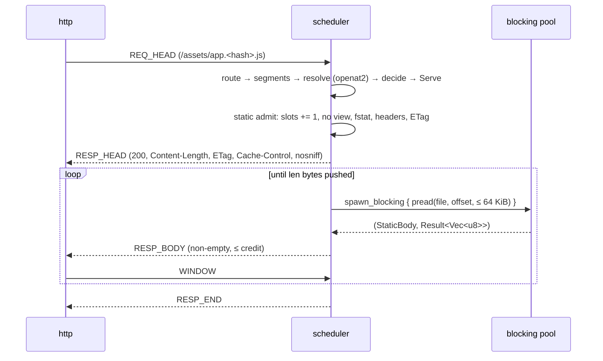

# Blastit 0.2.0 Technical Design: Static Asset Serving, Rewrite Precedence and Path Safety

`docs/frameworks/static-and-spa.md` is the input of record and is normative: every
command, TOML key, status code, header and exit code on that page is a promise this
document has to make true. The design adds **no** manifest key, CLI flag, environment
variable or log field the page does not show. Where the page is silent the design
picks the fail-closed answer and says so.

Companion ADR: [ADR-0007](../decisions/ADR-0007-static-asset-serving-and-rewriting.md).

---

## 1. Developer Experience Target (Local, CI/CD, Deploy)

### 1.1 Every page promise and where this design settles it

| Page promise (`static-and-spa.md`) | Settled by |
|---|---|
| the 10-line `blastit.toml` with `[route.static]` `root`/`spa`/`immutable` | §4.1 |
| "An all-static manifest needs no `app`" | §4.1 `is_all_static`, §4.7 boot order, `R13` |
| key table: `root` required, `index` = `index.html`, `spa` = `false`, `immutable` = none | §4.1 |
| `/assets/app.4f1c2a9b7d3e.js` → `200`, `Content-Type: text/javascript`, `Cache-Control: public, max-age=31536000, immutable` | §4.5 `R5`, `R9` |
| `/dashboard/settings` → `200`, `text/html; charset=utf-8`, `Cache-Control: no-cache` | §4.3 step 7, §4.5 `R5` |
| the five-row "What is served" table | §4.3 total order |
| "a directory without its `index` file falls through like any missing path" | §4.3 steps 7–10 |
| "a fallback whose file is missing is a `404`" | §4.3 step 8 |
| "only a file from `root` whose path matches `immutable`" gets the year | §4.5: only an exact-file answer is glob-matched |
| `GET`/`HEAD` only, `405` + `Allow: GET, HEAD`, body → `413` | §4.4 |
| a path it does not answer reaches the app with the route's `methods` and `[route.ingress]` | §4.4 |
| `HEAD` is `GET` without a body | §4.5 |
| `..`, percent-encoded `..`, NUL/control, absolute, backslash → `400` | §5.2 rows 1–13 |
| symlink escape and dotfiles → `404`; `/.well-known/` public; refusal final | §5.2 rows 15–25, §4.3 steps 3–4 |
| all-static `check`: audits every `root`, no pytest, exit `0`; missing/non-directory exit `2`; `--json` shape unchanged | §4.7 |
| front controller: omit `spa`, `/checkout/42` reaches `app` with `PATH_INFO=/checkout/42`, one `.*`, PHP = `public/index.php` | §4.3 step 9, §4.4, §2 |
| `0.2.0` ships the rewrite and this responder; the `public/index.php` worker is `0.2.1` | §2 non-goals |
| "a preset already runs the site"; production still fails closed | unchanged (`ADR-0005`); §5.1 states the uid the responder runs as |

### 1.2 What the `blastit dev` banner does **not** gain

The page shows the banner for a manifest with **no app** and replays it verbatim in
`MB.2.7`, so the banner stays the three documented lines and `1 route` / `<N> routes`
(`crates/blastit/src/dev_learn.rs::banner`). A static route is a route: it is counted.
No root list, no static marker, no fourth line — that would need a flag the page does
not have. `MB.2.6`'s note that the banner "reports static routes and their roots" is a
Follow-up for the lead; the page wins.

### 1.3 CI/CD

`blastit check` on an app-less, all-static manifest: no pytest, no dbproxy, no
`http_obs.jsonl`; every root is audited; exit `0` and **nothing on stdout** (the page's
fence shows no output), or exit `2` with the manifest path, the route and the root on
stderr. `--json` still prints exactly one document, with the existing `Report` shape and
zeroes (§4.7). With an `app`, `check` is unchanged.

### 1.4 Deployments

No new privilege path, and **the responder is not init**: in production the scheduler
runs as `UID_BASE+2` (`ARCHITECTURE.md` §2.4) with the seccomp role that may not call
`socket()`. A static root must therefore be traversable and readable by that uid —
ordinary build output (`0755` directories, `0644` files) already is. `blastit dev`
uses one uid for every role, so the same tree works locally. §4.7 proves it: `check`
and `dev` probe the root in the caller's identity, the production boot probes it in the
scheduler's, and the scheduler's own `open` is the final authority.

---

## 2. Goals & Non-Goals

**Goals.** One manifest block that serves a built front end; a total, documented
rewrite order; an escape-proof resolver that survives `..`, encoded slashes, NUL,
symlinks, dotfiles, and unicode tricks; hashed-asset caching keyed on the file that
actually answered; honest `dev`/`check` behaviour for a site with no app.

**Non-goals (0.2.0).** No FastCGI worker and no `public/index.php` execution
(`0.2.1`, §Front controller of the page); no directory listing; no redirects (`/docs`
answers `200`); no `Range`/`206`, no `If-Modified-Since`, no `If-Match`, no `If-Range`,
no `Accept-Encoding` negotiation or `.gz` siblings; no `fallback`, `cache_max_age`,
`max_bytes` or `dotfiles` key (the page has four keys); no `**` recursive glob (the page
documents one metacharacter, `*`, and says it stops at `/`); no top-level
`[static.<name>]` block (`ADR-0007` decision 2); no WASM/CDR (Milestone C); no second process,
role, uid or supervisor for static files.

---

## 3. Requirements

- **R1 `[route.static]` grammar.** Exact keys `root` (required string), `index`
  (string, default `index.html`), `spa` (bool, default `false`), `immutable` (array of
  strings, default `[]`). Unknown key fatal; `static` is a reserved route sub-table
  name.
- **R2 `root` semantics.** Relative to the directory holding `blastit.toml`; must not
  be empty, absolute (a leading `/` is a boot error, `/` included), or contain a `..`
  segment, a `\` or a control byte; must exist, be a directory and be listable; and (at
  the production boot) be readable by the scheduler's uid.
- **R3 `index` semantics.** Relative to `root`, one or more non-empty `/`-separated
  segments, no `..` segment, no leading `/`, no `\`, no control byte, and **no dotfile
  segment** (an `index` that starts with `.` would publish a dotfile to every miss).
- **R4 `spa`.** `false` by default. `true` ⇒ a path that is no file answers `index`.
  A static route that can never reach the app (`spa = true`, or no manifest `app`) may
  not **declare on the route** `[route.ingress]`, `prefork = true`, a
  `[route.<proxy>]` grant or an inline `groups` list: each is fatal with the fix in
  the message. Groups inherited from a manifest-wide `groups` list are not re-checked.
- **R5 `immutable`.** Patterns are `/`-anchored globs, matched **whole** against the
  **answering file's** URL path (root-relative, `/`-prefixed), after decoding and after
  `SCRIPT_NAME` stripping — never against the request path. `*` matches zero or more
  bytes except `/`; the only metacharacter is `*`. The year-long cache is given to an
  **exact-file** answer only; a directory `index` and an SPA fallback are always
  `no-cache`, whatever a pattern says.
- **R6 Rewrite precedence** is the total order in §4.3; two routes claiming one path
  keep today's rule (first matching route in manifest order wins) and `[static]` never
  changes matching.
- **R7 Refusals.** `400` for `..`, absolute form, backslash, NUL/C0 control bytes,
  invalid UTF-8, a path over `MAX_STATIC_PATH_BYTES` and a segment over
  `MAX_SEGMENT_BYTES`; `404` for symlinks, FIFOs, sockets, devices, oversize files,
  dotfiles and unreadable files. A refusal is final: never the app, never `index`.
- **R8 Methods and bodies.** On a path with a **servable** static target: any method but
  `GET`/`HEAD` is `405` + exactly `Allow: GET, HEAD`; a `GET`/`HEAD` that declares a
  body is `413`. A refusal (`Refused`, `Hidden`, `SpaLost`, or a miss with no `app`) is
  answered with its own status for **every** method and body — `400` or `404`, never
  `405`/`413`. A path with no static target and an `app` forwards to it with the route's
  own `methods` and `[route.ingress]`.
- **R9 Response semantics.** Closed `Content-Type` table; `Content-Length`; quoted
  `ETag`; `Last-Modified`; `X-Content-Type-Options: nosniff`; `If-None-Match` ⇒ `304`;
  `HEAD` = `GET` head with no body; no redirect, no range, no compression.
- **R10 Budgets.** No whole-file buffering: one in-flight 64 KiB read per response,
  `max_workers` reads in flight scheduler-wide, performed off the scheduler loop,
  under the existing 1 MiB response credit; a
  `static_max_bytes` ceiling; a short read aborts the response rather than lying about
  its length; a static answer occupies one admission slot.
- **R11 Path boundary.** One dirfd per root opened once at boot; every candidate is
  `openat2` with `RESOLVE_BENEATH|RESOLVE_NO_SYMLINKS|RESOLVE_NO_MAGICLINKS`, opened
  `O_PATH`, classified by `fstat`, and read-opened only when it is a regular file, with
  a `(st_dev, st_ino)` identity check between the two opens; a per-segment
  `O_NOFOLLOW` `openat` walk on kernels without `openat2`; exactly one percent-decode;
  the decoded path must start with exactly one `/` (a second leading `/` is
  `Absolute`), interior `//` collapses, `.` segments are dropped, `..` is refused — no
  dot-segment resolution and no Unicode normalization. The `same_inode` probe→read
  check is unit-tested, and its call site is exercised by the `resolve_with`
  substitution test in `critical_static_resolve.rs` (probe, swap the leaf, expect
  `Hidden`).
- **R12 No new role.** The scheduler answers on the existing `http.chan`; no view, no
  uid, no fork, no second supervisor; the `request` event keeps its shape
  (`outcome: "ok"` for an answer, `"unmatched"` for a scheduler-written refusal).
- **R13 Boot.** `app` is optional iff every route is static; a bad, unlistable or
  unreadable static root is named before any listener is bound (exit `1` for
  `dev`/`blastit`, `2` for `check`), the readability probe using the responder's uid in
  production and the caller's in `dev`/`check`; the banner is unchanged.
- **R14 `check`.** All-static ⇒ no pytest, root audit, exit `0`/`2`, one `--json`
  document, empty stdout on success; `check --learn` on an all-static manifest is
  exit `2` ("nothing to learn"); with an `app`, unchanged.
- **R15 Docs stay executable.** `docs/frameworks/static-and-spa.md`'s complete
  manifest joins `docs_fences.rs` (7 files) with its shape asserted, and `MB.2.7`
  replays its runnable fences verbatim (§7.3).

---

## 4. Architecture & Data Flow

### 4.1 Manifest grammar

```toml
[[route]]
name = "site"
path = ['.*']

[route.static]
root = "public"
index = "index.html"          # default; may be omitted
spa = true                    # default false
immutable = ["/assets/*"]     # default []
```

| Key | Type | Default | Meaning | Fatal at boot |
|---|---|---|---|---|
| `root` | string | required | directory served, relative to `blastit.toml`'s directory | missing key, empty, leading `/`, `..` segment, `\`, control byte, not a directory, unlistable, unreadable by the responder uid |
| `index` | string | `"index.html"` | file a directory or the SPA fallback answers with, relative to `root` | empty, empty segment, leading `/`, `..` segment, dotfile segment, `\`, control byte |
| `spa` | bool | `false` | a path that is no file answers `index` instead of the app | non-bool |
| `immutable` | array of strings | `[]` | `/`-anchored whole-match globs against the answering file's path | element not a string, not starting with `/`, `..` segment, control byte, > 32 patterns, > 256 bytes each |

Per-route, not a named top-level block: the page writes `[route.static]`, the keys
belong to one route's rewrite policy like `[route.ingress]` does, and `app` is already
manifest-global so one front-controller `.*` route plus one `app` is the whole config
(`ADR-0007` decision 2). `static` becomes a reserved route key, exactly as `ingress` is;
`[proxy.static]` stays legal to declare but can never be granted on a route (the
existing `UngrantedProxy` warning says so) and `[route.static] queries = […]` is an
unknown-key error, not a silent drop.

New `ManifestError` variants (all carry `Location`, so the boot message names the
route; `quoted()` escapes the value):

| Variant | Example message |
|---|---|
| `StaticRootInvalid { location, root, rule }` | `route "site" (index 0): static root "public": must be a relative path` |
| `StaticRootUnusable { location, root, reason }` | `route "site" (index 0): static root "public": not a directory` |
| `StaticIndexInvalid { location, index, rule }` | `route "site" (index 0): static index "index.html": must not contain ..` |
| `StaticImmutablePattern { location, pattern, rule }` | `route "site" (index 0): static immutable "assets/*": must start with /` |
| `StaticDeadDeclaration { location, key, why }` | `route "site" (index 0): spa = true never reaches the app; [route.ingress] can never run` |

`rule` and `reason` are fixed phrases (`must be a relative path`,
`must not contain ..`, `must not contain \`, `must not contain a control byte`,
`must not contain a dotfile segment`, `must be one or more segments`,
`must start with /`, `at most 32 patterns`, `at most 256 bytes`,
`no such file or directory`, `not a directory`, `permission denied`) so tests never
depend on `strerror`. `why` is `spa = true never reaches the app` or
`the manifest declares no app`; `key` is one of `[route.ingress]`, `prefork = true`,
`groups`, `[route.<proxy>]`.

**Existence is not checked by `Manifest::validate`.** `docs_fences.rs` parses the
page's block from the workspace root, where no `public/` exists, so a filesystem probe
inside `parse_and_validate` would fail the docs gate. Syntax lives in `validate`; the
probe is a separate explicit call:

```rust
impl Manifest {
    pub fn is_all_static(&self) -> bool;                 // app().is_none() && !routes().is_empty()
    pub fn check_static_roots(&self, manifest_dir: &Path) -> Result<(), ManifestErrors>;
    /// The declared roots, route index and absolute path, in manifest order: the
    /// input of `check_static_roots` and of the responder-uid visibility probe.
    pub fn static_roots(&self, manifest_dir: &Path) -> Vec<(usize, PathBuf)>;
}
impl Route {
    pub fn static_policy(&self) -> Option<&StaticPolicy>;
}

pub struct StaticPolicy {   // parsed once, in blastit-manifest
    pub root: String,       // as written in the manifest
    pub index: String,      // default "index.html"
    pub spa: bool,          // default false
    pub immutable: Vec<String>,
}
```

`check_static_roots` uses `std::fs::metadata` (symlinks followed: `root = "current/public"`
must work), requires `is_dir`, then `read_dir(root)` whose first `next()` must not be an
`Err`, and maps `io::ErrorKind` to the fixed reasons. It is called by `stage0` (`dev`
and `blastit`) and by `check` — never by `validate`.

### 4.2 Types: resolve (`static_asset.rs`), decision (`rewrite.rs`), response (`static_response.rs`)

Three modules, one public surface. The split is deliberate and is *not* to be
re-litigated by an implementer: `static_asset.rs` (`MB.2.4.1`) resolves, `rewrite.rs`
(`MB.2.5.1`) decides, `static_response.rs` (`MB.2.4.2`) builds the head and body, so
each production module stays under the §8 500-line rule. `StaticRoot`'s fields are
`pub(crate)` except the backend selector, which stays private; only the items below are
`pub`, and every one of them is in this section. All three modules diff cleanly against
it today (`static_response.rs` landed with `MB.2.4.2`).

`crates/blastit-scheduler/src/static_asset.rs` (`MB.2.4.1`) owns decoding to segments
and the I/O; it never builds a header:

```rust
pub const MAX_STATIC_PATH_BYTES: usize = 4096;
pub const MAX_SEGMENT_BYTES: usize = 255;
pub const STATIC_CHUNK_BYTES: usize = 64 * 1024;
pub const STATIC_MAX_FILE_BYTES: u64 = 64 * 1024 * 1024;

/// The exact `RESOLVE_*` composition `resolve` passes to `openat2`. Exported so
/// `critical_static_resolve.rs` can assert the bits instead of restating them
/// (the only unprivileged oracle for the flag set).
#[doc(hidden)] pub const STATIC_RESOLVE_FLAGS: ResolveFlags;

pub enum StaticRefusal { Traversal, Absolute, Backslash, Control, Encoding, TooLong, SegmentTooLong }

/// One decode already happened (path.rs). The decoded path must begin with
/// exactly one `/`: a second leading `/` (from `//x` or `/%2Fx`) is
/// `StaticRefusal::Absolute`, because it is the form a naive `root + path`
/// join treats as an absolute filesystem path. Interior `//` collapses and `.`
/// segments are dropped; `..` is refused. No Unicode normalization.
pub fn segments(decoded: &str) -> Result<Vec<&str>, StaticRefusal>;

/// The scheduler's head-step entry (design §4.3 steps 3–4) on a raw request
/// target: cut at `?`, exactly one percent-decode, `segments`, then the
/// dotfile rule. `Ok` is the segment list to hand to `resolve`; `Err` is the
/// final outcome for that path (`Refused` or `Hidden`).
/// `#[doc(hidden)] pub` because `path::percent_decode` is `pub(crate)` and the
/// protected suites compile the crate as a dependency: it is how the production
/// decode/dotfile wiring is table-driven instead of restated in a test. This is
/// the function `MB.2.5.2`'s head path calls.
#[doc(hidden)] pub fn head_segments(target: &str) -> Result<Vec<String>, StaticOutcome>;

/// The probe→read-open identity check, over plain `(st_dev, st_ino)` tuples so a
/// protected integration test can build every row (`rustix::fs::Stat` is
/// `#[non_exhaustive]` and has no constructor).
#[doc(hidden)] pub fn same_inode(probe: (u64, u64), read: (u64, u64)) -> bool;

/// The dotfile rule (§4.3 step 4): a segment starting with `.` is hidden unless
/// the first is exactly `.well-known`.
pub fn is_dotfile(segments: &[&str]) -> bool;

/// The whole-file classification, pure: the row a `fstat` result lands in.
/// `RegularFile` is servable, `Directory` descends to the index, and every
/// other `FileType` (FIFO, socket, character/block device, symlink, unknown)
/// is `Hidden` — the `_` arm is the table's total case.
pub fn classify(kind: FileType, len: u64, max_bytes: u64) -> Result<(), StaticOutcome>;

/// `max_bytes` is the `pub(crate)` field `run` sets from
/// `SchedulerConfig.static_max_bytes` right after `open` (which takes only the
/// manifest dir and the policy); `classify` compares against it.
///
/// What `StaticRoot::open` can fail on: `run` maps it into
/// `SchedulerError::Protocol("static root <root>: <source>")`, which exits the role.
pub struct StaticError { pub root: String, pub source: io::Error }

/// One `/`-anchored pattern: literal bytes, `*` = any run without `/`.
pub struct ImmutableGlob;
impl ImmutableGlob {
    pub fn new(pattern: &str) -> Option<Self>;   // `None` only if MB.2.3 let it through
    pub fn matches(&self, url_path: &str) -> bool;
}

pub struct StaticRoot { /* dirfd, index segments, spa, immutable globs, max_bytes */ }
pub enum Backend { Openat2, Walk }   // `Walk` is selectable in tests

impl StaticRoot {
    /// Opens `root` beneath `manifest_dir`; run as the scheduler's uid.
    pub fn open(manifest_dir: &Path, policy: &StaticPolicy) -> Result<StaticRoot, StaticError>;
    /// The same open with the backend chosen explicitly. `#[doc(hidden)] pub`,
    /// not `#[cfg(test)]`: an integration test compiles the crate as a
    /// dependency, where `cfg(test)` is off, so the `Walk` matrix could not run.
    #[doc(hidden)] pub fn open_with(manifest_dir: &Path, policy: &StaticPolicy, backend: Backend) -> Result<StaticRoot, StaticError>;
    pub fn resolve(&self, segments: &[&str]) -> StaticOutcome;
    /// `resolve`, with a hook that runs between the `O_PATH` probe and the read
    /// open. `resolve` is `resolve_with(segments, None)`; the protected suite
    /// uses `Some` to swap the leaf for a different inode and prove the identity
    /// check answers `Hidden` (the only way to exercise the TOCTOU arm without
    /// a real race).
    #[doc(hidden)] pub fn resolve_with(&self, segments: &[&str], after_probe: Option<&dyn Fn()>) -> StaticOutcome;
}

pub enum StaticOutcome {
    File(StaticFile),        // exact file, directory index, or SPA index
    Missing,                 // nothing at that path: may forward
    SpaLost,                 // spa = true and root/index is missing: 404
    Hidden,                  // exists but is not servable: 404
    Refused(StaticRefusal),  // 400
}

pub enum AnswerKind { Exact, DirectoryIndex, SpaFallback }
pub struct StaticFile {
    /// Built from the **resolved segments** (after `//` collapse), so every alias
    /// of one file shares one `url_path` and one `ETag`: `/assets//app.js` and
    /// `/assets/app.js` are the same key. The cache header is keyed on
    /// `(kind, url_path)` (§4.5), so an `Exact` answer and an `index` answer for
    /// the same bytes can still differ — `kind` is part of that key.
    pub url_path: String,    // "/assets/app.4f1c2a9b7d3e.js": the immutable key
    pub kind: AnswerKind,
    pub file: OwnedFd,       // O_RDONLY, fstat-verified regular file
    pub len: u64,            // st_size at the read open
    pub meta: StaticMeta,    // st_size, st_mtime (secs, nsecs)
}
pub struct StaticMeta { pub size: u64, pub mtime_secs: i64, pub mtime_nsec: u32 }
```

`crates/blastit-scheduler/src/static_response.rs` (`MB.2.4.2`) owns the head and the
body source; it takes the `StaticFile` by value and never re-opens the path:

```rust
pub struct StaticResponse {
    pub status: u16,              // 200, 304, or the over-ceiling 404 below
    pub reason: &'static str,     // "OK", "Not Modified", "Not Found"
    pub headers: Vec<(Vec<u8>, Vec<u8>)>,
    pub body: Option<StaticBody>, // None for HEAD and 304
}
pub struct StaticBody { pub file: OwnedFd, pub offset: u64, pub len: u64 }

impl StaticRoot {
    /// Consumes the file: the descriptor moves into `StaticBody`, never `dup`ed.
    pub fn respond(&self, file: StaticFile, method: &[u8], if_none_match: Option<&[u8]>) -> StaticResponse;
}

/// The IMF-fixdate of `unix_secs` (§4.5), pure and dependency-free. `pub` so
/// the protected suite asserts the three vectors rather than restating the
/// algorithm.
pub fn http_date(unix_secs: i64) -> String;
```

`respond`'s only third status is a defence-in-depth `404` (empty body,
`Content-Length: 0`, `Cache-Control: no-store`) for a `StaticFile` already above
`static_max_bytes`: `classify` makes it unreachable through `resolve` + `decide`, and it
exists so a forged `StaticFile` can never make the responder promise bytes it will not
stream (§4.6).

`crates/blastit-scheduler/src/rewrite.rs` (`MB.2.5.1`) owns the precedence and the
method/body gate, and is testable without a filesystem or a socket:

```rust
/// The exact `Allow` value a static `405` carries: `b"GET, HEAD"` (`R8`, §4.4).
/// Exported so the one helper that writes a rejection's headers and the
/// protected suite spell it once.
pub const STATIC_ALLOW: &[u8] = b"GET, HEAD";

pub enum Rewrite {
    Serve(StaticFile),                                    // caller runs respond()
    Forward,                                              // to the manifest's app
    Reject { status: u16, allow: Option<&'static [u8]> },  // 400/404/405/413
}

/// Consumes the outcome: `Serve` carries the one `StaticFile` into
/// `Request.static_target`, the single owner until `dispatch_static` moves it
/// into `respond`. `Scheduler::release` drops whatever is left in
/// `static_body` then `static_target`; no descriptor is ever duplicated.
pub fn decide(outcome: StaticOutcome, method: &[u8], has_body: bool, has_app: bool) -> Rewrite;

/// `has_body` for `decide`, and the only definition of it: `true` when a
/// `Content-Length` is greater than zero or any `Transfer-Encoding` header is
/// present (names compare ASCII case-insensitively). Nothing is read, buffered
/// or transcoded. A `Content-Length` that is not a plain number counts as a
/// declared body (fail closed); the front end refuses such a head before the
/// request reaches the scheduler.
pub fn declares_body(headers: &[(Vec<u8>, Vec<u8>)]) -> bool;
```

`crates/blastit-scheduler/src/static_response.rs` (`MB.2.4.2`) owns `respond`, the
`ETag`/`Last-Modified`/`304` rules, the `(answer kind, answering path)` cache rule,
the `Content-Type` table and `http_date`. It receives a `StaticFile` from `decide` and
returns the `StaticResponse` the scheduler pushes.

`has_body` is `rewrite::declares_body`'s result and nothing else: `MB.2.5.2` computes it
once at the head and passes it into `decide`, and nothing is read to decide. `rewrite.rs`
builds no header: the `405`'s `Allow` value is chosen there (`allow = Some(STATIC_ALLOW)`)
and the scheduler's one rejection helper writes it (§4.4); every static rejection gets
`Cache-Control: no-store` in that same helper.

### 4.3 Rewrite precedence — one total order

| # | Condition | Outcome |
|---|---|---|
| 1 | The request matched the health path (`BLASTIT_HEALTH_PATH`) | health answer, unchanged |
| 2 | The route declares no `[route.static]` | unchanged: view answer or `404` |
| 3 | `head_segments(target)` refuses the path (§5.2 rows 1–13) | `400`, final |
| 4 | A segment is a dotfile and the first is not exactly `.well-known` | `404`, final |
| 5 | `openat2` resolves the path to a regular file | `File { kind: Exact }` |
| 6 | The path is a directory whose `index` resolves to a regular file | `File { kind: DirectoryIndex }` |
| 7 | Any miss, `spa = true`, `root/index` resolves to a regular file | `File { kind: SpaFallback }` |
| 8 | Any miss, `spa = true`, `root/index` is missing | `SpaLost` → `404`, final |
| 9 | Any miss, `spa` unset, and the manifest declares `app` | `Forward` → the app |
| 10 | Any miss, `spa` unset, no `app` | `404`, final |
| 11 | The entry exists but is a symlink, FIFO, socket, device, oversize or unreadable | `Hidden` → `404`, final |

Steps 1–2 are existing behaviour, restated so the order is total; steps 3–11 are the
static route's own order, first match wins. Steps 3–4 are decided from the head (a
malformed or hidden path is answered immediately, even under load) by `head_segments()`
in `static_asset.rs` (`MB.2.4.1`) — its query cut, one decode, `segments()` and
`is_dotfile()` — called from the scheduler's head path
(`MB.2.5.2`); steps 5–11 are the filesystem half and run in `dispatch_static`, once the
request holds a slot (§4.6), so a queued request never holds a descriptor. A `File` from
5–7 then becomes `405`, `413`, `304` or `200` (§4.4, §4.5). Refusals (3, 4, 8, 10, 11)
are terminal: **a denied path is never masked by the SPA fallback** — the
traversal-to-`index.html` bug — and never reaches the app.

**Head work vs. slot work (and both halves end in `decide`).** On a route with a policy,
`begin_raw` — which already parses the head for `plan_request_body` — does three things
before the payload moves into the request: it builds the `&[(Vec<u8>, Vec<u8>)]` that
`rewrite::declares_body` takes from `head.headers()` and stores only the resulting
`bool` (`Request` keeps no headers; this is the one place `begin_raw` copies header
bytes, only on a route with a policy, and it is bounded by the head); it calls
`head_segments(target)` — the request
target is bytes, so it converts with `std::str::from_utf8` and maps `Err` to
`Refused(Encoding)` (`400`), **never** `from_utf8_lossy`, which would turn an invalid
byte into U+FFFD and a forward; and an `Err(outcome)` from it goes straight to
`decide`. A steps 3–4 refusal
is therefore answered **there, before `admit_ready`**: no slot is taken, nothing is
queued, and no `..` probe can turn into `503`. It is answered after the request is
registered, so its `request` event (`route`, `rule`, `outcome: "unmatched"`) is emitted
like any other scheduler-written refusal (§7.2). `Ok(parts)` sets `static_pending`, and
`dispatch_static` borrows the owned parts once as `Vec<&str>` for `resolve`, then decides
the result (steps 5–11). The head path never writes a static status itself: every
refusal and every answer goes through `decide`, so `no-store`, the absence of `Allow`
and the exact `405` header stay in one place.

Consequences the page words directly: `/docs` and `/docs/` are the same directory index
(`200`, identical bytes and `ETag`) because empty segments are dropped and there are no
redirects; an **interior** `//` collapses (`/a//b` is `/a/b`) but a **second leading**
`/` does not — `//etc/passwd` and `/%2Fetc/passwd` are `400` (matrix rows 5–6), so a
`.split('/').filter(non_empty)` shortcut is a bug, not the rule; `%2F` decodes to `/`
and is therefore a separator (`/docs%2Findex.html` is `/docs/index.html`); a
double-encoded `%252e` is inert data
(one decode only, so it names the literal file `%2e…`, which normally does not exist
and then follows steps 7–10); `/x.js/` is `/x.js`; the query string is never part of
resolution (`/a.js?v=1` answers `/a.js`).

**Two routes, one path.** Matching is `blastit_manifest::RoutingTable`'s, unchanged:
first route in manifest order whose methods (when listed) and first matching pattern
accept the request wins (`docs/reference/manifest.md:307` already states the rule).
`[static]` adds no matching rule and reorders nothing; a static route placed after an
app catch-all is unreachable, and 0.2.0 adds no diagnostic for that.

### 4.4 Methods, bodies and the ordering against `plan_request_body`

A route with a policy is admitted **at the head, without waiting for its body**: its
`BodyPlan` is still computed by `begin_raw` (a `Forward` may need it), but
`request.body_ready` is set true immediately, so `dispatch_static` runs before any
`REQ_END`/transcode. `plan_body`'s `Err(status)` is **stored, not answered**, on such a
route (`request.body_plan_error: Option<u16>`): the page's method/body rule outranks a
codec error on a path the responder answers. Then:

- `Serve` answers from the head and **never** waits for, buffers or transcodes the body:
  the method gate first (`405` for anything but `GET`/`HEAD`), then the page's `413` for
  a `GET`/`HEAD` that declares a body. A body whose content type would have been a codec
  `400` on the app path is therefore `405` or `413` here — never `400` — and the buffer
  and the stored error are dropped;
- `Forward` is the only path that answers the stored `body_plan_error` (as today) or
  honours the plan: if it is `Buffer`, `dispatch_static` sets `request.body_ready =
  false` and returns; `REQ_END` transcodes exactly as today (`400` on a bad codec) and
  re-enters the ordinary buffered path.

| Method / body | Servable static target (§4.3 steps 5–7) | No target, `app`, `spa` unset | No target, no `app` |
|---|---|---|---|
| `GET` or `HEAD`, no declared body | `200` / `304` | forward (`PATH_INFO` = decoded path; route `methods` + `[route.ingress]` unchanged) | `404` |
| `GET` or `HEAD`, declared body | `413` (`content too large\n`) | `413`, exactly as today (the route's ingress plan, or `AllowEmptyOnly` when it declares none: a bodyless-safe method may hold no bytes) | `404` |
| any other method | `405` + exactly `Allow: GET, HEAD` | forward, exactly as today | `404` |

**A refusal is terminal for every method, and only a servable target is ever `405`.**
The three rows above describe a path the responder *answers*. When §4.3's order ends in
a refusal, that refusal's own status wins whatever the method or the body: the method
gate never turns it into `405`, the body gate never turns it into `413`, and no row of
this table forwards it.

| §4.3 outcome, any method and any body | Response | `Allow` |
|---|---|---|
| `Refused` (step 3; §5.2 rows 1–13) | `400` | none |
| `Hidden` (steps 4 and 11) | `404` | none |
| `SpaLost` (step 8) | `404` | none |
| miss, `spa` unset, no `app` (step 10) | `404` | none |
| `Missing`, `app` declared (step 9) | forward, exactly as the table above | none |

So `POST /assets/app.js` is `405`; `POST /../etc/passwd` is `400` and `POST /.env` is
`404`, never `405`; `POST /dashboard` on a `spa = true` route is `405` when `root/index`
resolves (the fallback is a servable target) and `404` when it does not (`SpaLost`), so
the fallback's own existence decides, not the method; `POST /checkout/42` on a
front-controller route forwards with its `[route.ingress]`. Methods compare exactly
(`GET`, `HEAD`); `get` is just another method. `405` carries exactly
`Allow: GET, HEAD` (`rewrite::STATIC_ALLOW`) and no other status carries `Allow`. All
four refusals go through **one** private helper in `scheduler.rs`: it takes the status
and the optional `Allow`, gets reason and body from `canned(status)` (the `405` pair is
not part of this contract — a proper `Method Not Allowed` arm is `MB.2.5.2`'s — so this
design fixes only the status and the `Allow` header), adds the `Allow` header only for
`405`,
and adds `Cache-Control: no-store` to all four. It also records `status`, `head_sent` and
`bytes_out` exactly as the existing scheduler rejections do, so a static refusal is
accounted for like any other and no bookkeeping is re-derived. No static **refusal**
builds a header anywhere else (§7.2 asserts that header).

`decide`'s other input is `has_app`, and `MB.2.5.2` passes `RouteInfo.static_forward`
(§4.6): policy present, `spa` unset, `manifest.app().is_some()`. A `spa = true` route
never yields `Missing` (`SpaLost` instead), so that `bool` equals "the manifest declares
an app" at every point `decide` reads it — no second source, no `route.rs` change.

### 4.5 Response semantics

| Header | Value |
|---|---|
| `Content-Type` | closed table below, from the answering file's extension (ASCII lowercase) |
| `Content-Length` | `st_size` from the read open (`HEAD` included); absent on `304` |
| `ETag` | quoted, strong: `"<size:x>-<mtime_ns:x>"` — no inode or device disclosure; it changes when a rewrite changes the size or the mtime, which a same-byte rewrite may not |
| `Last-Modified` | IMF-fixdate from `st_mtime` in UTC, e.g. `Sun, 06 Nov 1994 08:49:37 GMT` |
| `X-Content-Type-Options` | `nosniff` on every `200`/`304` |
| `Cache-Control` | see the cache rule below |
| `Date`, `Server`, `Accept-Ranges`, `Location` | never set by this responder |

**Cache rule — the key is `(answer kind, answering URL path)`:**

| Answer | `Cache-Control` |
|---|---|
| `AnswerKind::Exact` whose `url_path` matches an `immutable` pattern | `public, max-age=31536000, immutable` |
| `AnswerKind::Exact` that matches no pattern | `no-cache` |
| `AnswerKind::DirectoryIndex` or `AnswerKind::SpaFallback` — **every** `index`, regardless of patterns | `no-cache` |
| any scheduler-written static refusal (`400`, `404`, `405`, `413`) | `no-store` |

That is the page verbatim: only "a file from `root` whose path matches `immutable`"
gets the year, and "every other answer, `index` included, is `no-cache`". A `304`
repeats the cache header the `200` would have carried.

| Condition | Response |
|---|---|
| `If-None-Match` lists the file's `ETag` (weak `W/` prefix ignored) or `*` | `304`, same `ETag`/`Last-Modified`/`Cache-Control`/`nosniff`, no body, no `Content-Length` |
| `If-None-Match` does not match, or absent | `200` + body |
| `HEAD` | the `200` head with `Content-Length`; **no** `RespBody` frame |
| `Range`, `If-Modified-Since`, `If-Match`, `If-Range`, `If-Unmodified-Since` | ignored; a full `200` |

| Extension (lowercased first: `.PNG` is `image/png`) | `Content-Type` |
|---|---|
| `.html` `.htm` | `text/html; charset=utf-8` |
| `.js` `.mjs` | `text/javascript` (the page's own output) |
| `.css` | `text/css; charset=utf-8` |
| `.json` `.map` | `application/json` |
| `.webmanifest` | `application/manifest+json` |
| `.txt` | `text/plain; charset=utf-8` |
| `.xml` | `application/xml` |
| `.svg` | `image/svg+xml` |
| `.png` · `.jpg`/`.jpeg` · `.gif` · `.webp` · `.avif` | `image/png` · `image/jpeg` · `image/gif` · `image/webp` · `image/avif` |
| `.ico` | `image/x-icon` |
| `.woff` · `.woff2` · `.ttf` · `.otf` | `font/woff` · `font/woff2` · `font/ttf` · `font/otf` |
| `.wasm` | `application/wasm` |
| `.pdf` · `.mp4` · `.webm` · `.mp3` | `application/pdf` · `video/mp4` · `video/webm` · `audio/mpeg` |
| anything else, or no extension | `application/octet-stream` |

`Last-Modified` needs no dependency: `fn http_date(unix_secs: i64) -> String` is the
inverse of days-from-civil (~30 lines, pure). Vectors: `0` →
`Thu, 01 Jan 1970 00:00:00 GMT`; `784111777` → `Sun, 06 Nov 1994 08:49:37 GMT`;
`1700000000` → `Tue, 14 Nov 2023 22:13:20 GMT`.

`immutable` glob vectors (the matcher is ~30 lines, no regex; `MB.2.3` validates the
same syntax and both suites use this table):

| Pattern | Answering path | Match |
|---|---|---|
| `/assets/*` | `/assets/app.4f1c2a9b7d3e.js` | yes |
| `/assets/*` | `/assets/` | yes (`*` may be empty) |
| `/assets/*` | `/assets/x/y.js` | **no** (`*` stops at `/`) |
| `/assets/*` | `/x/assets/app.js` | no (anchored) |
| `/assets/*/*` | `/assets/chunks/x.js` | yes (one pattern per depth, no `**`) |
| `/assets/app.*` | `/assets/app.js` | yes |
| `/index.html` | `/index.html` | yes, **but** only as `AnswerKind::Exact`; `/` and `/dashboard` answer the same file as an index and stay `no-cache` |

### 4.6 Flow, admission and the body pump



**Admission.** `admit_ready` gains a static branch before `can_dispatch`:
`Request.static_target: Option<StaticFile>` is set during resolution, and

- `can_dispatch_static()` is `self.slots < self.cfg.max_workers` — no view is involved;
- `admit_ready`'s static branch is `if can_dispatch_static() { dispatch_static } else if
  queue.len() >= queue_size { 503 queue full + Retry-After } else { enqueue }`, and both
  `dispatch_queued` walks take a queued `static_pending` request through
  `dispatch_static` (never through the view `can_dispatch`/`try_spawn` path) while
  `slots < max_workers`. That is what makes "more than `max_workers` static streams
  complete in waves" true;
- `dispatch_static(stream_id)` is the one function that sets `request.slots = true`,
  `request.view = None`, `request.dispatched_at = now`, `request.deadline =
  now + cfg.request_timeout` (exactly as `dispatch` does, or `next_deadline` and
  `expire_requests` would never fire for it), runs the filesystem half of §4.3
  (steps 5–11: `resolve` + `decide`), and then either pushes `RESP_HEAD` and schedules the first
  read (`Serve`), releases the slot and re-enters the ordinary path (`Forward`), or
  answers the rejection and releases the slot;
- `Forward` **gives the slot back** before it rejoins the ordinary path:
  `release_static_slot`, clear `static_pending`, `dispatched_at = None`,
  `deadline = None` (the view queue measures its own timeout from its own dispatch) and
  **do not** `release`; then `admit_ready(stream_id)`, which is the ordinary view path —
  normal queue, lazy spawn, `dispatch`. That is the only way a front controller's
  *first* request can spawn its view: a slot-holder that never entered the queue could
  not. A `Buffer` plan records `queued_since = now`, sets `body_ready = false` and
  returns to wait for `REQ_END` **after** that handback, so a client that never ends its
  body is timed out by `expire_queue` (`!body_ready` + `queued_since`) instead of
  holding a slot;
- a slot is never taken twice and never leaked: `Serve` keeps its one slot until
  `RESP_END`/the read result, `Forward` hands it back and the view path takes its own,
  and **both** `Reject` and the stored-`body_plan_error` answer release it before
  writing the status;
- `Request.static_pending: bool` is set when the matched route has a policy and cleared
  by `dispatch_static` on every verdict. `admit_ready` is, in order:
  `if request.static_pending { dispatch_static } else { the unchanged path }`, and
  `dispatch_static` `debug_assert!(!request.slots)`. A buffered `Forward` cleared
  `static_pending` before it returned, so its `REQ_END` re-entry is the ordinary
  buffered path — no re-resolve, no second slot;
- **no descriptor is opened before a slot exists**: `head_segments` (steps 3–4) runs in
  `begin_raw`, before `admit_ready`, and its refusal is answered there (§4.3), so a
  queued request has already passed it; `resolve` (steps 5–11) runs inside
  `dispatch_static`, so a queued static request holds no `StaticFile` and the
  `max_workers` slot bound is also the descriptor bound;
- `try_spawn` is allowed only for a route that can forward. `RouteInfo` gains
  `static_forward: bool`, set by `RouteInfo::with_static(policy, has_app)` — the policy
  is present, `spa` is unset and `has_app` is `manifest.app().is_some()`. **All three
  declared-route sites** pass it — `routes_from_manifest` and the two `stage1` branches
  that map `manifest.routes()` (dev and dev `--learn`) — so a dev front controller can
  spawn. The fourth builder, `stage1`'s unrouted `LEARN_FALLBACK_ROUTE`, has no manifest
  `route` and keeps `RouteInfo::new`'s defaults (`static_policy: None`,
  `static_forward: false`), which is correct because its pattern never matches. A pure
  static route (`static_forward == false`) is never spawned by either `dispatch_queued`
  walk or by `Scheduler::start`; a forward-capable one keeps the ordinary lazy spawn;
- the same bounded queue, `queue_timeout` and `503` + `Retry-After` apply; the slot is
  released when `RESP_END` is pushed, or — if a read is still outstanding — by that
  read's result (never by the timeout alone).

**The pump.** `Request` gains, besides `static_pending` and `static_target` (set at
admission, above), `static_parts: Option<Vec<String>>` (the `head_segments` result, kept until
`dispatch_static` borrows it for `resolve`), `static_has_body: bool` (the
`declares_body` result from `begin_raw`), `static_body: Option<StaticBody>` and
`pumping: bool`; `Scheduler` gains `static_roots: Vec<Option<Arc<StaticRoot>>>` (opened
by `run`, which also creates the `static_in: mpsc::Sender<…>` handed to the blocking
tasks and its `Receiver` arm in `select!`). `pump_static(stream_id)`:

1. `remaining == 0` → push `RESP_END` and release the slot, **before** any read (a
   zero-length file is an ordinary `200` with `Content-Length: 0` and no body frame);
2. else, with a queued chunk, push it; with credit available and no read in flight, set
   `pumping = true` and move the `StaticBody` into one `tokio::task::spawn_blocking`
   (a `pread` at `offset` of at most `min(remaining, credit, max_payload,
   STATIC_CHUNK_BYTES)`), whose result returns `(stream_id, StaticBody,
   io::Result<Vec<u8>>)` over `static_in`;
3. otherwise wait for `WINDOW` or the read result.

**No separate reader counter.** Only a request holding an admission slot can spawn a
read, and a slot is held until its response ends (below), so a stalled read always
occupies the slot that spawned it. `slots ≤ max_workers` and "one read in flight per
slot-holder" therefore *are* the reader bound: at most `max_workers` blocking reads and
descriptors. There is no `static_reads` counter and no re-drive queue to get wrong — a
request admitted with a free slot always spawns its read immediately, and every
`static_in` result pumps only its own stream.

**A parked read is bounded, not detached.** A `pread` on a stalled mount cannot be
cancelled, so the admission slot stays charged until that read's result comes back: a
timed-out or cancelled request is marked `complete` and aborts the response, but its
slot and its `pumping` flag are released *by the read result*, never by the timeout.
One function, `release_static_slot(stream_id)`, owns that transition:

```rust
/// The only place `slots` is decremented for a static answer. False when the
/// request holds no slot, or when its read is still parked. `pub(crate)`: the
/// protected suite compiles this crate as a dependency and cannot reach a
/// private item without a `lib.rs` export, which is outside `MB.2.5.2`'s paths,
/// so a `#[cfg(test)]` unit test in `scheduler.rs` tables it instead.
pub(crate) fn slot_releasable(holds_slot: bool, pumping: bool) -> bool { holds_slot && !pumping }
```

`release_static_slot(stream_id) -> bool` decrements only when
`slot_releasable(request.slots, request.pumping)` is true and clears `request.slots`.
The read result clears `pumping`, then calls it and, when it returns `true`, calls
`release(stream_id)` (so a completed, timed-out or cancelled response drops its
`StaticBody`, fd and `Request`). `expire_requests` and `client_cancel` call the same
function: with `pumping == false` it frees and they then `release`; with
`pumping == true` it is a no-op, the request stays `complete`, and the read result
performs both — a parked read is never freed early and nothing is dropped twice.
`slot_releasable` is tabled by a `#[cfg(test)]` unit test in `scheduler.rs`
(`(true,false) → true`; `(true,true) → false`; `(false,_) → false`); the protected
`critical_rewrite.rs` flow cases prove the predicate is the one `release_static_slot`,
`expire_requests` and the read result actually consult, including the "timeout while
parked" arm that no integration test can drive by itself.

**Budgets.** `static_max_bytes` (`SchedulerConfig.static_max_bytes`, initialised to
`STATIC_MAX_FILE_BYTES`; there is no environment variable or manifest key for it) is
checked from `fstat` before any read; a larger file is `404`. A read error or a short
read aborts the response with `Frame::RespAbort { reason: "static: read failed" }`; the
scheduler never sends a truncated body under a `Content-Length` it promised. `root` is
expected on a local filesystem: a network or FUSE mount is unsupported in 0.2.0 (a
stalled read parks one of the `max_workers` readers, never the loop).

### 4.7 Boot, CLI and `check` wiring (`MB.2.6`)

`Config` (`config.rs`) gains `manifest_dir: PathBuf`, set once when the manifest path is
discovered as `std::path::absolute(config.manifest.parent().unwrap_or(Path::new(".")))`,
carried in the stage-1 document, and copied into `SchedulerConfig.manifest_dir` by
`stage1::scheduler_config` — the manifest path is relative to the boot cwd, and stage 1
must not re-derive it. `SchedulerConfig` also gains `static_max_bytes`, whose only
source is the `STATIC_MAX_FILE_BYTES` constant (no env var, no manifest key).

Boot order in `stage0` (`dev` and `blastit`), preserving `MB.1.6`'s fix and staying
**before any listener is bound and before any role child exists** (the only pre-boot
fork is the read-only permission probe of step 5):

1. read `config.manifest` (a missing file is named first);
2. `Manifest::parse_and_validate`;
3. `if config.app.is_none() && !manifest.is_all_static()` → the existing
   `BLASTIT_APP: the WSGI callable (module:attribute) is required` (exit `1`);
4. `manifest.check_static_roots(&config.manifest_dir)` → exit `1`,
   `"<manifest path>: <errors>"`;
5. for each `root` in `manifest.static_roots(&config.manifest_dir)`, call
   `crate::visibility::unreadable(&[root], &probe, false)` and, on `Some(_)` or a
   timeout, exit `1` with `"static root <root>: permission denied"` (the probe's own
   `Blocker` prose is `sys.path`-specific and is not reused). `probe` is
   `DroppedTo { uids: BTreeSet::from([layout.scheduler()]), probe: layout.scheduler() }`
   in production and `DroppedTo { uids: BTreeSet::from([geteuid()]), probe: geteuid() }`
   in `dev` and `check`, where the prober *is* the responder and `by_probe_or_mode`
   answers from the mode bits;
6. env swap, directories, listeners, as today.

`stage1` (`crates/blastit/src/stage1.rs`, one added path, the handoff `MB.2.2` recorded
as Follow-up 1 in its `RESULT.md`):

- `load` returns `py.None()` and skips the app import, `check_view_paths`, preload,
  warmup, `gc.collect`/`freeze`/immortalise when `config.app.is_none()`;
- **all three** declared-route sites chain `.with_static(route.static_policy().cloned(), has_app)`
  where the branch's `has_app` is `manifest.app().is_some()` (`routes_from_manifest`
  computes it once; each `stage1` branch binds it before the map) — the dev and dev
  `--learn` branches that iterate `manifest.routes()`, plus `routes_from_manifest`; the
  unrouted `LEARN_FALLBACK_ROUTE` builder has no `route` and keeps `RouteInfo::new`'s
  defaults (design §4.6);
- `scheduler_config` sets `manifest_dir` and `static_max_bytes`.

`check::execute`, after `parse_and_validate` and `RoutingTable::new` and before
`CheckRoot::create`/`require_pytest`:

1. the same app rule (exit `2`, `eprintln!("blastit check: …")`), then
   `check_static_roots` and the same `visibility` probe (exit `2`);
2. `check --learn` on an all-static manifest → exit `2`,
   `nothing to learn: every route is static`;
3. `manifest.is_all_static()` → build
   `Report { schema_version: 1, ok: true, requests: 0, statements: 0,
   routes: RouteCounts { total, exercised: 0 }, proxies: {}, findings: [] }`,
   print it for `--json`, print nothing otherwise, exit `0`. **No** `no_observations`,
   **no** `unexercised_route`, **no** finding kind, **no** `fix.action`;
4. otherwise unchanged.

A mixed manifest (an `app` plus a static route) still runs the suite; a static root the
suite never requested is one stderr line —
`  route "<name>": static root "<root>" was never requested` — never a finding, never
`ok`, never the exit code. The responder's own `StaticRoot::open` in `run` is the last
authority; its failure is `SchedulerError::Protocol("static root …")` and exits the role
with `1` (a race against steps 4–5, since both ran before the listeners).

---

## 5. Security & CVE Analysis

### 5.1 The boundary

- **Identity.** The responder is the scheduler, `UID_BASE+2` in production
  (`ARCHITECTURE.md` §2.4), with the seccomp role that may not call `socket()`. It can
  read exactly what that uid can read, so the root must be `0755`/`0644`-readable by it;
  §4.7 step 5 proves that before any listener is bound, and a file it still cannot read
  is `Hidden` (`404`).
- One dirfd per static root, opened at boot with `O_PATH|O_DIRECTORY|O_CLOEXEC` on
  `manifest_dir.join(root)` (the only place a symlink is followed, and only on the
  operator's own declaration). Every candidate is then
  `openat2(dirfd, "a/b/c", O_PATH|O_CLOEXEC, 0,
  RESOLVE_BENEATH|RESOLVE_NO_SYMLINKS|RESOLVE_NO_MAGICLINKS)` and classified by `fstat`
  on that descriptor: a regular file is re-opened
  `O_RDONLY|O_CLOEXEC|O_NONBLOCK|O_NOCTTY` with the same resolve flags, and the
  read-open `fstat` must report `S_ISREG` **and** the same `(st_dev, st_ino)`; a
  directory is the index lookup; anything else is `Hidden`. So a special file is **never read-opened** (a device's open-time side
  effects, a tty's controlling-terminal grab, a FIFO's block), and a swapped path is
  caught by the identity check. Never `canonicalize()` plus a string prefix.
- Kernels without `openat2` (`ENOSYS`/`EINVAL`) fall back to a per-segment
  `openat(parent, segment, O_PATH|O_NOFOLLOW|O_DIRECTORY|O_CLOEXEC)` walk and the same
  probe/re-open/identity check; `..`, `.` and empty segments are already gone, so the
  walk cannot leave the root. `Backend::Walk` is selectable in tests, so the fallback is
  not dead code.
- **One decode, no normalization.** `path.rs` decodes once; `segments()` never decodes
  again, so `%252e` is the literal text `%2e`. No Unicode normalization is applied
  anywhere, so `..` can only be the two ASCII bytes; overlong encodings (`%c0%ae`) are
  invalid UTF-8 and `400`; NFC/NFD spellings are distinct filenames on both sides of the
  boundary, so there is no validator/filesystem differential to exploit.
- Control bytes are the existing `path.rs` rule: `< 0x20` (NUL and C0). `0x7F` keeps
  today's meaning. `MAX_STATIC_PATH_BYTES` (4096) and `MAX_SEGMENT_BYTES` (255) are
  checked before any syscall, so `ENAMETOOLONG` is unreachable.
- **Mounts are followed.** `RESOLVE_NO_XDEV` is deliberately not used: a bind-mounted
  asset directory or a Compose volume under `root` is legitimate, and the boundary
  claimed is "beneath `root` in the path namespace", not "one filesystem".
  `EXDEV` therefore stays in the errno table as defence and is unreachable by
  construction (no tested row).
- **Errno table (total).** Every failure that is not "the path does not exist" is a
  refusal; nothing falls through to the fallback or the app on an error.

| `Errno` | Outcome | Why |
|---|---|---|
| `ENOENT`, `ENOTDIR` | `Missing` | nothing at this path: fallthrough (§4.3 steps 7–10) |
| `ELOOP` | `Hidden` (`404`) | a symlink at any depth: the page's symlink rule |
| `EXDEV` | `Hidden` | a beneath violation (unreachable today; defence) |
| `EACCES`, `EPERM` | `Hidden` | the operator's permissions hid it: fail closed |
| `ENXIO`, `EISDIR`, `ENODEV` | `Hidden` | socket/device/directory where a file was expected |
| `EMFILE`, `ENFILE`, `ENOMEM`, `EIO`, `EAGAIN`, `EINTR` | `Hidden` | transient or resource failure: never serve bytes or forward the path |
| any other | `Hidden` | total by construction |

  The 404-vs-fallthrough distinction does reveal that *something* exists at a refused
  path (a symlink, an unreadable file) — that is the page's own "hidden existence is
  `404`" policy, it is limited to the status code, and the canned body never varies.
  Content is never revealed.
- **Trust assumptions.** The operator declares `root` and is responsible for its
  contents: blastit does not detect a hardlink that points at a file outside the tree,
  does not police what the application writes under `root`, and does not serve a file
  larger than `static_max_bytes`. `root` must not contain device nodes; the scheduler's
  uid is the second line of that defence. A compromised scheduler gains read access to
  everything beneath a declared `root` — not to the credentials or the view processes'
  memory, which stay behind the same uid and seccomp boundaries.

### 5.2 Attack matrix (the contract `MB.2.4.1`/`MB.2.4.2`/`MB.2.5.1` table-drive)

Fixture **S** = the page's route (`spa = true`, `immutable = ["/assets/*"]`) over a
tempdir root containing `index.html`, `docs/index.html`,
`assets/app.4f1c2a9b7d3e.js`, `.well-known/acme-challenge/token`, `.env`,
`.git/config`, `café.js` (NFC bytes), `link -> /etc/passwd` (absolute),
`link2 -> ../outside`, `proclink -> /proc`, `fifo`, `sock`, `mode000` (mode `000`). Fixture **F** = the same root with `spa` unset, an `app`
declared and `[route.ingress] body = "json"` (front controller). Column **N** = an all-static, `spa = false` root with no
`app`. Fixture **D** = `immutable = ["/index.html"]` for the cache-kind rows.

| # | Request path | S (`spa`) | F (front controller) | N (no app) | Why |
|---|---|---|---|---|---|
| 1 | `/../etc/passwd` | `400` | `400` | `400` | plain `..` |
| 2 | `/%2e%2e/%2e%2e/etc/passwd` | `400` | `400` | `400` | encoded `..` |
| 3 | `/..%2f..%2fetc%2fpasswd` | `400` | `400` | `400` | encoded separator + `..` |
| 4 | `/assets/app.4f1c2a9b7d3e.js%2f..%2f..%2fetc%2fpasswd` | `400` | `400` | `400` | `..` after a decoded `/` |
| 5 | `/%2Fetc/passwd` | `400` | `400` | `400` | decodes to `//etc/passwd`: absolute form |
| 6 | `//etc/passwd` | `400` | `400` | `400` | second leading `/`: `Absolute` |
| 7 | `/foo%5c..%5cbar` | `400` | `400` | `400` | backslash |
| 8 | `/%c0%ae%c0%ae/etc/passwd` | `400` | `400` | `400` | overlong UTF-8, not valid UTF-8 |
| 9 | `/%00.js` | `400` | `400` | `400` | NUL |
| 10 | `/%1f.js` | `400` | `400` | `400` | C0 control |
| 11 | `/%ff.js` | `400` | `400` | `400` | invalid UTF-8 |
| 12 | `/%zz` | `400` | `400` | `400` | malformed escape (existing `path.rs`) |
| 13 | `/` + 4096 bytes + `.js` | `400` | `400` | `400` | over `MAX_STATIC_PATH_BYTES` |
| 14 | `/%252e%252e/%252e%252e/etc/passwd` | `200` index | forward | `404` | double-encoded is inert: one decode, literal `%2e` names |
| 15 | `/.env` | `404` | `404` | `404` | dotfile |
| 16 | `/.git/config` | `404` | `404` | `404` | dotfile |
| 17 | `/.git/` | `404` | `404` | `404` | dotfile directory |
| 18 | `/.well-known/acme-challenge/token` | `200` file | `200` file | `200` file | `.well-known/` is public |
| 19 | `/.well-known/missing` | `200` index | forward | `404` | the page: a path it does not answer reaches the app / the fallback |
| 20 | `/.well-known/../.env` | `400` | `400` | `400` | `..` outranks the exemption |
| 21 | `/.well-known/.env` | `404` | `404` | `404` | exemption covers the first segment only |
| 22 | `/link` | `404` | `404` | `404` | symlink to `/etc/passwd` |
| 23 | `/link2/x` | `404` | `404` | `404` | traversal through a symlink |
| 24 | `/fifo` · `/sock` | `404` | `404` | `404` | FIFO · UNIX socket (classified, never read) |
| 25 | `/mode000` | `404` | `404` | `404` | unreadable regular file |
| 26 | `/big.bin` (> `static_max_bytes`) | `404` | `404` | `404` | oversize (`classify`) |
| 27 | `/assets` (directory, no `index`) | `200` root index | forward | `404` | "falls through like any missing path" |
| 28 | `/docs` and `/docs/` | `200` `docs/index.html` | `200` | `200` | directory index, no redirect |
| 29 | `/missing` | `200` root index | forward (`PATH_INFO=/missing`) | `404` | the page's rows 3–5 |
| 30 | `/docs%2Findex.html` | `200` file | `200` file | `200` file | `%2F` is a separator |
| 31 | `/DOCS` | `200` root index | forward | `404` | no case folding (case-sensitive FS) |
| 32 | `/assets/app.4f1c2a9b7d3e.js?v=1` | `200` immutable | `200` no-cache | `200` no-cache | query ignored; F/N declare no `immutable` |
| 33 | `/assets/app.4f1c2a9b7d3e.js/` | `200` immutable | `200` no-cache | `200` no-cache | trailing empty segment dropped; F/N declare no `immutable` |
| 34 | `/index.html` (fixture D) | `200` immutable | — | — | `Exact` + `/index.html` pattern |
| 35 | `/` and `/dashboard` (fixture D) | `200` `no-cache` | — | — | `index` answer, never globbed |
| 36 | `/device` | `404` | `404` | `404` | device node: **e2e only** (needs root); `classify` unit-tested |
| 37 | `/caf%C3%A9.js` (NFC) | `200` file | `200` file | `200` file | the NFC bytes name `café.js`: no normalization, real file |
| 38 | `/cafe%CC%81.js` (NFD) | `200` index | forward | `404` | NFD is a different filename: the miss is the SPA fallback, never `café.js` |
| 39 | `/proclink/self/fd/0` | `404` | `404` | `404` | magic link behind a root symlink: `ELOOP` at `proclink`; `RESOLVE_NO_MAGICLINKS` is the second wall |
| 40 | `/assets//app.4f1c2a9b7d3e.js` | `200` immutable | `200` no-cache | `200` no-cache | interior `//` collapses to one `url_path`, one `ETag`; F/N declare no `immutable` |

Rows 14, 19 and 38 are *miss* rows: their `200` on fixture S is the SPA index, and the
suite asserts both the index's sha256 **and** that the bytes are never the near-miss
file. Rows 14, 18–19, 27–35, 37–38 and 40 are the positive twins: they prove the
refusals are not a blanket `404`. Row 20 is a `..` under the `.well-known` exemption and
row 21 a dotfile below it: both are refusals (`400`, `404`), not positives. Rows 32, 33
and 40 read `no-cache` in the F/N columns because fixtures F and N declare
`immutable = []` (the year is a configured glob, not a property of a hashed name); the
rule keeps real-file oracles in the S column of those rows, in fixture D's `/index.html`
(row 34) against its `/` and `/dashboard` (row 35), and in a front-controller policy
that does declare `/assets/*`. Every
positive row also asserts the body's sha256 and the `ETag` of the answering fixture
file, so an empty or wrong `200` cannot pass. The device row is the only one that is not
executable unprivileged; it is `MB.2.7`'s.

### 5.3 CVE classes this shuts

- **Traversal-to-fallback (nginx `alias`/`merge_slashes` class, Apache CVE-2021-41773):**
  `..` is refused before any lookup and a refusal is final, so `/assets/../../etc/passwd`
  can never answer `index.html` with `200`, and never reaches the app.
- **Encoded-slash / double-encode differentials:** exactly one decode on both sides of
  the decision; `%2F` is a separator, `%252e` is data.
- **Symlink escape at any depth:** `RESOLVE_NO_SYMLINKS` (and the per-segment
  `O_NOFOLLOW` walk, which cannot leave the root because `..`, `.` and empty segments are
  already gone), `(st_dev, st_ino)` identity between the two opens.
- **`/proc/self/fd` magic links:** a root symlink to `/proc` is refused at the symlink
  (`ELOOP`, row 39); `RESOLVE_NO_MAGICLINKS` is the second wall for a root that *is* a
  magic-link-bearing tree; `critical_static_resolve.rs` asserts
  `STATIC_RESOLVE_FLAGS` contains it, since an unprivileged row cannot build such a
  root.
- **NUL truncation (`/etc/passwd%00.html`):** refused as a control byte before the path
  exists as bytes; the kernel never sees a truncated C string.
- **`php2shell` LFI/polyglot class (`/uploads/x.jpg/../../…`, `/.git` leaks):** the
  responder never executes anything and never serves a dotfile; the 0.2.1 FastCGI
  worker inherits the refusals, since a refused path is never forwarded.
- **Vite `/@fs/` dev-server traversal probes:** `/@fs/..` is a `..` refusal.
- **FIFO/socket/device DoS and tty capture:** classified through an `O_PATH` probe and
  never read-opened; the read open adds `O_NOCTTY|O_NONBLOCK`.
- **Cache poisoning via aliases:** `Cache-Control` and `ETag` are computed from the
  answering file and its kind, so `/a.js`, `/a.js/`, `/a%2ejs` and `/a.js?v=2` cannot
  disagree — and a SPA shell can never be year-cached.

---

## 6. Alternatives Considered

1. **A top-level `[static.<name>]` block reused by routes** — rejected: the page's block
   is `[route.static]`; `app` is manifest-global, so the front-controller case is one
   route plus one `app`; a reusable block adds a second way to name a directory and a
   reference-resolution rule nothing asks for (`ADR-0007` decision 2).
2. **Rewrite with a catch-all regex plus `try_files` in the manifest** — rejected: it
   moves precedence into user-authored regexes (the "regex soup" the page's first line
   forbids), makes the traversal-to-index bug configurable, and cannot key `immutable`
   on the answering file.
3. **A static role/process, or a per-request uid** — rejected: no new process tree,
   socket or uid; the scheduler already owns the response channel and answers `413`
   there today (`ADR-0007` decision 1). A helper process would need its own budget and
   supervisor for no isolation gain.
4. **`canonicalize()` + `starts_with(root)`** — rejected: it resolves one path and opens
   another (TOCTOU), follows symlinks, and is exactly the check the `php2shell`/CVE
   class defeats.
5. **`O_RDONLY` straight away and `fstat` after** — rejected: it read-opens a device
   node before knowing what it is. `O_PATH` probe + identity-checked re-open costs one
   syscall and closes both that and the substitution race.
6. **`spawn_blocking` per chunk vs inline reads** — chosen `spawn_blocking`: an inline
   `read()` on a stalled mount stops the whole scheduler and its own request timeout.
7. **`**` recursive globs** — rejected for 0.2.0: the page documents one metacharacter
   and says `*` stops at `/`; a nested output directory uses one pattern per depth, and
   a later docs node can add `**` with the page change it needs.

---

## 7. Validation & Critical Tests Plan

### 7.1 Tiers and harness rules

| Tier | Where | Proves |
|---|---|---|
| standard | `crates/blastit-manifest/tests/docs_fences.rs` (7 files) | the page's block parses, validates, and still has its shape |
| critical (protected) | `crates/blastit-manifest/tests/critical_static_manifest.rs` (`MB.2.3`) | grammar, defaults, every fatal rule with its message, `check_static_roots` both directions |
| critical (protected) | `crates/blastit-scheduler/tests/critical_static_resolve.rs` (`MB.2.4.1`) | rows 1–13, 15–17, 20–26, 39's refusal half, `segments`, `classify`, `same_inode`, `openat2` **and** `Walk` |
| critical (protected) | `crates/blastit-scheduler/tests/critical_static_assets.rs` (`MB.2.4.2`) | 24 `200` response cases plus one `decide` status test (`400`/`404`/`405`/`413`/Forward/Serve): headers, `ETag`, `304`, `HEAD`, cache kinds, `Content-Type`, `http_date`; the refusal rows' `resolve` half stays in `critical_static_resolve.rs` and their statuses in `critical_rewrite.rs` |
| critical (protected) | `crates/blastit-scheduler/tests/critical_rewrite.rs` (`MB.2.5.1` + `MB.2.5.2`) | the total order, `405`/`Allow`, `413`, denial-not-masked, forward, no view spawn, pump/timeout |
| critical (protected) | `crates/blastit/tests/critical_static_cli.rs` (`MB.2.6`) | app-optional boot, bad/unreadable root before the listeners, all-static `check` exit `0`/`2`, `--json` shape, banner |
| e2e | `e2e/static_assets.py` (`MB.2.7`) | the page's runnable fences in a container (§7.3), device row, real `curl` headers |

No existing critical file is edited; every suite above is a new file (`testing` §2,
`tools/critical_guard.py`). All are unprivileged: `std::env::temp_dir()` (no
`tempfile` dependency) with a unique leaf per test
(`format!("{module}-{pid}-{nanos}")`), `create_dir_all` under an ownership-exclusive
check, `Drop` cleanup, and short socket names (the 108-byte `sun_path` limit). A fixture
that needs permissions asserts `geteuid() != 0` as a hard failure (never a skip): a
`chmod 000` file and a `0o400` directory are only meaningful for a non-root runner.
`World`-based scheduler tests set `cfg.manifest_dir` to the fixture root and
`cfg.static_max_bytes` where the row needs a small ceiling. The fixture builder asserts
its own preconditions as hard failures (never skips): the runner is non-root
(`geteuid() != 0`), the filesystem is case-sensitive (`/DOCS` does not exist) and
normalization-preserving (`café.js` created with NFC bytes is found, the NFD spelling is
not), because rows 31/37/38 silently invert otherwise. All four fixtures (S/F/N/D) are
built over the **same tree** and differ only by policy, so every file row is comparable.
The reader bound is asserted through the slot rule: a parked response holds its slot,
the fd count (`/proc/self/fd`) does not grow past `max_workers` with `max_workers`
parked streams, and a further stream completes when one ends.

### 7.2 Requirement → enforcing module → protected suite

| Reqs | Enforcing | Suite | Positive / negative twins |
|---|---|---|---|
| `R1`–`R4`, `R13` (syntax) | `blastit-manifest` `parse.rs`/`validate.rs` | `critical_static_manifest.rs` | *(+)* the page's block, all defaults, `index` subpath, `immutable` with one `*` per segment, `check_static_roots` on a tempdir with an empty root.<br/>*(−)* unknown key, empty/absolute/`..`/`\`/NUL `root`, non-existent and file-shaped root, bad `index` (incl. `.env`), bad patterns, `spa = true` + declared `[route.ingress]`/`prefork`/grant/inline `groups`, no-`app` + declared `[route.ingress]` — each asserting the exact message |
| `R1`, `R15` (docs) | `docs_fences.rs` | standard | *(+)* `count == 7` including `docs/frameworks/static-and-spa.md`, and for that fence `is_all_static()`, `root == "public"`, `spa`, `immutable == ["/assets/*"]` pinned; *(+/−)* the canary that a changed shape fails |
| `R5`, `R9`, `R10` | `static_response.rs` (`MB.2.4.2`) | `critical_static_assets.rs` (headers/cache), `critical_static_resolve.rs` (rows), `critical_rewrite.rs` (refusal statuses, abort) | **`critical_static_assets.rs`** (11 tests) owns the head rules and the `200` answers: 24 `200` response cases — among the numbered rows exactly **18, 28, 30, 32–35, 37 and 40**, plus the page's plain-asset, `/index.html`, `/`, `/dashboard/settings` and `/assets/missing.js` rows and the F/N twins — each with one exact `ETag` from the fixture's `stat`, stable across two GETs, equal across `/a.js`, `/a.js/`, `/a.js?v=2`, different after `utimensat` to a known future mtime; `304` for exact and `W/` match, repeating `ETag`/`nosniff`; `HEAD` with `Content-Length`, no body; a zero-length file (`Content-Length: 0`, no body frame, GET and HEAD, both backends); `/assets/*` exact → immutable, `/index.html` → immutable and `/`, `/dashboard` → `no-cache` (fixture D), `/docs` → `no-cache` on S (a directory index), F/N exact → `no-cache` because they declare no pattern; every `Content-Type` row incl. no extension, `.PNG` → `image/png`, unknown extension; `http_date`'s three vectors. Its one `decide` status test adds `400` for rows **1/2/6/7**, `404` for **15/16/22/25/26**, `405` + exact `Allow` and `413` for a declared body, `Serve`, Forward vs `404` vs `index`, and `SpaLost` → `404`.<br/>*(−)* the refusal rows' bytes are **`critical_static_resolve.rs`**'s (14 tests): rows 1–13, 15–17, 20–26 and 39 through `resolve` over both backends (§7.2 `R7`/`R11`), and the `400`/`404` statuses over those rows are **`critical_rewrite.rs`**'s (rows 1–13 → `400` for GET/HEAD/POST; 15–17, 21–26 and 39 → `404` for GET/POST; row 20 (`/.well-known/../.env`) → `400`), which also owns rows 14, 19, 27, 29, 31 and 38 and the short-read `RespAbort`. No file re-maps another's half |
| `R7`, `R11` | `static_asset.rs` (`MB.2.4.1`) | `critical_static_resolve.rs` | *(+)* rows 14, 18–19, 27–35, 37–38 and 40 over `Backend::Openat2` **and** `Backend::Walk` (`#[doc(hidden)] pub open_with`); `segments` table incl. `//x` and `/%2Fx` → `Absolute`, interior `//` collapsing, `.` dropped; `classify` over `RegularFile`, `Directory`, `Fifo`, `Socket`, `CharacterDevice`, `Symlink` (the `_` arm is total, so `BlockDevice` needs no constructor); `STATIC_RESOLVE_FLAGS` contains `BENEATH|NO_SYMLINKS|NO_MAGICLINKS` (the only unprivileged oracle for the flags); `same_inode` table over `(dev, ino)` tuples (equal → true, inode differs → false, device differs → false), plus a `resolve_with` substitution (probe the leaf, swap it for a different inode in the hook, assert `Hidden`), which is the only oracle for the TOCTOU arm; oversize `404`; the three fixed `permission denied` paths.<br/>*(−)* rows 1–13, 15–17, 20–26 and 39 as refusals (the outcome + "no byte of the target") |
| `R6`, `R8`, `R12` | `rewrite.rs` (`MB.2.5.1`) + `scheduler.rs` (`MB.2.5.2`) | `critical_rewrite.rs` | *(+)* exact hit, `/docs` vs `/docs/`, SPA fallback, front-controller forward with `PATH_INFO`, file-before-fallback, `HEAD`, `request` event `route`/`rule`/`outcome == "ok"`; a refusal reports `outcome == "unmatched"`; `log.spawns` unchanged and the route's script never sees `REQ_HEAD`; slot released exactly once (including the timeout path); two concurrent static streams interleave; a client that stops granting credit is aborted at `request_timeout`; on a forward-capable static route with `body = "json"`: `GET` + any body is `413` on `Serve` and on `Forward`; `POST` + `Content-Type: text/plain` is `405` + `Allow` on `Serve` and `400` on `Forward` (the stored `body_plan_error`, where the pre-change head-time refusal gave `400` on both); `POST` + `application/json` + `{` is `405` on `Serve` and `400` at `REQ_END` on `Forward`; the view never sees any of them; a parked response holds its slot and the read result releases it exactly once (no double release through `release_static_slot`); a front-controller `Forward` releases its static slot and re-enters the ordinary path (spawn included), asserted observably with `max_workers = 1`: a `Serve` then a `Forward`, and two `Forward`s, all answer `200` — a double count or a leak surfaces as `503 queue_timeout` on the second; a pure static route's `static_forward == false` means `log.spawns` stays empty even after many routed requests; **more than `max_workers` static streams all complete** in waves as slots free, and the fd count does not grow.<br/>*(−)* denied path never `200`/`index`/forward, `405` + exact `Allow: GET, HEAD` for `POST`/`PUT`/`OPTIONS` and `get`, `413` for `GET`/`HEAD` with `Content-Length: 1` and with `Transfer-Encoding: chunked`, rows 1–13 → `400` for **GET/HEAD/POST** (the decode-level refusals included, and no method turns them into `405`), rows 15–17, 21–26 and 39 → `404` for **GET/POST**, row 20 (`/.well-known/../.env`) → **`400`**, miss rows 14, 19, 27, 29, 31 and 38 (never the near-miss bytes, never the app), row 37's exact NFC twin, `no-store` on every scheduler-written `400`/`404`/`405`/`413`, a short read → `RespAbort { reason: "static: read failed" }`, `503` + `Retry-After` at `max_workers` live static streams |
| `R13`, `R14` | `config.rs`/`stage0.rs`/`check.rs` | `critical_static_cli.rs` | *(+)* all-static manifest boots `blastit dev` with no `app` and no pytest importable; 3-line banner with `1 route`; `check` exit `0`, empty stdout, no pytest spawn (a missing pytest proves it: `require_pytest` would have exited `2`); `--json` one document with `ok: true`, `findings: []`, `schema_version: 1`, `requests: 0`; mixed manifest with `app` unchanged.<br/>*(−)* missing root → exit `2` naming path+route+root, `stdout == b""`; root that is a file; unlistable/unreadable root (`geteuid != 0` asserted); mixed manifest without `app` → the old `BLASTIT_APP` message; `check --learn` on all-static → exit `2` |
| `R15` | `MB.2.7` driver | `e2e/static_assets.py` | §7.3 |

Mutation audit at the `MB` gate: `cargo-mutants -f static_asset.rs`, `-f
static_response.rs` and `-f rewrite.rs` in `blastit-scheduler`, target ≥ 75 % killed
(the `blastit-manifest` gate already holds for the new validation branches). The
`resolve_with` substitution test is what kills the identity-check call-site mutant.

### 7.3 `MB.2.7` replay map (one line per page fence)

| Fence (`inventory.toml` index) | Page command | `MB.2.7` |
|---|---|---|
| 1 | `npx vite build --outDir public` | **exempt**: npm is not in the image; the fixture carries the same `public/` shape |
| 2 | `uv init --app` · `uv add blastit` | **exempt**: needs the package index; the image installs the wheel |
| 3 | `uv run blastit dev` + banner | **replay**: exact three lines including `127.0.0.1:8080` — the static service runs alone in its container on port `8080`; `E2E_STATIC_PORT` is for the driver's other requests, not this fence |
| 4 | `curl -i /assets/app.<hash>.js` | **replay**: `200`, `text/javascript`, `public, max-age=31536000, immutable` |
| 5 | `curl -i /dashboard/settings` | **replay**: `200`, `text/html; charset=utf-8`, `no-cache` |
| 6 | `blastit check` · `check --json` | **replay**: exit `0`, empty stdout, one JSON document |
| 7 | front-controller `check` | **replay**: exit `0` (no app) |
| 8 | `blastit --preset compose-traefik` | **two contexts**: (a) unprivileged, on the host, exit `1` with stderr naming the missing capabilities; (b) in the capable container, the preset boots and answers `GET /` with `index.html` — the page's deploy promise |

Assertions the driver adds beyond the fences, each one line: rows 3, 5–7, 15–17, 20,
22 of §5.2 with their **exact** status (`400` where the matrix says `400` — never
`400/404`), `HEAD` headers and no body, `405` with `Allow: GET, HEAD`, `413` for a
`GET` with `Content-Length: 1`, `.well-known` `200`, `/docs` = `/docs/` bytes and
`ETag`, and the device row (root can `mknod`).

---

## 8. Implementation Plan (leaves `MB.2.3`, `MB.2.4.1`, `MB.2.5.1`, `MB.2.4.2`, `MB.2.5.2`, `MB.2.6`, `MB.2.7`, `MB.2.9`)

**Chain:** `MB.2.3 → MB.2.4.1 → MB.2.5.1 → MB.2.4.2 → MB.2.5.2 → MB.2.6`, then `MB.2.7`
and `MB.2.9` in parallel. `MB.2.4` and `MB.2.5` are now **epics**; their children are the
four leaves below. `MB.2.4.2` follows `MB.2.5.1` because its 24 response cases drive
the statuses **through `decide`**, which `MB.2.5.1` owns.

**Depth-overlap override (accepted).** Response construction lives in
`crates/blastit-scheduler/src/static_response.rs`, not in `static_asset.rs`, and the
split is not to be re-litigated: `static_asset.rs` resolves, `rewrite.rs` decides,
`static_response.rs` responds, `scheduler.rs` dispatches. `StaticRoot`'s fields are
`pub(crate)` and its public surface is exactly §4.2, so the two modules stay under the
500-line rule without inventing a second public API.

**Paths are settled (planner, 20:52).** `MB.2.4`'s epic and children own
`static_asset.rs`, `static_response.rs`, `tests/critical_static_resolve.rs`,
`tests/critical_static_assets.rs` and `tests/common/static_fixture.rs`; `MB.2.5`'s own
`rewrite.rs`, `route.rs`, `scheduler.rs`, `tests/critical_rewrite.rs`; `MB.2.6` gained
`crates/blastit/src/stage1.rs`; `MB.2.9` owns the five public docs and the inventory.
No leaf needs an out-of-lane edit.

| Node | Files | Lands | Acceptance |
|---|---|---|---|
| `MB.2.3` | `blastit-manifest/{model,parse,validate,error,lib}.rs`, `tests/critical_static_manifest.rs`, `tests/docs_fences.rs`, `docs/reference/manifest.md` | `StaticPolicy`, `Route::static_policy`, `Manifest::{is_all_static,static_roots,check_static_roots}`, the five error variants, `docs_fences` 7 rows + shape assertion, the `[static]` reference entry | `cargo test -p blastit-manifest --test critical_static_manifest --locked` |
| `MB.2.4.1` | `blastit-scheduler/src/{static_asset,config,lib}.rs`, `blastit-scheduler/tests/critical_static_resolve.rs`, `blastit-scheduler/tests/common/static_fixture.rs` | `segments` (the exact-one-leading-`/` rule), `is_dotfile`, `classify`, `StaticRoot::{open,open_with,resolve,resolve_with}`, `same_inode`, `ImmutableGlob`, `STATIC_RESOLVE_FLAGS`, `Backend::Walk`, total errno table, `static_max_bytes`, `manifest_dir`; **≤ 500 production lines** | `cargo test -p blastit-scheduler --test critical_static_resolve --locked` |
| `MB.2.5.1` | `blastit-scheduler/src/{rewrite,route,lib}.rs`, `blastit-scheduler/tests/critical_rewrite.rs` | `decide`, `declares_body`, `STATIC_ALLOW`, `RouteInfo::with_static`, the precedence/status pure half; **≤ 250 production lines** in `rewrite.rs`; `critical_rewrite.rs` under the shared 1,600-line file ceiling | `cargo test -p blastit-scheduler --test critical_rewrite --locked` |
| `MB.2.4.2` | `blastit-scheduler/src/{static_response,lib}.rs`, `blastit-scheduler/tests/critical_static_assets.rs` | `respond`, `ETag`/`Last-Modified`/`304`, the answer-kind cache rule, the `Content-Type` table, `http_date`, the response half of the matrix (24 cases) through `decide` with refusals left to `critical_static_resolve.rs`; **≤ 500 production lines** (317 landed, 200 non-comment) | `cargo test -p blastit-scheduler --test critical_static_assets --locked` |
| `MB.2.5.2` | `blastit-scheduler/src/scheduler.rs`, `blastit-scheduler/tests/critical_rewrite.rs` | `run` opens roots, `static_target`/`static_body`/`pumping`, `static_in`, `dispatch_static`/`can_dispatch_static`, `RouteInfo.static_forward`, spawn rule, `body_plan_error`, forward release-and-re-enter, `slot_releasable`/`release_static_slot`, timeout/cancel; **appends** to `critical_rewrite.rs` under the same shared ceiling | `cargo test -p blastit-scheduler --test critical_rewrite --locked` |
| `MB.2.6` | `crates/blastit/src/{cli,config,stage0,stage1,check,audit_v1}.rs`, `tests/critical_static_cli.rs` | boot order, `manifest_dir`, app-optional `load`, `.with_static` on all three declared-route sites (the learn fallback keeps the defaults), visibility probe, all-static `check`, stderr warning, banner unchanged | `cargo test -p blastit --test critical_static_cli --locked` |
| `MB.2.7` | `e2e/**`, `docs/testing/VISUAL-MB.2.md` | the §7.3 replay map and assertion list, device row | `make e2e` |
| `MB.2.9` | `docs/security.md`, `docs/how-it-works.md`, `docs/ci.md`, `docs/reference/{cli,manifest}.md`, `python/tests/runnable_docs/inventory.toml` | the page's threat-list links become true: the scheduler's read scope, traversal/encoded-slash/symlink/special-file dotfile/mount rows, the mechanism paragraph; `app` optional + the `[static]` reference rows; the all-static `check` exception; the §7.3 reasons in the inventory | `make docs-check && make docs-unit` |

**Line budgets, and the one suite two leaves share.** The 500-line rule measures
production modules, not test files: `static_asset.rs` ≤ 500 (400 non-comment lines
landed), `static_response.rs` ≤ 500, `rewrite.rs` ≤ 250 (166 landed by `MB.2.5.1`).
`tests/critical_rewrite.rs` is given by §7.2 to **both** `MB.2.5.1` (the pure half) and
`MB.2.5.2` (the flow half), so it has one recorded **file ceiling of 1,600 lines**
instead of two leaf budgets: `MB.2.5.1` landed 672; `MB.2.5.2`'s flow half brings the
file to 1,365, inside the same 1,600. A later leaf that finds the file already at 672 lines must
append, **never** trim a `MB.2.5.1` oracle to fit a changed-line budget; the ceiling is
recorded here so that question is settled once. The same rule bounds the leaf's own
cases: `MB.2.5.2`'s changed-line budget applies to `scheduler.rs`, while every case in
`tests/critical_rewrite.rs` is bounded only by the file's 1,600-line ceiling — a leaf
that reaches either cap raises its budget through a Follow-up rather than dropping a
§7.2 case. `tests/common/static_fixture.rs` (231) is used by both `MB.2.4.1` and
`MB.2.4.2` (only `MB.2.4.1` owns it) and is never trimmed, and its frozen F/N policies
declare no `immutable` (so §5.2's F/N cells read `no-cache`); `tests/critical_static_resolve.rs`
(868) is `MB.2.4.1`'s own suite and grows with its rows, not with `MB.2.4.2`'s;
`tests/critical_static_assets.rs` (946) is `MB.2.4.2`'s own response suite.

Never truncate the matrix to fit a budget. The child briefs must be re-synced before
they start, and `MB.2.5.2`'s still is **not**: it names the removed `static_reads` rule
and says `decide` runs before `plan_request_body`, while §4.4 computes the plan in
`begin_raw` and stores its error. The other outstanding resyncs are the ones already
named: `MB.2.4` still carries a `(dev, ino, size, mtime)` `ETag`, a 36-row matrix and a
per-row device test, `MB.2.5` the pass-1 `decide` signature, `MB.2.6` a static-root
banner line and "manifest line" messages, `MB.2.7` a `400/404` status and
`E2E_STATIC_PORT` for the banner.

## 9. Review Resolution

Pass 1 (`security` S1–S10, `implementability` I1–I12, `testability` T1–T15) reshaped
§1.4, §3 (`R2`, `R3`, `R4`, `R5`, `R7`, `R10`, `R11`, `R13`, `R15`), §4.2–§4.7, §5 and
§7, so all three lenses were re-run. Pass 2 added: the bounded reader pool and the
slot-until-result rule (`S11`), the `MB.2.9` docs leaf that owns the page's threat-list
links (`S8`), the by-value `decide`/`respond` ownership chain (`I14`), the probe
identity per mode and `Manifest::static_roots` (`I13`), the `#[doc(hidden)] pub
open_with` seam and the total `classify` arm (`T6`, `T2`), the zero-length/`S_ISREG`
cases, the exact `ETag` assertion, the two fence contexts, and the `MB.2.4`/`MB.2.5`
split. Every finding and its fix is listed under `## Review Resolution` in
`plan/nodes/MB/MB.2/MB.2.2/RESULT.md`; all three artefacts end `VERDICT: PASS`.

Pass 3 (`MB.2.10`, a doc-sync after `MB.2.4.1`, `MB.2.5.1` and `MB.2.4.2` landed;
re-reviewed by `consistency` and `implementability` goldfish, whose findings are folded in
here) makes the design match the shipped surface and records the leaves' named deviations instead of
leaving them as deviations: §4.2 gains `static_asset::head_segments` (the head-step entry
`MB.2.5.2` calls) and `rewrite::{STATIC_ALLOW, declares_body}`, so "only the items below
are `pub`" is again literally diffable against the crate; §4.3 names `head_segments` as
the steps 3–4 entry and pins both halves to `decide` — the head answers a refusal before
`admit_ready` (never a `503`), `dispatch_static` does steps 5–11 — and says where
`has_body` is built (`begin_raw`, from the head, since `Request` keeps no headers); §4.4
states that a refusal is terminal for **every** method and body (`400`/`404`, never
`405`/`413`), so only a servable target earns `405` + exactly `Allow: GET, HEAD`,
`SpaLost` decides a `POST` to a `spa` route, `has_app` is `RouteInfo::static_forward`, and
the `405` is written by the scheduler's one rejection helper; `R8` says the same. The
latent contradictions the same review found are fixed: the `Forward` cell's body rule (it is
the existing bodyless-method/`AllowEmptyOnly` rule, not a second ingress decision), the
`(kind, url_path)` cache key in `StaticFile`'s doc, and §7.2's row lists — rows 20–21
(and 39) are refusals, not positive twins, and fixture D's `/index.html` is `immutable`
while `/`, `/dashboard` and `/docs` are `no-cache`; §7.2's `404 for rows 9/11/12` was
corrected to the matrix's own `400`. §8 records the `critical_rewrite.rs` ceiling it
shares across two leaves and states that `MB.2.5.2`'s brief still has **not** been
re-synced (`static_reads`, `decide` before `plan_request_body`). The lens re-runs added
the seam details a cheap implementer needs: the head converts the byte target with
`from_utf8` (never lossily) before `head_segments`, copies the header pairs once (the one
exception to `begin_raw`'s no-copy rule, static routes only) and emits the refusal's
`request` event after registering the request; `static_parts` and `static_has_body`
are named `Request` fields; `slot_releasable` stays `pub(crate)` and is tabled by a
`#[cfg(test)]` unit test in `scheduler.rs` (an integration test cannot reach it without a
`lib.rs` export, which is outside `MB.2.5.2`'s paths); the three declared-route sites that
call `.with_static` are named, with the learn fallback's defaults stated; `rewrite.rs`
builds no header (the scheduler's one rejection helper does); ADR references cite
decisions rather than non-existent section numbers; and "`RESOLVE_BENEATH` for the walk"
became the per-segment `O_NOFOLLOW` statement it always meant. `MB.2.4.2`'s review added
the last two: §5.2's F/N `immutable` cells were wrong (fixtures F and N declare
`immutable = []`, so rows 32/33/40 are `no-cache` there, while S and fixture D keep the
real-file oracles), and §7.1/§7.2/§8 no longer claim the whole matrix lives in
`critical_static_assets.rs`: that file owns the 24 `200` cases and one `decide` status
test, `critical_static_resolve.rs` owns the 40-row resolution matrix over both backends,
and `critical_rewrite.rs` owns the refusal statuses (rows 1–13 → `400` for GET/HEAD/POST;
15–17, 21–26 and 39 → `404` for GET/POST, row 20 → `400`), the miss rows
14/19/27/29/31/38 and the short-read `RespAbort`. `ADR-0007` decisions 4–5 gained
the same "servable target", `spa`-unset-`app`, and "terminal for every method"
qualifiers. No behaviour changed and no new status, key or seam was invented: the code
was the source and the design now says what it does.
