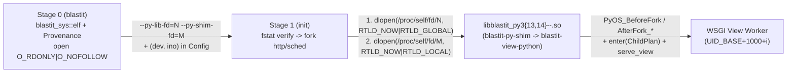

# Universal Distribution, `libpython`-Free Runtime & PHP 8.3–8.6 (`ADR-0017`)

Authoritative technical blueprint (detail layer; `ADR-0017` is the decision record). Governs the universal `blastit` binary, per-minor Python `cdylib` shims, unified `blastit-audit` + `_blastit.py` bridge, safe local CLI handoff, PHP `8.6` end-to-end (`16` PHP shims), signed APT/RPM repositories + `docs/install.sh`, `py3-none-*` PyPI wheels, and `offworldnexus/blastit` on Composer.

## 1. Per-Minor Python Shim (`crates/blastit-py-sapi` + `crates/blastit-py-shim`)



### 1.1 Crate Boundaries, Shared Pinning & Single Audit Owner
- **`crates/blastit/Cargo.toml`:** `default = ["python", "php", "static"]`, `python = ["dep:blastit-py-sapi"]`, `php = ["dep:blastit-view-php"]`, `static = ["blastit-scheduler/static"]`. Delete `pyo3` and `blastit-view-python` from `crates/blastit` dependencies; strip `python_home`/`rpath`/`PYO3_PYTHON` from `crates/blastit/build.rs` (retain `coverage` only). Every `cargo build -p blastit` and `cargo build --workspace` produces a `libpython`-free, `libphp`-free, zero-`RUNPATH` binary. `make rs-no-default` (`--no-default-features`) pulls zero `blastit-py-sapi`, `blastit-view-php`, `blastit-view-static`, or `pyo3`.
- **Shared pinning in `crates/blastit-sys/src/pin.rs` (`<150` LOC):** lift `(path, st_dev, st_ino)` verified descriptor open (`open_pinned`) and `SharedObject` (`/proc/self/fd/<fd>`) here so `blastit-view-php` and `blastit-py-sapi` share one owner alongside `blastit_sys::elf`. Shared-object pins need only `(st_dev, st_ino)` because `libphp`, `libpython`, and both shims load once via `/proc/self/fd/<fd>`, whereas `EntryPin` (`st_size` + `st_ctime` + `O_PATH` fd + `repin_entry`) stays in `crates/blastit-view-php/src/pinning.rs` because PHP re-resolves `SCRIPT_FILENAME` by path per request.
- **`crates/blastit-py-sapi`** (`#![deny(unsafe_code)]`, `#[allow(unsafe_code)]` on `abi.rs` + `loader.rs` only; `<500` LOC/file): owns `abi` (including the `Copy` `PyRuntime<'a>` handle of `(*mut PyZygoteOpaque, PyForkHooks<'a>, &'a BlastitPyVtableV1)`), `discovery` (extracted from `crates/blastit/src/stage0/project_python.rs`), and `loader`.
- **`crates/blastit-py-shim`** (`crate-type = ["cdylib", "rlib"]`; deps: `blastit-py-sapi`, `blastit-sys`, `blastit-view`, `blastit-view-python`, `pyo3 = "0.30.1"`, `serde`, `serde_json`; non-default `extension-module = ["pyo3/extension-module"]`): exports `blastit_py_abi_v1` with `std::panic::catch_unwind` on every boundary.
- **`crates/blastit-audit` & retired binaries:** consolidate **both** `crates/blastit-py/src/audit.rs` **and** `crates/blastit/src/audit_v1.rs` into `crates/blastit-audit` (`<500`-LOC modules: `normalize`, `analyze`, `covering`, `model`, `obs`, `evaluate`, `learn`, `report`; zero `pyo3`), leaving one grant-diff/route-trace owner and `crates/blastit/src/cli/internal_json.rs` as a `<150`-LOC NDJSON dispatcher. Delete `crates/blastit-py/`, `Host::wheel`/`Install::Wheel`, and `crates/blastit-dbproxy/src/main.rs` + its `[[bin]]` stanza (`blastit-dbproxy` stays a library crate; `Makefile` `install:` and `blastit_build.py` drop `-p blastit-dbproxy`, and `Host::binary()` serves `--role=dbproxy` everywhere).

### 1.2 Frozen C-ABI Surface (`blastit_py_abi_v1`, `ABI_VERSION = 1`)
Exported `#[unsafe(no_mangle)] pub extern "C" fn` symbols in `libblastit_py3{13,14}-<arch>-<libc>.so`: `blastit_py_abi_version() -> u32` (`1`), `blastit_py_minor() -> u32` (`313` or `314`), `blastit_py_abi_v1() -> *const BlastitPyVtableV1`.

```rust
#[repr(C)]
pub struct PyBufV1 { pub ptr: *mut u8, pub len: usize, pub cap: usize }
#[repr(C)]
pub struct PyZygoteOpaque { _private: [u8; 0] }

#[repr(C)]
pub struct BlastitPyVtableV1 {
    pub abi_version: extern "C" fn() -> u32,
    pub py_minor: extern "C" fn() -> u32,
    pub before_fork: extern "C" fn(),       // PyOS_BeforeFork (caller holds GIL)
    pub after_fork_parent: extern "C" fn(), // PyOS_AfterFork_Parent
    pub after_fork_child: extern "C" fn(),  // PyOS_AfterFork_Child
    /// Py_InitializeEx(0), SITE_PACKAGES, restores sys_path (Vec<Vec<u8>>) + cwd, checks minor,
    /// evaluates VIEW_PATHS & SYS_PATH -> {"version","prefix","view_paths","sys_path"}.
    pub init_paths: extern "C" fn(req: *const u8, req_len: usize, out: *mut PyBufV1, err: *mut PyBufV1) -> i32,
    /// LoadedTracker (if report_fd >= 0), imports app + preload + warmup, flushes boot batch,
    /// CLOSE_AND_COLLECT, immortal::apply, gc.freeze() -> {"decision","objects","reason","elapsed_ns"}.
    pub preload: extern "C" fn(req: *const u8, req_len: usize, zygote: *mut *mut PyZygoteOpaque, out: *mut PyBufV1, err: *mut PyBufV1) -> i32,
    /// PyCode::compile with PyCodeInput::File without execution (`dev` reload preflight).
    pub check_syntax: extern "C" fn(zygote: *mut PyZygoteOpaque, code: *const u8, code_len: usize, path: *const u8, path_len: usize, err: *mut PyBufV1) -> i32,
    /// Post-`blastit_sys::child::enter(plan)` child entry: sets Python os.environ["HOME"/"TMPDIR"],
    /// adopts view_fd + optional (loaded_fd, loaded_source), runs serve_reporting (returns 0, 1, or 70).
    pub serve_view: extern "C" fn(zygote: *mut PyZygoteOpaque, req: *const u8, req_len: usize, err: *mut PyBufV1) -> i32,
    pub free_buf: extern "C" fn(buf: PyBufV1),
}
```
- **Zero-global fork wiring:** `forking.rs` takes `Option<PyForkHooks<'_>>` (`Copy` struct of `(before_fork, after_fork_parent, after_fork_child)` plus `PhantomData<&'a LoadedPy>`) injected from `LoadedPy` into `visibility::*` and `Supervisor`.
- **Symbol-gate semantics (`gate_libpython`):** a `.dynsym` entry counts as exported only when `st_shndx != SHN_UNDEF` (an object that merely imports `Py_InitializeEx` must not pass), and `sh_entsize` is validated against the ELF class minimum before scanning.
- **`make py-sapi`:** iterates `PY_MINORS ?= 3.14 3.13`; finds `PY_SAPI_PYTHON_<digits>` -> `/opt/python/cp<digits>-cp<digits>/bin/python3` (inside `quay.io/pypa/manylinux_2_28_<arch>` for release builds) -> `uv python find --no-project <minor>` -> `command -v python<minor>`; builds in `CARGO_TARGET_DIR=target/py-sapi/build-<digits>` with `PYO3_PYTHON=<interp>`, `--features extension-module`, `-C link-arg=-Wl,-soname,libblastit_py<digits>-<arch>-<libc>.so` (`-C target-feature=-crt-static` on `musl`), writes `target/py-sapi/libblastit_py<digits>-<arch>-<libc>.so`, and runs `scripts/check-portable-elf.sh` (`--max-glibc 2_28` on `gnu` release builds) + `DT_SONAME` + `UND Py_InitializeEx`. `PY_SAPI_REQUIRE_ALL=1` fails closed in release/CI builds.

### 1.2.1 Fork, zygote & GIL ownership
1. **Who forks & Stage-1 order (`Embed` vs `Hosted`):** Only Stage 1 (`init`) forks view workers (the shim never calls `fork(2)`). After `test_swap_pause` + `fstat` `(st_dev, st_ino)` re-verify, Stage 1 splits by installation:
   - **`Embed`** (universal binary; shim owns CPython): `fork(http)` (`hooks = None`) -> `fork(scheduler)` (`hooks = None`) -> `dlopen(libpython, RTLD_NOW | RTLD_GLOBAL)` -> `dlopen(shim, RTLD_NOW | RTLD_LOCAL)` -> `blastit_py_abi_v1()` (`abi_version`/`py_minor`) -> `init_paths` -> `hooks = Some(loaded.hooks())` (`Serve` `visibility::{unreadable,writable}` forks) -> `preload(zygote)` -> per-view `fork` via `blastit-view::spawn::Forker` (`ForkProtocol::InterpreterLive`, `Some(hooks)`).
   - **`Hosted`** (wheel where CPython is already live before Stage 1, until `crates/blastit-py` is retired): `dlopen(shim, RTLD_NOW | RTLD_LOCAL)` only (**no** `dlopen(libpython)`, **no** `gate_libpython`, **no** `init_paths`) -> `hooks = Some(loaded.hooks())` -> `fork(http)`/`fork(scheduler)` (and Stage-0 `dbproxy`/`visibility` forks) with `Some(hooks)` -> `preload(zygote)` -> per-view `fork` via `Forker` (`Some(hooks)`).
2. **Zygote & `PyRuntime<'a>` ownership (zero `pyo3` in `crates/blastit`):** The `Py<PyAny>` app, `immortal` state, and `LoadedTracker` live **only** inside the shim's `Box::into_raw` `PyZygoteOpaque`: the shim owns the box, it is **never** dropped, `crates/blastit` must **never** `Box::from_raw` it, and **no `free_zygote` entry may ever be added** (every forked view references the `Py<PyAny>` inside). **No `pyo3` or `blastit_view_python` type may appear in any `crates/blastit` signature, struct field, or `cfg`**: Stage 1's `Serving`/`Parts<'a>` owns `Option<LoadedPy>`, `Supervisor<'a>` borrows `Option<PyRuntime<'a>>` (`Copy` struct `(*mut PyZygoteOpaque, PyForkHooks<'a>, &'a BlastitPyVtableV1)` in `blastit-py-sapi::abi`), and `forking.rs`/`visibility.rs` take `Option<PyForkHooks<'_>>`.
3. **`LoadedTracker` lifecycle:** Installed inside `vtable.preload` **pre-fork** (before importing `app`) iff `report_fd >= 0`, harvested/flushed once after `warmup` (`boot = true` on `report_fd`, then closed) before `CLOSE_AND_COLLECT`/`immortal::apply`/`gc.freeze()` so `_blastit_loaded` in `sys.modules` is inherited by view children (`serve_view` adopts per-view `(loaded_fd, loaded_source)`). Across a `dev` `exec_cycle` re-exec it is **re-`preload`ed** from scratch (`execve` destroys the frozen heap; never reused).
4. **Reload syntax check:** Runs **in the Stage-1 parent** (`Supervisor::begin_cycle`) via `vtable.check_syntax(zygote, ...)` (`PyCode::compile` with `PyCodeInput::File` — compile-only, no import, no execution, never `PyCode::compile` in `crates/blastit`): a **successful** cycle re-execs (`exec_cycle`) so the parse allocation is discarded, and only a **rejected** save warns and returns before `Ctl::Reload`, leaving that parse allocation in the frozen parent.
5. **GIL discipline & child sequence:** `crates/blastit` never calls a `pyo3` API; it calls only the three `PyOS_*Fork` hook pointers, always with the GIL held. `Embed`'s `init_paths` calls `Py_InitializeEx(0)` directly (never `Python::initialize()`, which detaches), leaving the GIL held on Stage 1's sole thread (`Hosted` already holds it); `init_paths` (post-init), `preload`, `check_syntax`, and `serve_view` each do `PyGILState_Ensure`/`Release` (`Python::attach`, keeping Stage 1's GIL held while `serve_reporting` calls `py.detach` for worker threads). Per-view fork order: `before_fork` -> `blastit_sys::fork` -> (`after_fork_parent` on `Ok(Parent) | Err`; in child: `after_fork_child` **before** `blastit_sys::child::enter(plan)` -> `enter(plan)` -> `serve_view` -> `_exit`).
6. **`Adoption.py_fds` across `dev` `exec_cycle`:** On non-reload boots both `(lib_fd, shim_fd)` `OwnedFd`s drop right after `dlopen`. With `dev` reload on, `Serving` holds `(OwnedFd, OwnedFd)` alongside `LoadedPy` and moves them through `Parts` into `supervise::Adoption` (the single `OwnedFd` owner, while `stage1::Adoption` holds only `py_fds: Option<(RawFd, RawFd)>`), keeping them open (`FD_CLOEXEC` set) until `exec_cycle` clears `FD_CLOEXEC` for `execve` (never re-opened by path; `http`/`dbproxy`/`chan`/`learn`/`policy` also survive, while `ctl.chan`/`scheduler`/`signalfd`/`fanotify` recreate and PHP `PhpBinding`s **re-pin** via `boot_bindings`). Both initial (`--py-lib-fd`/`--py-shim-fd`) and replacement (`Adoption.py_fds`) boots immediately re-set `FD_CLOEXEC` and **re-verify `fstat` `(st_dev, st_ino)` against `Config.python` right after `test_swap_pause`** (before TCP bind, forks, or `dlopen`).

## 2. Stage-0 Python Discovery, Provenance & FD Pinning

1. **Activation Gate (hard rule):** runs **only** when a Python WSGI view/app is active (`!runs_own_executors(&manifest) || config.app.is_some()`, after `static_app_refusal`). PHP-only and static-only boots **never** search for, open, or `dlopen` `libpython` or `libblastit_py*`.
2. **Interpreter Resolution Order (filesystem-only, zero Python execution in Stage 0):** `{cmd}` is `dev`, `check` or `serve`; every refusal in §2.2–§2.4 is printed to `stderr` as `blastit {cmd}: <sentence>`.
   - `Dev` & `Check`: (1) `BLASTIT_PYTHON` — if set and missing, non-regular, or non-executable, fail closed immediately with `blastit {cmd}: BLASTIT_PYTHON ({path}) is not an executable file; unset BLASTIT_PYTHON, or point it at {venv}/bin/python3` (`venv`/`uv venv` write `bin/python3`, never `bin/python3.14`); (2) `$VIRTUAL_ENV/bin/{python3,python}` (`pyvenv.cfg` present); (3) `<manifest_dir>/.venv/bin/{python3,python}` (`pyvenv.cfg` present); (4) `BLASTIT_WHEEL_PYTHON` (set by `__main__.py` to `sys.executable`, stripped by `blastit-env`); (5) `{python3,python}` on `PATH`.
   - `Production` (`Serve`): (1) `BLASTIT_PYTHON` — if relative, refuse distinctly with `blastit {cmd}: BLASTIT_PYTHON ({path}) is not an absolute path; a deployment reads only absolute paths — use an absolute path such as {venv}/bin/python3`, else require executable regular file (same invalid-file sentence above); (2) `<manifest_dir>/.venv/bin/{python3,python}` (`$VIRTUAL_ENV` is **never** read in `Serve`); (3) `BLASTIT_WHEEL_PYTHON` (must be absolute); (4) `{python3,python}` in `/usr/local/bin`, `/usr/bin`, `/bin`.
   - **No interpreter found:** `blastit {cmd}: no CPython 3.13 or 3.14 interpreter was found (searched {searched}); run uv python install 3.14`.
3. **`PYTHONHOME`, `site-packages`, Distinct Refusals & `libpython`/Shim Resolution:**
   - Venv (`../pyvenv.cfg`): read `home = <dir>` -> `python_home = Path::new(home).parent()`, prepend `<venv>/{lib,lib64}/python3.{13,14}/site-packages` to `config.sys_path`. Non-venv: `canonicalize(interpreter)` -> `python_home = exe.parent()?.parent()?`.
   - **Unresolvable prefix / unreadable minor (two distinct variants):** `blastit {cmd}: CPython at {path} cannot be used: {detail}; reinstall it with uv python install {minor}` (when prefix resolution fails) and `blastit {cmd}: CPython at {path} does not say which minor it is ({detail}); reinstall it with uv python install 3.14` (when the minor cannot be read).
   - **Free-threaded refusal (`3.13t`/`3.14t`):** `blastit {cmd}: CPython {found} at {interpreter} is free-threaded and cannot serve WSGI views; reinstall it without --free-threaded (uv python install cpython-3.14)`.
   - **Unsupported-minor refusal (`3.12`, `3.15`, etc. — one next step only):** `blastit {cmd}: CPython {found} at {interpreter} is not supported for WSGI views (CPython 3.13 and 3.14 are supported; Python 3.12+ runs blastit check, fmt, and fold): run uv python install 3.14 && uv venv --python 3.14`.
   - Search `libpython3.<m>.so.1.0` then `libpython3.<m>.so` across `<python_home>/lib/<triplet>`, `<python_home>/lib64`, `<python_home>/lib`, `/usr/lib/<triplet>`, `/usr/lib64`, `/usr/lib`, `/usr/local/lib`; refuse missing shared lib with `blastit {cmd}: CPython {minor} is installed at {python_home}, but this host has no shared libpython for CPython {minor}; install it — Debian/Ubuntu: apt install libpython{minor}, Alpine: apk add python3, Fedora/RHEL: dnf install python3-libs — or provision one with uv python install {minor}`.
   - Shim search & split `NoShim` refusals: `Deployment` searches `<exe_dir>` only and refuses with `blastit {cmd}: CPython {minor} is ready, but no {name} shim sits beside this blastit; install the blastit build that ships the CPython {minor} shim` (no env-var clause because `shim_dir` is never searched in deployment); `Development`/`Check` searches `$BLASTIT_PY_SHIM_DIR` -> `<exe_dir>` -> `<cargo_target_ancestor>/py-sapi` and refuses with `blastit {cmd}: CPython {minor} is ready, but no {name} shim was found (looked in {searched}); build one with make py-sapi, or point BLASTIT_PY_SHIM_DIR at a directory that holds it`.
4. **ELF Gate, Loader Diagnostics, Provenance & FD Handoff:**
   - Stage 0 opens `libpython` and `shim` via `blastit_sys::pin` (`O_RDONLY | O_CLOEXEC | O_NOFOLLOW | O_NONBLOCK`), checks `libpython` `.dynsym` (`Py_InitializeEx`, `PyGILState_Ensure`, `PyOS_BeforeFork` with `st_shndx != SHN_UNDEF`; `DT_SONAME` not `*t.so*`), and in `Serve` runs `Provenance::check_objects` on `(libpython, shim)` + `check_trees` on `(python_home, venv_root?, manifest_dir)`.
   - **Loader & pin refusal rules:** every load/pin refusal renders `SharedObject::source()` for refusals and `SharedObject::path()` (`/proc/self/fd/<N>`) for `dlopen` (never `/proc/self/fd/<N>` in refusals), and decodes `py_minor` via `dotted_py_minor()` (never raw `313`/`314`). Free-threaded `DT_SONAME` refuses with `blastit {cmd}: CPython at {interpreter} is free-threaded ({soname}) and cannot serve WSGI views; reinstall it without --free-threaded (uv python install cpython-3.14)`. `NotALibrary`/`MissingSymbols` backtick-quote missing symbols and emit `install the shared libpython for CPython {minor}: apt install libpython{minor}`; `AbiVersion` refuses with `blastit {cmd}: the shim was built for blastit_py_abi version {found}, but this blastit speaks version {ABI_VERSION}; install the blastit build that ships this shim`; identity swap refuses in prose (no `Debug` tuple, no internal stage name): `{path} was replaced after blastit inspected it (inode {expected} is now {found}); restore the file and restart blastit`.
   - Stage 0 sets `PYTHONHOME=<python_home>` in `stage1_env` (unless already in `app_env`), clears `FD_CLOEXEC` on `(libpython_fd, py_shim_fd)` **only** for Stage-1 `execve` (`--py-lib-fd=<N> --py-shim-fd=<M>`), and Stage 1 adopts both `OwnedFd`s, re-sets `FD_CLOEXEC`, verifies `fstat` `(st_dev, st_ino)` matches `Config.python` (after `test_swap_pause`), and loads/forks per §1.2.1 (`Adoption` carries `py_fds: Option<(RawFd, RawFd)>` across `dev` `exec_cycle`; otherwise both fds close right after `dlopen`).

## 3. Pure-Python Bridge (`_blastit.py`) & `blastit --internal-json`

- **`python/blastit/_check_pytest.py`:** `_probe` calls `_probe_stdlib` directly. `check.rs::bundled_python` resolves `<exe_dir>/../python` or `<exe_dir>/../../..` (`site-packages` when `blastit/_check_pytest.py` sits beside `_bin/blastit`).
- **`python/blastit/_blastit.py` (`100%` stdlib, Python `>=3.12`) & `Makefile` `test-critical`:** lazy `blastit --internal-json` NDJSON pipe child guarded by `(owner_pid == os.getpid(), threading.Lock)` + `os.register_at_fork(after_in_child=...)` (resetting lock and closing inherited fds without flush) + `atexit` cleanup. Every `{"ok":false,"error":msg}` response raises `ValueError(msg)`. Exposes `bin_path()` (`<pkg>/_bin/blastit` -> `<pkg>/../../lib/blastit` -> `BLASTIT_BIN` -> `PATH`) and `main(argv: list[str], executable: str, dbproxy: str = "") -> int` (sets `BLASTIT_WHEEL_PYTHON=executable` via `setdefault` + `BLASTIT_HANDOFF_DONE="1"`, then `os.execvpe(bin_path(), [bin_path(), *argv], env)`). `Makefile` `test-critical` stages `target/debug/blastit` at `$(CRITICAL_STAGE)/blastit/_bin/blastit` and symlinks `_bin/blastit-dbproxy -> blastit` so protected `test_lsp_stdio.py` and `test_check_contract.py` pass with zero edits. `python/blastit/__main__.py` calls `_blastit.main(sys.argv[1:], sys.executable, "")`, and `main_lsp()` `os.execvpe`s sibling `blastit-lsp`.

| `op` (`--internal-json`) | Python signature in `_blastit.py` | JSON `args` keys | `result` type |
|---|---|---|---|
| `normalize` | `normalize(sql: str) -> str` | `{"sql": str}` | `str` |
| `has_quoted_literal` | `has_quoted_literal(sql: str) -> bool` | `{"sql": str}` | `bool` |
| `redact_literals` | `redact_literals(sql: str) -> str` | `{"sql": str}` | `str` |
| `audit` | `audit(manifest_text: str, observations_json: str) -> str` | `{"manifest_text": str, "observations_json": str}` | `str` (JSON text) |
| `analyze` | `analyze(sql: str) -> str` | `{"sql": str}` | `str` (JSON text) |
| `covering` | `covering(statements: list[str], locator: str) -> str` | `{"statements": list[str], "locator": str}` | `str` (JSON text) |
| `classify` | `classify(sql: str) -> str` | `{"sql": str}` | `str` (JSON text) |
| `check_audit` | `check_audit(manifest_text: str, http_obs_jsonl: str, sql_obs_jsonl: str) -> str` | `{"manifest_text": str, "http_obs_jsonl": str, "sql_obs_jsonl": str}` | `str` (JSON text) |
| `plan_learn` | `plan_learn(manifest_text: str, http_obs_jsonl: str, sql_obs_jsonl: str, dry_run: bool = False) -> str` | `{"manifest_text": str, "http_obs_jsonl": str, "sql_obs_jsonl": str, "dry_run": bool}` | `str` (JSON text) |
| `probe_ingress` | `probe_ingress(content_type: str \| None, prefix: bytes, total_len: int) -> str` | `{"content_type": str\|null, "prefix_b64": str, "total_len": int}` | `str` (JSON text) |
| `blastfile_apply_edits` | `blastfile_apply_edits(source: str, edits_json: str) -> str` | `{"source": str, "edits_json": str}` | `str` |
| `blastfile_model` | `blastfile_model(source: str) -> str` | `{"source": str}` | `str` (JSON text) |

## 4. Safe Local CLI Handoff (`crates/blastit/src/cli/handoff.rs`)

User rule: *"`blastit` uses your project's `blastit` when `.venv/`, `vendor/bin/`, or `node_modules/.bin/` has one; `--version` and `--help` always answer from the global binary."* Prints **nothing** on valid handoff.
- **Scope:** runs in `cli::main` **only** for `Command::{Dev, Check, Fmt, Lsp}` (never `Serve`, `--preset`, `--stage=1`, `--role=*`, `--internal-json`, top-level `--help`/`help`, or `--version`). Skipped when `BLASTIT_HANDOFF_DONE` is non-empty, or `BLASTIT_NO_LOCAL_HANDOFF` is set and neither `""` nor `"0"`.
- **Candidate order from `cwd`:** (1) `$VIRTUAL_ENV/bin/blastit` if `VIRTUAL_ENV` is non-empty (explicit; no `./.venv` fallback when set), else auto-discovered `<cwd>/.venv/bin/blastit`; (2) `<cwd>/vendor/bin/blastit`; (3) `<cwd>/node_modules/.bin/blastit`.
- **Zero-TOCTOU verification per existing `lstat` candidate:**
  1. `canonicalize(&candidate)` -> `(parent, file_name)`, `parent_fd = open(parent, O_RDONLY | O_DIRECTORY | O_CLOEXEC | O_NOFOLLOW)`, `bin_fd = openat(parent_fd, file_name, O_RDONLY | O_CLOEXEC | O_NOFOLLOW)`: require regular file, `st_mode & 0o111 != 0`, `st_uid in {geteuid(), 0}`, and `st_mode & 0o022 == 0` on `bin_fd`, `parent_fd`, and every ancestor to `/` (except root-owned sticky dirs `st_uid == 0 && st_mode & 0o1000 != 0` whose immediate child is owned by `geteuid()` or `0`).
  2. **Failure policy:** if the candidate came from explicit `$VIRTUAL_ENV`, fail closed (`exit 1`) printing `blastit <cmd>: refusing local handoff to <path>: <reason>; set BLASTIT_NO_LOCAL_HANDOFF=1 to use global blastit` on `stderr`; for auto-discovered `.venv`/`vendor`/`node_modules` candidates, emit one warning line `blastit <cmd>: skipping unsafe local binary <path> (<reason>)` to `stderr` and continue probing (so `0775` CI checkouts or third-party-owned `node_modules` never brick `blastit dev`).
  3. If `(bin_stat.st_dev, bin_stat.st_ino) == stat("/proc/self/exe")`, stop probing and return `Ok(())`.
  4. Export `BLASTIT_HANDOFF_DONE=1`. Read 4 magic bytes from `bin_fd`: if `\x7fELF`, `execveat(bin_fd, c"", argv, envp, AT_EMPTY_PATH)`; if `#!`, `execve(canonical_path, argv, envp)` keeping `parent_fd` + `bin_fd` (`O_CLOEXEC`) open across the call so `binfmt_script` preserves `$0`/`__file__` and the inode cannot be recycled.

## 5. PHP `8.6` End-to-End Seam Specification (`16` PHP Shims)

1. **`crates/blastit-php-sapi` (`toolchain.rs`, `loader.rs`, `build.rs`, `Makefile`):** add `Minor::Php86` (`806`, digits `"86"`, dotted `"8.6"`, `["php-config8.6", "php-config"]`, `libblastit_php86-<arch>-<libc>.so` + `DT_SONAME`); `SUPPORTED_MINORS: [Minor; 4] = [Minor::Php86, Minor::Php85, Minor::Php84, Minor::Php83]` (**newest-first**); `CONFIG_NAMES: [&str; 5]` + `build.rs` (`php-config8.6`, `php-config86`, `SUPPORTED = ["8.6","8.5","8.4","8.3"]`); `loader.rs` `"8.3, 8.4, 8.5 and 8.6 are supported"`; `Makefile` `PHP_MINORS ?= 8.6 8.5 8.4 8.3`; C shim compiles cleanly under `-Wall -Wextra -Werror` against 8.6 headers.
2. **`crates/blastit-view-php/src/discovery.rs`:** `LIBPHP_CANDIDATES: [&str; 13]` prepends `libphp8.6.so`, `libphp-8.6.so`, `libphp86.so`; `LIBPHP_PROBES: [LibphpProbe; 17]` prepends those 3 (`per_minor_dir: None`) + `libphp.so` (`per_minor_dir: Some("php86")`); `library_dirs()` inserts `/usr/lib/php86` and `/usr/local/lib/php86` before `php85`; `SUPPORTED_PHP = "PHP 8.3, 8.4, 8.5 and 8.6"`. Make the package hint minor-aware (`php_packages_hint(Option<PhpVersion>)`, defaulting to `8.6` when none probed): `install the PHP embed package — Debian/Ubuntu: apt install libphp<M.m>-embed (stock Debian: libphp-embed), Alpine: apk add php<Mm>-embed, Fedora/RHEL: dnf install php-embedded — or set BLASTIT_LIBPHP=/path/to/libphp.so`.
3. **Digest-pinned containers & `scripts/platform_matrix.py` (`16` shims = `4 minors × 4 (arch, libc)`):**
   - `PHP_MINORS` adds `"8.6": "86"`; `PHP_BUILDS` adds `"extra_repo"` (`""` default, surfaced in `shim_legs()`, passed as `--build-arg EXTRA_REPO` by `e2e/php_sapi_probe.py`, which adds `"806"` to `{"803","804","805","806"}`):
     - `("8.6", "gnu")`: `base = "debian:bookworm-slim@sha256:734a72b3d6142a71993b4bc580ca01d8ca687f77a2c422d96a961d3376b179bc"` (glibc `2.36`), `extra_repo = "sury"` (download `https://packages.sury.org/php/apt.gpg`, assert `gpg --show-keys --with-colons` contains primary fingerprint `15058500A0235D97F5D10063B188E2B695BD4743` before installing `/etc/apt/keyrings/sury.gpg` and `/etc/apt/sources.list.d/sury.list`), `dev = "php8.6-dev"`, `embed = "libphp8.6-embed"`, `curl = "php8.6-curl"`, `libphp = "/usr/lib/libphp8.6.so"`, `suites = True`.
     - `("8.6", "musl")`: `base = "alpine:edge@sha256:020dfcbaaf4cc1078bf2d9c7ba31a8466e334061dcd2f248001d68f79e52c000"`, `extra_repo = "alpine-edge-testing"` (`echo "https://dl-cdn.alpinelinux.org/alpine/edge/testing" >> /etc/apk/repositories`), `dev = "php86-dev"`, `embed = "php86-embed"`, `curl = "php86-curl"`, `libphp = "/usr/lib/php86/libphp.so"`, `suites = True`.

## 6. Signed Repositories, Measured Glibc Floors, `install.sh` & Ecosystem Wrappers

### 6.1 Bundle Layout, Glibc Floors & Artifact Families (`scripts/platform_matrix.py`)
Bundle layout under `<prefix>` (`/usr` in `.deb`/`.rpm`, `/usr/local` or `~/.local` in `.tar.gz`/`make install`, `blastit-<target>/` in `.tar.gz`): `<prefix>/bin/{blastit,blastit-lsp}` -> `../share/blastit/lib/{blastit,blastit-lsp}` (plus `blastit-<target>/blastit -> share/blastit/lib/blastit` in `.tar.gz`), `<prefix>/share/blastit/{LICENSE, lib/{blastit, blastit-lsp, libblastit_php{83,84,85,86}-<arch>-<libc>.so, libblastit_py3{13,14}-<arch>-<libc>.so}, python/blastit/{__init__,__main__,_blastit,_check_pytest,fold,logs,pytest_plugin}.py}`.
- **Measured glibc floors (`scripts/check-portable-elf.sh --max-glibc <ver>`):** extend `check-portable-elf.sh` to parse `readelf --version-info` `.gnu.version_r` and fail when any `GLIBC_X.Y` exceeds `--max-glibc`. (a) `blastit`, `blastit-lsp`, and `gnu` `libblastit_py*.so` build inside `quay.io/pypa/manylinux_2_28_<arch>` and enforce `--max-glibc 2_28`; (b) `LIBCS["gnu"]["shim_floor"]` declares the max glibc across the distro-built PHP shim legs (`2.41` / `ubuntu:26.04` ceiling), and `scripts/build-{deb,rpm}.sh` run `check-portable-elf.sh --max-glibc <shim_floor>` over **every** ELF in `share/blastit/lib/` and stamp `Depends: libc6 (>= <measured>)` / `Requires: glibc >= <measured>` from the bundle's measured max `GLIBC_X.Y` (never hard-coded `2.28`). Lowering the `.deb`/`.rpm` package floor below `shim_floor` requires compiling the PHP shims against a `2.28` sysroot; otherwise the documented `.deb`/`.rpm` support floor is the measured `shim_floor`.
- **Machine install vs per-project pins:** there is **one machine install** (`install.sh`/`.deb`/`.rpm`/`.tar.gz`); `uv add --dev blastit` and `composer require --dev offworldnexus/blastit` are **per-project version pins, not install methods** — they populate `.venv/bin/blastit` / `vendor/bin/blastit` for local CLI handoff inside that project and are upgraded by `uv lock --upgrade` / `composer update`, never by `install.sh`.

| Family (`platform_matrix.py`) | Count & Keys / Filenames | Builder & Consumer Contract |
|---|---|---|
| `packages` (`.deb` + `.rpm`) | `4`: `blastit_<ver>_{amd64,arm64}.deb`, `blastit-<ver>-<rel>.{x86_64,aarch64}.rpm` | `build-{deb,rpm}.sh` (`dpkg-deb --root-owner-group`, `rpmbuild -bb` with `AutoReqProv: no`, `%global _build_id_links none`, zero hard PHP/Python deps). `packages.yml` (`main` on `v*`) + `nightly.yml` (`0.2.0~nightly<YYYYMMDD>.r<run>+g<sha>` `.deb`, `0.2.0-0.nightly.<YYYYMMDD>.r<run>.g<sha>` `.rpm`, keeping newest `7`) push to **Cloudsmith** (`offworld-nexus/{apt,rpm}`) + non-fatal **Forgejo** mirror (`https://forge.offworld.nexus`, `OffworldNexus`, skips cleanly when token unset) + GitHub Release assets. |
| `binaries` (`.tar.gz`) | `4`: `blastit-{x86_64,aarch64}-unknown-linux-{gnu,musl}.tar.gz` | `build-standalone.sh` (`--max-glibc 2_28` on `blastit`/`blastit-lsp`/`py_shims`, `--max-glibc <shim_floor>` on `php_shims`; `-crt-static` on `musl`). |
| `wheels` (`py3-none-*`) | `4`: `blastit-<ver>-py3-none-{manylinux_2_28,musllinux_1_2}_{x86_64,aarch64}.whl` | `build-wheel.sh` runs `maturin build --bindings bin` in `manylinux_2_28_<arch>` / `alpine:3.21` then `scripts/repack_universal_wheel.py` relocates `blastit`, `blastit-lsp`, and all `6` shims (`4` PHP + `2` Python) into `blastit/_bin/` (`0755`), keeps `[project.scripts]` (`blastit`, `blastit-lsp`, `blastit-manifest`), writes `Root-Is-Purelib: false` + `Tag: py3-none-<platform>` in `WHEEL`, and recomputes `RECORD`. `wheel_legs()` keys: `{name, arch, libc, python_tag: "py3-none", wheel_tag, smoke_pythons: "3.12,3.13,3.14", runtime_images: "python:3.12-<sfx>,python:3.13-<sfx>,python:3.14-<sfx>", runs_on, manylinux}` (`<sfx>` = `slim`\|`alpine`). Each wheel is smoke-tested in `3.12`, `3.13`, and `3.14`; `e2e/prebuilt_wheel.py` accepts `py3-none-manylinux_*` (`E2E_PYTHON_VERSION`, default `3.14`). |
| `shims` / `py_shims` / `lsp` | `16` PHP shims, `8` Python shims (`--matrix py-shims`), `5` `lsp` assets | Native builds; new `crates/blastit/tests/critical_universal_bundle.rs` verifies all bundle/wheel ELFs (`critical_artifacts.rs` untouched unless authorized in node `# Goal`). |
| Composer (`offworldnexus/blastit`) | `packages/composer-blastit/` (`composer.json` `"bin": ["bin/blastit"]`) | POSIX `sh` `bin/blastit`: caches to `${BLASTIT_COMPOSER_CACHE}` -> `<pkg_root>/.runtime` (if writable) -> `${XDG_CACHE_HOME:-$HOME/.cache}/blastit/composer`; verifies against embedded SHA-256 table on default GitHub URL, or requires `BLASTIT_SHA256=<hex>` / `BLASTIT_SHA256SUMS_FILE=<local-path>` when `BLASTIT_RELEASE_BASE_URL` overrides the origin (failing closed if absent); `BLASTIT_HANDOFF_DONE=1 exec .../blastit "$@"`. |

### 6.2 `docs/install.sh` Contract (`https://offworldnexus.github.io/blastit/install.sh`)
POSIX `sh`, `set -eu`, honours `NO_COLOR`/`TERM=dumb`, copied to `site/install.sh` in `docs.yml`. Flags: `--version <ver>`, `--nightly`, `--mirror cloudsmith|forgejo`, `--user`, `--prefix <dir>`, `--develop [ref]`, `-y/--yes`, `-h/--help`; env: `BLASTIT_RELEASE_BASE_URL`, `BLASTIT_SHA256`, `BLASTIT_SHA256SUMS_FILE`, `BLASTIT_DEB`, `BLASTIT_RPM`. Unknown flags, missing values, or unwritable `--prefix` print usage to `stderr` and **`exit 2`**.
- **TTY & pipe rule:** `stdin` is **never** consulted (`[ -t 0 ]` is forbidden) because `curl … | sh` carries the script on fd `0`. Interactivity is tested solely via `[ -r /dev/tty ] && [ -w /dev/tty ] && ( : </dev/tty ) 2>/dev/null`; confirmations and `sudo` prompts read `</dev/tty` and notes write to `stderr`, so `curl -fsSL …/install.sh | sh` in a terminal takes the signed-repo path.
- **Install paths:** (1) `BLASTIT_DEB`/`BLASTIT_RPM` installs the local file (`dpkg -i` / `rpm -Uvh --replacepkgs`); (2) Default GPG-signed repo install (never `--allow-unauthenticated`/`--nogpgcheck`): on Debian/Ubuntu (`apt-get` + `/etc/debian_version`) runs Cloudsmith `bash.deb.sh` (`main` or `nightly`, or signed Forgejo source with `--mirror forgejo`) then `apt-get update && apt-get install -y --no-install-recommends blastit[=<ver>]` via root / `sudo -n` / `sudo </dev/tty`, and on Fedora/RHEL/Rocky/Alma (`dnf`) runs `bash.rpm.sh` / signed Forgejo `.repo` then `dnf install -y blastit[-<ver>]`, falling back with a 1-line `stderr` note to `--user` when unprivileged without usable `sudo`; (3) Direct `.tar.gz` path (`--user` = `--prefix ~/.local`, `--prefix <dir>`, `--develop`, `musl`, or no-`sudo` fallback): verifies archive against the **embedded** SHA-256 table (or requires `BLASTIT_SHA256` / local `BLASTIT_SHA256SUMS_FILE` when `BLASTIT_RELEASE_BASE_URL` or `--develop` overrides the release asset, failing closed if absent), extracts into `<dir>`, prints the installed path, and prints `Add it to your PATH: export PATH="<dir>/bin:$PATH"` if `<dir>/bin` is not in `$PATH`.

## 7. Security Invariants

- **R1–R5:** Zero `libpython`/`libphp` `DT_NEEDED` or `RUNPATH` across all binaries/shims, with measured `--max-glibc` gates (`2.28` on `blastit`/`blastit-lsp`/`py_shims`, `shim_floor` on `.deb`/`.rpm`); PHP/static boots never load Python (`http`/`scheduler`/`dbproxy` map neither); Stage 0 never executes Python or `dlopen`s; Stage 1 verifies `(st_dev, st_ino)` on `--py-lib-fd`/`--py-shim-fd`; `Serve` enforces `Provenance`; CoW preload, `immortal` (`3.13`/`3.14`), `LoadedTracker`, and `check_syntax` hold.
- **R6–R8:** Single `blastit-audit` owner + fork-safe `_blastit.py` (`Python >=3.12` CLI/`check`/`fold` vs `3.13`/`3.14` WSGI serving); `Serve`/`--stage=1`/`--role=*`/`--internal-json`/`--help`/`--version` never hand off; handoff skips unsafe auto-discovered candidates with 1 `stderr` warning and exits `1` on unsafe `$VIRTUAL_ENV`.
- **R9–R12:** Repo installs enforce GPG and archive installs verify embedded/`BLASTIT_SHA256` digests (never trusting remote `SHA256SUMS` from an overridden URL); `platform_matrix.py` enforces `4` packages, `4` wheels, `4` archives, `16` PHP shims (`8.3`–`8.6`), `8` Python shims, and `5` `lsp` assets; `e2e/rootless/` `setcap`s `blastit` (`BLASTIT_EXEC`), never `python3`; **zero user-facing pages may contain `uv run blastit` or `uv run --project`** (enforced by `docs_fences.rs` and `runnable_docs`).

## Slices

| Slice | Owner | Scope |
|---|---|---|
| `MB.42.2` | `implementer` | `blastit_sys::pin`, `blastit-py-sapi`, `blastit-py-shim`, unified `blastit-audit` (retiring `audit_v1` + `blastit-py` + `blastit-dbproxy` bin), `make py-sapi`, Stage-0/1 Python `dlopen`, `--internal-json` + fork-safe `_blastit.py`, `cli/handoff.rs`. |
| `MB.42.5` | `implementer` | PHP `8.6` (`Minor::Php86`, minor-aware `discovery.rs`, `platform_matrix.py` `16` shims + digest/GPG-pinned `extra_repo`, `php_sapi_probe.py` `806`, `8.3`–`8.6` support sentences). |
| `MB.42.3` | `implementer` | `check-portable-elf.sh --max-glibc`, `.deb`/`.rpm` measured `shim_floor`, Cloudsmith + Forgejo workflows (`packages.yml`, `nightly.yml`), `/dev/tty`-aware `docs/install.sh` + `site/install.sh`, `repack_universal_wheel.py` (`3.12`/`3.13`/`3.14` smokes), Composer wrapper, `critical_universal_bundle.rs`. |
| `MB.42.4` | `writer` | 3-line hero, zero `uv run blastit` fences, signed-repo `docs/install.md` + Cloudsmith attribution + machine-vs-pin rule, Python `3.13/3.14` vs `3.12+` & PHP `8.3`–`8.6` prose, `docs_fences.rs`, `runnable_docs`, `e2e/`. |
