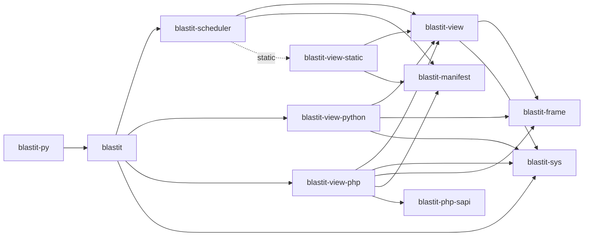

# View crates over the wire: `blastit-view` as transport, one crate per view kind, a thin `blastit`

This document fixes the crate graph, the file-by-file move list, the Cargo feature matrix and
the seam types of `MB.36` **before a single file moves**. It supersedes the `WorkerRuntime` /
`Upstream` **trait** requirement of [ADR-0009](../decisions/ADR-0009-runtime-providers-and-capability-gating.md)
Decision 1 (and of `docs/design/backend-runtimes.md` §4.1–§4.2) with the interface the network
already defines: `view.chan` plus the process that speaks it. Every security, pinning, sandbox
and distribution invariant of ADR-0009/ADR-0010 survives verbatim; §5 is the item-by-item
proof. The decision is recorded as [ADR-0016](../decisions/ADR-0016-view-crates-over-wire.md).

Measurements are `wc -l` / `grep -c` of this worktree on 2026-11-17 and are re-runnable:
`wc -l crates/blastit-view/src/*.rs crates/blastit/src/{zygote,immortal,php_view,stage0}.rs`.

## 1. Developer Experience Target (Local, CI/CD, Deploy)

**This epic changes nothing a developer types, reads or writes.** No new flag, no `Blastfile`
keyword, no environment variable, no log event, no status code. The design's job is that moving
~16 000 lines of Rust (sources and relocated tests) between crates is invisible. The table is
the **executable** form of that promise: each row is a command whose stdout/stderr/exit code is
captured from a scratch checkout of `develop` and from the epic head, and the two captures must
match exactly after §1's documented mask (below). `MB.36.7` runs it.

| # | Documented behaviour | Command (on a fixture) | What the capture must show |
|---|---|---|---|
| 1 | `blastit dev` static | `blastit dev` on a `static "/" { root "public" }` fixture, then `GET /index.html`, `GET /missing`, `GET /..%2fetc` | `200` with the file's bytes and `ETag`; `404`; `400` |
| 2 | `blastit dev` PHP | `blastit dev` on `entrypoint php "public/index.php"`, `GET /` twice | two `200`s and two `request` events with the same status; when `cpu_ns` is present it is `<=` the event's own `duration_ms` in ns (a cheap script may report none) |
| 3 | `blastit dev` WSGI | `blastit dev` on `entrypoint python "shop.wsgi:application"`, `GET /`, a `POST` with a JSON body | the app's status/body; a `413` where the route declares no body |
| 4 | `blastit dev --no-reload` | boot with `--no-reload` | no `reload: on` line, no `dev.reload*` event |
| 5 | `blastit check` | `blastit check` and `blastit check --json` on a complete fixture, then on one missing a grant | the same exit codes; the JSON document identical to the `develop` capture (schema owned by `critical_check_schema`) |
| 6 | PHP refusal sentence | boot with `BLASTIT_LIBPHP=/dev/null` | exit 1, one sentence naming the route, its `entry`, the distro package and `BLASTIT_LIBPHP` |
| 7 | no-interpreter refusal | a `--no-default-features` build, `entrypoint python "…"` | exit 1, one sentence naming `uv add blastit` |

The capture is normalised before the diff, because a byte-identical capture is impossible and
pretending otherwise is the unfalsifiable oracle this row replaces. Masked: `ts`, `duration_ms`,
`cpu_ns`, `wall_ns`, `request_id`, `pid`, `fork_ms`, `cost_ns` and the version banner. **Not**
masked — and compared by shape — is the `ETag`, which is hex (`"[0-9a-f]+-[0-9a-f]+"`, matching
`static_response.rs:203`'s `{:x}-{:x}`); two runs of the same file must agree on the shape, never
on the value. Everything else — statuses, header names and order, bodies, exit codes, and the two
refusal sentences — must match exactly.

Rows 1–5 are `docs/local.md` (`## Start`), `docs/reference/cli.md` (`## blastit dev`,
`## blastit check`), `docs/ci.md`, `docs/frameworks/static-and-spa.md`,
`docs/frameworks/php/index.md` and `docs/frameworks/python/index.md`; rows 6–7 are the boot
sentences those pages promise. `MB.36.7` additionally lands
`crates/blastit/tests/dx_invariance.rs` (non-protected), which asserts rows **1 and 3** in
process; row 4 is a boot-line capture, row 7 a build-level one, and rows 2/5/6 the remaining
captures plus `critical_check_schema`.

No new user page is written: a page that says "the internals moved" is the bloat `dx-first`
forbids, and the `Blastfile` fences in `crates/blastit-manifest`'s `docs_fences` suite must keep
parsing untouched.

## 2. Goals & Non-Goals

**Goals.**

1. `crates/blastit-view` is the `view.chan` **transport**: frames, credit windows, the
   loaded-file datagram, `ViewError`, the one request-target path decoder and the shared spawn
   context. Zero `pyo3` (including `[dev-dependencies]`), zero `blastit-php-sapi`, no
   `runtime.rs`.
2. One crate per view kind — `blastit-view-python`, `blastit-view-php`, `blastit-view-static` —
   each owning the innards of its process (or, for static, its library) end to end.
3. `crates/blastit` is the composition root: CLI, stage 0, stage 1, supervisor, role wiring,
   `forking.rs`. It contains no per-language worker code.
4. Adding `blastit-view-node` (`0.2.2`) or `blastit-view-jvm` (`0.2.3`) is a new crate plus one
   feature line, with no edit to another view kind's worker and no new `unsafe`.

**Non-goals.** No behaviour change (R14). No new manifest or CLI surface. No new third-party
dependency (R17). No second `view.chan` implementation, no second admission queue, no second
HTTP parser. Not the Node/JVM crates themselves, and not the `MB.33`/`MB.23.5.2` features that
must land before the freeze.

## 3. Requirements

Each requirement names an oracle that can fail; §7 repeats them as a table.

- **R1 — Acyclic graph.** No view crate depends on `blastit` or on `blastit-scheduler`;
  `blastit-scheduler` depends on `blastit-view-static` only behind its own `static` feature.
  Oracle: `cargo tree -p <crate> --edges normal,build,dev --prefix none` per crate, plus the
  edge assertions in §7.
- **R2 — Transport purity.** `crates/blastit-view/Cargo.toml` has no `pyo3` line (not even a
  `[dev-dependencies]` one) and no `blastit-php-sapi` line; `crates/blastit-view/src/runtime.rs`
  does not exist; `cargo tree -p blastit-view -e normal --prefix none` contains no `pyo3` and no
  `blastit-php-sapi` (it does contain `thiserror`'s own deps — the oracle is the negative, not
  an exact list).
- **R3 — The worker trait is deleted; the transport helpers survive.** `WorkerRuntime`,
  `RequestIo`, `RequestEnd` and `RequestIo::flush_response` stop existing; `OutputStream` and
  `OUTPUT_LINE_CAP` **move** to `blastit-view::stream` (the PHP worker formats app.output lines
  with them); `serve_forever` takes the concrete `PhpEmbedRuntime`. Oracle: a grep for the four
  deleted names is empty and `grep -q 'pub enum OutputStream' crates/blastit-view/src/stream.rs`.
- **R4 — The view child sequence is one function.** `enter` returns `Err` before any load on any step's failure, and every caller exits non-zero with that sentence (`child_exit`, as today), never continues. `blastit_sys::child::enter` runs
  `prepare → setpgid(0,0) when asked → drop_privileges → harden_child → install_filter →
  set_dumpable(false) → saved signal mask (when there is one)`, with its own doc for each step
  and the best-effort `set_dumpable` policy; it has exactly **three** call sites — the WSGI
  fork, the PHP worker fork and the PHP probe — and no view-side call site re-implements a step.
  Init's role children (`stage1::prepare_child`) are out of scope and unchanged.
- **R5 — Discovery never loads.** `blastit-view-php::discovery` names no SAPI type, no
  `binding`/`worker` module and no `dlopen`; its oracle is the grep in §7 plus the unchanged
  canary `/proc` legs.
- **R6 — Pinning unchanged, and fail-closed by construction.** The `libphp` and shim pins are
  `(st_dev, st_ino)` re-opened `O_RDONLY|O_CLOEXEC|O_NOFOLLOW` and `dlopen`ed as
  `/proc/self/fd/<n>`; the `entrypoint php` record is `(st_dev, st_ino, st_size, st_ctime)`,
  held in an **opaque `EntryPin`** with no `Option` and no `Default`, verified once at load and
  before **every** request.
- **R7 — Static stays `openat2`-only with one decoder, and the decoder stays out of the static
  crate's resolution path.** `STATIC_RESOLVE_FLAGS` unchanged, the segment walk remains the only
  kernel-without-`openat2` path, `.php`/`.phtml`/`.phar` are never served, the scheduler decodes
  once and hands `&[&str]` to the static crate, and the only `percent_decode` text in
  `blastit-view-static` is the `use` plus the `head_segments` test mirror (§7 has the exact
  command).
- **R8 — Seccomp roles unchanged.** `SeccompRole::View` for WSGI, `EmbeddedView` for PHP (and
  the probe), `Scheduler` still zero `socket()`; the filter is installed after the privilege
  drop and after `setpgid`, and before the first thread.
- **R9 — Secret barrier unchanged.** No new `BLASTIT_*`, no secret in a view's `environ`; the
  dev report socket and the pinned fds travel in `ChildIo.keep`.
- **R10 — Wire unchanged.** Frame types, `INITIAL_WINDOW`, the 64 KiB response low-water mark,
  `CANCEL`/`ABORT`, `RESP_END_COST`, the stale-frame rules and the `loaded` datagram codec are
  identical bytes.
- **R11 — Standalone artifact.** `cargo build -p blastit --locked` (defaults) has no
  `DT_NEEDED` on `libpython` and none on `libphp`, and no `RPATH`/`RUNPATH`.
- **R12 — Wheel artifact.** The wheel family carries the `python` capability and never a
  `libphp` `DT_NEEDED`.
- **R13 — Feature wiring, and it builds at every corner.** `blastit` is
  `default = ["php", "static"]`; `blastit-view` is `default = []`; `blastit-py` enables
  `python`; `cargo build -p blastit --locked --no-default-features` compiles; no build or ship
  command uses `--workspace`.
- **R14 — Zero behaviour change.** §1's seven captures diff empty against `develop`.
- **R15 — No protected case lost.** Every moved `critical_*.rs` keeps its case count (a
  `cargo test … -- --list` count, not a `grep`), and the two trait-machinery unit cases that are
  deleted with their subject are listed in §4.2.1.
- **R16 — Green increments.** Each leaf ends `make check` green and is the only `Cargo.lock`
  owner of its step.
- **R17 — No new dependency.** No new third-party crate: the only manifest edits are workspace
  members, path dependencies between workspace crates, optional members, feature lines and
  `rustix` at the workspace's existing version/features.
  Neither worker crate adds `libc` (the `setenv`/fd-adoption helpers they need are safe
  `blastit-sys` functions; `setpgid` is `rustix::process::setpgid`).
- **R18 — The payoff.** A fourth view kind adds a crate and a feature line; no existing view
  kind's worker source changes. Oracle: MB.36.5's diff touches no
  `crates/blastit-view-python/src/{environ,input,request,response,serve}.rs`.

## 4. Architecture & Data Flow

### 4.1 Crate graph (the shape `MB.36.1` must not change)

| Crate | Owns (after this epic) | Process | Compiled when |
|---|---|---|---|
| `blastit-frame` | raw frames, `ReqHeadView`, `Limits` | — | always |
| `blastit-view` | `wire`, `flow`, `stream`, `loaded`, `error`, `config`, `sync`, `path`, `spawn` — **transport primitives and the process seam only** | — | always |
| `blastit-view-python` | `environ`, `input`, `request`, `response`, `serve` (the worker pool), `loaded` (the Python tracker), `immortal`, `zygote` (the fork + child half) | view | `blastit` feature `python` |
| `blastit-view-php` | `worker` (`PhpEmbedRuntime`, `view.chan` loop), `discovery` (stage-0 ELF gate), `pinning` (library/shim + entry pins), `probe` (the boot probe child), `spawn` (the PHP fork + child half) | view | `blastit` feature `php` |
| `blastit-view-static` | `static_asset` (`openat2` resolution), `static_response` (MIME/`ETag`/`immutable`), `rewrite` (SPA answer) | **none** (library, called by the scheduler) | `blastit-scheduler` feature `static` |
| `blastit` | CLI, stage 0, stage 1, supervisor, `forking.rs`, role wiring | init / sched / http / dbproxy | always; `default = ["php", "static"]`; the wheel adds `python` |
| `blastit-sys` | kernel primitives **and** `child` (`ChildIo`, `enter`, `child_exit`, `setpgid`/`setenv` helpers, poll helpers) | — | always |
| `blastit-scheduler` | admission, routing, fair queue, `ViewSet`, dispatch; the static modules behind `feature = "static"` | sched | always |
| `blastit-php-sapi` | the frozen `blastit_php_abi_v1` surface and the one `dlopen` | view (via `view-php`) | with `php` |

Dependency DAG (arrows are "depends on"; a cycle is a failed leaf):



Three edges are the ones to guard: `blastit-scheduler -. static .-> blastit-view-static` (D3/D4:
optional, never the reverse); `blastit-view-python → blastit-view` + `blastit-sys` (never
`blastit`, never `blastit-scheduler`; D2); and **every new edge into `blastit-view` is declared
`default-features = false` from the leaf that adds it** — at `MB.36.2` the transport crate still
defaults `python`, so an edge with defaults on would unify `pyo3` into `-p blastit` and fail
`make rs-no-python` before `MB.36.3` ever deletes the default. `blastit-view-php` depends on `blastit-manifest`
because discovery reads the manifest data model — a data crate with no cycle — and on nothing
else from the root.

### 4.2 File-by-file module map

"Source" is the file as it exists today; "Destination" is where every line of it ends up; the
"unit cases" column is `grep -cE '#\[(tokio::)?test\]'` today and where those cases run after
the move (a dash means the file has none). The leaf's `RESULT.md` re-measures with `wc -l` and
`cargo test … -- --list`, so a silent deletion shows up as a drop.

#### 4.2.1 `crates/blastit-view` — transport only (13 files, 8 935 lines today)

| Source | Lines | Unit cases | Destination | Notes |
|---|---|---|---|---|
| `src/wire.rs` | 302 | 6 | `blastit-view/src/wire.rs` | `Writer`, `WriteError` become `pub` (the PHP worker writes through them) |
| `src/flow.rs` | 314 | 8 | `blastit-view/src/flow.rs` | `Flow`, `Credit` and `WINDOW_BATCH` become `pub`, with the methods the workers call (`Flow::{new, body_received, body_granted, response}`, `Credit::{take, try_take, grant, close}` — `try_take` loses its `cfg(feature = "php")` gate); `Credit::grant`'s doc says it is applied **only** from a `WINDOW` frame the scheduler sent — the worker forwards a grant, it never invents one, and the scheduler's own window accounting is unchanged (R10; exercised by `critical_rewrite`'s flow rows) |
| `src/loaded.rs` | 1 094 | 22 | `blastit-view/src/loaded.rs` | codec + `Reporter`; `LoadedReport` moves in from `runtime.rs` (ungated); `php.rs`'s identical `PhpLoadedReport` is deleted |
| `src/error.rs` | 53 | — | `blastit-view/src/error.rs` | unchanged |
| `src/sync.rs` | 13 | — | `blastit-view/src/sync.rs` | `lock` becomes `pub` |
| `src/config.rs` | 118 | 4 | `blastit-view/src/config.rs` | keeps `route_name` + `frame_limits` only; `script_name`, `max_threads` **and the four unit cases** move to `blastit-view-python/src/config.rs` (`WsgiConfig`, with `validate`) |
| `src/runtime.rs` | 1 088 | 5 | **split** | `OutputStream`, `OUTPUT_LINE_CAP` + 1 case (`the_output_line_cap_is_the_documented_2048`) → `blastit-view/src/stream.rs`; `LOADED_MODULE`, `LOADED_TRACKER`, `LoadedTracker`, `LoadedReporter` + their 2 cases → `blastit-view-python/src/loaded.rs` **in `MB.36.3`** (the leaf that drops the `python` feature, so nothing Python stays behind); `LoadedReport` (plain) → `blastit-view/src/loaded.rs`; the trait, `RequestIo`, `RequestEnd`, `flush_response` stay until `MB.36.5` and are then **deleted**, with 2 unit cases whose subject is deleted (`the_seam_is_object_safe…`, `a_request_writes_head_then_body…`) — R15 counts them here so nothing else may vanish |
| `src/lib.rs` (`frame_kind`, `:993`) | 20 | — | `blastit-view/src/lib.rs` as an **unconditional** `pub fn` **in `MB.36.3`** (its `cfg(any(python, php))` goes, since the crate has no features after that leaf; the PHP worker, still in this crate, needs it), moved to `blastit-view/src/stream.rs` in `MB.36.5` with `OutputStream` | protocol errors must never `{frame:?}` (body bytes in a log) |
| `src/path.rs` (**from** the scheduler) | 190 | 5 | `blastit-view/src/path.rs` | helpers become `pub` with their docs; D3 |
| — (new) | ~120 | 1 | `blastit-view/src/spawn.rs` | `SpawnContext`, `ForkProtocol`, `Forker` (D1/D2) |
| `src/php.rs` | 2 558 | 22 | `blastit-view-php/src/worker.rs` | whole file |
| `src/environ.rs` | 570 | 11 | `blastit-view-python/src/environ.rs` | in-file cases move with the file; 12 integration cases live in `tests/environ.rs` |
| `src/input.rs` | 568 | 11 | `blastit-view-python/src/input.rs` | in-file cases move with the file |
| `src/request.rs` | 487 | 4 | `blastit-view-python/src/request.rs` | in-file cases move with the file |
| `src/response.rs` | 536 | 5 | `blastit-view-python/src/response.rs` | in-file cases move with the file |
| `src/lib.rs` (loop) | 1 234 | 6 | `blastit-view-python/src/serve.rs` + `lib.rs` (~60) | the loop keeps 6 unit cases, in a test module that is unconditional in a feature-less crate |
| `Cargo.toml` | — | — | rewritten | `default = []`; `python`/`php` features, `pyo3` (incl. the `auto-initialize` dev-dep) and `blastit-php-sapi` deleted; `blastit-sys` added (R2) |
| — (rule) | — | — | every moved file | **delete every `#[cfg(feature = "python")]` / `#[cfg(feature = "php")]` attribute** in the files that change crate (43 in `lib.rs`, 15 in `runtime.rs`, 8 in `php_view.rs`): the destination crate *is* the feature, and a stale attribute is an `unexpected_cfgs` error under `rs-lint`'s `-D warnings`. `cfg(any(feature = "php", test))` becomes `pub`, `cfg_attr(not(feature = …), allow(dead_code))` is dropped |

#### 4.2.2 `crates/blastit-view-python`

| Source | Lines | Unit cases | Destination |
|---|---|---|---|
| `crates/blastit/src/immortal.rs` | 1 400 | 17 | `blastit-view-python/src/immortal.rs`; `crate::config::Immortalize` becomes a local `Setting { Auto, On, Off }` (~20) mapped by `blastit`'s `config.rs`; the module carries the crate's **only** `#[allow(unsafe_code)]` (raw `PyObject` refcount/flag
writes; its test module's `libc::setrlimit` becomes `blastit_sys::set_rlimits`, so no
production `libc` dependency is needed) |
| `crates/blastit/src/zygote.rs` | 281 | — | `blastit-view-python/src/zygote.rs` (**the module name `MB.36.4`'s acceptance greps**); `unsafe { UnixStream::from_raw_fd(raw) }` (line 238) becomes **`UnixStream::from(view_end)`** (std's safe `From<OwnedFd>`), so the crate keeps `deny(unsafe_code)` with only `immortal` excepted; `traceback_text` (~20) is re-exported for `stage1.rs` |
| `crates/blastit-view/src/{environ,input,request,response}.rs` | 2 161 | — | as §4.2.1 |
| `crates/blastit-view/src/lib.rs` | 1 234 | 6 | `src/serve.rs` |
| `runtime.rs` Python half | ~470 | 2 | `src/loaded.rs` |
| `crates/blastit-view/src/config.rs` (WSGI fields) | ~60 | 4 | `src/config.rs` (`WsgiConfig`) |
| `crates/blastit-view/tests/serve.rs` | 772 | 30 | `tests/serve.rs` |
| `crates/blastit-view/tests/body.rs` | 291 | 10 | `tests/body.rs` |
| `crates/blastit-view/tests/concurrency.rs` | 202 | 4 | `tests/concurrency.rs` |
| `crates/blastit-view/tests/environ.rs` | 388 | 12 | `tests/environ.rs` |
| `crates/blastit-view/tests/flow.rs` | 302 | 7 | `tests/flow.rs` |
| `crates/blastit-view/tests/gil.rs` | 111 | 1 | `tests/gil.rs`; `blastit-view-python`'s `[dev-dependencies]` keeps `pyo3` with `auto-initialize` (the test owns the interpreter) — a feature flag on an existing crate, which R17 allows |
| `crates/blastit-view/tests/support/mod.rs` | 578 | — | `tests/support/mod.rs`; `use blastit_view::{ViewConfig, serve}` becomes `blastit_view_python::{WsgiConfig, serve}` |
| `crates/blastit/tests/critical_loaded_files.rs` | 443 | 2 (`grep` scores 3 only because one `#[test]` sits in a doc comment) | `tests/critical_loaded_files.rs` **in `MB.36.3`** (it cannot stay behind once the `python` feature leaves `blastit-view`); **delete `#![cfg(feature = "python")]` (line 30)**, split imports into `blastit_view::loaded::{decode, LoadedReport, MAX_BATCH_BYTES}` and `blastit_view_python::{LoadedTracker, serve_reporting, WsgiConfig}`, change `ViewConfig::for_route` (`:121`) to `WsgiConfig::for_route`, and change `include_str!("../src/stage1.rs")` to `include_str!("../../blastit/src/stage1.rs")` |

`LoadedTracker`, its two unit cases and `critical_loaded_files.rs` move in **`MB.36.3`**, the leaf
that drops `blastit-view`'s `python` feature and removes the last Python reference from
`blastit-view`; `MB.36.5` then deletes only the trait and its two cases. (Round-2 consistency X1
caught the earlier split: a protected test importing `serve_reporting` cannot outlive the feature
that compiles it, and `make check` builds it with `--features python`.)

#### 4.2.3 `crates/blastit-view-php`

| Source | Lines | Unit cases | Destination |
|---|---|---|---|
| `crates/blastit-view/src/php.rs` | 2 558 | 22 | `src/worker.rs`; `serve_forever(chan, runtime: PhpEmbedRuntime, limits)` (R3); the entry pin is an **opaque `EntryPin`** field of `PhpRuntimeConfig` built by `PhpRuntimeConfig::new(…, pin)` (no `Option`, no `Default`), verified at load and per request beside `handle.request`; `PinnedEntryRuntime` is **deleted** |
| `crates/blastit/src/stage0.rs` (the PHP block, measured item by item at the leaf) | ~1 800 | — | `src/discovery.rs`: every item whose name is PHP-specific — `LIBPHP_CANDIDATES`, `LibphpProbe`, `LIBPHP_PROBES`, `PhpSearch` (+ `PhpSearch::new(libphp, shim_dirs, scope)`), `PhpShimScope`, `PhpBoot`, `PhpRefusal`, `php_refusal_message`, `Deployment` (+ **two** callbacks, D5: `is_protected_object` is `host::Provenance::check_objects()` — the public whole decision (ownership, file caps **and** the zero-writable `DT_RPATH`/`DT_RUNPATH` scan), never a hand-rolled per-path test, because the RUNPATH half is private to `host`; `is_protected_tree` is the ownership-only tree claim — one callback would silently drop the RUNPATH refusal), `php_boot_in` (**`pub`**), `discover_php`, `first_existing`, `resolve`, `version_of`, `path_versions`, `choose_version`, `inspect_object`, `shim_name`, `target_tuple`, `deployment_refusal`, `php_trees`, `present_refusal`, `missing_claim`. **Nine items the kept 27-case module names become `pub`** (documented) in `discovery`:
`discover_php`, `shim_name`, `target_tuple`, `PhpSearch` (with `new` and the fields the tests
set), `PhpShimScope`, `Deployment` (including its **two** provenance callbacks, which the five deployment literals
must set to the same `host` checks they use today — a no-op closure would silently invert those
assertions and drop the `DT_RUNPATH` refusal), `php_refusal_message`, and `PhpBoot`/`PhpRefusal`'s variants. The leaf
adapts imports; it does not rewrite assertions. **Two items stay in `stage0.rs`** as thin `Config`-aware wrappers: `php_boot_gate(config, manifest, scope)` (builds `PhpSearch`/`Deployment`, calls `php_boot_in`) and `deployment_boot_check` (parses the Blastfile, calls `php_boot_in`), which is what keeps `check.rs` and `host.rs` compiling. The leaf re-measures; the set of names above is the checklist, not the line count |
| `crates/blastit/src/stage0.rs` `mod php_boot_gate` | 1 700 | 27 | **stays in `stage0.rs`**: those cases drive `crate::host::{facts_of, protected, Provenance, Claim}`, the private `current_uid()` and stage 0's own provenance path, none of which belongs in a view crate. They keep their assertions and are adapted to call `blastit_view_php::discovery`'s public API, and their `include_str!` reads `discovery.rs` (the three sentence assertions included) |
| `crates/blastit/tests/common/libphp_probes.rs` + the three suites' `include_str!` | — | 3 cases | **edited in place**: from `tests/common/` `include_str!("../../../blastit-view-php/src/discovery.rs")`, from `tests/` `include_str!("../../blastit-view-php/src/discovery.rs")`; the three candidate-order cases keep their assertions |
| `crates/blastit/src/config.rs` (`PhpVersion`, `PhpRuntime`) | ~200 | 2 (one of them builds a root `Config`, so it **stays** in `config.rs`) | `src/discovery.rs`; `Config::php` and its JSON parser become `#[cfg(feature = "php")]` (R13's feature-off build) |
| `crates/blastit/src/php_view.rs` lines ~95–560 | ~415 | 7 | `src/pinning.rs`: `PhpBinding`, `EntryPin`, `boot_bindings`, `open_pinned`, `pin_entry`, `verify_entry`, `await_test_swap` |
| `crates/blastit/src/php_view.rs` lines ~560–920 | ~352 | — | `src/probe.rs`: `PhpProbeBoot`, `probe_bindings(probe, forker)`, `probe_route`, `probe_child`, `await_probe`, `kill_probe`, `read_available`, `drain_to_end`, `keep_probe_text`, `detail`, `join_group`. **`own_process_group` is deleted** — its `setpgid(0,0)` is inside `enter` (D1); a verbatim move would place it after `install_filter(EmbeddedView)` and get `EPERM` |
| `crates/blastit/src/php_view.rs` lines ~924–1 150 | ~226 | — | `src/spawn.rs`: `PhpViewSpawn`, `ForkedPhpView`, `fork_php_view(spawn, forker)`, `runtime_config`, `child_main`, `serve`, `set_view_environment`, `request_timeout_s`, `max_requests`, `max_body_bytes` |
| `crates/blastit/src/php_view.rs` lines ~1 168–1 726 | ~558 | 7 | `src/pinning.rs`'s `#[cfg(test)]` module, rebuilt on a `PhpSlot`/`PhpBinding` fixture instead of the root's `Config`+`RouteInfo` (which no view crate can name); oracle: `cargo test -p blastit-view-php --lib -- --list` piped to `grep -c '^pinning::tests::'`
reports **≥ 7** (the lib binary also holds `worker`'s 22, so a bare total is vacuous). The cases assert the same things (pin recording, inode/`chmod` refusals, the pair's identity checks) |
| `crates/blastit-view/tests/php_native.rs` | 247 | 1 | `tests/php_native.rs`; delete `#![cfg(feature = "php")]`; the case keeps its `#[ignore = "needs the host's libphp …"]` and is **not** coverage (`make php-sapi` runs it) |

#### 4.2.4 `crates/blastit-view-static`

| Source | Lines | Cases | Destination |
|---|---|---|---|
| `crates/blastit-scheduler/src/static_asset.rs` | 800 | — | `src/static_asset.rs` (**byte for byte except its one `use crate::path` line**, which becomes `use blastit_view::path`). No runtime assertion is added: `resolve` keeps taking `&[&str]`, and `head_segments` stays the only caller of the decoder in this crate |
| `crates/blastit-scheduler/src/static_response.rs` | 333 | — | `src/static_response.rs` |
| `crates/blastit-scheduler/src/rewrite.rs` | 167 | — | `src/rewrite.rs` |
| `crates/blastit-scheduler/tests/common/static_fixture.rs` | 259 | — | `tests/common/static_fixture.rs`; its `use blastit_scheduler::static_asset::…` becomes `use blastit_view_static::static_asset::…` (and any `blastit_scheduler::rewrite` line `blastit_view_static::rewrite`). The new crate's **normal** dependencies are `blastit-view`, `blastit-manifest` and `rustix`, which is what the fixture and the three suites import |
| `crates/blastit-scheduler/tests/critical_static_assets.rs` | 1 152 | 14 | `tests/critical_static_assets.rs` (only the `blastit_scheduler::` prefix changes) |
| `crates/blastit-scheduler/tests/critical_static_resolve.rs` | 1 145 | 18 | `tests/critical_static_resolve.rs` |
| `crates/blastit-scheduler/tests/critical_static_entry.rs` | 376 | 6 | `tests/critical_static_entry.rs` |
| `crates/blastit-scheduler/tests/critical_rewrite.rs` | 2 301 | 32 (15 `#[test]` + 17 `#[tokio::test]`) | **stays** in the scheduler; its `#[path = "common/static_fixture.rs"]` becomes `#[path = "../../blastit-view-static/tests/common/static_fixture.rs"]` (one line; the leaf lists this file in `paths`) |
| `crates/blastit-scheduler/src/lib.rs` | 83 | — | `pub use blastit_view::path;` (always) and, inside `#[cfg(feature = "static")]`, `pub use blastit_view_static::{rewrite, static_asset, static_response};` — the decoder lives in the transport crate, the static modules in the responder crate (D3) |

#### 4.2.5 `crates/blastit` (the composition root, after)

| Change | File |
|---|---|
| `src/child.rs` (297) becomes a **re-export shim**: `pub(crate) use blastit_sys::child::*;` | keeps `mod child;` and every `crate::child::…` call site in `stage0.rs`, `stage1.rs`, `supervise.rs`, `visibility.rs`, `php_view.rs` compiling unchanged |
| `src/zygote.rs` (281) | deleted (→ `blastit-view-python`) |
| `src/php_view.rs` (1 726) | deleted (→ `blastit-view-php`); `supervise.rs`/`stage1.rs` call `blastit_view_php::{pinning,probe,spawn}` |
| `src/immortal.rs` (1 400) | deleted (→ `blastit-view-python`) |
| `src/stage0.rs` (6 320 → ≈4 520: ≈1 800 lines of code move; the 1 700-line `php_boot_gate` module and its two 250-line siblings
stay (1 950 lines, 35 cases)) | PHP half removed (§4.2.3); `deployment_boot_check` stays as a thin wrapper (it parses the Blastfile and calls `discovery::php_boot_in`), so `host.rs`'s `pub use` keeps working |
| `src/forking.rs` (85) | text unchanged except one added function: `fork_for(protocol, interpreter_live)`, which refuses a protocol that disagrees with the image (D1/S4); it is `MB.36.4`'s and in P1 |
| `src/py.rs` (35) | unchanged text; the interpreter token still travels the same call chain |
| `src/config.rs` | `Immortalize` → `immortal::Setting` mapping (6 lines); `PhpVersion`/`PhpRuntime` removed; `php` fields behind `#[cfg(feature = "php")]` |
| `src/supervise.rs`, `src/stage1.rs` | call paths only (`blastit_view_python::zygote`, `blastit_view_php::spawn`, `Forker`) |
| `Cargo.toml` | `blastit-php-sapi` deleted (no remaining use); `php = ["dep:blastit-view-php"]`, `static = ["blastit-scheduler/static"]`, `python = ["dep:pyo3", "dep:blastit-view-python"]`, `default = ["php", "static"]` |
| `tests/{critical_php_backend,critical_php_embed,critical_parallel_views,critical_dev_reload,critical_static_cli}.rs` | **stay** (they drive `env!("CARGO_BIN_EXE_blastit")`, which exists only in the package that defines the bin) |

### 4.3 Cargo features, exact build commands and the guards

| Artifact | Command (never `--workspace`) | Features resolved | What it must show |
|---|---|---|---|
| standalone binary | `cargo build -p blastit --locked` | `php, static` (defaults) | `readelf -d`: `NEEDED` = libc/libm/libgcc_s/ld-linux only; **no `libpython`, no `libphp`**; no `RPATH`/`RUNPATH` |
| feature-less build (compile oracle) | `cargo build -p blastit --locked --no-default-features` | none | compiles; a static mount or an `entrypoint` is refused at boot with one sentence, never a link failure |
| wheel's extension | `cargo build -p blastit-py --locked --features extension-module` (via `scripts/build-wheel.sh`) | `python, php, static` (from `blastit-py`'s `blastit = { features = ["python"] }`) | `_blastit*.so` carries the python capability, never a `libphp` `NEEDED`; `scripts/check_wheel_tag.py` sees one platform tag |
| the wheel's binary half (not shipped) | `cargo build -p blastit --locked --features python` | `python, php, static` | links `libpython` (the capability), still no `libphp` |
| the tests | `cargo test -p blastit-view --locked`, then `-p blastit-view-static`, `-p blastit-sys`, `-p blastit-view-python`, `-p blastit-view-php`, `-p blastit-scheduler`, `-p blastit` (in leaf order; a crate that does not exist yet is not named) | per crate | each crate's own graph only |

Feature matrix, item by item:

| Feature | Enables | Deletes |
|---|---|---|
| `blastit` `default` | `php` + `static` (today it is `["php"]`) | — |
| `blastit` `php` | `dep:blastit-view-php` | `dep:blastit-php-sapi`, `blastit-view/php` |
| `blastit` `static` | `blastit-scheduler/static` (which enables `dep:blastit-view-static`) | — |
| `blastit` `python` | `dep:pyo3`, `dep:blastit-view-python` | `blastit-view/python` |
| `blastit-scheduler` `static` (**default**) | `dep:blastit-view-static`; `blastit` depends on the scheduler with `default-features = false` and forwards `static`. Without it, `Scheduler::run` refuses a manifest with mounts (`SchedulerError::StaticNotCompiled`), and the package's own `cargo test -p blastit-scheduler` still runs `critical_rewrite` because `static` is that package's default | — |
| `blastit-view` `default` | `[]` (today `["python"]`; deleting it removes a trap — the real `libpython` leak path is `blastit-py`'s `blastit = { features = ["python"] }` under a `--workspace` build, `LESSONS.md` `MB.17`) | `python`, `php`, `dep:pyo3`, `dep:blastit-php-sapi`, `[dev-dependencies] pyo3` |
| `blastit-view-python`, `blastit-view-php`, `blastit-view-static` | no features | — |

Guards, and the regression each catches:

- `make rs-no-python` — also runs `grep -c -e pyo3 -e blastit-php-sapi crates/blastit-view/Cargo.toml`
  (must be 0: the ELF check and `cargo tree -e normal` cannot see `[dev-dependencies]`), builds the
  **default** `-p blastit`, runs `scripts/check-portable-elf.sh`
  (no `libpython`, no `RPATH`/`RUNPATH`; `MB.36.6` adds the `libphp` `NEEDED` assertion),
  `scripts/check-no-inotify.sh`, `cargo test -p blastit --lib`, `no_python_build`, and
  `cargo test -p blastit-view --locked` (replacing `cargo check -p blastit-view
  --no-default-features`, which stops meaning anything once the crate has no features).
- `make rs-no-default` (**new**, `MB.36.6`) — `cargo build -p blastit --locked
  --no-default-features` + `cargo tree -p blastit --no-default-features --prefix none | grep -c
  '^blastit-view-php'` is 0. This is R13's corner, and today nothing builds it.
- `scripts/check-portable-elf.sh` — the load-time half (`make rs-no-python`,
  `scripts/build-standalone.sh`, the CI `standalone` job).
- `scripts/build-standalone.sh --require-no-python` — `cargo tree -p blastit` shows zero `pyo3`.
- `make check` — the whole tier; `cargo test --workspace --features python` is a *test* command,
  never a ship command (`LESSONS.md` `MB.17`).

### 4.4 The six seam decisions

**D1 — the child sequence's home: `blastit-sys::child`, one `enter`, three callers, and the forks
in the view crates.** `crates/blastit/src/child.rs` (297 lines) moves to
`blastit-sys/src/child.rs` and gains one function; `crates/blastit/src/child.rs` stays behind as
a three-line re-export shim, so `stage0.rs`/`stage1.rs`/`supervise.rs`/`visibility.rs` compile
untouched.

```rust
// Built by the composition root, which is the only place that knows the boot mode.
pub enum Privileges { DropTo(u32), Shared }          // `Shared` is dev/check only
pub enum Filter { Seccomp(SeccompRole), Off }        // `Off` is stage 0's BLASTIT_SECCOMP=0

pub struct ChildPlan {
    pub name: String,
    pub io: ChildIo,
    pub privileges: Privileges,
    pub filter: Filter,
    pub pgroup: bool,                // setpgid(0,0), after prepare, before the filter
    pub mask: Option<SignalMask>,    // None: keep the inherited mask (the probe)
}

/// Steps 1–7, in order, and nothing after them.
pub fn enter(plan: ChildPlan) -> Result<(), String>;

impl ChildPlan {
    /// Test-only: `Shared` + `Off`, so a unit test needs no privilege; excluded from the
    /// `Privileges::Shared`/`Filter::Off` census because it lives here, not in a view crate.
    #[doc(hidden)]
    pub fn for_test(io: ChildIo) -> Self;
}
```

`enter` runs `io.prepare()` → `setpgid(0, 0)` (when `pgroup`) → `drop_privileges(uid)` (when
`Privileges::DropTo`) → `harden_child(SIGKILL)` → `install_filter(role)` (when
`Filter::Seccomp`) → `set_dumpable(false)` (best effort, discarding the error on purpose:
`blastit-sys/src/privs.rs` records that gVisor ignores it and the `execve` barrier is the
mechanism) → `restore_signal_mask_in_child(mask)` (when `Some`), and returns.

**One stale sentence in ADR-0009, recorded not silently followed.** Decision 1 says init
"places each child into `setpgid(0, 0)` before filter install". Measured on this tree, the only
`setpgid` call sites are the PHP probe's (`php_view.rs:763` in the child, `:776` joining the
group, `:844` the `kill(-pid, SIGKILL)`); the two worker forks are not group leaders and
`supervise` kills them by pid. This design preserves that code exactly and records the sentence
as inaccurate in ADR-0016 rather than changing behaviour to match prose.

**Where the "production always drops and filters" rule is enforced — and where it cannot be.**
The view crates never name `Privileges::Shared` or `Filter::Off`: they copy
`ctx.privileges`/`ctx.filter` from `SpawnContext` into `ChildPlan`, and stage 1 is the only
constructor of the two variants. `enter` runs in the child, after the `execve` barrier, where every `BLASTIT_*` is gone, so it
cannot read a mode or an opt-out; a child-side check would either be forgeable or make the
environment authoritative after the barrier. The rule lives where the mode exists: stage 1 builds
`Privileges::DropTo(uid)` + `Filter::Seccomp(role)` for a production boot,
`Privileges::Shared` + `Filter::Seccomp(role)` for `dev`/`check` (they are **filtered** today —
`Config::seccomp` defaults to `true`), and `Filter::Off` only for an explicit
`BLASTIT_SECCOMP=0`; the census
`grep -rn -e 'Privileges::Shared' -e 'Filter::Off' crates/blastit/src crates/blastit-view/src crates/blastit-view-*/src` must
return exactly **two** `Privileges::Shared` (the `dev` and `check` boots) and **one** `Filter::Off`
(the explicit `BLASTIT_SECCOMP=0`), all three in `crates/blastit/src/stage1.rs` and none in a view
crate (the `blastit-sys` match arms are out of scope). A `blastit` unit test pins that the
production constructor produces `DropTo` + `Seccomp`. The
crate then sets its own `HOME`/`TMPDIR`, loads, serves; `READY` is still `serve`'s first write.
**The census is one list, and it has four names.** Three **production** call sites, each written
`blastit_sys::child::enter(plan)` (the fully qualified form is what the census greps):
`blastit-view-python/src/zygote.rs` (the WSGI fork), `blastit-view-php/src/spawn.rs` (the PHP
worker fork) and `blastit-view-php/src/probe.rs` (the probe child) — the first two pass
`pgroup: false`, only the probe passes `pgroup: true`. The **fourth** name is
`blastit-view-php/src/pinning.rs`'s `#[cfg(test)]` module, which calls `blastit_sys::child::enter(ChildPlan::for_test(io))`
to exercise the sequence; it is a test, and it is the only other file allowed to mention `enter`.
`stage1::prepare_child` is **out of R4's scope**: it is init's role child (http/scheduler/dbproxy),
not a view child, and it keeps its own sequence unchanged (the two worker forks are
not group leaders today and `supervise` kills them by pid, unchanged). The probe's `setpgid` is
inside `enter` because `EmbeddedView` answers `setpgid` with `EPERM` and ADR-0009 Decision 1
requires the leader before the filter; `probe_child` therefore keeps its containment
(`kill(-pgid, SIGKILL)` on a hung `worker_init`). The PHP worker's `set_view_environment` moves
from *before* the mask restore to *after* `enter`; that is invisible (both are after the drop)
and stated here so no test pretends otherwise. `ChildIo::prepare` switches `chdir(path)` to
`open(path, DIRECTORY|NOFOLLOW|CLOEXEC)` + `fchdir`: a scratch directory that is a symlink is now
refused, which stage 0 never creates, so no supported path changes.

The forks move to the two view crates; both take the fork syscall by injection so CPython's
three-hook protocol keeps one implementation in `blastit/src/forking.rs`:

```rust
// blastit-view::spawn
pub enum ForkProtocol { InterpreterLive, NoInterpreter }
pub type Forker<'a> = &'a dyn Fn(ForkProtocol) -> io::Result<blastit_sys::Fork>;

// blastit/src/forking.rs
pub fn fork_for(protocol: ForkProtocol, interpreter_live: bool) -> io::Result<Fork>;
// a protocol that disagrees with the image is an error, never a silent bare fork(2)
```

The mismatch check is the *mechanism*: the type cannot prove "the GIL is held", so the one
implementation refuses the wrong answer and a unit test pins it
(`cargo test -p blastit --lib forking`). **Step 0 is stated, not implied:** the fork protocol's
child half (`PyOS_AfterFork_Child` and any handler an extension registered) runs privileged and
unfiltered before `enter`, and nothing may `dlopen`, open a file or mutate the environment
before `enter` — the probe's canary already asserts "no load above the worker".

*Rejected.* (a) **Leave the forks in `blastit`**: 611 lines of per-language process code stay in
the root, so `blastit-view-node` edits the root again — the failure this epic removes — and the
epic's ownership table plus `MB.36.4`'s title say otherwise. (b) **A non-language
`blastit-view::child`**: the crate is `#![forbid(unsafe_code)]`, `child_exit` needs `libc::_exit`,
and every view crate would depend on the transport to fork. (c) **A ninth `blastit-child`
crate**: 340 lines whose primitives (`Rlimits`, `drop_privileges`, `harden_child`,
`install_filter`, `restore_signal_mask_in_child`) already live in `blastit-sys`, whose own doc
calls the file "the shared implementation". (d) **A `GilHeld` token** instead of the mismatch
check: it cannot be constructed outside the crate that owns pyo3, and putting pyo3 in
`blastit-view` is the one thing R2 forbids.

**D2 — the spawn-context seam: one `SpawnContext` in `blastit-view::spawn`, no `Config`, no
`RouteInfo`.** Field by field:

| Field | Type | Where the caller gets it |
|---|---|---|
| `route` | `String` | `RouteInfo::name` |
| `uid` | `u32` | `RouteInfo::uid` |
| `frame_limits` | `Limits` | boot data |
| `rlimits` | `Rlimits` | `nproc = view_worker_cap() + margin` when `drop_privileges`, `nofile = 1024`, `core_zero = true` |
| `privileges` | `Privileges` (`DropTo(uid)` / `Shared`) | stage 1: `DropTo` in production, `Shared` in `dev`/`check` |
| `filter` | `Filter` (`Seccomp(role)` / `Off`) | stage 1: `Seccomp` from `config.seccomp` in **every** mode (dev/check included); `Off` only for the explicit `BLASTIT_SECCOMP=0` |
| `egress` | `bool` | `route.egress()` |
| `mask` | `SignalMask` | the mask stage 1 saved before the fork |

`SpawnContext` carries **no** directory and **no** report socket: each crate's own spawn adds
`dir: PathBuf` (WSGI) or uses `binding.view_tmp` (PHP — one field, never two: the fork's `chdir`
target and PHP's `open_basedir`/`HOME`/`sys_temp_dir` are the same value, and the fork site
asserts it), plus `loaded: Option<LoadedReport>` which becomes an entry in `ChildIo.keep`.
`WsgiSpawn` adds `app: Py<PyAny>`, `script_name`, `max_threads`; `PhpSpawn` adds
`binding: PhpBinding` and the values `PhpRuntimeConfig::new(…)` takes. `immortal::Setting` is
**not** a spawn field: immortality is a stage-1 preload step (`immortal::apply(py, setting)`),
and `blastit/config.rs` maps `Immortalize` into it with six lines.

The two init-time PHP entry points take values, never the root's configuration:

```rust
pub struct PhpSlot {
    pub route: String,
    pub dir: PathBuf,
    pub egress: bool,
    pub script_name: String,
    pub privileges: Privileges,   // this slot's own DropTo(uid) / Shared
    pub filter: Filter,           // this slot's own Seccomp(EmbeddedView { egress }) / Off
}
pub struct PhpBootLimits { pub request_timeout: Duration, pub max_requests: u32, pub max_body_bytes: usize }

// `slots` is indexed by **view slot**, so a `dev --learn` boot whose slot 0 is the
// unrouted fallback keeps its numbering (today's contract).
pub fn boot_bindings(manifest: &Manifest, slots: &[PhpSlot], libphp: Option<&PhpRuntime>,
                     document_root: &Path, limits: PhpBootLimits)
    -> Result<Vec<Option<PhpBinding>>, String>;
pub fn probe_bindings(probe: PhpProbeBoot<'_>, forker: Forker<'_>) -> Result<(), String>;
// PhpSlot { route, dir, egress, script_name, privileges: Privileges, filter: Filter }
// PhpProbeBoot { slots: &[PhpSlot], bindings: &[Option<PhpBinding>], limits: Rlimits,
//               libphp: Option<&PhpRuntime>, timeout: Duration }
// — one Privileges/Filter per slot (each probe child drops to its own route uid),
//   no Config, no RouteInfo, no bools;
// PhpBinding carries its slot's route + uid so the probe can name what it refuses.
```

`PhpSearch::new(libphp, shim_dirs, scope)` replaces `PhpSearch::from_config(&Config)` (the
four-field mapping moves to `stage0.rs`), and `Deployment` carries
`is_protected_object: &dyn Fn(&Path) -> Result<(), String>` and
`is_protected_tree: &dyn Fn(&Path) -> Result<(), String>` — `blastit` supplies the first over
**`host::Provenance::check_objects()`** (it is the public whole decision, ownership + caps +
`DT_RPATH`/`DT_RUNPATH`) and the second over the tree claim; `discovery` only formats the
refusal, so the sentence
stays in one place and no `blastit::host` type crosses.

*Rejected.* (a) **Pass `&Config`** (a private 4 634-line root module: a cycle, and 90 % of it is
none of a view's business). (b) **Pass `&RouteInfo`** (drags `blastit-scheduler` and
`blastit-ingress` into every view crate). (c) **A serialized `ConfigSnapshot`** (a second copy
that drifts; the seam is a struct, not a format). (d) **`SpawnContext.dir` plus
`PhpBinding.view_tmp`** (two fields for one directory — S6's confused-deputy hazard).

**D3 — one path decoder, owned by `blastit-view::path`, and it never enters the static crate.**
Measured (the unit tests' own assertions elided):

```console
$ grep -rn 'percent_decode' crates/ --include='*.rs' | grep -v 'assert_eq\|percent_decoded\|percent_decode(b\|percent_decode(&'
crates/blastit-env/src/postgresql.rs:71:use percent_encoding::percent_decode_str;
crates/blastit-env/src/postgresql.rs:535:    percent_decode_str(value)
crates/blastit-ingress/src/form.rs:10:use percent_encoding::percent_decode;
crates/blastit-scheduler/src/path.rs:32:pub(crate) fn percent_decode(input: &[u8]) -> Option<Vec<u8>> {
crates/blastit-scheduler/src/static_asset.rs:38:use crate::path::{path_of_target, percent_decode};
crates/blastit-scheduler/src/static_asset.rs:734:    let decoded = percent_decode(path_of_target(target.as_bytes()))
crates/blastit-scheduler/src/scheduler.rs:168:    is_control_byte, normalize_script_name, path_of_target, percent_decode, strip_script_name,
crates/blastit-scheduler/src/scheduler.rs:1941:        let Some(decoded) = percent_decode(path) else {
crates/blastit-view/src/environ.rs:84:        strip_script_name(&latin1(&percent_decode(raw_path)), script_name),
crates/blastit-view/src/environ.rs:240:fn percent_decode(raw: &[u8]) -> Vec<u8> {
```

Three decoders; the **call graph** is what the invariant protects. In production the scheduler
decodes once (`scheduler.rs:1941`) and hands `&[&str]` to `StaticRoot::resolve`; the static crate
never decodes a path. `static_asset.rs:734`'s `head_segments` is the **test-facing mirror**
(`#[doc(hidden)] pub`, called only by the protected suites) of the same decode, and it stays
`#[doc(hidden)]` in the new crate. `environ.rs:240` is CGI's lenient `PATH_INFO` decode (`%zz`
stays `%zz`), a PEP 3333 rule about what the app sees and never consulted before an `openat2`;
`form.rs`/`postgresql.rs` decode a body and a URL. **The guarantee is the call graph, and the
oracle is a call-site census, not a runtime assert**: one definition
(`grep -c 'fn percent_decode' crates/blastit-view/src/path.rs` is 1), one production call in
`scheduler.rs`, and one call in the static crate — inside `head_segments`, the test mirror —
which the oracle names explicitly. `StaticRoot::resolve` takes `&[&str]`, a decoded value it
cannot produce itself, so the resolution path cannot grow a second decode without changing the
signature every caller and the protected suites use. (An earlier draft put a
`debug_assert!(!segment.contains('%'))` in `resolve`; it was wrong: `%25` legitimately decodes to
`%`, `critical_static_resolve` has a `/%252e%252e/…` row, and a debug build would abort on a
client's target — a panic on network bytes, which this repository forbids.)

*Rejected.* (a) **Keep `path.rs` in `blastit-scheduler`** and have `blastit-view-static` depend
on the scheduler: the cycle D3 exists to prevent. (b) **Put it in `blastit-view-static`**: the
scheduler routes on the decoded path, so a `static`-less build would lose routing. (c) **Put it
in `blastit-frame`**: that crate is a frame codec with no process or wire-channel seam, so a
request-target rule there would be an HTTP-semantics parser in the one crate every role links;
`blastit-view` already owns `view.chan` semantics and is where the view's process seam lives.

**D4 — `blastit-view-static` is a library, not a process.** Direction:
`blastit-scheduler -. static .-> blastit-view-static`; the scheduler calls `StaticRoot::open/
resolve`, `rewrite::decide`, `StaticRoot::respond`. No `view.chan`, no fork, no `ctl.chan` slot,
no uid and no seccomp role: it runs inside the scheduler process (`UID_BASE+2`), which holds
zero credentials and zero proxy sockets, and each answer keeps the resolver's single descriptor
(`StaticFile` → `StaticBody`) so the `(st_dev, st_ino)` probe→read check stays in one process.
The feature is real: without `static`, `Scheduler::run` refuses a manifest that declares a mount
(`SchedulerError::StaticNotCompiled`) instead of failing to link.

*Rejected.* **A static worker process**: a fork/uid/filter per static answer, a new seccomp role
that opens files, 12–25 MiB per route and a `view.chan` that cannot carry the descriptor — for
one `openat2` and a 64 KiB `pread` in a process that already has the root open.

**D5 — PHP discovery's split inside `blastit-view-php`: `discovery` (init) vs `worker` (view).**
`discovery` (ELF `.dynsym` reading, candidate order, refusal sentences, `PhpSearch`, `PhpBoot`,
`Deployment`) names no SAPI type, no `pinning`/`worker` module and no `dlopen`; `pinning`/`probe`
sit between (fds, pins, the probe child); `worker`/`spawn` are the only modules that name the
SAPI. Its oracle is the grep in §7 plus the `critical_php_embed` canary legs; a
`[lints.clippy] disallowed_path` entry for `crate::worker`/`crate::pinning`/`blastit_php_sapi`
in the module is the cheap structural equivalent. **Admitted limitation:** `blastit` links the
crate into stage 0 *and* stage 1, so the loader's object code is in init's image — it already is
today through `blastit-php-sapi` — and the enforceable invariant is "no `dlopen` before the
fork", proved by the canary, not a Cargo edge.

*Rejected.* (a) **Two crates** (`blastit-php-discovery` + `blastit-php-worker`): a third public
crate and a feature pair that cannot keep the loader out of init's image in one build; the
invariant is proved by the canary, not by a Cargo edge. (b) **Leave discovery in `stage0.rs`**:
≈1 800 lines of boot leave the root (its 1 700-line `php_boot_gate` module and its siblings stay, because they drive
`crate::host`), and `blastit` keeps a
direct SAPI dependency for no remaining caller.

**D6 — feature wiring, exactly.** `blastit`'s `default = ["php", "static"]`; `blastit-view`'s
`default = []`; `blastit-py`'s `blastit = { features = ["python"] }`; the standalone archive is
built from the defaults, so `scripts/build-standalone.sh`'s two `--no-default-features --features
php` invocations become `--features php,static`.

**That spelling is a required amendment, not a detail.** ADR-0009 Decision 5 and ADR-0010 §4
both name the archive command as `--no-default-features --features php`, and ADR-0009 Decision 5
lists the wheel's features as `["python", "php"]`; both predate `static` existing as a feature.
With `static` a feature, the old command ships an archive that cannot serve a `static` mount —
a silent, user-visible regression of `docs/frameworks/static-and-spa.md`. `ADR-0016` records the
new spelling and the three-feature wheel (`["python", "php", "static"]`); `MB.36.6` edits
`scripts/build-standalone.sh` and `ADR-0010`'s status line ("Superseded in part by ADR-0016
(the distribution command spelling)"), because accepted ADRs are superseded, never rewritten.
`--workspace` appears in **no** build or ship command: it is a test-graph command, and it is how
`libpython` reached the 0.2.0 standalone binary (`LESSONS.md` `MB.17`).

*Rejected.* (a) **`default = ["php", "python", "static"]`** (the archive would link `libpython`).
(b) **Enabling `static` in `blastit-view`'s defaults** (static is not transport, and a default
there is inherited by every backend). (c) **The `static` feature on `blastit` only**, with a hard
scheduler edge (then `static` is inert and a static-less build still links the responder). (d)
**`--workspace` in CI** (the feature-unification leak).

### 4.5 Critical-test relocation table, and the count oracle

One row per file that changes home. "Cases" is the before → after count, asserted with
`cargo test -p <crate> --all-features --test <name> -- --list | grep -c ': test$'` — `--all-features`
because two whole-file feature-gated suites otherwise list **0 tests** (one of them moves), and
because six protected suites use `#[tokio::test]` (a plain `grep '#[test]'` scores them 0). The
`--list` count is a **floor**, not an equality: three protected suites `#[path]`-include a helper
whose 3 cases appear in their output (27/9/7 against the column's 24/6/4), so the assertion is
"≥ the column, and ≥ the previous revision's `--list` plus the additions its `RESULT.md` names"
(the one row that must grow, `critical_php_embed`, records the added leg), and a fall is the failure.
A second, independent assertion rides on every moved suite, run by the lead on the **committed**
range (`git diff -M --numstat <prev>..<this>`, where rename detection sees the move; an untracked
destination prints nothing): the changed lines must stay within a **budget** — ≤ 2 × the suite's
`blastit_scheduler::`-prefixed import lines (4/1/3 today) plus the fixture's import lines, ≤ 10 for
`critical_loaded_files` (four named edits: delete the `cfg` line, split imports, the `include_str!`
path, and `:121`'s `ViewConfig::for_route` → `WsgiConfig`). For the protected files that stay but are edited (`critical_php_embed`/`critical_php_backend`/
`critical_parallel_views`, plus `critical_rewrite.rs`'s one `#[path]` line in `MB.36.2` and
`tests/common/libphp_probes.rs`'s `include_str!` in `MB.36.5`) the rule is their **named edits**
(`include_str!`/`#[path]` paths, imports) plus any *added* leg, which `RESULT.md` records; a changed line of an existing assertion outside those edits exceeds the budget, while an
addition never does. `paths`
is the leaf's glob that legalises
the **deletion** of the source; `tools/critical_guard.py` answers "was I allowed to touch this
file?", never "is it still complete", so the count is a separate, mandatory line in every
leaf's `RESULT.md`. The third guard is `make test-critical`'s `critical-skip-check`, which refuses
an `#[ignore]`/skip in the protected tier (`--list` still lists ignored tests, so the count alone
would not catch one). In-file unit modules are invisible to the guard; their counts are in §4.2.

| File | Cases | Lines | Destination | Leaf path that legalises the deletion |
|---|---|---|---|---|
| `crates/blastit-scheduler/tests/critical_static_assets.rs` | 14 → 14 | 1 152 | `crates/blastit-view-static/tests/` | `MB.36.2` `…/tests/critical_static_assets.rs` |
| `crates/blastit-scheduler/tests/critical_static_resolve.rs` | 18 → 18 | 1 145 | `crates/blastit-view-static/tests/` | `MB.36.2` `…/tests/critical_static_resolve.rs` |
| `crates/blastit-scheduler/tests/critical_static_entry.rs` | 6 → 6 | 376 | `crates/blastit-view-static/tests/` | `MB.36.2` `…/tests/critical_static_entry.rs` |
| `crates/blastit-scheduler/tests/common/static_fixture.rs` | — | 259 | `crates/blastit-view-static/tests/common/` | `MB.36.2` (support; also edits `critical_rewrite.rs`'s `#[path]`) |
| `crates/blastit/tests/critical_loaded_files.rs` | 2 → 2 | 443 | `crates/blastit-view-python/tests/` | `MB.36.3` `…/tests/critical_loaded_files.rs` |
| `crates/blastit-view/tests/serve.rs` (non-protected) | 30 → 30 | 772 | `crates/blastit-view-python/tests/` | `MB.36.3` `crates/blastit-view/tests/**` |
| `crates/blastit-view/tests/body.rs` | 10 → 10 | 291 | same | same |
| `crates/blastit-view/tests/concurrency.rs` | 4 → 4 | 202 | same | same |
| `crates/blastit-view/tests/environ.rs` | 12 → 12 | 388 | same | same |
| `crates/blastit-view/tests/flow.rs` | 7 → 7 | 302 | same | same |
| `crates/blastit-view/tests/gil.rs` | 1 → 1 | 111 | same | same |
| `crates/blastit-view/tests/support/mod.rs` | — | 578 | same | same |
| `crates/blastit-view/tests/php_native.rs` (non-protected, `#[ignore]`) | 1 → 1 | 247 | `crates/blastit-view-php/tests/` | `MB.36.5` `crates/blastit-view/tests/**` |
| `crates/blastit/tests/critical_static_cli.rs` | 12 → 12 | 777 | **stays** | drives `CARGO_BIN_EXE_blastit` |
| `crates/blastit/tests/critical_php_backend.rs` | 6 → 6 | 1 101 | **stays** | same |
| `crates/blastit/tests/critical_php_embed.rs` | 24 → 25 (one added pin leg, so the CLI tier is 60 → 61; the existing `assert_probe_containment`, `:1537`/`:1934`/`:2011`, keeps the `pgid == pid` proof it already has, and `critical_child_sequence`'s case 3 proves the plan that makes it non-vacuous) | 4 052 | **stays** | same (+ `blastit::host`) |
| `crates/blastit/tests/critical_parallel_views.rs` | 4 → 4 | 1 245 | **stays**; its `include_str!("../src/stage0.rs")` (line 319) is repointed at `../../blastit-view-php/src/discovery.rs`, assertion unchanged | `MB.36.5` (P1) |
| `crates/blastit/tests/common/libphp_probes.rs` | 3 → 3 | — | **stays**; its own `include_str!` (line 133) repointed the same way. Because it is `#[path]`-included by three protected suites, their `--list` output is 3 higher than the table's column (27/9/7 vs 24/6/4): the oracle is *≥ the column and equal to the previous revision's `--list`*, never equality with the column | `MB.36.5` (P1) |
| `crates/blastit/tests/critical_dev_reload.rs` | 14 → ≥14 | 1 619 (measured today; the file is owned by the in-flight `MB.23.5.2` and the leaf re-measures with `--list`, which may only grow) | **stays** | drives a real `blastit dev` |
| `crates/blastit/src/stage0.rs` `mod php_boot_gate` (unit) | 27 → 27 | 1 700 | **stays** in `stage0.rs`, calling `discovery`'s public API; oracle `cargo test -p blastit --lib -- --list` piped to `grep -c '^stage0::php_boot_gate::'` = 27 |
| `crates/blastit/src/stage0.rs` `mod app_rule_executors` + `mod raw_ingress_gate_tests` | 4+4 → 8 | 250 | **stays, untouched** (siblings, `stage0.rs:6082`/`:6224`); oracle `grep -cE '^stage0::(app_rule_executors|raw_ingress_gate_tests)::'` = 8 | `MB.36.5` `…/src/stage0.rs` |
| `crates/blastit-sys/tests/critical_child_sequence.rs` (**new**) | — → 5, all unprivileged | — | `crates/blastit-sys/tests/` | `MB.36.4` (P1's `crates/blastit-sys/**`) |

Totals: **38** protected static cases, **2** protected loaded-file cases, and **60** protected
CLI cases stay in the protected tier (12 + 6 + 24 + 4 + 14, the last being the added pin leg); the total is a **floor** (`critical_dev_reload` is 14 cases /
1 619 lines today, owned by the in-flight `MB.23.5.2`, and may only grow); **65** non-protected view cases move; **27** PHP discovery
unit cases stay in the root, retargeted at `discovery`'s public API; **2** `runtime.rs` unit
cases are deleted with the trait they test, by name in §4.2.1. Nothing else may vanish.

The guard is run **per leaf, before its commit**, where `BASE` defaults to `HEAD` and therefore
contains exactly that leaf's changes:

```console
$ make critical-guard NODE=MB.36.<leaf>
```

The branch-wide proof belongs to the release PR and names every moving leaf, because one
`--base develop` diff sees every leaf's deletions at once and a single `NODE=` cannot cover them:

```console
$ uv run --no-project tools/critical_guard.py --base develop \
    --node MB.36.2 --node MB.36.3 --node MB.36.4 --node MB.36.5
```

(The epic's own `make critical-guard BASE=develop NODE=MB.36` is vacuous: `MB.36`'s `paths` is
`crates/**`, so every protected path matches. Recorded for the lead in §8.)

## 5. Security & CVE Analysis

The move is a refactor of *where* code lives. Each row names the invariant, its source, where it
lives after the move, and the oracle that already proves it. Citations are the sections that
exist: `ADR-0009` Decision 1/2/3/5, ADR-0010 §1/§4, ADR-0014 Decision, `ARCHITECTURE.md` §7.2,
§7.3, §9.3.

| Invariant (source) | After the move | Oracle |
|---|---|---|
| **Stage-0 `execve` secret barrier**, no secret in `environ`/`argv`/heap (`ARCHITECTURE.md` §4, ADR-0010 §1) | unchanged: `stage0.rs` loses only the PHP half; `blastit-env`'s reserved-prefix/`STRIP_VAR` strip set and the swapped `envp` are untouched; no new `BLASTIT_*` is introduced (`SpawnContext` is a struct, not a format; `loaded` is a `WsgiSpawn`/`PhpSpawn` field carried in `ChildIo.keep`) | `critical_dev_and_fail_closed::dev_boots_five_unprivileged_roles_and_strips_secrets` (protected, stays); `crates/blastit/tests/smoke.rs`'s environ case |
| **`SeccompRole::{View, EmbeddedView}` and the child order** (ADR-0009 Decision 1, `ARCHITECTURE.md` §7.3) | `blastit_sys::child::enter` is steps 1–7 with `setpgid` inside and **three** callers (WSGI, PHP worker, probe); stage 1 builds `Privileges::DropTo` + `Filter::Seccomp` for production and is the only builder of `Shared`/`Off` (the child cannot see the mode, so no child-side refusal exists); init's role children keep `stage1::prepare_child`, unchanged and out of scope | new `crates/blastit-sys/tests/critical_child_sequence.rs`, **all five cases unprivileged**, each a row of a case → `ChildPlan` → assertion table beside the suite: (1) `dumpable()` is `false` after `enter` (`blastit_sys::dumpable`, `privs.rs:248`); (2) `/proc/self/status` shows a `Seccomp:` filter line; (3) **`ChildPlan { privileges: DropTo(euid), filter: Seccomp(EmbeddedView { egress: false }), pgroup: true }`** — the child prints `getpid()`/`getpgid(0)` and reaches the print only if `setpgid` ran **before** the filter, because `EmbeddedView` answers `setpgid` with `EPERM` (`seccomp.rs:125,661,1597`); (4) a symlinked cwd is refused; (5) `DropTo(uid_base + 4242)` exits non-zero and stderr carries the drop step's sentence (`` dropping privileges failed at `setresuid` ``, the crate's own prefix — `privs.rs`/`error.rs` print the stage and errno, not the uid), which a `prepare`/`setpgid`/filter failure cannot produce |
| **PHP `(st_dev, st_ino)` library + shim pinning with `BLASTIT_LIBPHP`, zero `dlopen` in stage 0/1, nothing mapped above the worker** (ADR-0010 §1) | `blastit-view-php::{discovery,pinning,spawn}`; pinned fds still in `ChildIo.keep`; `BLASTIT_LIBPHP` still the one override and the refusal still names the package | `critical_php_embed` (24 cases: no stub mapped, ZTS refused from `.dynsym`, inode swap refused), `critical_php_backend` (6) |
| **Entry pin `(st_dev, st_ino, st_size, st_ctime)` before every request** (ADR-0010 §1, `MB.3.56`) | opaque `EntryPin` (no `Option`, no `Default`, private fields), required by `PhpRuntimeConfig::new`, verified at load **and** before `handle.request`; `PinnedEntryRuntime` is deleted, and §9 records that `php_view.rs:503-510`'s "not in `PhpRuntimeConfig`" decision is overruled deliberately in favour of "a constructor that cannot omit it" | `critical_php_embed`'s rewrite/`chmod`/inode legs + a ```` ```compile_fail,E0308 ```` **doc test** on `PhpRuntimeConfig` (`cargo test -p blastit-view-php --doc`) that calls `PhpRuntimeConfig::new(…, pin: None)` — it must fail on the **type**, not on arity, or an `Option` field would satisfy every named oracle |
| **`openat2`-only static resolution, one decoder on the path** (ADR-0007, `ARCHITECTURE.md` §3.2) | `static_asset` byte for byte (`BENEATH\|NO_SYMLINKS\|NO_MAGICLINKS`, `O_PATH` probe → `fstat` → `O_RDONLY`, `same_inode`); the strict decode stays in `blastit-view::path`, the scheduler hands `&[&str]`, and `resolve` cannot produce a decoded path itself | the 38 relocated static cases (including the `/%252e%252e/…` row); `grep -c 'fn percent_decode' crates/blastit-view/src/path.rs` is 1; `grep -rn 'percent_decode' crates/blastit-view-static/src` returns exactly two lines: the `use` and the one call inside `head_segments` |
| **`.php`/`.phtml`/`.phar` never served** (`MB.3.33`) | `is_php_source` unchanged, applied in `head_segments` and again in `resolve`, before any descriptor; `static_response::respond` keeps its defence-in-depth arm | `critical_static_resolve`/`critical_static_assets` (`404` before `405`/`413`), `critical_static_cli` |
| **`view.chan` credit window and frames** (ADR-0009 Decision 3, `ARCHITECTURE.md` §3.1) | `wire`/`flow` byte-identical; `Flow`, `Credit` and `WINDOW_BATCH` become `pub` because the workers are in other crates; `Credit::grant` is documented as "apply a `WINDOW` the scheduler sent", which is the only thing the worker does with it, and the scheduler's own window accounting is what bounds a view; stale `Window`/`Cancel` no-ops stay in the PHP worker | `blastit-view-python/tests/{flow,serve,body}.rs` (47), `php_native`, `critical_rewrite`'s flow rows |
| **Dev loaded-file report is an fd** (ADR-0014 Decision) | `blastit_view::loaded` keeps codec + `Reporter` + `LoadedReport`; the socket is a `WsgiSpawn`/`PhpSpawn` field added to `ChildIo.keep`, never an environment variable | `critical_loaded_files` (2), `critical_dev_reload` (12) |
| **Fail-closed production, no degraded mode** (ADR-0009 Decision 1, ADR-0001) | `PrivilegeMode`/`caps::clear_before_uid_change` untouched; `BLASTIT_SECCOMP=0` remains the only filter switch, carried as `Filter::Off` from stage 0's `config.seccomp`; stage 1 is the only builder of `Privileges::Shared`/`Filter::Off`, and the production constructor is pinned by a unit test | `critical_dev_and_fail_closed`, `critical_config_and_presets`, `critical_embedded_seccomp` |
| **Standalone/wheel distribution** (ADR-0009 Decision 5, ADR-0010 §4) | `-p blastit` defaults = `php,static`, no `libpython`/`libphp` `NEEDED`; wheel = `python,php,static`, python capability, no `libphp`; the `--features php` spellings in both ADRs are amended in ADR-0016 | `make rs-no-python`, `scripts/check-portable-elf.sh`, `scripts/check_wheel_tag.py` |

**Unsafe policy, stated.** `blastit-view-php` depends on `rustix` (the workspace's version and feature set, no new third-party crate) for `open`/`fstat`/`waitpid`/`kill`/`setpgid`; `setenv` goes behind a safe `blastit_sys::set_env` helper. `blastit-view` and `blastit-view-static` are `#![forbid(unsafe_code)]`.
`blastit-view-php` is `#![forbid(unsafe_code)]` as well: every `unsafe` call the moved PHP code
made becomes a safe helper — `rustix::process::{setpgid, kill}`, `UnixStream::from(OwnedFd)`
(std) and a `blastit_sys::set_env` wrapper for the `HOME`/`TMPDIR` write (`std::env::set_var` is
`unsafe` in edition 2024); that helper documents its single-threaded precondition, which a view
child satisfies by construction (it is before any thread starts). Only `blastit-view-python` cannot keep `forbid`, because
`immortal` writes CPython's refcount and flag words with `read_volatile`/`write_volatile`; it is
`#![deny(unsafe_code)]` with **one** `#[allow(unsafe_code)]` on that module. The design does
**not** add `libc` to any view crate (R17), and a guard counts `unsafe` blocks per crate so a
fourth view kind cannot arrive with a new one.

**Honest limitations, not oversights.**

1. The loader's object code is linked into init's image (it already is today); the invariant is
   "no `dlopen` before the fork", proved by the canary (D5).
2. Three `percent_decode` symbols remain (the strict path one, CGI's lenient one, and
   `percent_encoding` in body/URL parsing). The rule protects the **call graph into `openat2`**,
   not the symbol count; a design claiming "exactly one `percent_decode` in `crates/`" would
   fail its own grep (D3).
3. The wheel's `_blastit*.so` is built with `pyo3/extension-module`, so it carries the python
   *capability* and no `libpython` `NEEDED` itself; if it were built without that feature it
   would carry the `NEEDED`, which is the distribution invariant the wheel is allowed and the
   standalone binary is not.

**Two behavioural deltas, both invisible to a supported path.** (1) A scratch directory that is
a symlink is now refused by `open(…|NOFOLLOW)` + `fchdir`; stage 0 creates it `0700` and
`fchown`s it, so only a tree that was tampered with changes behaviour. (2) The PHP worker sets
`HOME`/`TMPDIR` after the mask restore instead of before it; both are after the uid drop, and no
test asserts their order relative to the mask.

**CVE classes.** `php2shell` (CVE-2012-1823, CVE-2024-4577/8926/8927, `httpoxy`): the shim's
`$_SERVER` construction, the `ZEND_INI_SYSTEM` lock, `disable_functions`, `open_basedir`, the
`SCRIPT_FILENAME`/`DOCUMENT_ROOT` pins and the absence of any argv/FastCGI path are inside
`blastit-php-sapi` + `blastit-view-php::worker`, moved verbatim; nothing here creates a CGI
surface. `node2shell` is a later crate and untouched, which is the point of the seam. Polyglot
media/PDFs are Milestone C's WASM work: this design adds no parser and no decoder to ingress.

## 6. Alternatives Considered

The six seam decisions carry their own rejected options (§4.4); the epic-level alternatives are:

| Alternative | Why not |
|---|---|
| **Keep the trait seam, move code around it** | A trait whose only implementations are the two crates you also own hides the concrete capabilities (`max_inflight`, `recycle`) and gives a new backend a contract the wire never asked for. The frames already are the contract. |
| **One `blastit-view` with per-language features (status quo)** | It is how `php.rs` ended up in the Python crate, `runtime.rs` in the middle, and `libpython` one `--workspace` away from the standalone binary. |
| **A runtime flag to pick a view kind** | A second capability gate with a worse failure mode; Cargo features fail at `execve` and change no user-facing surface. |
| **Two crates for PHP (discovery + worker)** | D5: it cannot keep the loader out of init's image in one build. |
| **A static worker process** | D4: a fork, a uid and a filter to replace one `openat2` in the scheduler. |
| **Move the `entrypoint php` pin into a public, optional config field** | S2: the code it replaces (`php_view.rs:503-510`) rejected exactly that; the design keeps the fail-closed shape with an opaque `EntryPin` and a constructor that cannot omit it. |

## 7. Validation & Critical-Tests Plan

| Req | Oracle (fast, unprivileged unless named) |
|---|---|
| R1 | `cargo tree -p blastit-view-python --edges normal,build,dev --prefix none` piped to `grep -c -e '^blastit ' -e '^blastit-scheduler '` is 0 (same for `-php`, `-static`); the scheduler tree has 0 `blastit-view-static` lines without `static` and 1 with it |
| R2 | `grep -c -e pyo3 -e blastit-php-sapi crates/blastit-view/Cargo.toml` is 0 **and `make rs-no-python` runs that manifest grep** (the ELF check and `cargo tree -e normal` are blind to `[dev-dependencies]`); `test ! -e crates/blastit-view/src/runtime.rs`; the `blastit-view` tree piped to `grep -c -e '^pyo3 ' -e '^blastit-php-sapi '` is 0 |
| R3 | `grep -rn 'WorkerRuntime\|RequestIo\|RequestEnd\|flush_response' crates/` empty; `grep -q 'pub enum OutputStream' crates/blastit-view/src/stream.rs`; `grep -n 'runtime: PhpEmbedRuntime' crates/blastit-view-php/src/worker.rs` |
| R4 | `crates/blastit-sys/tests/critical_child_sequence.rs`: 5 unprivileged cases (dumpable 0, a `Seccomp:` filter line, group leader, symlinked cwd refused, a `DropTo(other uid)` failing before `READY`); `grep -rln 'child::enter(' crates/blastit-view/src crates/blastit-view-*/src` names **exactly the four
files D1 lists** — `zygote.rs`, `spawn.rs`, `probe.rs` (one production call each) and `pinning.rs`
(one `#[cfg(test)]` call through `ChildPlan::for_test(io)`, a `#[doc(hidden)] pub` constructor in
`blastit-sys` supplying `Privileges::Shared` + `Filter::Off`); `stage1::prepare_child` is init's
role child and out of scope. The `Shared`/`Off` census therefore stays "two `Shared` (`dev`, `check`) + one `Off`
(`BLASTIT_SECCOMP=0`), all in `stage1.rs`, none in a view crate"; `grep -rnE 'drop_privileges\(|harden_child\(|install_filter\(|set_dumpable\(|restore_signal_mask_in_child\(' crates/blastit-view/src crates/blastit-view-*/src | grep -vE ':[0-9]+:[[:space:]]*//'` is 0 (the `-vE` drops a doc comment, e.g. `php_view.rs`'s header); `grep -cE '^pub fn enter\(' crates/blastit-sys/src/child.rs` is 1; the `Privileges::Shared`/`Filter::Off` census above |
| R5 | `grep -n -e 'dlopen(' -e libloading -e blastit_php_sapi -e 'crate::worker' -e 'crate::pinning' crates/blastit-view-php/src/discovery.rs` empty (a `dlopen(` **call**, so the moved doc comment that says "`dlopen` happens inside a view worker, never here" is allowed); clippy `disallowed_path`; `critical_php_embed` canary legs |
| R6 | `critical_php_embed` (rewrite/`chmod`/inode legs, plus the new no-pin-constructor proof); `grep -rc 'entry_pin: Option' crates/blastit-view-php/src` is 0 everywhere |
| R7 | the 38 relocated static cases (including `%25`); `grep -c 'fn percent_decode' crates/blastit-view/src/path.rs` is 1; `grep -rn 'percent_decode' crates/blastit-view-static/src` is exactly the `use` + the `head_segments` call |
| R8 | `critical_embedded_seccomp`'s per-role cases (its `exec`-denial case is the `EmbeddedView` proof); `critical_php_embed`'s socket/egress `EPERM` cases (`:1883`/`:1961`); `critical_child_sequence` case 3 (the probe's group leader under `EmbeddedView`) |
| R9 | `critical_dev_and_fail_closed::dev_boots_five_unprivileged_roles_and_strips_secrets`; `smoke.rs`'s environ case; `critical_loaded_files` |
| R10 | `blastit-view-python/tests/{flow,serve,body}.rs` (47), `php_native` (1, `#[ignore]`), `critical_rewrite`'s flow rows |
| R11 | `make rs-no-python` → `scripts/check-portable-elf.sh target/debug/blastit` (`NEEDED`, no `RUNPATH`) |
| R12 | `scripts/build-wheel.sh`; `scripts/check-portable-elf.sh --allow-origin-rpath target/wheels/blastit-*/blastit/_blastit*.so`; `scripts/check_wheel_tag.py` |
| R13 | `make rs-no-default` (`cargo build -p blastit --locked --no-default-features` + no `blastit-view-php` in `cargo tree`); `grep '^default' crates/blastit/Cargo.toml crates/blastit-view/Cargo.toml` |
| R14 | §1's seven captures diff empty after the documented mask (below); `crates/blastit/tests/dx_invariance.rs` covers rows 1 and 3 in process, row 4 is the boot-line capture and row 7 a build-level capture; `crates/blastit/tests/dx_capture.rs` carries the normaliser **and two self-tests**: a varying `ts` is masked while a stable `status` is kept, and a line the normaliser cannot parse is a **failure, never dropped** — so neither an over-broad mask nor a lossy parse can make the diff compare nothing; `critical_check_schema` owns row 5's JSON shape; row 1's `ETag` is compared **unmasked by shape**, and the shape is hex because `static_response.rs:203` formats `"{:x}-{:x}"`: `^"[0-9a-f]+-[0-9a-f]+"$` |
| R15 | the per-row `cargo test … -- --list` counts; `make critical-guard NODE=MB.36.<leaf>`; the release-wide `--node` list in §4.5 |
| R16 | every leaf's `make check` tail in its `RESULT.md`, and `git show --stat <leaf commit>` names `Cargo.lock` for that leaf and no other leaf's commit in its range does |
| R17 | `git diff develop -- 'Cargo.toml' '*/Cargo.toml'` shows only members/feature lines/dev-dep flags; `grep -c libc crates/blastit-view-{python,php}/Cargo.toml` is 0; the `unsafe` guard is computable: `grep -rn 'unsafe {' crates/blastit-view/src crates/blastit-view-*/src` (through `cut -d: -f1 | sort -u`) must list **only** `blastit-view-python/src/immortal.rs`, and `MB.36.6` wires that into `rs-lint` (`Makefile` is in its `paths`) |
| R18 | `git show --name-only <MB.36.5's commit>` contains none of `crates/blastit-view-python/src/{environ,input,request,response,serve}.rs` (a path list, not a stat line) |

Commands every leaf runs, with `--locked` (a crate that does not exist yet in that leaf is not
named — the leaf order in §8 is the order the crates appear):

```console
$ cargo test -p blastit-view --locked                     # after MB.36.2
$ cargo test -p blastit-view-static --locked              # after MB.36.2
$ cargo test -p blastit --locked --features python
$ cargo test -p blastit-view-python --locked              # after MB.36.3
$ cargo test -p blastit-view-php --locked                 # after MB.36.5
$ make critical-guard NODE=MB.36.<leaf>                   # before the commit
$ make check
```

## 8. Implementation Plan

Leaves run **strictly one after another** (each ends green, each owns `Cargo.lock` alone).
`MB.36.2` waits for `MB.33` and `MB.23.5.2`.

### 8.0 P1 — the path amendments, before `MB.36.2` is dispatched

Three leaves cannot compile inside their current lanes. The lead must **replace** (not append
to) each node's `paths` list with the current list plus these globs:

| Leaf | Add | Why |
|---|---|---|
| `MB.36.2` | `crates/blastit-view/src/path.rs`, `crates/blastit-view/src/lib.rs`, `crates/blastit-view/Cargo.toml` | it creates `blastit-view::path` (D3), which `blastit-view-static` needs to compile, and sets `blastit`'s `default = ["php", "static"]` in the same leaf so `critical_static_cli` (12 cases) is green at its end state |
| `MB.36.2` | `crates/blastit-scheduler/src/error.rs` | `SchedulerError::StaticNotCompiled` is declared there for the `static`-less refusal |
| `MB.36.2` | `crates/blastit-scheduler/src/static_asset.rs`, `crates/blastit-scheduler/src/static_response.rs` | the files it exists to move |
| `MB.36.2` | `crates/blastit-scheduler/tests/common/static_fixture.rs`, `crates/blastit-scheduler/tests/critical_rewrite.rs` | the fixture moves and the staying protected suite's `#[path]` changes with it |
| `MB.36.4` | `crates/blastit-sys/**`, `crates/blastit/src/child.rs`, `crates/blastit/src/forking.rs` | `enter` and the sequence move to `blastit-sys`; `child.rs` becomes the re-export shim; `forking.rs` gains `fork_for` and the protocol-mismatch refusal |
| `MB.36.4` | `crates/blastit-view/src/spawn.rs`, `crates/blastit-view/src/lib.rs`, `crates/blastit-view/Cargo.toml` | it creates `SpawnContext`/`Forker` and adds `blastit-sys` to the transport crate |
| `MB.36.3` | `crates/blastit/src/zygote.rs`, `crates/blastit/tests/critical_loaded_files.rs` | it deletes `serve_reporting`/the `LoadedTracker` that `zygote.rs` and the protected suite import, and the suite must move in the same leaf |
| `MB.36.5` | `crates/blastit/src/config.rs`, `crates/blastit/src/supervise.rs`, `crates/blastit/src/check.rs` | `PhpVersion`/`PhpRuntime` leave `config.rs`; `supervise.rs` calls the new crate; `check.rs` imports `PhpBoot`/`PhpShimScope`/`php_boot_gate` from `stage0` |
| `MB.36.5` | `crates/blastit/tests/common/**`, `crates/blastit/tests/critical_parallel_views.rs` | four test files carry `include_str!("…/src/stage0.rs")` (`common/libphp_probes.rs` and the three PHP suites); the candidate-order assertion is preserved by pointing them at `discovery.rs` |
| `MB.36.5` | — | (the tracker and its suite moved in `MB.36.3`) |
| `MB.36.6` | `docs/decisions/ADR-0010-php-embedded-via-libphp-embed.md`, `docs/decisions/README.md`, `docs/design/backend-runtimes.md` | the ADR-0010 status line and its README row (the index must agree with its entry), and P2's header + §4.7 command correction |

**P2 — record the superseded design.** `MB.36.6` also needs `docs/design/backend-runtimes.md`,
whose §4.1–§4.2 describe the trait this design deletes and whose §4.7 still spells the archive
command `--no-default-features --features php`: add that file to its `paths`, put one line under
its frontmatter ("Trait contract superseded by ADR-0016; the provider taxonomy stands") and
correct §4.7's command spelling. Without it a reader finds two live contracts and one wrong
artifact command.

**P4 — `MB.36.6`'s own acceptance cannot pass.** It asserts
`test -z "$(grep -rn 'WorkerRuntime' ARCHITECTURE.md docs/)"`, but ADR-0009's Decision 1 text,
ADR-0016 and this design must keep the name to explain what was superseded, and the four review
files quote it. The lead should narrow the check to `ARCHITECTURE.md` plus live code
(`crates/`), or accept the historical records; the design's R3 oracle
(`grep -rn 'WorkerRuntime' crates/` empty) is the real gate.

**P5 — the plan blocks that this design supersedes.** (a) `MB.36.2`–`.5` **and `.7`** each carry
`make critical-guard BASE=develop NODE=…`; on serial leaves that diff contains every
previous leaf's deletions and goes red where a single `NODE=` cannot cover them. The leaf runs
`make critical-guard NODE=<leaf>` (the Makefile's `BASE=HEAD` default) **before its commit**,
and the release-wide `--node` list in §4.5 is the branch proof; `RESULT.md` records both.
(b) `MB.36.3`'s acceptance runs `cargo test -p blastit --test critical_loaded_files`, but this
design moves that file (with the `LoadedTracker`) **in that same leaf**, so the target no longer
exists there; its replacement is `cargo test -p blastit-view-python --test critical_loaded_files`.
(c) `MB.36.5`'s Notes order `RequestIo`/`RequestEnd` into `flow.rs`/`wire.rs` and `PinnedEntryRuntime`
kept; R3 and ADR-0016 decision 2 delete all three, and the leaf's `RESULT.md` records the
deviation. (d) `MB.36.5`'s acceptance claims `cargo tree -p blastit-view` is "frame + thiserror
only"; after the split it is also `blastit-sys` (R2's real oracle is the *negative*: no `pyo3`, no
`blastit-php-sapi`). (e) `MB.36.7`'s acceptance has no capture command, no `dx_invariance` and no
`make check`; add them, and land the capture normaliser as `crates/blastit/tests/dx_capture.rs`
(in that leaf's `paths`). (f) `MB.36.3`'s body says the `LoadedTracker` stays in `blastit-view` until `MB.36.5`; this
design moves it (and `critical_loaded_files.rs`) in `.3`, which is what keeps that leaf green —
the node text must follow. (g) `MB.36.5`'s acceptance greps `libphp8|LibphpProbe` out of `stage0.rs`, but the kept 27-case
test module uses `libphp8.4.so`-style fixture names and calls the moved items: the grep must be
**definition-anchored**, e.g. `grep -nE '^(pub(\(crate\))? )?(fn|struct|enum|const) (LIBPHP_PROBES|PhpSearch|php_boot_in|discover_php)\b' crates/blastit/src/stage0.rs`
is empty, never a bare substring. The lead should update these blocks (and `MB.36.6`'s
`WorkerRuntime` grep, P4) rather than have a leaf "fix" a gate by widening a `paths` list or
keeping a dead target. (j) `MB.36.5`'s Note "do not touch the probe's process-group handling"
is superseded by D1: `own_process_group` is deleted and its `setpgid` moves into `enter`.
(i) `MB.36.6`'s acceptance must add `make rs-no-default` (R13's corner);
`MB.36.2`'s Note forbidding the `static` gating in the scheduler is superseded by §8.1. (h) `MB.36.5`'s Context names
`blastit-view-php/src/{fork,pinning,probe}.rs`; the design (and the ADR) name `spawn.rs`,
`pinning.rs`, `probe.rs` — the node text follows the design.

**P3 — the epic's own guard line is vacuous.** `MB.36`'s acceptance says
`make critical-guard BASE=develop NODE=MB.36`, but `MB.36`'s `paths` is `crates/**`, so the guard
can never fail there. The real gates are §4.5's per-leaf runs and its release-wide `--node`
list; record that in `RESULT.md` rather than "fixing" it inside this node.

### 8.1 `MB.36.2` — `blastit-view-static` (no behaviour change)

Move `static_asset.rs`, `static_response.rs`, `rewrite.rs`; create `blastit-view::path`; move the
three suites + `common/static_fixture.rs` and repoint `critical_rewrite.rs`; add `blastit-scheduler/static` (default feature, optional dep), `blastit/static`, and `blastit`'s
`default = ["php", "static"]` **in this leaf**, writing both new edges as
`default-features = false` (`blastit → blastit-scheduler`, and `blastit-scheduler`/`blastit-view-static`
→ `blastit-view`); gate the mount dispatch in `crates/blastit-scheduler/src/scheduler.rs` (in
this leaf's `paths`) behind `feature = "static"` and make a mount in a `static`-less build a
`SchedulerError::StaticNotCompiled` boot refusal. Acceptance: the count oracle for the three suites, `make critical-guard
NODE=MB.36.2`, `make check`.

### 8.2 `MB.36.3` — `blastit-view-python` (the serve half)

Move `environ`, `input`, `request`, `response`, the `lib.rs` loop, the WSGI-only `ViewConfig`
fields + their four unit cases, the six test files + `support/`, the `LoadedTracker` + its two unit cases, and
`critical_loaded_files.rs`; `blastit-view` loses
`python` (feature, dep, dev-dep) and keeps `wire`/`flow`/`loaded`/`error`/`config`/`sync`/`stream`
(`spawn` arrives in `MB.36.4`). Acceptance: `cargo test -p blastit-view`, `-p blastit-view-python`,
`-p blastit --features python`; `make rs-no-python`; `make check`.

### 8.3 `MB.36.4` — the zygote fork, `immortal`, and the spawn seam (P1 required)

Move `child.rs` → `blastit-sys/src/child.rs` (+ `enter`, the `setpgid`/`set_env` helpers, the
`fchdir` change) and leave the shim; move `zygote.rs` → `blastit-view-python/src/zygote.rs`
(taking `SpawnContext` + `Forker`), `immortal.rs` (+ `Setting`); `blastit` keeps `forking.rs`
(`fork_for` + the mismatch refusal) and passes the forker. New
`crates/blastit-sys/tests/critical_child_sequence.rs`. Acceptance: `cargo test -p blastit-sys`,
`-p blastit-view-python`, `-p blastit --features python`; the `blastit_view_python::zygote`
grep; `make rs-no-python`; `critical_dev_reload` unchanged.

### 8.4 `MB.36.5` — `blastit-view-php`; delete `runtime.rs` and the trait

**A recorded deviation from `MB.36.5`'s Notes.** Those Notes say "keep `PinnedEntryRuntime`
as an adapter"; ADR-0016 supersedes that sentence: the trait the adapter implemented is
deleted, so the entry pin moves into `PhpRuntimeConfig` as a required value and the adapter
is deleted. `RESULT.md` must record the deviation and point at ADR-0016 decision 2.

Delete the trait and its two unit cases; move `php.rs` → `worker.rs` (concrete runtime, opaque `EntryPin`), `php_view.rs` →
`pinning`/`probe`/`spawn`, `stage0.rs`'s PHP **code** (the 27-case test module stays, retargeted
at `discovery`) → `discovery`,
`config.rs`'s `PhpVersion`/`PhpRuntime` (+ the `#[cfg(feature = "php")]` fields); delete
`runtime.rs`; move `php_native.rs` (the tracker and `critical_loaded_files.rs` moved in
`MB.36.3`); delete `blastit`'s
`blastit-php-sapi` dep; add the pin leg to `critical_php_embed`. Acceptance:
`cargo test -p blastit-view-php`, `-p blastit-view`, `-p blastit --features python`; the four
protected CLI suites; `make critical-guard NODE=MB.36.5`; `make check`.

### 8.5 `MB.36.6` — the feature matrix, the guards and the living spec

`blastit-py` `python` (`blastit`'s defaults were set in `MB.36.2`); `Makefile`'s `rs-no-python` +
`rs-no-default`; `scripts/check-portable-elf.sh` (+`libphp`); `scripts/build-standalone.sh`
(`--features php,static`); every place in `ARCHITECTURE.md` that names a crate, `blastit_view::serve` or `WorkerRuntime`
(§2, §2.4, §2.5, §2.6, §3.1, §4, §7.3 and §9.3 — there is no separate "crate map" section;
§7.3's "a view's own `setpgid(0,0)` runs before the filter" sentence becomes true of `enter`); `LESSONS.md`'s feature-unification entry;
`ADR-0010`'s status line; `backend-runtimes.md`'s header. Acceptance: `make rs-no-python`,
`make rs-no-default`, `make check`, `make standalone`.

### 8.6 `MB.36.7` — prove it end to end

`make e2e`, the wheel smoke, §1's seven captures (baseline from `git archive develop`, never
from this worktree), the new `dx_invariance` test, the release-wide `critical_guard --node` list,
and the `test-curator` audit at `docs/testing/AUDIT-MB.36.md` (`make mutants-rust
PKG=blastit-view-python`, `PKG=blastit-view-php` and the three existing view packages).

**Leaf size is a recorded deviation.** `MB.36.5` is ~5 000 changed lines (three crates' worth of
moves), well over the ≤ 600-line guideline; it is one crate boundary, so splitting it further
would put a half-moved `blastit-view-php` on the branch. The lead may split it into
`MB.36.5a` (worker + `runtime.rs` deletion) and `MB.36.5b` (discovery + pinning + probe) if the
attempt budget shows it is needed; the move set above is already ordered for that split.

## 9. Review Resolution

Four fresh-context reviews: `review-security.md` (1 BLOCKER, 5 MAJOR, 6 MINOR),
`review-implementability.md` (4 BLOCKER, 4 MAJOR, 6 MINOR, round 2),
`review-testability.md` (round 2: 1 BLOCKER, 11 MAJOR, 7 MINOR),
`review-consistency.md` (round 2: 1 BLOCKER, 6 MAJOR, 10 MINOR). The tables below are the
round-1 lists plus the round-2/3 follow-ups; the files on disk are the current verdicts.

| Finding | Resolution |
|---|---|
| S1 (BLOCKER) probe child / `setpgid` / mask | accepted → §4.4 D1: `ChildPlan` carries `pgroup: bool` and `mask: Option<SignalMask>`, `enter` is steps 1–7 with `setpgid` inside, **three** call sites, the probe keeps `-pgid` containment; new `critical_child_sequence` (five unprivileged cases) + a probe leg in `critical_php_embed` |
| S2 (MAJOR) entry pin became optional | accepted → §4.2.3, §4.4 D1, §5: opaque `EntryPin`, no `Option`/`Default`, required by `PhpRuntimeConfig::new`, verified at load and per request, `PinnedEntryRuntime` deleted, the reversal of `php_view.rs:503-510` recorded |
| S3 (MAJOR) `forbid(unsafe_code)` false | accepted → §5 "Unsafe policy": `forbid` on `blastit-view`, `-static` **and `-php`** (its `unsafe` calls become `rustix`/`std`/`blastit_sys::set_env`), `deny` + **one** `immortal` exception on `-python`, no `libc` in any view crate, an `unsafe` count guard (R17) |
| S4 (MAJOR) untyped fork switch / GIL proof | accepted in mechanism → §4.4 D1: `ForkProtocol` enum + `fork_for` refusing a mismatch with the image + a unit test; step 0 stated ("nothing loads or opens before `enter`"); the typed `GilHeld` token rejected because it cannot be built outside a pyo3 crate (R2) |
| S5 (MAJOR) one-decoder call graph | accepted → §4.4 D3 rewritten: the scheduler decodes once, `resolve` takes `&[&str]`, `head_segments` is the named test mirror, and the oracle is a call-site census (an earlier `debug_assert!` was removed in round 2 — it aborted on a legitimate `%25`) |
| S6 (MAJOR) `dir` duplicated / symlinked cwd | accepted → §4.4 D2 (`dir` removed from `SpawnContext`, one field per crate) and D1 (`open+O_NOFOLLOW`/`fchdir`), asserted at the fork site |
| S7–S12 (MINOR) | accepted → §5 anchors repointed; `loaded` homes fixed (S8); `Flow`/`Credit`/`WINDOW_BATCH` public and `Credit::grant` documented as "apply a received `WINDOW`" (S9, corrected in round 2); the real `libpython` leak path cited (S10); `set_dumpable` policy documented (S11); ADR-0016's `ViewConfig` and D5 limitation fixed (S12) |
| I1 (BLOCKER) deleting `child.rs` breaks `stage0`/`visibility` | accepted → §4.2.5: `child.rs` becomes a re-export shim, no call site changes |
| I2 (BLOCKER) D2 field-incomplete | accepted → §4.4 D2: `script_name` per PHP slot, `Forker` on both forks and the probe, `PhpSearch::new`, `Deployment`'s two provenance callbacks, per-slot `dir`/`privileges`/`filter`, `boot_bindings` signature, `manifest` edge in §4.1 |
| I3 (BLOCKER) `enter` vs the probe / grep self-defeating | accepted → §4.4 D1 + §7 R4 (scoped grep, three call sites) |
| I4/I5/C1/B5 (BLOCKER) missing `paths` | accepted → §8.0 P1 lists every glob for `MB.36.2`/`.4`/`.5`, plus P2 (ADR-0010, `backend-runtimes.md`) |
| I6 (BLOCKER) `static` feature inert / manifest edge | accepted → §4.1 DAG, §4.3 (`blastit-scheduler/static`, boot refusal), D4 |
| I7 (BLOCKER) R3 vs `OutputStream`, module names | accepted → R3 rewritten, `stream.rs` owns them, modules named `pinning`/`probe`/`spawn` to match `MB.36.5`'s title, `PinnedEntryRuntime` deleted |
| C2 (MAJOR) R18 vs the deferred tracker | accepted → R18 narrowed to the five worker sources and its oracle re-stated |
| C3 (MAJOR) `ARCHITECTURE.md` §9.3 unowned | accepted → §8.5 names §9.3 |
| C4 (MAJOR) amendment scope (wheel features, dead `Upstream::capacity`, ADR-0010 owner) | accepted → D6 + P2; ADR-0016 records both command and wheel-feature amendments and names Decision 2's dead `Upstream::capacity()` parenthetical |
| C5 (MAJOR) `backend-runtimes.md` unowned | accepted → P2 |
| C6 (MAJOR) R4's grep also matches init's role children | accepted → R4 scoped to view children, `stage1::prepare_child` named out of scope |
| T1 (BLOCKER) `critical_loaded_files` `cfg(feature="python")` | accepted → §4.2.2 row: attribute deleted, imports split, `include_str!` path fixed |
| T2 (BLOCKER) no lost-case oracle | accepted → §4.5 count oracle (`cargo test -- --list`), per-row before → after, guard limitation stated |
| T3 (BLOCKER) `BASE=develop` per leaf | accepted → §4.5: per-leaf `make critical-guard NODE=…` (BASE=HEAD) before the commit; release-wide `--node` list; epic line recorded vacuous (P3) |
| T4 (BLOCKER) R14 unfalsifiable | accepted → §1 seven executable captures + `dx_invariance` test; `check --json` and both sentences included |
| T5 (BLOCKER) `MB.36.2` paths | accepted → P1 |
| T6 (MAJOR) in-file unit cases | accepted → §4.2.1 unit-case column, two trait cases named as deleted with their subject (R15) |
| T7 (MAJOR) R3/`OutputStream` contradiction | accepted → R3 + §4.2.1 |
| T8 (MAJOR) R4 unpinned | accepted → §7 R4, new protected suite |
| T9 (MAJOR) R9 named a non-existent leg | accepted → §5/§7 R9 name `critical_dev_and_fail_closed::dev_boots_five_unprivileged_roles_and_strips_secrets` and `smoke.rs` |
| T10 (MAJOR) `PhpRuntime` breaks the feature-off build | accepted → §4.2.3 (`#[cfg(feature = "php")]` fields) + `make rs-no-default` (R13) |
| T11 (MAJOR) stage0 arithmetic | accepted → §4.2.3/§4.2.5: ≈1 800 lines of code leave, the 1 700-line `php_boot_gate` module and its 250-line siblings stay, so the file is ≈4 520; the oracle is `wc -l < 5 000` plus a zero grep for the moved item names (not for `libphp8`, which is a fixture string in the kept tests), re-measured at the leaf |
| T12 (MAJOR) R5 oracle passes while discovery reaches the loader | accepted → §7 R5 grep extended + clippy `disallowed_path` |
| MINOR (T): `cargo tree` expectation, `check_wheel_tag.py`, R1 edges, R17 baseline, §4.5 column, `tokio::test` count, static fixture dev-deps, `php_native` ignore | accepted → §4.3, §4.2.3/§4.2.4, §7, §4.5 |

The lenses whose BLOCKER/MAJOR fixes changed the design (all four) are re-run once; their
verdicts are recorded beside this file.

### Round 2 — the security lens' second pass (1 BLOCKER, 5 MAJOR, 8 MINOR)

| Finding | Resolution |
|---|---|
| B1 (BLOCKER) `debug_assert!(!segment.contains('%'))` aborts on a legitimate `%25` target (and on `critical_static_resolve`'s `/%252e%252e/…` row) — a panic on network bytes | accepted → the assert is **removed** (§4.2.4, §4.4 D3, §5); the rule is the call graph (`resolve` takes `&[&str]`) and a call-site census, with the removal and its reason recorded so nobody re-adds it |
| M1 (MAJOR) R7's "grep empty in the static crate" is unsatisfiable while `head_segments` calls the decoder | accepted → §4.4 D3/§5/§7 R7: the static crate's `grep` is *exactly the `use` + the one call in `head_segments`*, and `head_segments` is named as the test mirror |
| M2 (MAJOR) `Flow`/`Credit` visibility: a public `Flow::response()` returning a private `Credit` is `E0446`, and making `Credit` public lets a worker grant itself credit | accepted with a different mechanism → `Flow`, `Credit` and `WINDOW_BATCH` are all `pub`; the worker's *only* use of `grant` is to apply a `WINDOW` frame the scheduler sent (the code already does exactly that), the doc says so, and the scheduler's window accounting (R10; `critical_rewrite`'s flow rows) is what bounds a view. A type-level split (`BodyCredit`/`ResponseCredit`) was rejected: the transport thread is the one that parses `WINDOW`, so a directional handle would not remove the call, only rename it |
| M3 (MAJOR) `uid: Option`/`role: Option` let a production plan skip the drop or the filter | accepted, then revised in round 4 → `Privileges::{DropTo,Shared}` + `Filter::{Seccomp,Off}`, built by stage 1 (a child-side `mode` was forgeable and could not read `BLASTIT_SECCOMP` after the barrier); a census and a `blastit` unit test pin the production constructor (§4.4 D1) |
| M4 (MAJOR) `pgroup` unspecified for the fork-capable view roles | accepted → §4.4 D1: only the probe passes `pgroup: true`; the two worker forks are not group leaders, `supervise` keeps killing by pid, and the probe keeps `-pgid` containment |
| M5 (MINOR) `GilHeld` still in the move list | accepted → removed from §4.2.1's `spawn.rs` row and from ADR-0016 |
| S6 residual (MINOR) an unstated `O_NOFOLLOW` scope change | accepted → §5 "Two behavioural deltas": a symlinked scratch directory is refused, which stage 0 never creates |

### Round 3 — testability and implementability second passes

| Finding | Resolution |
|---|---|
| TB1 (BLOCKER) the four `include_str!("…/src/stage0.rs")` candidate-order assertions break when `LIBPHP_PROBES` moves, and two of the files are in no leaf's `paths` | accepted → §4.2.3 and §4.5: all four sites (`critical_php_embed`, `critical_php_backend`, `critical_parallel_views`, `tests/common/libphp_probes.rs`) are **edited in place** to read `blastit-view-php/src/discovery.rs`, assertions unchanged; P1 grants `MB.36.5` `crates/blastit/tests/common/**` and `crates/blastit/tests/critical_parallel_views.rs` |
| TM1 (MAJOR) §1's captures cannot be byte-identical (`ETag` carries `mtime_ns`; `cpu_ns`/`ts`/`request_id` vary) | accepted → §1 gains the documented mask (etag value, `ts`, durations, `cpu_ns`/`wall_ns`, `request_id`, `pid`, `fork_ms`, `cost_ns`, version banner); R14 says what is masked and what must match exactly, and `dx_invariance` covers rows 1 and 3 (row 4 is a boot-line capture, row 7 build-level) |
| TM2/IB1 (MAJOR/BLOCKER) `MB.36.2` cannot end green while `blastit`'s defaults wait for `MB.36.6`, and a non-default scheduler `static` would silently empty `critical_rewrite` | accepted → `blastit`'s `default = ["php","static"]` moves into **`MB.36.2`**, and `blastit-scheduler`'s `static` is a **default** feature with `blastit` depending on the scheduler `default-features = false` (so the package's own tests run it, and `--no-default-features` still proves the corner) |
| TM3 (MAJOR) `MB.36.3` deletes `serve_reporting`/`ViewConfig` fields that `blastit/src/zygote.rs` still calls | accepted → P1 adds `crates/blastit/src/zygote.rs` to `MB.36.3` |
| TM4 (MAJOR) T1's import split named `LoadedReport`/`MAX_BATCH_BYTES` in the wrong crate | accepted → §4.2.2 row: `blastit_view::loaded::{decode, LoadedReport, MAX_BATCH_BYTES}` vs `blastit_view_python::{LoadedTracker, serve_reporting, WsgiConfig}` |
| TM5/IM (MAJOR/MINOR) `critical_rewrite` is 32 cases (15 `#[test]` + 17 `#[tokio::test]`), not 15 | accepted → §4.5 |
| IB2 (BLOCKER) R7's oracle unsatisfiable / the `debug_assert` wrong | accepted → already fixed in round 2; R7 now names the two expected lines |
| IB3 (BLOCKER) the seam's supporting API unnamed (`waitpid`/`kill(-pgid)`/`setpgid(pid,pid)`/`fchdir`/`rustix`, the `event` feature) | accepted → §5 "Unsafe policy" + R17: `blastit-view-php` uses `rustix` at the workspace version (`open`/`fstat`/`waitpid`/`kill`/`setpgid`), `setenv` is a safe `blastit-sys` helper, and P1's `crates/blastit-sys/**` covers `rustix`'s `event` feature |
| IB4 (BLOCKER) `PhpProbeBoot` still took `&Config`/`&[RouteInfo]`, and `PhpBinding` carried no route/uid | accepted → §4.4 D2: `PhpProbeBoot { slots, bindings, privileges, filter, timeout }`, and `PhpBinding` carries its slot's `route` + `uid` |
| S6 residual, M5 (MINOR) | accepted → §5 behavioural deltas; `GilHeld` gone from the map and the ADR |

### Round 4 — security's third pass (1 BLOCKER, 4 MAJOR, 9 MINOR)

| Finding | Resolution |
|---|---|
| B1 (BLOCKER) `ChildPlan.mode` was set by the view crates, so a production refusal was vacuous or forgeable | accepted with a different mechanism → §4.4 D1: no `mode` in the child at all. `ChildPlan` carries `Privileges::{DropTo,Shared}` and `Filter::{Seccomp,Off}`, built by stage 1 (the only place the mode exists), and a census (`grep -rn 'Privileges::Shared\|Filter::Off' crates/`) plus a `blastit` unit test pin the production constructor. The reviewer is right that a child-side check cannot be by construction; this puts the enforcement where the mode is and makes the dangerous variants nameable and countable |
| M2 (MAJOR) R4's greps could not pass (tests call `enter`; the field name `drop_privileges` matched) | accepted → §7 R4: call-site census scoped to `crates/blastit-view-*/src` + `blastit-sys/src` minus `child.rs` (exactly 3), hardened-call census with `\b…\(` so a field name cannot match, and `grep -c 'fn enter'` is 1 |
| M3 (MAJOR) `role: None` "unless `BLASTIT_SECCOMP=0`" could not be implemented in the child (the barrier strips `BLASTIT_*`) | accepted → same as B1: the opt-out is stage 0's `config.seccomp`, carried as `Filter::Off`; nothing reads `BLASTIT_*` after the barrier |
| M2-note (MAJOR) the `critical_charge` citation was about CPU billing, not window credit | accepted → §5/§4.2.1: the citation is R10 (frames unchanged) + `critical_rewrite`'s flow rows |
| mins (MINOR) root-gated child cases | accepted → §4.5/§7 R4: **five unprivileged cases**, the drop proven by a `DropTo(other uid)` that must fail before `READY` (no root runner) |

### Round 6 — the lead's convergence pass (testability only)

| Finding | Resolution |
|---|---|
| T1 (MAJOR) three places stated the `child::enter` census differently | accepted → §4.4 D1 and §7 R4 now carry **one list with four names**: the WSGI fork (`zygote.rs`), the PHP worker fork (`spawn.rs`), the probe child (`probe.rs`) and the fourth, `pinning.rs`'s `#[cfg(test)]` call through `ChildPlan::for_test(io)`; `stage1::prepare_child` is explicitly init's role child and out of scope (§9's T1 row points here) |
| T2 (MINOR) the CLI total understated `critical_dev_reload` | accepted → §4.5 says the total is a floor and records 14 cases / 1 619 lines as today's measurement (grow-only) |
| T3 (MINOR) R17's pathspec missed the root manifest | accepted → §7 R17 uses `'Cargo.toml' '*/Cargo.toml'` |
| T4 (MINOR) the anti-gutting clause named two guards, not the skip guard | accepted → §4.5 names `critical-skip-check` as the third guard and says why `--list` alone cannot replace it |
| T5 (MINOR) R16's oracle checked only `make check` | accepted → §7 R16 also asserts `git show --stat` names `Cargo.lock` for that leaf's commit only |

### Round 5 — testability's third pass and consistency's third pass

| Finding | Resolution |
|---|---|
| TB1 (BLOCKER) the leaves' `# Acceptance` blocks still say `critical-guard BASE=develop` | accepted → §8.0 P5(a): the per-leaf form is `make critical-guard NODE=<leaf>` before the commit (`BASE=HEAD`, which is what the guard's diff actually needs), the release form is §4.5's `--node` list, and the lead updates the five blocks; `RESULT.md` records both runs |
| TB2 (BLOCKER) §4.5's `--list` count omits `--features python`, so two `#![cfg(feature = "python")]` suites measure 0→0 | accepted → the count command is `cargo test -p <crate> --all-features --test <name> -- --list`, and the reason (two staying suites are feature-gated) is written beside it |
| TM1 (MAJOR) `common/libphp_probes.rs` needs `../../../`, not `../../` | accepted → §4.2.3/§4.5 give both paths explicitly (one from `tests/common/`, one from `tests/`) |
| TM2 (MAJOR) R7's "is empty" wording survived in one place | accepted → §7 R7 now names the two expected lines; no "empty" claim remains |
| TM3 (MAJOR) `dx_invariance` scoped to two different row sets | accepted → §1/R14: the test covers rows 1 and 3; rows 2/5/6 are capture-and-diff plus `critical_check_schema`, row 4 is a boot-line capture and row 7 a build-level one |
| TM4 (MAJOR) `critical_dev_reload` is 12 cases / 1 407 lines (an in-flight node's untracked file), totals 58 | accepted → §4.5 row re-measured live, the leaf re-measures with `--list` (grow-only), totals corrected to 58 |
| TM5 (MAJOR) `forking.rs` was "unchanged" yet gains `fork_for` | accepted → §4.2.5 says "text unchanged except `fork_for`", and P1 owns the file |
| TM6 (MAJOR) "uid after prepare" cannot be asserted unprivileged | accepted → §4.5/§7 R4: five unprivileged cases, the drop proven by a `DropTo(other uid)` that must fail before `READY` |
| TM7 (MAJOR) R6's "compile-fail proof" had no mechanism | accepted → a `compile_fail` doc test on `PhpRuntimeConfig` (`cargo test -p blastit-view-php --doc`), no new dependency |
| X2 (MAJOR) ADR-0009's `setpgid` sentence and the amendment scope | accepted → ADR-0016's header now names Decision 2's `Upstream::capacity()`, Decision 1's `setpgid` sentence (implemented only by the probe) and Decision 5's spelling; ADR-0009's status line matches; §4.4 D1 records the measured `setpgid` sites |
| X9 (MAJOR) `MB.36.3`'s acceptance runs a test target the leaf deletes | accepted → P5(b): the line becomes `cargo test -p blastit-view-python --test critical_loaded_files` |
| X4 residual (MINOR) | accepted → §8.4 keeps the recorded deviation; P5 tells the lead to correct the Notes |


### Round 7 — accepted non-gating notes (testability sign-off)

| Note | Disposition |
|---|---|
| case 5's assertion named the uid; the crate prints the stage and errno | accepted → §4.5 now quotes the real prefix, `` dropping privileges failed at `setresuid` `` |
| the fourth census call was spelled `enter(…)`, invisible to a `child::enter(` grep | accepted → D1 spells it `blastit_sys::child::enter(ChildPlan::for_test(io))` |
| the `--all-features`/`--list` rationale miscounted the gated suites | accepted → two whole-file gated suites (one moves) and six protected `#[tokio::test]` suites |
| `critical_dev_reload`'s row lagged its live count | accepted → 14 → ≥14 / 1 619 |
| R16's `Cargo.lock` half cannot be checked by `MB.36.7` itself | deferred → the lead runs `git show --stat` per leaf commit at the release gate |
| case 1's `dumpable` is best-effort, and cases 3/5 invert under a root container | notes → the suite states it; the container legs are `MB.36.7`'s |
| P5(e) omits `PKG=blastit-view-python` | already in §8.6's mutation list |
