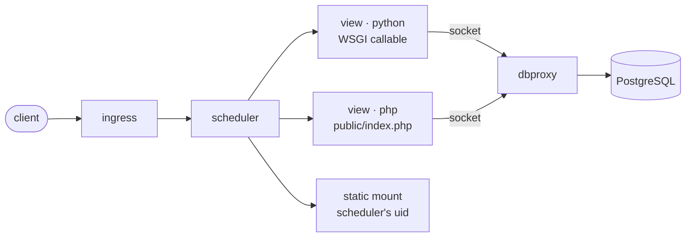

# Frameworks

Blastit starts your app and calls it. Pick the runtime you deploy, and read only
what your framework changes: the `Blastfile` and the trust boundary are the same
for all three.

`entrypoint` is declared once, at the top level of the file, and every view below
it is identical: its own process, its own uid, its own grants. Two things change
per runtime — what the entrypoint names and which files it may read — and one
page per framework covers the rest.

!!! note "PHP: `blastit dev --learn` writes the grants"

    A PHP app has no request audit in 0.2.0, so `check` proves the file, every
    `root` and the `libphp` preflight, and `fmt --check` proves the layout. The
    grants come from one `blastit dev --learn` pass: send every route with your
    client or a `curl` list, stop it with ++ctrl+c++, then read `git diff`
    ([the workflow](php/index.md#learn-the-grants)).

## Pick your runtime

| Runtime | What you write | Pages |
|---|---|---|
| **[Python (WSGI)](python/index.md)** | `entrypoint python "module:attr"` | [Connector](python/index.md) · [Django](python/django.md) · [Flask, SQLAlchemy and raw WSGI](python/flask.md) |
| **[PHP (embedded `libphp`)](php/index.md)** | `entrypoint php "public/index.php"` | [Connector](php/index.md) · [Symfony](php/symfony.md) · [Laravel](php/laravel.md) |
| **[Static sites and SPAs](static-and-spa.md)** | `static "/" { root "public" }` | [Static and SPAs](static-and-spa.md) |

## Nine things to decide

Every runtime answers these nine things. Each answer has one home — or two where
filling the file and proving it are different jobs — and a page below adds only
where its framework changes the answer.

1. How does Blastit start my code? ([entrypoint](../reference/blastfile.md#sections))
2. Where do the built files live, and what is cached for a year? ([static mounts](../reference/blastfile.md#static-mounts))
3. How does my app reach PostgreSQL without the credential? ([stores](../reference/blastfile.md#stores))
4. How does a body reach my code, and who validates it? ([view directives](../reference/blastfile.md#view-directives))
5. What happens to my environment variables and secrets? ([stores](../reference/blastfile.md#stores), [settings](../reference/settings.md#the-app-and-the-file))
6. What answers the platform health check? ([port and health](../reference/settings.md#port-and-health))
7. Where do schema changes run? ([migrations](../deploy/anything-else.md#migrations))
8. How are the grants filled in ([`--learn`](../reference/blastfile.md#what-learn-writes)) and proven complete ([`--json`](../ci.md#for-agents-json))?
9. Which parts become their own process, and how many run at once? ([privilege layout](../reference/settings.md#privileges-and-the-uid-layout), [threads](../reference/settings.md#admission-and-threads))

A PHP app has no request audit in 0.2.0, so question 8's proof is Python's; [the connector](php/index.md#what-ci-can-prove) names its gate.
