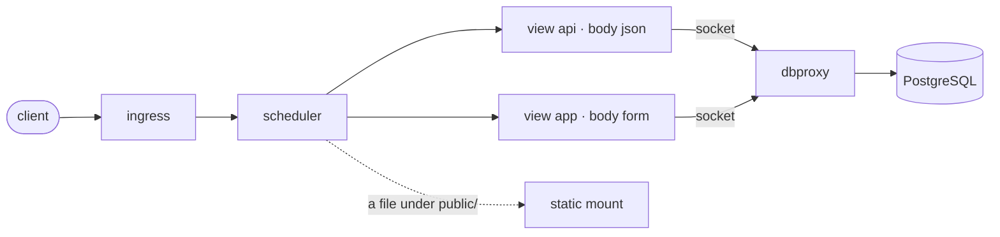

# PHP (embedded `libphp`)

Blastit runs `public/index.php` inside each view worker: no PHP server beside it, no rewrite rules,
one `entrypoint` line, and the host library is the only step that needs `sudo`.



## The Blastfile

```text title="Blastfile"
app "shop"

entrypoint php "public/index.php"

postgres $DATABASE_URL

static "/" {
    root "public"
}

view api POST "/api/*" {
    body json
    postgres { insert orders(customer_id, total) }
}

view app {
    GET, DELETE, OPTIONS "/*"
    POST "/*" { body form }

    postgres {
        select products(id, name, price), carts(id)
        select cart_items(cart_id, product_id, quantity)
    }
}
```

`entrypoint php` is declared once at top level: every view reaches that one front controller, so a
PHP app is at least the catch-all. A JSON API is its own view above the catch-all with `body json`,
so the catch-all's `form` codec never sees it.

## Run it from an artifact that carries the shim

Download `blastit-<arch>-unknown-linux-<libc>.tar.gz` from `github.com/OffworldNexus/blastit/releases`,
extract it, and put the directory it creates on `PATH`. The shim must sit beside the binary, and the
PyPI wheel ships none; every command below is that `blastit`.

## Install the host library

Install the distro's NTS `libphp` for a supported minor (8.3–8.5) and the PDO driver on the host or CI runner:

```text
sudo apt install libphp-embed php-pgsql                 # Debian 13, Ubuntu 24.04+
sudo apk add php84-embed php84-pdo_pgsql                # Alpine
sudo dnf install php-embedded php-pgsql                 # Fedora / RHEL
```

That is the one privileged step: Blastit needs no `sudo` and writes nothing under `/etc`. Debian 12
and Ubuntu 22.04 ship 8.2 or older, which the boot refuses by design. `BLASTIT_LIBPHP` must be an
absolute path; an image you build adds the same library and the shim; a boot without one names the
package.

Supported PHP versions: 8.3, 8.4 and 8.5.

## Concurrency

Concurrent requests to one PHP route run in parallel in separate view processes, bounded by the
shared `BLASTIT_MAX_WORKERS` budget, because the distro's NTS `libphp` runs one request per process
([settings](../../reference/settings.md#admission-and-threads)). `BLASTIT_VIEW_MAX_WORKERS` caps one
process, not the route; there is no daemon or socket between Blastit and PHP.

Route uids are `BLASTIT_UID_BASE + 1000 + i` — `21000`, `21001`, … — each with `gid == uid` and no
supplementary groups, so a directory a view writes must be owned by that uid or carry its ACL.

## public/ is the static root

A regular file under `public/` is served first, every other path reaches the front controller, and
`.php`, `.phtml` and `.phar` files are `404`. A `.env` never ships inside `public/`.

## The database

Blastit reads the real `DATABASE_URL` or `DB_*` from its own environment and hands the app a local socket URL, or local `DB_HOST`, `DB_PORT`, `DB_USERNAME` and `DB_DATABASE` with `DB_PASSWORD` removed, so the real password never enters the app's `.env`.
`$pdo->prepare()` binds a value only when the driver prepares it server-side; an emulated prepare
inlines it.

## Learn the grants

`blastit dev` refuses at boot, naming the root, the `libphp` or the shim. Start
`blastit dev --learn`, send every route with your client or a `curl` list, stop it with `Ctrl-C`,
read `git diff`, and run `blastit fmt`.

```console
$ blastit dev --learn
```

## What CI can prove

`blastit check` validates the file, every `root` and the libphp gate, then exits `2` without a
pytest suite and prints no document, so nothing proves a PHP grant is complete in 0.2.0. The gate
is `blastit fmt --check`, which proves the file parses and is canonical; the reviewed diff is the
only evidence the grants match the app ([exit codes](../../reference/blastfile.md#blastit-check)).

```console
$ blastit fmt --check
```

## Where next

[Symfony](symfony.md) · [Laravel](laravel.md).
