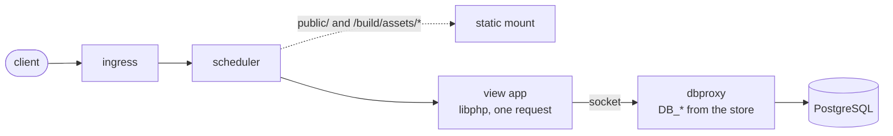

# Laravel

A Laravel app is a front controller plus caches and a Vite build made before the image starts; the
[connector](index.md) has the archive, the host `libphp` and the gate.



## Install

The [connector](index.md#install) has the whole install: the release archive beside the binary, and
the distro's NTS `libphp` plus `php-pgsql` as the one privileged step. The app's own dependencies
arrive with `composer install --no-dev` at build time.

## The Blastfile

```text title="Blastfile"
app "shop"

entrypoint php "public/index.php"

postgres {
    host $DB_HOST
    port $DB_PORT
    user $DB_USERNAME
    password $DB_PASSWORD
    database $DB_DATABASE
}

static "/" {
    root "public"
    immutable "/build/assets/*"
}

view app {
    GET, DELETE, OPTIONS "/*"
    POST "/*" {
        body form
    }
    PUT, PATCH "/*" {
        body json
    }
    postgres {
        select products(id, name, price)
        insert cart_items(cart_id, product_id, quantity)
    }
}
```

The split store is Laravel's `DB_*` wiring, and `immutable "/build/assets/*"` is Vite's hashed
output; a trailing `/*` crosses `/`, so this one pattern covers the files under `assets/` at any
depth. [The connector](index.md) has the store slots, and [the
reference](../../reference/blastfile.md#stores) has the directives.

## Static assets

`public/` is the root and `public/build/assets/` the one immutable pattern; a file under `public/`
is served by the scheduler first, so neither costs a `libphp` request. `.php` sources under the root
are `404`, and a `.env` never ships inside `public/`.

## Learn the grants

`blastit dev --learn` records the views and exact `query` lines a real pass exercises: send every
route, stop with ++ctrl+c++, read `git diff`, then run `blastit fmt`. Eloquent's prepared statements
are what make the text learnable.

## Check in CI

`blastit fmt --check` proves the file parses and is canonical; `blastit check` validates it, every
`root` and the `libphp` preflight, then audits nothing without a pytest suite
([exit codes](../../reference/blastfile.md#blastit-check)).

## Deploy

`blastit --preset compose-traefik` runs the same file under real uids, with the host's `libphp`
beside the binary ([deployments](../../deploy/index.md)).

## Bind parameters in PDO

Set `PDO::ATTR_EMULATE_PREPARES => false` in `config/database.php`; the default emulates prepares.
An emulated prepare inlines the values, and an inlined statement cannot be learned.

## Build the caches

`npm ci && npm run build`, `php artisan route:cache` and `php artisan view:cache` run at build time.
Leave `config:cache` off: it snapshots the build's environment, while Blastit renders `DB_*` inside
each view worker. `chown -R 21000:21000 storage bootstrap/cache` in the image gives the view that
runs the app the directories it writes to.

## Trusted proxies

Listing the edge in `TrustProxies` is what makes `$request->ip()` and `secure` URLs follow
`X-Forwarded-*`.

## Migrations

`php artisan migrate --force` applies them non-interactively, because Laravel prompts before it
migrates in production.

## Where next

[Symfony](symfony.md) · [PHP connector](index.md) · [Deployments](../../deploy/index.md).
