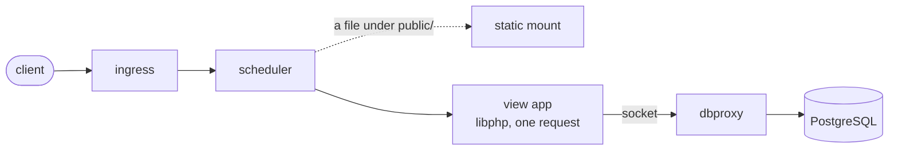

# Symfony

A Symfony app is a front controller plus a cache built before the first request; the
[PHP connector](index.md) has the archive, the host `libphp` and the gate.



## Install

The [connector](index.md#install) has the whole install: the release archive beside the binary, and
the distro's NTS `libphp` plus `php-pgsql` as the one privileged step. Doctrine DBAL arrives with
the app's own `composer install`, which the image runs at build time.

## The Blastfile

```text title="Blastfile"
app "shop"

entrypoint php "public/index.php"

postgres $DATABASE_URL

static "/" {
    root "public"
}

view app {
    GET, DELETE, OPTIONS "/*"
    POST "/*" {
        body form
    }
    PUT, PATCH "/*" {
        body json
    }
    postgres {
        query 'SELECT id, name, price FROM products WHERE id = $?'
        insert orders(customer_id, total)
    }
}
```

`postgres $DATABASE_URL` is the store Doctrine reads, and `static "/" { root "public" }` serves the
front controller's own directory ([the connector](index.md)). One view covers the router's paths
because the front controller owns them all; a JSON API route is a view of its own above it.

## Static assets

`public/` is the root, so an asset is answered by the scheduler and no worker: add
`immutable "/build/*"` and `immutable "/assets/*"` for what Webpack Encore or AssetMapper
fingerprints. `.php` sources under `public/` stay `404`, whatever the mount says.

## Learn the grants

`blastit dev --learn` records the views and exact `query` lines a real pass exercises: send every
route, stop with ++ctrl+c++, read `git diff`, then run `blastit fmt`. Doctrine prepares
server-side by default, so the statement text is stable enough to learn.

## Check in CI

`blastit fmt --check` proves the file parses and is canonical; `blastit check` validates it, every
`root` and the `libphp` preflight, then audits nothing without a pytest suite
([exit codes](../../reference/blastfile.md#blastit-check)). Log the denial `check` or `dev` prints
and add the `query` it names.

## Deploy

`blastit --preset compose-traefik` runs the same file under real uids, with the host's `libphp`
beside the binary ([deployments](../../deploy/index.md)).

## Warm the cache at build time

Build with `APP_ENV=prod` and a `bin/console cache:warmup` step into `var/cache`, then set the same
`APP_ENV=prod` and `APP_DEBUG=0` in the app's runtime environment — the warmed cache is only used
when the front controller sees that environment. `chown -R 21000:21000 var/` in the image gives the
view that runs the app the cache and logs it writes.

## Doctrine reads DATABASE_URL

Doctrine DBAL reads `$DATABASE_URL` and prepares statements server-side by default, so a statement's
text is stable without a switch. [The grant directives](../../reference/blastfile.md#grants) are
what the view's `postgres` block takes.

## Trusted proxies

`framework.trusted_proxies` is what makes `X-Forwarded-*` believed and generated URLs use `https`.

## Migrations

`bin/console doctrine:migrations:migrate --no-interaction` applies the migrations the image shipped.

## Where next

[Laravel](laravel.md) · [PHP connector](index.md) · [Deployments](../../deploy/index.md).
