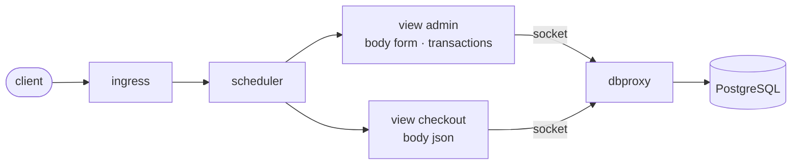

# Django

A Django project is a WSGI callable; the [connector](index.md) starts it, and this file and the
settings below are the whole adaptation, with `SECRET_KEY` still coming from the environment.



## The Blastfile { #manifest }

```text title="Blastfile"
app "myshop"

entrypoint python "myshop.wsgi:application" {
    preload "myshop.urls"
}

postgres $DATABASE_URL

view admin GET, POST "/admin/*" {
    body form
    postgres {
        transactions
        select auth_user(id, password, last_login, is_superuser, username, first_name,
                         last_name, email, is_staff, is_active, date_joined),
               auth_group(id, name), auth_permission(id, name, codename, content_type_id),
               django_content_type(id, app_label, model),
               django_session(session_key, session_data, expire_date),
               django_admin_log(id, action_time, object_id, object_repr, action_flag)
        insert django_admin_log(action_time, object_id, object_repr, action_flag, user_id)
        update auth_user(last_login), django_session(session_data)
        delete django_session
    }
}

view checkout POST "/checkout" {
    body json
    postgres {
        transactions
        insert orders(id, total)
    }
}

view catalog GET "/products/*" {
    postgres {
        select products(id, name, price), categories(id, name)
    }
}

view fallback "/*" {}

static "/static" {
    root "staticfiles"
    immutable "/static/*"
}
```

`preload "myshop.urls"` imports the URLconf before the workers fork; views are first-match, so
`view admin` sits above the catch-all, and the last view takes every path nothing else claimed. A
body sent to the catch-all is a `413`, so a body-taking view is declared above it.

## Static files

Set `STATIC_ROOT = BASE_DIR / "staticfiles"` and `STATIC_URL = "/static/"`, then run
`uv run python manage.py collectstatic --no-input` once: the mount's `root` must exist before
`blastit dev` starts. One `immutable "/static/*"` reaches every depth, `select2/i18n` included: a
trailing `/*` crosses `/`, exactly as in a `view` pattern. `collectstatic` leaves the unhashed
copies beside the hashed ones, so that line pins both; to cache hashed names only, use
`immutable regex '/static/.+\.[0-9a-f]{12}\.[^/]+'`.

## Database settings

`uv add blastit 'psycopg[binary]' dj-database-url` installs these three packages.

```python title="myshop/settings.py"
import dj_database_url

DATABASES = {"default": dj_database_url.config(conn_max_age=0)}
DATABASES["default"].setdefault("OPTIONS", {})["server_side_binding"] = True
```

`conn_max_age=0` closes the connection with the request, and `server_side_binding = True` in `OPTIONS` keeps psycopg from inlining values.

## Transactions

`atomic()` and its savepoints need `transactions` in that view's grant, because the savepoint name
is generated per request. [The grant directives](../../reference/blastfile.md#grants) have the rest.

## The admin

The admin's SQL is table reads and writes, not `query` lines: `view admin` takes the four kinds
above for the six tables, each naming a column. Add the three join tables when `check` reports
them; a `pg_catalog` statement stays a `query`.

## Behind TLS

Do not set `SECURE_PROXY_SSL_HEADER`: Blastit sets `wsgi.url_scheme` from a trusted peer and the
raw `X-Forwarded-Proto` still reaches the app, so trusting it again is the bypass. Name the origin
in `CSRF_TRUSTED_ORIGINS` and the host in `ALLOWED_HOSTS`.

## Tests and migrations

`uv add --dev pytest pytest-django`, with a `manage.py` or `DJANGO_SETTINGS_MODULE`, is the handshake `check` uses for `test_<database>`; `check` exits `3` when the suite collects nothing, so write one test per route.

```console
$ uv run blastit check
```

`manage.py migrate` runs outside the view workers, before the new code boots ([the rule](../../deploy/anything-else.md#migrations)).

## Where next

[Flask, SQLAlchemy and raw WSGI](flask.md).
