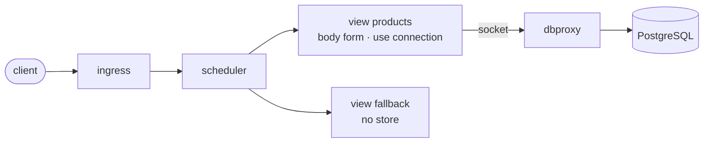

# Flask, SQLAlchemy and raw WSGI

Flask is a decorator around a WSGI callable, a bare WSGI app drops it, SQLAlchemy changes two lines,
and the [connector](index.md) has the runtime mechanics.



## Install

```console
$ uv add flask 'psycopg[binary]' blastit
$ uv add --dev pytest
```

## The Blastfile

```text title="Blastfile"
app "shop"

entrypoint python "app:app"

postgres $DATABASE_URL

trait connection {
    postgres {
        transactions
        query 'select pg_catalog.version()'
        query 'select current_schema()'
        query 'show standard_conforming_strings'
        query 'show transaction isolation level'
        query 'SELECT typname AS name, oid, typarray AS array_oid, oid::regtype::text AS regtype, typdelim AS delimiter FROM pg_type t WHERE t.oid = to_regtype($1) ORDER BY t.oid'
    }
}

view products POST "/products/" {
    body form
    use connection
    postgres {
        insert products(name, price)
    }
}

view fallback GET "/*" {
}
```

`app:app` is the module attribute `entrypoint python` names: `app.py` in the project root exposes
`app`. The `connection` trait carries the transaction control and the setup statements every view
that opens the engine needs; `view products` adds the trait and the one `insert` its handler runs,
and the catch-all shows "no database here" — it is not the shape for the app's other routes.
psycopg's own `hstore` OID lookup on connect is part of the trait — or set `use_native_hstore=False`.

## Static assets

Flask already serves `static/`, and a mount is what gives it Blastit's boundary and cache header:
`static "/static" { root "static" }` beside the views, with `immutable "/static/*"` for hashed
names. A built front end goes the same way with `root "public"` and a `fallback`
([static sites](../static-and-spa.md)).

## Learn the grants

`blastit dev --learn` records every view and statement the run exercised; click through the
app, stop with ++ctrl+c++, read `git diff Blastfile`, then run `blastit fmt`. It never writes
`body`, `use` or `transactions`, so this file's trait stays yours to keep.

## Check in CI

`blastit check` runs `pytest` from the project root, so the suite must import the same
callable the file names — `app:app` here. A statement the suite reached and the file does not grant
is one finding with the `query` that closes it ([the list](../../ci.md#what-it-fails-on)).

## Deploy

`blastit --preset compose-traefik` runs the same file under real uids and capabilities
([deployments](../../deploy/index.md)).

## The callable you name

`entrypoint python` names a module attribute, so an app built by `create_app()` needs a module-level
`app = create_app()` (a two-line `wsgi.py`) for the file to name.

## SQLAlchemy

`postgresql+psycopg://` selects psycopg 3, `NullPool` gives each request its own connection, and
the lowercase `select pg_catalog.version()` probe and the `transactions` that `engine.begin()` needs
belong in the one `connection` trait every view `use`s. `engine.begin()` sends `BEGIN`, the savepoint
pair psycopg wraps it in, and `COMMIT`, which is what `transactions` allows.

```python
url = os.environ["DATABASE_URL"].replace("postgresql://", "postgresql+psycopg://", 1)
engine = create_engine(url, poolclass=NullPool)
```

A connection closed in `teardown_appcontext` cannot outlive the request that opened it. The reference
has [the connection-setup trait](../../reference/blastfile.md#connection-setup).

## Proxy headers

Nothing to configure: Blastit sets `REMOTE_ADDR` and `wsgi.url_scheme` from a trusted peer, so the
app must not re-read `X-Forwarded-*` — `ProxyFix` would let a client choose both.

## Migrations

`uv run flask db upgrade` applies what Flask-Migrate wrote into `migrations/`.

## Where next

[Django](django.md) · [Static sites and SPAs](../static-and-spa.md) ·
[The Blastfile](../../blastfile.md).
