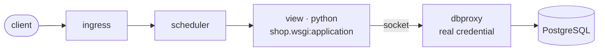

# Python (WSGI)

A Python app is one WSGI callable: `uv add blastit` adds the CLI and the server, and the app keeps
its own driver.



## Install

Blastit is a Linux application server. `uv add --dev blastit` pins it in the project, and the
global `blastit` hands `dev`, `check`, `fmt` and `lsp` to that copy automatically. One `py3-none`
wheel covers every CPython 3.12+ on x86_64 and aarch64, glibc and musl; serving WSGI views needs
one of the CPython minors in the [install
table](../../install.md#one-package-per-language-version) on the host. Nothing is installed
outside the project, and nothing needs `sudo`.

## The Blastfile

```text title="Blastfile"
app "shop"

entrypoint python "shop.wsgi:application" {
    preload "shop.urls"
}

postgres $DATABASE_URL

view products GET "/products" {
    postgres {
        select products(id, name, price)
    }
}
```

`entrypoint python` names `module:attribute`, and `preload` imports each module once before the
workers fork — name the URLconf or the app module, never `settings`. Grants nest inside the `view`
that may run them, and views are tried in the order written, so a specific pattern goes above a
catch-all.

## Static assets

A built front end is one mount beside the views: `static "/static" { root "staticfiles" }` serves
`collectstatic`'s output from the scheduler's own uid — no process, no interpreter — and
`immutable "/static/*"` keeps the hashed names for a year, because a trailing `/*` crosses `/`. The
mount is a directive like any other, so it lives in the file, not in the deployment
([Django](django.md#static-assets)).

## Learn the grants

`blastit dev --learn` writes the views and exact `query` lines the run exercised, including
new statements on existing views. For a suite, `blastit check --learn --dry-run` prints the
proposal and `blastit check --learn` writes newly discovered views with their statements.
`--learn` never writes `body`, `use` or `transactions`, so declare those yourself. Read `git diff`,
split a view whose paths need different grants, then run `blastit fmt`.

## Check in CI

`blastit check` runs `pytest -q` from the project root and fails on a statement the suite
reached that the file does not grant, on a grant the suite never used, on a view it never reached
and on a request no view matched. `--json` prints one finding per problem, each with a `fix.action`
([what each finding means](../../ci.md#what-it-fails-on)).

## Deploy

`blastit --preset digitalocean-paas` boots the same file under real uids and capabilities;
without root or the capability set it exits `1` and points at `blastit dev`
([deployments](../../deploy/index.md)).

## One view, one worker

Each view is its own sandbox with its own grants and its own worker process, so a hot or risky path
gets its own `view` above the catch-all. `prefork` forks that worker at boot instead of on its first
request.

## The DATABASE_URL your app receives { #bind-parameters-server-side }

The app reads a local Unix-socket URL in `DATABASE_URL` and never the credential: Blastit strips
every store input at the `execve` and renders the local value in its place. Parameters travel apart
from the statement text, so one template is one grant; an inlined literal has no stable text to
grant, and `--learn` refuses to write one.

A statement `check` reports as not granted is closed by pasting the `sql` in that `add_query`
finding into the view's `postgres` block. The reference has every
[grant directive](../../reference/blastfile.md#grants).

## Where next

[Django](django.md) · [Flask, SQLAlchemy and raw WSGI](flask.md) ·
[Static sites and SPAs](../static-and-spa.md).
