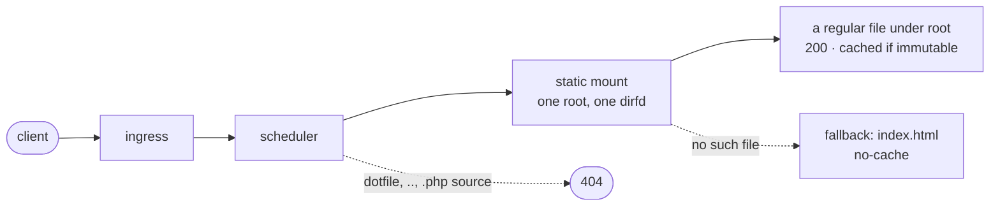

# Static sites and SPAs

A built front end is one `static` mount and no app: no `entrypoint`, no worker, no database.



## The Blastfile

```text title="Blastfile"
static "/" {
    root "public"
    fallback "index.html"
    immutable "/assets/*"
}
```

`blastit dev` serves it on `127.0.0.1:8080`. A static site needs no language runtime, so the release
archive is the whole install: unpack `blastit-x86_64-unknown-linux-gnu.tar.gz` and put that
directory on `PATH` ([getting started](../getting-started.md#1-install)).

```console
$ blastit dev
  blastit dev · single-uid simulation · http://127.0.0.1:8080
  Not a sandbox. Production `blastit` refuses to run like this.
  http · scheduler · dbproxy · 0 routes
  static  /  GET, HEAD  public
```

## The four directives

| Directive | What it does |
|---|---|
| `root` | the directory served, relative to the `Blastfile`; required |
| `index` | the file a directory answers with, `index.html` by default |
| `fallback` | the file a deep path that is no file answers with |
| `immutable` | files that never change; alone it caches every exact file, or list `"/assets/*"` patterns; a match gets the year-long cache |

The reference has [the defaults and the matching rules](../reference/blastfile.md#static-mounts).

## Build into the root

```console
$ npx vite build --outDir public
```

Vite writes `dist/`; one flag puts it where `root` looks. Vite's own `publicDir` is emptied by the
build, so move what you keep into `static/` and set `publicDir: "static"` in `vite.config.ts`.

## Deep URLs and caching

```console
$ curl -i http://127.0.0.1:8080/assets/app.4f1c2a9b7d3e.js
HTTP/1.1 200 OK
Content-Type: text/javascript
Cache-Control: public, max-age=31536000, immutable
```

The hashed asset's name changes when its bytes do, so `immutable` keeps it for a year.
`"/assets/*"` crosses `/`, so `/assets/chunks/x.js` is cached too. A deep path is no file, so
`fallback` answers `public/index.html` with `no-cache`:

```console
$ curl -i http://127.0.0.1:8080/dashboard/settings
HTTP/1.1 200 OK
Content-Type: text/html; charset=utf-8
Cache-Control: no-cache
```

## What a mount refuses

`root` is a boundary, not a prefix: `..` (plain or percent-encoded), a NUL byte, an absolute or a
backslash path are refused with `400`; a symlink that leaves `root` and a dotfile such as `.env` or
`.git` are `404`. A refusal is final — never the app, never `index.html` — and `/.well-known/` is
the one dotfile exception.

## Check the roots

```console
$ blastit check
$ blastit check --json
```

`blastit check` audits every `root` for existence and readability, exits `0`, or `2` naming a root
it cannot read. `--json` prints the same document on success; exit `2` leaves stdout empty. A mount
is not a route, so the banner and the document both count none.

## Deploy it

```console
$ blastit --preset compose-traefik
```

`blastit --preset compose-traefik` on the deploy host starts this file with the Compose preset's
defaults; [deployments](../deploy/index.md) own the stack.

## Where next

* [Frameworks](index.md) — the Python and PHP interfaces beside this one.
* [The Blastfile](../blastfile.md) — every directive a mount reads.
