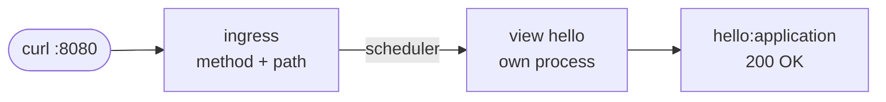

# Getting started

Blastit is a **Linux** application server: three steps from a `./Blastfile`, no root, no `sudo`.

* **Python (WSGI):** CPython 3.13+ — `uv add blastit`.
* **PHP:** PHP 8.3, 8.4 or 8.5 NTS embed (`apt install libphp-embed` /
  `apk add php84-embed` / `dnf install php-embedded`) plus the standalone
  `blastit` binary.
* **Static files & SPAs:** the standalone `blastit` archive, no language runtime.

## 1. Install

=== "Python (WSGI)"
    ```console
    $ uv init --app
    $ uv add blastit
    ```

=== "PHP"
    ```console
    $ curl -fsSLO https://github.com/OffworldNexus/blastit/releases/latest/download/blastit-x86_64-unknown-linux-gnu.tar.gz
    $ tar -xzf blastit-*.tar.gz && export PATH="$PWD/blastit-x86_64-unknown-linux-gnu:$PATH"
    ```

=== "Static & SPA"
    ```console
    $ curl -fsSLO https://github.com/OffworldNexus/blastit/releases/latest/download/blastit-x86_64-unknown-linux-gnu.tar.gz
    $ tar -xzf blastit-*.tar.gz && export PATH="$PWD/blastit-x86_64-unknown-linux-gnu:$PATH"
    ```

`uv add` pins the CLI in the project; the archive is one native binary (no CPython) and
carries the PHP SAPI shim for `entrypoint php`.

!!! warning "One privileged step"

    A PHP app needs the distro's NTS `libphp` package, which is the only `sudo` on
    this path. Python and static apps install nothing outside your project.

## 2. Write two files

=== "Python (WSGI)"
    ```python title="hello.py"
    def application(environ, start_response):
        start_response("200 OK", [("Content-Type", "text/plain")])
        return [b"hello from blastit\n"]
    ```

    ```text title="Blastfile"
    app "hello"

    entrypoint python "hello:application"

    view hello GET "/*" {
    }
    ```

=== "PHP"
    ```text title="public/index.php"
    <?php
    header("Content-Type: text/plain");
    echo "hello from blastit\n";
    ```

    ```text title="Blastfile"
    app "hello"

    entrypoint php "public/index.php"

    static "/" {
        root "public"
    }

    view app GET "/*" {
    }
    ```

=== "Static & SPA"
    ```text title="public/index.html"
    <!doctype html>
    <title>hello</title>
    <p>hello from blastit</p>
    ```

    ```text title="Blastfile"
    static "/" {
        root "public"
    }
    ```

`entrypoint python` names the WSGI callable; `entrypoint php` the front controller.

## 3. Run it

=== "Python (WSGI)"
    ```console
    $ uv run blastit dev
      blastit dev · single-uid simulation · http://127.0.0.1:8080
      Not a sandbox. Production `blastit` refuses to run like this.
      http · scheduler · dbproxy · 1 route
      view  hello  GET, HEAD  /*
    ```

=== "PHP"
    ```console
    $ blastit dev
    ```

=== "Static & SPA"
    ```console
    $ blastit dev
    ```

`blastit dev` reads `./Blastfile`, forks production's processes on one uid, and prints
a clickable link — one request, one view, one process, no credential in that path.



??? note "Linux targets, wheels and the archive"

    Wheels cover CPython 3.13 and 3.14 on Linux x86_64/aarch64, glibc and musl; the archives are native binaries with the PHP SAPI shim.

## Where next

* [The Blastfile](blastfile.md) — views, grants and one-line edits.
* [Local](local.md) · [CI/CD](ci.md) · [Deployments](deploy/index.md).
