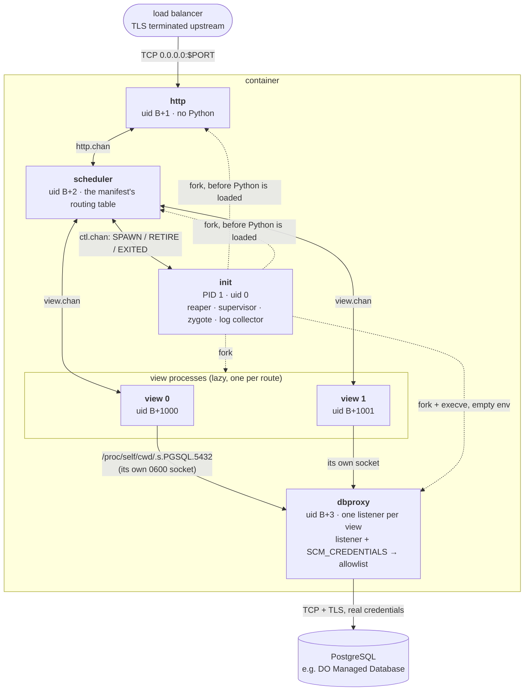
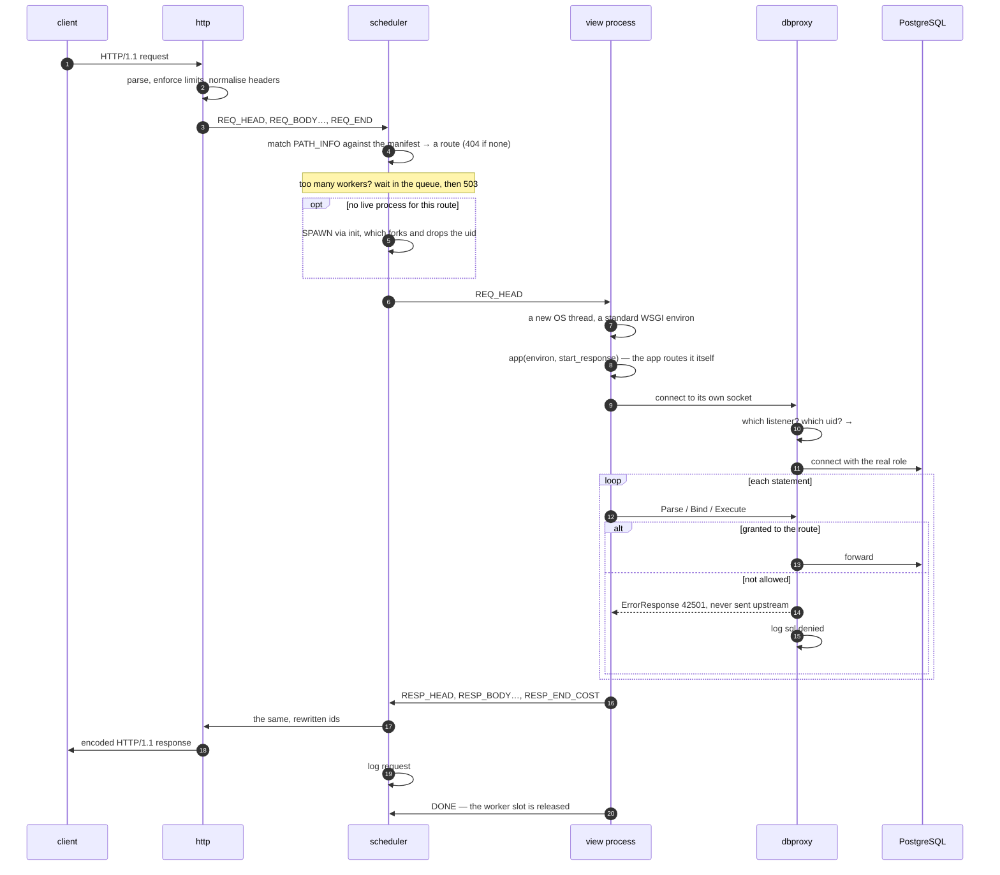
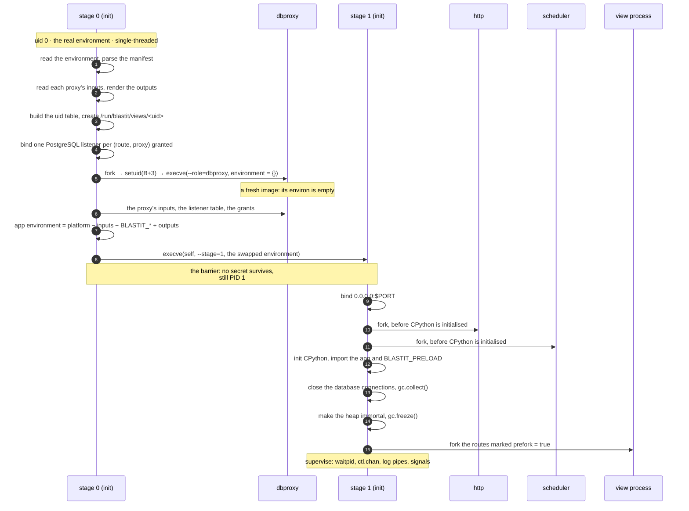

# How it works

A tour of the machine, in the order a request meets it. The full specification
is [`ARCHITECTURE.md`](https://github.com/OffworldNexus/blastit/blob/develop/ARCHITECTURE.md),
which this page links into at every step rather than paraphrasing.

## One binary, five roles

A single Rust binary, `blastit`, plays every role. Most roles are chosen by
their position in the process tree; the database proxy is the exception, and is
`execve`'d with an empty environment. CPython is embedded through `pyo3`, and the
only Python blastit knows about is one standard WSGI callable.

| Component | Count | uid | Python? | Holds | Talks to |
|---|---|---|---|---|---|
| **init** | 1 (PID 1) | `0`, or the uid it was started as | stage 1 only | the listen socket, the preloaded app | everyone |
| **http** | 1 | `UID_BASE + 1` | no | the listening TCP socket | the load balancer, the scheduler |
| **scheduler** | 1 | `UID_BASE + 2` | no | the routing table, the worker budget | http, init, view processes |
| **view** | 1 per route, lazily | `UID_BASE + 1000 + i` | yes | nothing but its own channel | the scheduler, the proxy |
| **dbproxy** | 1 | `UID_BASE + 3` | no | **the real credentials** and the query policy | view processes, PostgreSQL |



Solid arrows are data channels; dotted arrows are parenthood. `B` is
`BLASTIT_UID_BASE`, `20000` by default.

**Internal traffic never uses TCP.** Channels are `socketpair`s, except the
PostgreSQL sockets, which are named because Python drivers need a path. Nothing
can connect to a socketpair later, and a named socket is protected by file
permissions and by the identity of the *listener* the connection arrived on.

## A request



Three things in that diagram are the whole design:

* **the routing happens in the scheduler, before Python.** A path no route
  matches gets blastit's own `404` and no interpreter runs;
* **the database connection is opened by the app, and authorised by the
  listener it arrived on.** The app never presents a credential;
* **a denial is a PostgreSQL error the app sees**, `42501`, plus a log line. It
  never reaches the real server.

## Identity, not passwords

This is the bit worth understanding before reading the rest.

Under the target platform's sandboxed kernel, `SO_PEERCRED` on an accepted Unix
socket returns the *listener's* own credentials, so it cannot identify a client.
Unix socket file permissions, however, are enforced at `connect()`.

So init binds **one PostgreSQL listener per (route, proxy)** at startup, inside
that view's private directory, `chown`s it to the view's uid, and sets it to
`0600`:

```text
/run/blastit/views/<uid>/            0700, owned by the view uid
    .s.PGSQL.5432                    0600, owned by the view uid (proxy "analytics")
    .s.PGSQL.5433                    0600, owned by the view uid (proxy "db")
```

A connection on a given listener can only have come from that listener's view
uid, or from root. As a second check, every listener has `SO_PASSCRED` set and
the proxy requires the kernel-attached `SCM_CREDENTIALS` uid of the startup
packet to equal the listener's view uid — forging one is refused by the kernel.

That is why the app's `DATABASE_URL` has no password in it: `user = blastit`,
and the database *proxy* authenticates by socket identity, then connects
upstream with the real role. The port selects the proxy, and `/proc/self/cwd` —
each view's working directory is its own socket directory — selects the view.

## Startup, and the `execve` barrier

Startup has two stages separated by an `execve`. The real secrets are read in
stage 0, handed to the database proxy over a pipe, and then gone from the process
image for good:



The barrier is not optional. Under the sandboxed kernel, **any uid can read any
process's `/proc/<pid>/environ`** (and `cmdline`, `maps`, `auxv`, the fd list) —
and `PR_SET_DUMPABLE(0)` does not change that. The file shows the process's
*initial* environment block, which `fork` inherits and only `execve` replaces. So
two rules hold everywhere:

* no process may ever have a real secret in its `environ` or `argv`;
* dbproxy is `fork` + `execve`'d with an **empty** environment, and gets the
  secrets over a pipe.

Every view process is created the same way, at startup or on demand: init
`socketpair`s a channel, forks, hands the scheduler end back over `ctl.chan` with
`SCM_RIGHTS`, and in the child closes everything it does not own, sets its
rlimits and `umask`, moves into its private directory, drops its capabilities in
the order the kernel requires, `setgroups`/`setgid`/`setuid`s to its own uid,
sets `PR_SET_PDEATHSIG(SIGKILL)` and `PR_SET_NO_NEW_PRIVS`, installs its seccomp
filter, and reports ready.

**init is single-threaded at every `fork()`.** It runs no async runtime and no
background thread before the fork, and thread pools are pinned to one thread,
because a thread pool that exists before a `fork` does not exist in the child and
the child deadlocks.

## The heap

Python and the application are imported **once**, before any fork, and every
process then shares that memory copy-on-write. Two things make that work on the
target platform, where copy-on-write breaks in chunks of about 2 MiB:

* **immortalisation.** Before `gc.freeze()`, init walks every reachable object
  and writes CPython's own immortal marker over its reference count, so an
  incref or decref never writes to those objects — which is what would otherwise
  dirty a 2 MiB chunk per object read. Measured on App Platform: touching 1 % of
  the objects at random cost 89 MiB per child without it and 18.8 MiB with it.
  Each CPython version needs its own marker, so an interpreter whose marker
  blastit does not know is skipped, with the reason in the `boot` event;
* **lazy spawning, and a cap on live view processes.** A view that is never hit
  costs nothing. The cap is derived from memory at boot and then re-derived from
  what a view process really costs on your app — which is where the number
  usually moves, because a real Django app copies about 140 MiB per view process
  under the sandboxed kernel, against the 32 MiB default estimate.

## Where the tour ends

Everything above is the shape of the thing. The specification is
[`ARCHITECTURE.md`](https://github.com/OffworldNexus/blastit/blob/develop/ARCHITECTURE.md),
and the sections worth reading next are:

* [§4 Startup sequence](https://github.com/OffworldNexus/blastit/blob/develop/ARCHITECTURE.md#4-startup-sequence) — the barrier, and every step of a fork;
* [§6 The manifest](https://github.com/OffworldNexus/blastit/blob/develop/ARCHITECTURE.md#6-the-manifest) — matching, normalisation and validation;
* [§7 Security model](https://github.com/OffworldNexus/blastit/blob/develop/ARCHITECTURE.md#7-security-model) — the trust boundaries and the mechanisms;
* [§9 Findings](https://github.com/OffworldNexus/blastit/blob/develop/ARCHITECTURE.md#9-findings-this-design-relies-on) — what was measured, and where;
* [§10 Platform constraints](https://github.com/OffworldNexus/blastit/blob/develop/ARCHITECTURE.md#10-platform-constraints-digitalocean-app-platform) — the measurements behind the two presets.

The measurements themselves are archived in
[`docs/spikes/`](https://github.com/OffworldNexus/blastit/tree/develop/docs/spikes)
(App Platform) and
[`docs/archive/`](https://github.com/OffworldNexus/blastit/blob/develop/docs/archive/2026-10-experiments.md)
(bare Linux and local gVisor).

## See also

* [Security model](security.md) — the same machine, from the attacker's side.
* [The manifest](reference/manifest.md) — what a route may do.
* [Fit it to your infra](infra/index.md) — where it runs.
