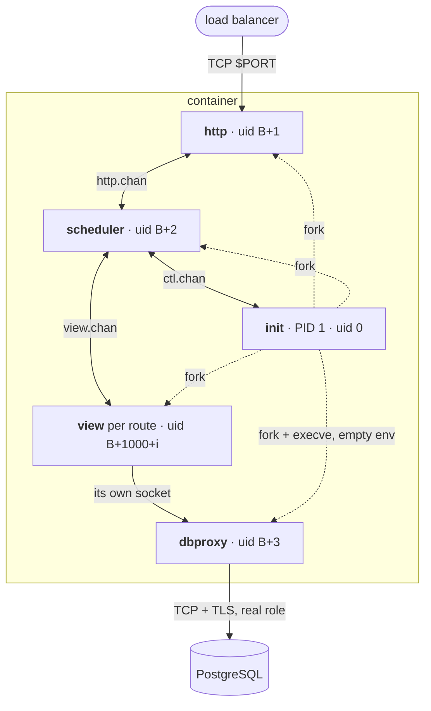
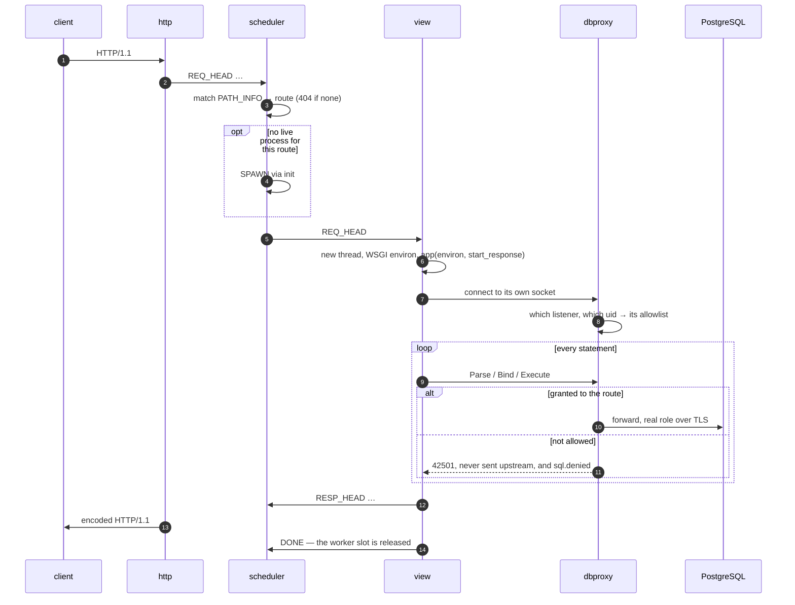

# How it works

One Rust program plays five roles. The specification is
[`ARCHITECTURE.md`](https://github.com/OffworldNexus/blastit/blob/develop/ARCHITECTURE.md).

## One program, five roles

| Component | uid | Holds |
|---|---|---|
| **init** | `0`, or the uid it was started as | the listen socket, the app (stage 1 only) |
| **http** | `UID_BASE + 1` | the listening TCP socket |
| **scheduler** | `UID_BASE + 2` | the routing table, the worker budget |
| **view** | `UID_BASE + 1000 + i` | nothing but its own channel; one per route, forked lazily |
| **dbproxy** | `UID_BASE + 3` | **the real credentials**, the query policy |



Solid arrows are data, dotted ones parenthood; `B` is `BLASTIT_UID_BASE`.
Internal traffic never uses TCP: only the PostgreSQL sockets are named, because
drivers need a path.

## A request



Three things are the whole design: routing happens before Python; the listener a
connection arrived on authorises it; and a denial is a PostgreSQL error the app
sees, plus one log line.

## Identity, not passwords

Under the sandboxed kernel `SO_PEERCRED` returns the *listener's* own
credentials, not the client's, but socket file permissions are enforced at
`connect()`. So init binds one listener per (route, proxy) in that view's private
directory:

```text
/run/blastit/views/<uid>/      0700, owned by the view uid
    .s.PGSQL.5432              0600, owned by the view uid (proxy "db")
```

A connection on a listener can only have come from its view's uid or from root,
and dbproxy cross-checks the kernel-attached `SCM_CREDENTIALS` of the packet
against the listener. So `DATABASE_URL` holds no password: the port selects the
proxy and `/proc/self/cwd` selects the view.

## Startup, and the `execve` barrier

No process may ever hold a real secret in its `environ` or `argv`. Stage 0 reads
them, hands them to dbproxy over a pipe, and `execve`s stage 1 without them:

* dbproxy is `fork` + `execve`'d with an **empty** environment, so its own
  `/proc/<pid>/environ` is empty;
* stage 1 imports the app and forks the views, all of them secret-free;
* another uid *can* read `/proc/<pid>/environ` under the sandboxed kernel, which
  is why the barrier is an `execve` rather than a `fork`.

A new view process closes every fd it does not own, sets its rlimits and `umask`,
moves into its private directory, clears every capability set, drops to its own
uid, and installs its seccomp filter.

## The heap

Python and the app are imported once, before any fork; every process shares that
memory copy-on-write:

* **immortalisation** — init writes CPython's immortal marker over the reference
  count of every reachable object, so an incref never dirties a chunk;
* **lazy spawning** and a cap on live view processes, derived from memory at boot
  and re-derived from what one costs on your app.

## Keep reading

* [The security model](security.md) — the same machine, from the attacker's side.
* [Fit it to your infra](infra/index.md) — where it runs.
