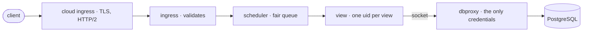

{ align=right width=200 }

# Small bird. Small blast radius.

**Blastit is a Linux application server that runs behind your ingress.** Traefik,
DigitalOcean App Platform, Cloudflare or nginx terminate TLS and HTTP/2; blastit
isolates what they forward — one `view` per route, with its own process, uid and
SQL allowlist — so a bug in the least important page is worth that page.

[Get started](getting-started.md){ .md-button .md-button--primary }
[How it works](how-it-works.md){ .md-button }

```console
$ curl -fsSL https://offworldnexus.github.io/blastit/install.sh | sh
$ blastit dev
$ blastit check
```

The installer adds the signed Blastit APT (Debian/Ubuntu) or RPM
(Fedora/RHEL/Rocky/Alma) repository and installs `blastit`; where it cannot use a
system package manager it puts the release archive in `~/.local/bin` instead
([install reference](install.md)).

!!! note "Linux, and one file for every interface"

    `entrypoint python "module:attr"` starts a WSGI callable; `entrypoint php
    "public/index.php"` runs a PSR-7/PSR-15 front controller on the host's embedded
    NTS `libphp` (8.3, 8.4, 8.5 and 8.6); no `entrypoint` plus a `static` mount
    serves a built front end. One `blastit` binary serves all three. `blastit-lsp`
    runs natively on Linux, macOS and Windows; on a macOS or Windows laptop, run
    the server in Docker/Compose or a Linux VM.

## One file, no code changes

=== "Python (WSGI)"
    ```text title="Blastfile"
    app "myshop"

    entrypoint python "myshop.wsgi:application"

    postgres $DATABASE_URL

    view catalog GET "/products/*" {
        postgres {
            select products(id, name, price)
        }
    }
    ```

=== "PHP"
    ```text title="Blastfile"
    app "myshop"

    entrypoint php "public/index.php"

    postgres $DATABASE_URL

    view api POST "/api/*" {
        body json
        postgres {
            insert orders(customer_id, total)
        }
    }

    view app GET "/*" {
    }
    ```

=== "Static & SPA"
    ```text title="Blastfile"
    static "/" {
        root "public"
        fallback "index.html"
        immutable "/assets/*"
    }
    ```

Views, grants and the entry point live in one file; your framework keeps its own
routing, and views are tried in the order written. Every served file carries an
`ETag`, so a deploy invalidates cached copies. The three commands above do not
change: `blastit dev` on your machine, `blastit check` in CI, and
`blastit --preset digitalocean-paas` under real uids in production.

## The trust boundary



No view holds a database password, and no view opens a TCP socket unless its own
block says so. [Security model](security.md) has the argument.

## What you get

| | |
|---|---|
| **One sandbox per view** | own process and uid; a misrouted request lands in an allowlist that does not fit |
| **No credentials in the app** | the real URL stays in a proxy; your code gets a local one |
| **Only the SQL it needs** | statements and table/column grants, checked on the wire |
| **One command to prove it** | `blastit check` fails on an unrouted request, a missing or dead grant, an unexercised view, or an undeclared body |

??? note "Platforms"

    Linux x86_64 and aarch64, glibc and musl: one `py3-none` wheel per platform
    runs `blastit check`, `fmt` and `fold` on any CPython 3.12+, and serving WSGI
    views needs CPython 3.13 or 3.14 on the host. PHP is the distro's NTS
    `libphp` 8.3–8.6. Static sites need no language runtime. On musl,
    `apk add libgcc`.

## Where next

* [Getting started](getting-started.md) · [The Blastfile](blastfile.md)
* [Install](install.md) · [Local](local.md) · [CI/CD](ci.md)
* [Deployments](deploy/index.md) · [Security](security.md)
