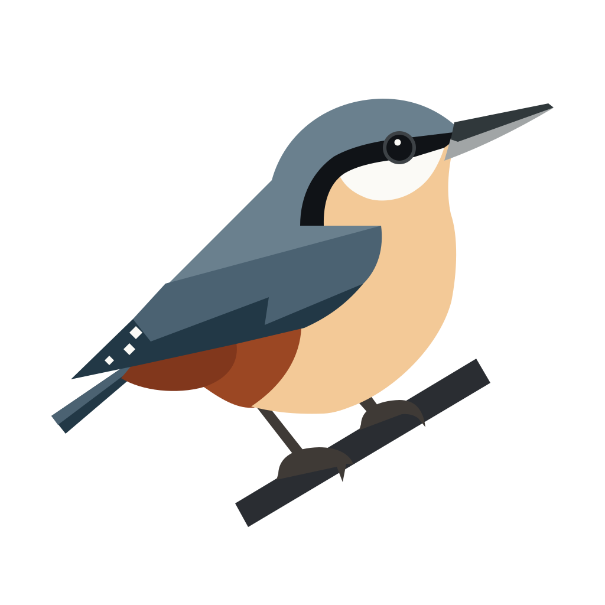
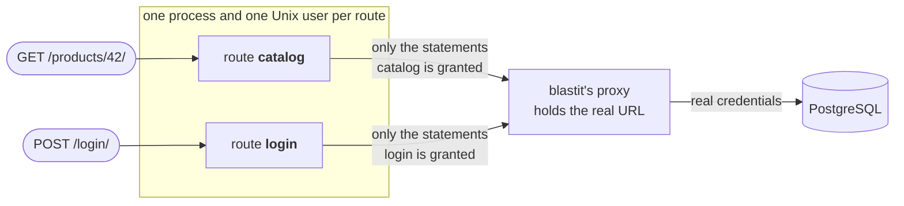

{ align=right width=200 }

# Small bird. Small blast radius.

**blastit is a WSGI server that keeps the blast radius of a security bug small.**

## What it is

In a typical Python web app every view runs in the same process, with the same
database credentials and the same rights. One exploitable bug in the least
important page — a template injection, a deserialisation flaw, a vulnerable
dependency — and the attacker holds everything the whole app holds.

blastit serves the same app, unchanged, but splits it up:

<div class="grid cards" markdown>

- :material-shield-account: **One sandbox per route**

    You group your URLs into *routes*; every route gets its own process under
    its own Unix user. A compromised route cannot read another one's memory,
    signal it, or borrow its rights.

- :material-key-off: **Secrets stay out of reach**

    The real database URL never reaches your code. Your app sees an ordinary
    `DATABASE_URL`, which points at a local proxy run by blastit. Only that
    proxy holds the credentials.

- :material-filter-variant: **Only the grants it needs**

    The proxy lets each route run only the SQL statements the manifest grants
    it. The product page can read products; it cannot read password hashes, and
    it cannot `DROP TABLE`.

</div>



Your framework doesn't know any of this happens. It gets ordinary WSGI requests
and routes them itself. All blastit adds is one file, `blastit.toml`, which says
which URLs belong to which route and what each route may do.

## Why

The point is not to stop the bug. The point is to decide, in advance, what the
bug is worth.

| If this is compromised… | …the attacker gets | …and cannot |
|---|---|---|
| one route | that route's granted statements, its scratch directory, and the network only if the route has `egress = true` | run any other statement, read the database credentials, touch another route's process |
| the HTTP front end | the raw bytes of requests in flight | reach the database, run Python |

blastit does not protect against code that runs when your app is *imported*:
that happens before the sandboxes exist. And it only sandboxes what goes through
its proxies — other secrets in the environment (an API key for a third-party
service, say) are still visible to every route. The
[security model](security.md#what-a-compromise-buys) is explicit about all of
it.

## Who it is for

**For you if:**

* your app is [WSGI](frameworks/index.md#no-framework-integration) — Django,
  Flask, Pyramid, or anything else behind a `def application(environ,
  start_response)`;
* you run on Linux in a container, and you can start the container as root or
  give it [a small set of capabilities](infra/anything-else.md#root-or-rootless);
* your database is PostgreSQL;
* you want to hand each route only the statements it needs, and you would
  rather derive those from your test suite than type them.

**Not for you if:**

* you need ASGI at the server. blastit speaks WSGI and HTTP/1.1 only; a
  FastAPI app runs through an adapter, and
  [that path is not covered by CI](frameworks/index.md#asgi-and-fastapi);
* your host is not Linux. uid isolation, file capabilities and seccomp are all
  Linux mechanisms;
* your interpreter is older than CPython 3.13, or is not CPython (the wheels
  are built for CPython 3.13 and 3.14);
* you need TLS, HTTP/2, WebSockets or `Upgrade` from the application server —
  a load balancer in front terminates TLS and speaks plaintext HTTP/1.1 to
  blastit;
* your routes each need a database other than PostgreSQL. `postgresql` is the
  only proxy protocol so far;
* you cannot keep one database connection per request. Under blastit every
  request opens its own connection, so a connection pool that outlives a
  request has nothing to attach to.

## What it looks like

A route for a catalogue, one for logging in, and a catch-all. The app's
`DATABASE_URL` is the real one at startup; blastit takes it and hands the app a
URL to its own proxy instead:

```toml title="blastit.toml"
version = 1

[proxy.db]
protocol = "postgresql"
input = { url = "DATABASE_URL" }

[[route]]
name = "catalog"
path = ['/products/', '/products/[0-9]+/']
methods = ["GET", "HEAD"]
[route.db]
queries = [
  'SELECT "shop_product"."id", "shop_product"."name", "shop_product"."price" FROM "shop_product" WHERE "shop_product"."id" = $1 LIMIT 21',
]

[[route]]
name = "login"
path = ['/login/']
[route.db]
transaction_control = true
queries = [
  'SELECT "auth_user"."id", "auth_user"."password", "auth_user"."username" FROM "auth_user" WHERE "auth_user"."username" = $1 LIMIT 21',
  'UPDATE "auth_user" SET "last_login" = $1 WHERE "auth_user"."id" = $2',
]

[[route]]
name = "fallback"     # everything else: no database at all
path = ['.*']
```

If the catalogue page is compromised, the attacker can list products. That is
it. Every refusal is one JSON line naming the route and the statement:

```json
{"ts":"2026-10-25T14:02:12.007Z","level":"warn","event":"sql.denied","component":"dbproxy","route":"catalog","proxy":"db","kind":"parse","sqlstate":"42501","sql":"SELECT \"auth_user\".\"password\" FROM \"auth_user\""}
```

## Status

!!! warning "Pre-release"

    blastit runs a real Django app end to end on DigitalOcean App Platform in
    CI, but it has not had a stable release, and the manifest format may still
    change. Linux only.

[Get started in five minutes →](getting-started.md){ .md-button .md-button--primary }
[How it works](how-it-works.md){ .md-button }
