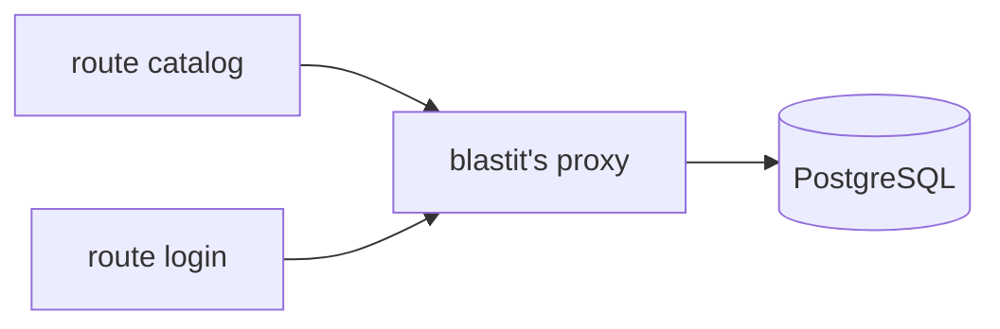

{ align=right width=200 }

# Small bird. Small blast radius.

**blastit is a WSGI server that keeps the blast radius of a security bug small.**

In an ordinary app every view shares one process and one set of database
credentials, so the least important page is worth everything the app holds.
blastit serves the same app, unchanged, and splits it up.

## What you get

* **One sandbox per route.** Each route runs in its own process under its own
  Unix user.
* **Secrets out of reach.** The real database URL never reaches your code: the
  app gets a `DATABASE_URL` pointing at a proxy blastit runs.
* **Only the grants it needs.** The catalogue page reads products — not
  password hashes, and it cannot `DROP TABLE`.

A request's route and its grants come from `blastit.toml`, next to your code.

## What it costs

* **One process per route**, forked from a preloaded parent. A route that is
  never requested costs nothing.
* **Root, or a small capability set**, at boot: it binds the port, then drops
  every other process to its own unprivileged user.
* **One file**, `blastit.toml`. No framework integration.

## Is it for you?

Yes if your app is [WSGI](frameworks/index.md#no-framework-integration), your
database is PostgreSQL, and your host is Linux.

No if you need HTTP/2, WebSockets or a non-CPython interpreter.

!!! warning "Pre-release"

    No stable release yet, and the manifest format may still change.

[Get started in five minutes →](getting-started.md){ .md-button .md-button--primary }
[How it works](how-it-works.md){ .md-button }
