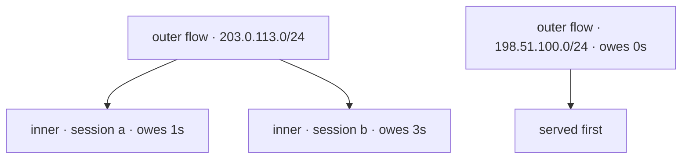

# Fair queuing

A scraper, a bad bot or one user hammering export can eat the whole worker
budget. Without fair queuing it eats it from the front of a FIFO: everyone else
waits behind that client's backlog.

Fair queuing orders the admission queue by client instead of by arrival.

## What it does

* **Two levels of flows.** Clients are grouped by IP prefix (`/24`, `/56`) into
  *outer* flows, then split by a hash of a few headers and cookies into *inner*
  flows. One browser behind a NAT cannot starve its neighbours, one network
  cannot starve another.
* **Charged what it cost.** The view measures how long the request really took,
  reports it back, and the flow pays that number — so a cheap request is cheaper.
* **Lowest debt goes next.** A flow that just became busy gets one burst
  allowance (`BLASTIT_FQ_BURST`) before it queues; its debt is capped at
  `BLASTIT_FQ_MAX_DEBT` and forgotten after `BLASTIT_FQ_DEBT_TTL` idle.
* It is a port of [granian's fair scheduler](https://github.com/Xowap/granian/tree/feature/kff-272-python-side-http-fair-queuing).

## Turn it on safely

- [ ] **The client IP is right.** Flows key on it: if every request looks like it
  comes from your load balancer, every client is one client. Set
  `BLASTIT_CLIENT_IP_HEADER` and `BLASTIT_TRUSTED_PROXIES`, or use a preset, and
  [check `REMOTE_ADDR`](../infra/anything-else.md#client-ip-and-trusted-proxies).
- [ ] **One office or NAT shares a `/24`.** They share a queue — usually fine.
  Tune `BLASTIT_FQ_OUTER_PREFIX_V4` / `_V6` if it is not.
- [ ] **Split your logged-in users.** Put your session cookie in
  `BLASTIT_FQ_INNER_COOKIES` so they do not queue as one person.
- [ ] **Turn it on:** `BLASTIT_FAIR_QUEUING=on`. Both presets already do.
- [ ] **Watch it:** `cost_ns` and `cpu_ns` in the [`request`
  event](../reference/log-events.md#the-events) show what each request paid; a
  full queue answers `503` with `Retry-After`.
- [ ] **Keep the defaults** unless you measured otherwise.

| Setting | Default | What it does |
|---|---|---|
| `BLASTIT_FAIR_QUEUING` | `off` | fair order instead of FIFO |
| `BLASTIT_FQ_OUTER_PREFIX_V4` / `_V6` | `24` / `56` | how much of an address an outer flow keeps |
| `BLASTIT_FQ_BURST` | `20ms` | what a flow may spend before it queues |
| `BLASTIT_FQ_MAX_DEBT` | `5s` | how far ahead of the queue it may borrow |
| `BLASTIT_FQ_DEBT_TTL` | `30s` | how long an idle debtor is remembered |
| `BLASTIT_FQ_INNER_COOKIES` | `sessionid,session` | the cookies that split one network |
| `BLASTIT_FQ_INNER_HEADERS` | `user-agent,accept-language,sec-ch-ua,sec-ch-ua-platform,sec-ch-ua-mobile,authorization` | the headers that do the same |
| `BLASTIT_FQ_INNER_INCLUDE_IP` | `1` | whether the full address is part of the inner key |

The queue's depth and wait are `BLASTIT_QUEUE_SIZE` (`256`) and
`BLASTIT_QUEUE_TIMEOUT` (`10s`); the table caps (`BLASTIT_FQ_OUTER_MAX`,
`BLASTIT_FQ_INNER_MAX*`) and every other knob are in
[the settings](../reference/settings.md#fair-queuing).
