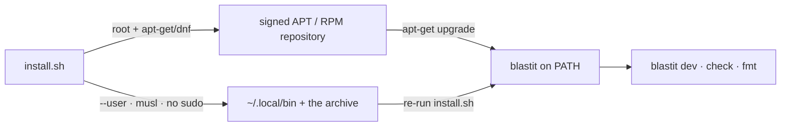

# Install

Blastit is **one Linux binary** — Python WSGI, embedded NTS PHP and static sites —
installed one way on every machine. Python and PHP apps each want their runtime on
the host; static sites want nothing.

```console
$ curl -fsSL https://offworldnexus.github.io/blastit/install.sh | sh
$ blastit --version
$ blastit dev
```

[](https://cloudsmith.io)

Package repositories are hosted by [Cloudsmith](https://cloudsmith.io) as part of
their free open-source plan.



## Managed by your package manager

The installer's default path only adds the repository and installs the package, so
everything afterwards is ordinary package management:

```console
$ sudo apt-get install blastit          # Debian, Ubuntu
$ sudo apt-get upgrade blastit          # a later release
$ sudo apt-get remove blastit           # and its repository line stays
```

```console
$ sudo dnf install blastit              # Fedora, RHEL, Rocky, Alma
$ sudo dnf upgrade blastit
$ sudo dnf remove blastit
```

`blastit --version` prints what is installed and `blastit --help` the preset list;
both are answered by the installed binary even inside a project that pins its own
([which binary runs](reference/cli.md#blastit)).

!!! note "0.2.0 needs a recent libc"

    0.2.0 packages require glibc 2.34+ — Debian 12+, Ubuntu 22.04+, RHEL/Rocky/Alma 9+;
    older distributions get an apt/dnf refusal naming the libc found.

## Repositories

| Store | Coordinates | Components |
|---|---|---|
| APT | `offworld-nexus/apt` on Cloudsmith | `main` (releases), `nightly` |
| RPM | `offworld-nexus/rpm` on Cloudsmith | `rpm` (releases), `rpm-nightly` |
| Mirror | `https://forge.offworld.nexus` | the same two, signed with its own key |

`--nightly` switches a machine to `nightly`; re-running without it returns to
releases. `--mirror forgejo` uses the mirror when Cloudsmith is unreachable — the
key it imports is the mirror's, so a host that already trusts Cloudsmith adds a
second source rather than replacing it.

## Without `curl | sh`

A machine with no `curl`, or a policy against piping a script into a shell, installs
a downloaded package directly — the repository is then yours to add:

```console
$ sudo apt-get install ./blastit_0.2.0_amd64.deb
$ sudo dnf install ./blastit-0.2.0-1.x86_64.rpm
```

The installer's own steps are readable: `sh -s -- --help` on the same URL prints
every flag, including `--prefix <dir>` for an unprivileged tree. A local package is
verified by apt/dnf like any other, and it does not add the repository, so later
releases arrive the way they always did.

## Per-project pins

`uv add --dev blastit` (Python) and `composer require --dev offworldnexus/blastit`
(PHP) install a second copy inside the project. The global binary hands `dev`,
`check`, `fmt` and `lsp` to it — `--version` and `--help` never hand off — so a
machine install and a lockfile pin agree instead of fighting. Upgrade them with
`uv lock --upgrade` / `composer update`, never with the installer.

## Where next

* [Getting started](getting-started.md) — two files, three steps.
* [Command line](reference/cli.md) — every flag, and which binary answers.
* [Settings](reference/settings.md) · [CI/CD](ci.md) · [Deployments](deploy/index.md).
