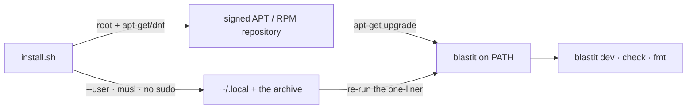

# Install

Blastit installs on Linux as the `blastit` server package plus **one shim package per
language version your host actually runs** — Python WSGI, embedded NTS PHP and static
sites all drive the same server.

```console
$ curl -fsSL https://offworldnexus.github.io/blastit/install.sh | sh
$ blastit --version
$ blastit dev
```

!!! warning "musl hosts, and hosts without apt or dnf"

    A musl host needs `apk add libgcc` before `blastit` runs, and a distro with neither
    `apt-get` nor `dnf` has no repository here: the installer places the signed release
    archive under `~/.local` instead and prints the `PATH` line.



## The two signed repositories

The default path writes one source definition and lets the package manager verify
every byte; `apt-get upgrade` / `dnf upgrade` keep both packages current. As root:

```bash
install -d -m 0755 /etc/apt/keyrings
curl -fsSL https://apt.offworld-nexus.app/keyring.gpg -o /etc/apt/keyrings/offworld-nexus.gpg
cat >/etc/apt/sources.list.d/offworld-nexus.sources <<'EOF'
Types: deb
URIs: https://apt.offworld-nexus.app
Suites: any-distro
Components: main
Signed-By: /etc/apt/keyrings/offworld-nexus.gpg
EOF
apt-get update
apt-get install blastit                      # server: static mounts, fmt, check work now
py=$(python3 -c 'import sys; print("%d.%d" % sys.version_info[:2])')
case "$py" in 3.13|3.14) apt-get install "blastit-python-$py" ;; *) echo "no WSGI shim for CPython $py (3.13/3.14 only)" ;; esac
php=$(php -r 'echo PHP_MAJOR_VERSION, ".", PHP_MINOR_VERSION;' 2>/dev/null || true)
case "$php" in 8.3|8.4|8.5|8.6) apt-get install "blastit-php-$php" ;; *) echo "no PHP shim for ${php:-no php} (8.3-8.6 only)" ;; esac
```

Fedora, RHEL, Rocky and Alma, as root:

```bash
cat >/etc/yum.repos.d/offworld-nexus.repo <<'EOF'
[offworld-nexus]
name=Offworld Nexus packages
baseurl=https://rpm.offworld-nexus.app/stable/$basearch/
enabled=1
gpgcheck=1
repo_gpgcheck=1
gpgkey=https://rpm.offworld-nexus.app/gpg.key
EOF
dnf install blastit
py=$(python3 -c 'import sys; print("%d.%d" % sys.version_info[:2])')
case "$py" in 3.13|3.14) dnf install "blastit-python-$py" ;; *) echo "no WSGI shim for CPython $py (3.13/3.14 only)" ;; esac
php=$(php -r 'echo PHP_MAJOR_VERSION, ".", PHP_MINOR_VERSION;' 2>/dev/null || true)
case "$php" in 8.3|8.4|8.5|8.6) dnf install "blastit-php-$php" ;; *) echo "no PHP shim for ${php:-no php} (8.3-8.6 only)" ;; esac
```

Shims ship for **CPython 3.13/3.14 and PHP 8.3–8.6 only**, by design: an older host
interpreter is supported-but-unavailable, and core `blastit` still serves static mounts, `check`.

`nightly` is a second component: put `Components: nightly` in the `.sources` file (remove it
to return to releases), or point the RPM `baseurl` at `.../nightly/$basearch/`. Shims pin the
exact core build, so install the core and its shims from the same run.

## One package per language version

Published for **amd64 and arm64** only, with the same names on each architecture:

| Package | What it adds | `Depends` | `Recommends` |
|---|---|---|---|
| `blastit` | server, `blastit-lsp`, pure-Python CLI, `/usr/bin` links | measured `libc6 (>= …)`, plus `libgcc-s1` only when a shipped ELF needs it | — |
| `blastit-python-3.13` · `-3.14` | the WSGI shim for that CPython | `blastit (= <version>)` | `python3.13` / `python3.14` |
| `blastit-php-8.3` … `-8.6` | the PHP shim for that NTS `libphp` | `blastit (= <version>)` | `libphp8.x-embed` |

Core `blastit` installs alone and never depends on a shim; every shim depends on
`blastit (= <version>)` and only *recommends* the matching distro runtime, so
`apt-get install blastit-php-8.4` (which reads as *Blastit's PHP 8.4 shim*) still
pulls Debian's `libphp8.4-embed` by default, while a pyenv or source-built
interpreter is fine — add the shim by name, since the one-liner above only offers a
shim whose distro runtime package it can see. apt/dnf name the libc they found.

!!! note "PHP 8.3/8.4 beyond Debian 13 and Ubuntu 24.04"

    Only Debian 13 and Ubuntu 24.04 ship `libphp8.3-embed` / `libphp8.4-embed`
    themselves. On Debian 12 (PHP 8.2), Ubuntu 22.04 (PHP 8.1), or for 8.5/8.6, add
    Ondřej Surý's repository first: `sudo add-apt-repository ppa:ondrej/php`,
    `sudo apt-get update`, then `sudo apt-get install blastit-php-8.4`.

## Without `curl | sh`

A machine with no `curl`, or a policy against piping a script into a shell, installs
downloaded packages directly — the repository is then yours to add:

```console
$ sudo apt-get install ./blastit_0.2.1_amd64.deb ./blastit-php-8.4_0.2.1_amd64.deb
$ sudo dnf install ./blastit-0.2.1-1.x86_64.rpm ./blastit-php-8.4-0.2.1-1.x86_64.rpm
```

The installer's own steps are readable: `sh -s -- --help` on the same URL prints every flag,
including `--prefix <dir>`. A local package is verified by apt/dnf like any other and does not
add the repository, so later releases arrive the way they always did.

`blastit --version` prints what is installed and `blastit --help` the preset list; both
are answered by the installed binary even inside a project that pins its own
([which binary runs](reference/cli.md#which-binary)).

## Per-project pins

`uv add --dev blastit` (Python) and `composer require --dev offworldnexus/blastit` (PHP)
install a second copy inside the project. The global binary hands `dev`, `check`, `fmt` and
`lsp` to it — `--version` and `--help` never hand off — so a machine install and a lockfile
pin agree. Upgrade them with `uv lock --upgrade` / `composer update`, never the installer.

## Where next

* [Getting started](getting-started.md) — two files, three steps.
* [Command line](reference/cli.md) — every flag, and which binary answers.
* [Settings](reference/settings.md) · [CI/CD](ci.md) · [Deployments](deploy/index.md).
