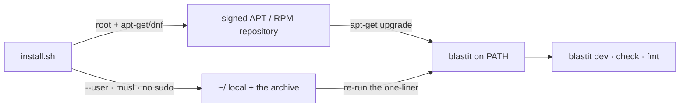

# Install

Blastit installs on Linux as `blastit` plus **one shim package per language version your host runs** — Python WSGI, embedded NTS PHP and static sites all drive the same server.

```console
$ curl -fsSL https://offworldnexus.github.io/blastit/install.sh | sh
$ blastit --version
$ blastit dev
```

!!! warning "musl hosts, and hosts without apt or dnf"

    A musl host needs `apk add libgcc` before `blastit` runs, and a distro with
    neither `apt-get` nor `dnf` has no repository here: the installer places the
    signed release archive under `~/.local` and prints the `PATH` line.



## The two signed repositories

The default path writes one source definition and lets the package manager verify every
byte; `apt-get upgrade` / `dnf upgrade` keep both current. As root:

<!-- BEGIN generated:languages:apt -->
```bash
install -d -m 0755 /etc/apt/keyrings
curl -fsSL https://apt.offworld-nexus.app/keyring.gpg -o /etc/apt/keyrings/offworld-nexus.gpg
cat >/etc/apt/sources.list.d/offworld-nexus.sources <<'EOF'
Types: deb
URIs: https://apt.offworld-nexus.app
Suites: any-distro
Components: main
Signed-By: /etc/apt/keyrings/offworld-nexus.gpg
EOF
apt-get update
apt-get install blastit                      # server: static mounts, fmt, check work now
py=$(python3 -c 'import sys; print("%d.%d" % sys.version_info[:2])')
case "$py" in 3.13|3.14|3.15) apt-get install "blastit-python-$py" ;; *) echo "no WSGI shim for CPython ${py:-no python3}: the table below lists the versions Blastit ships" ;; esac
php=$(php -r 'echo PHP_MAJOR_VERSION, ".", PHP_MINOR_VERSION;' 2>/dev/null || true)
case "$php" in 8.3|8.4|8.5|8.6) apt-get install "blastit-php-$php" ;; *) echo "no PHP shim for ${php:-no php}: the table below lists the versions Blastit ships" ;; esac
```
<!-- END generated:languages:apt -->

Fedora, RHEL, Rocky and Alma, as root:

<!-- BEGIN generated:languages:dnf -->
```bash
cat >/etc/yum.repos.d/offworld-nexus.repo <<'EOF'
[offworld-nexus]
name=Offworld Nexus packages
baseurl=https://rpm.offworld-nexus.app/stable/$basearch/
enabled=1
gpgcheck=1
repo_gpgcheck=1
gpgkey=https://rpm.offworld-nexus.app/gpg.key
EOF
dnf install blastit                      # server: static mounts, fmt, check work now
py=$(python3 -c 'import sys; print("%d.%d" % sys.version_info[:2])')
case "$py" in 3.13|3.14|3.15) dnf install "blastit-python-$py" ;; *) echo "no WSGI shim for CPython ${py:-no python3}: the table below lists the versions Blastit ships" ;; esac
php=$(php -r 'echo PHP_MAJOR_VERSION, ".", PHP_MINOR_VERSION;' 2>/dev/null || true)
case "$php" in 8.3|8.4|8.5|8.6) dnf install "blastit-php-$php" ;; *) echo "no PHP shim for ${php:-no php}: the table below lists the versions Blastit ships" ;; esac
```
<!-- END generated:languages:dnf -->

<!-- BEGIN generated:languages:sentence -->
Shims ship for **CPython 3.13, 3.14 and 3.15, and PHP 8.3, 8.4, 8.5 and 8.6**, by design: an older host interpreter is
supported-but-unavailable, and core `blastit` still serves static mounts, `check`.
<!-- END generated:languages:sentence -->

`nightly` is a second component — `Components: nightly` in the `.sources` file (remove it to return) or a nightly RPM `baseurl`; shims pin the exact core, so install both in one run. The nightly channel additionally ships **`blastit-python-3.16`** (built from CPython `3.16.0a2`), which no stable release carries: add the component (or `install.sh --nightly`) and `sudo apt-get install blastit-python-3.16` — the same binary serves it, so only the package is nightly.

## One package per language version

<!-- BEGIN generated:languages:table -->
| Package | What it adds | `Depends` | `Recommends` (deb / rpm) |
|---|---|---|---|
| `blastit` | server, `blastit-lsp`, pure-Python CLI, `/usr/bin` links | measured `libc6 (>= …)`, plus `libgcc-s1` only when a shipped ELF needs it | — |
| `blastit-python-3.13` | the WSGI shim for CPython 3.13 | `blastit (= <version>)`, measured `libc6` | `python3.13` / `python3.13` |
| `blastit-python-3.14` | the WSGI shim for CPython 3.14 | `blastit (= <version>)`, measured `libc6` | `python3.14` / `python3.14` |
| `blastit-python-3.15` | the WSGI shim for CPython 3.15 | `blastit (= <version>)`, measured `libc6` | `python3.15` / `python3.15` |
| `blastit-php-8.3` | the PHP shim for NTS `libphp` 8.3 | `blastit (= <version>)`, measured `libc6` | `libphp8.3-embed` / `php-embedded` |
| `blastit-php-8.4` | the PHP shim for NTS `libphp` 8.4 | `blastit (= <version>)`, measured `libc6` | `libphp8.4-embed` / `php-embedded` |
| `blastit-php-8.5` | the PHP shim for NTS `libphp` 8.5 | `blastit (= <version>)`, measured `libc6` | `libphp8.5-embed` / `php-embedded` |
| `blastit-php-8.6` | the PHP shim for NTS `libphp` 8.6 | `blastit (= <version>)`, measured `libc6` | `libphp8.6-embed` / `php-embedded` |
<!-- END generated:languages:table -->

Published for **amd64 and arm64** only, with the same names on each: core `blastit` needs no shim, and each shim depends on `blastit (= <version>)` — the release it was built against, resolved by apt/dnf and never typed by hand.
Each shim only *recommends* its distro runtime, so `apt-get install blastit-php-8.4` still pulls `libphp8.4-embed`; a pyenv build needs the shim by name.

!!! note "a newer minor than the distro ships"

    Debian 12 and Ubuntu 22.04 carry older PHP builds. Ubuntu:
    `sudo add-apt-repository ppa:ondrej/php`. Debian: add a keyring-signed source
    (`deb https://packages.sury.org/php/ bookworm main` in a `.sources` file,
    `Signed-By` your copy of `https://packages.sury.org/php/apt.gpg`). Then
    `sudo apt-get update` and `sudo apt-get install blastit-php-<minor>`.

## Without `curl | sh`

A machine with no `curl`, or a policy against piping a script into a shell, installs downloaded packages directly — the repository is then yours to add:

<!-- BEGIN generated:version -->
```console
$ sudo apt-get install ./blastit_0.2.1_amd64.deb ./blastit-php-8.6_0.2.1_amd64.deb
$ sudo dnf install ./blastit-0.2.1-1.x86_64.rpm ./blastit-php-8.6-0.2.1-1.x86_64.rpm
```
<!-- END generated:version -->

The installer's own steps are readable: `sh -s -- --help` on the same URL prints every flag, including `--prefix <dir>`. A local package is verified by apt/dnf and adds no repository.

`blastit --version` prints what is installed and `blastit --help` the preset list, both answered by the installed binary even under a project pin ([which binary runs](reference/cli.md#which-binary)).

## Per-project pins

`uv add --dev blastit` (Python) and `composer require --dev offworldnexus/blastit` (PHP)
install a second copy inside the project; the global binary hands `dev`, `check`, `fmt` and
`lsp` to it (`--version`/`--help` never hand off), and `uv lock --upgrade` updates the pin.

## Where next

* [Getting started](getting-started.md) — two files, three steps.
* [Command line](reference/cli.md) — every flag, and which binary answers.
* [Settings](reference/settings.md) · [CI/CD](ci.md) · [Deployments](deploy/index.md).
