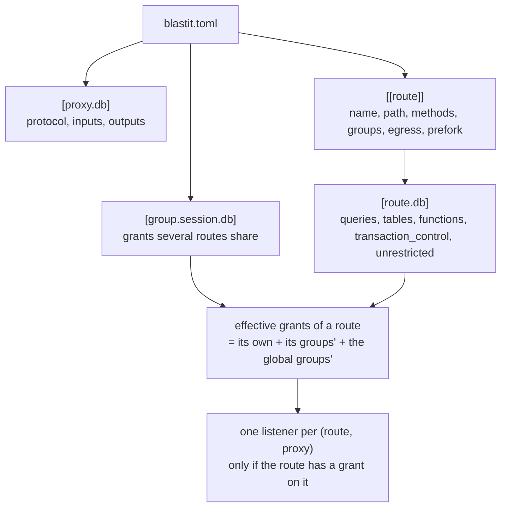

# The manifest

The manifest is blastit's own routing table and the whole of its permission
model, in one file that is **versioned with the code**, because it describes the
code.

* Default path: `/app/blastit.toml`, or `BLASTIT_MANIFEST`.
* Read at boot, in both stages, and in force until the process restarts. There
  is no reload.
* Parsed **strictly**: an unknown key is an error, not a comment.



## Top-level keys

| Key | Required | Meaning |
|---|---|---|
| `version` | yes | must be `1` |
| `groups` | no | group names attached to **every** route |
| `[proxy.<name>]` | no | a named broker for one external service. A grant naming an undeclared proxy aborts the boot |
| `[group.<name>]` | no | grants several routes share. A group grants nothing until it is attached |
| `[[route]]` | yes | one sandbox: one process, one uid |

Top-level keys come before any `[table]`. In TOML that means `version` and
`groups` at the top of the file.

## Proxies

A proxy declares the protocol it speaks, the environment variables it owns, and
the environment variables the application sees instead.

```toml
[proxy.db]
protocol = "postgresql"
input = { url = "DATABASE_URL", ca_cert = "DATABASE_CA_CERT" }
# No output table: DATABASE_URL is rewritten in place, and DATABASE_CA_CERT
# disappears from the app's environment.

[proxy.analytics]
protocol = "postgresql"
input = { url = "ANALYTICS_URL" }
[proxy.analytics.output]
ANALYTICS_DB_HOST = "{{ socket_dir }}"
ANALYTICS_DB_PORT = "{{ port }}"
ANALYTICS_DB_NAME = "{{ database }}"
ANALYTICS_DB_USER = "{{ user }}"
```

* **Inputs.** `input` maps the protocol's input slots to environment variable
  names. Every input variable is removed from the app's environment unless an
  output of the same name redefines it. **A missing input variable aborts the
  boot.**
* **Outputs.** `output` maps variable names to templates. Without an `output`
  table the protocol's defaults apply: each input variable is replaced by the
  equivalent local value under the *same name*. That is the `DATABASE_URL` →
  `DATABASE_URL` case, which needs no configuration.
* **Templates** are deliberately tiny: `{{ field }}` inserts a field and
  `{{ field | urlencode }}` percent-encodes it. No logic, no loops, no access to
  the environment. They are rendered once, at boot, and an unknown field or
  filter aborts the boot.
* **Secrets cannot be templated.** The fields a protocol offers describe the
  *local* endpoint plus a few non-secret facts. Passwords, upstream hosts and CA
  material never reach a template, so no output can leak them.
* **Collisions abort the boot**: an output may not overwrite a variable it does
  not own, and two proxies may not produce the same variable.

`blastit.toml` holds no secrets, and that is by design — nothing in it is a
credential, and it is safe to commit.

### Protocol `postgresql`

| Input slot | Content |
|---|---|
| `url` | a libpq URI (`postgres://` or `postgresql://`). The usual case, and DO's `${db.DATABASE_URL}` |
| `host`, `port`, `user`, `password`, `database`, `sslmode` | the same thing split into parameters, an alternative to `url` — setting both forms is an error |
| `ca_cert` | PEM text, for the upstream TLS leg. DO's `${db.CA_CERT}` |

| Template field | Value |
|---|---|
| `url` | `postgresql://{{ user }}@{{ socket_dir \| urlencode }}:{{ port }}/{{ database }}` |
| `socket_dir` | `/proc/self/cwd` — each view's working directory is its own socket directory |
| `port` | this proxy's local port: `5432 + k`, *k* being the proxy's index among the `postgresql` proxies **sorted by name** |
| `socket_path` | `/proc/self/cwd/.s.PGSQL.<port>` |
| `database` | the upstream database name (not a secret) |
| `user` | `blastit`. The proxy ignores it, because identity comes from the socket |

**Default outputs:** `url` → the same variable; `host` → `{{ socket_dir }}`,
`port` → `{{ port }}`, `user` → `{{ user }}`, `database` → `{{ database }}`;
`sslmode` → `disable`, since the local leg is a Unix socket; `password` and
`ca_cert` → removed.

The port selects the proxy and `/proc/self/cwd` selects the view: libpq connects
to `<host>/.s.PGSQL.<port>`, and a percent-encoded host is how libpq and
`dj-database-url` write a Unix socket directory. The rendered values are
identical in every process, which matters because frameworks read their database
settings once, at import, before the fork.

**Grant contents for this protocol:** `queries`, `tables`, `functions`,
`transaction_control`, `unrestricted`.

## Routes

```toml
[[route]]
name = "product-detail"
path = ['/products/[0-9]+/']        # full match against PATH_INFO
methods = ["GET", "HEAD"]           # optional; default: any method
groups = ["catalog"]                # shared grants
prefork = true                      # fork at startup: skip the first-hit latency
egress = true                       # may open TCP connections
[route.db]
queries = [ … ]
```

| Key | Required | Meaning |
|---|---|---|
| `name` | yes | the route's name: in the log, and in `environ["blastit.route"]`. Duplicates abort the boot |
| `path` | yes | a **list** of regular expressions, matched against the whole of `PATH_INFO`, in order |
| `methods` | no | the methods this route answers. Without it, any method. **`HEAD` is never implied by `GET`** |
| `groups` | no | groups whose grants this route takes |
| `egress` | no | `true` lets the process open outbound TCP connections. Without it the seccomp filter refuses every `AF_INET`/`AF_INET6` socket |
| `prefork` | no | `true` forks this view at startup instead of on first use |

`path` is a list even when it holds one regex: `path = ['.*']`, not
`path = ".*"`.

## Grants

A grant is per proxy. For a `postgresql` proxy it says which statements a route
may run, and whether transaction control is allowed.

```toml
[group.session.db]                  # grants several routes share
transaction_control = true
queries = [
  "SET TIME ZONE 'UTC'",
  'SELECT "django_session"."session_key" FROM "django_session" WHERE "django_session"."session_key" = $1 LIMIT 21',
]

[[route]]
name = "restaurants"
path = ['/restaurants/.*']
[route.db.tables]                   # instead of listing every statement
restaurants_restaurant = { select = ["id", "slug", "name"] }
restaurants_cuisinetype = { select = "*" }         # every column
orders_order = { select = "*", insert = "*", update = ["status", "accepted_at"], delete = true }
[route.db]
functions = ["st_distance", "unaccent"]            # beyond the built-in safe set
```

| Key | Type | Meaning |
|---|---|---|
| `queries` | list of strings | the statements this grant allows, compared after normalisation |
| `tables` | table | which tables and columns the route may read and write |
| `functions` | list of strings | function calls allowed beyond blastit's built-in safe set |
| `transaction_control` | bool | allow `BEGIN`/`COMMIT`/`ROLLBACK`/`SAVEPOINT`/`RELEASE`/`ROLLBACK TO` |
| `unrestricted` | bool | allow **every** statement on this proxy. Inline on a route only |

### Exact queries

An exact `queries` entry is trusted as it is: blastit compares the text and runs
what it matches. It does not look at what the statement calls, so an entry for
`SELECT set_config(…)`, `SELECT pg_read_file(…)` or a statement calling
`pg_terminate_backend` runs that function with the app's privileges. That is what
a table grant is for.

### Table and column grants

`[route.<db>.tables]` has one entry per table:

| Operation | Value |
|---|---|
| `select`, `insert`, `update` | a list of column names, or the string `"*"` (every column) |
| `delete` | `true` |

`functions` sits next to `tables`, in the grant's own table, and lists the
function calls allowed beyond the built-in safe set.

A statement that no exact query lists is parsed with **PostgreSQL's own parser**
(`libpg_query` — a second implementation would be a parser differential, and any
text the two read differently is a bypass) and allowed when every table, column
and function it touches is granted. Anything else is refused: another statement
kind, a construct the analysis does not understand, a function nobody granted.

The details that decide real deployments:

* reading a column **anywhere** — a `WHERE`, an `ORDER BY`, a join condition — is
  reading it;
* `*` needs `select = "*"` on every base table it expands to, through derived
  relations;
* `count(*)` reads no column;
* an unqualified column has to be granted on every relation in scope that could
  provide it;
* `public.t` is `t`; any other schema keeps its qualified name;
* `pg_catalog` and `information_schema` are never readable this way — statements
  on the catalogue stay exact `queries`;
* a function call must be in the built-in safe set or in `functions`
  (`pg_catalog.x` is `x`). Casts to `reg*` and to types other than the built-in
  plain ones need a `functions` entry;
* **every base table a statement names must appear in the grant**, even when no
  column of it is read: a row count or an `EXISTS` reveals it;
* a **row lock** (`FOR UPDATE`, `FOR NO KEY UPDATE`, `FOR SHARE`, `FOR KEY
  SHARE`, with or without `OF …`, and through a derived relation) needs an
  `update` entry on every base table it locks — but on **any one column**,
  because PostgreSQL asks for the UPDATE privilege on a single column of a locked
  table. So `update = ["id"]` is enough for a route that only reads the rows it
  locks, while the columns it reads still need `select`. The denial reads
  ``update on t (any column, to lock its rows) not granted``;
* unqualified `pg_*` names are never grantable as tables, since `pg_catalog`
  comes first on every search path.

### `unrestricted`

```toml
[[route]]
name = "admin"
path = ['/admin/.*']
[route.db]
unrestricted = true
```

It means exactly what it says: that route may run any statement on that proxy,
transaction control included.

* **Inline on a route only.** A group can be attached to every route at once,
  which would turn the whole manifest into one sandbox, so `unrestricted` in a
  group is a boot error.
* **Every unrestricted (route, proxy) is a `manifest.warning` at boot**, so a
  deployment cannot be unrestricted by accident.
* **It is still a sandbox**: the listener, the uid check, the other proxies'
  grants and the credential barrier all stay. It simply has nothing left to
  check on this one, so dbproxy logs no statement for it.
* `unrestricted` with `queries` is a boot error (`unrestricted grants take no
  queries`): the list would read as a restriction, and it is not one. The same
  for `unrestricted` with `tables` or `functions`.

Its user is a staff-only back-office — Django's admin — whose SQL is too varied
to enumerate, where the guarantee that remains is that the process still never
sees the credentials.

### Effective grants

A route's allowlist for a proxy is the **union** of:

1. its own inline grant,
2. the grants of the groups it lists,
3. the grants of the global groups.

`transaction_control` is on if any of them turns it on. `unrestricted` is on if
any of them turns it on — but since a group cannot carry it, in practice it is
only ever inline.

**A route with no grant at all for a proxy gets no listener for it.** That is the
strongest thing in the file: the `fallback` route in most manifests cannot reach
the database, because there is no socket for it to connect to.

## How a statement matches

Matching is exact, on normalised text, and the *shape* of the text is normalised
too, so a real app's SQL does not have to be the same bytes twice.

**Normalisation** (applied to both the grant and the text on the wire): trimmed,
a trailing `;` removed, whitespace collapsed outside quotes and identifiers.

**Shape:**

* every bind placeholder `$<digits>` outside quoted regions and comments becomes
  `$?`. The numbering carries no meaning for the policy — values always travel
  separately — and it shifts whenever a statement is assembled dynamically, so
  one template means one grant;
* a parenthesised list right after `IN`/`NOT IN` that holds nothing but
  placeholders becomes `IN ($?, ...)`, whatever its length, so
  `prefetch_related` and `__in` match one grant for every page size. A list with
  anything else in it — a string, a subquery, a nested tuple — is left alone;
* after `VALUES`, a run of identical rows `(…), (…), …` becomes the single row
  followed by `, ...`, so `bulk_create` matches one grant for every number of
  objects. A single row is left as it is, rows that differ from each other do not
  collapse, and a **function call's argument list never collapses**: its arity
  picks the overload.

**Protocol:** a `Parse` that matches authorises the `Bind`/`Execute` that follow
it. Simple-protocol `Query` messages go through the same check, so a route
cannot get around the policy by switching protocols. `COPY`, `LISTEN` and the
function-call sub-protocol are denied unless they are listed. A text holding
several statements never matches: a grant is one statement.

**Two things cannot be granted**, and the tooling reports them instead of trying:

* a savepoint's name (`SAVEPOINT "s140234_x1"`) is made per request. The fix is
  `transaction_control = true`;
* a named cursor — `QuerySet.iterator()`, that is Django's `chunked_cursor()` —
  sends `DECLARE "_django_curs_140234_sync_1" CURSOR FOR …` and then
  `FETCH`/`CLOSE` with the same generated name.

## Routing

* Routes are tried **in manifest order**, and the first one whose `path` (and
  `methods`, if set) matches wins.
* A regex must match the **whole** of `PATH_INFO` — the percent-decoded path the
  app will see.
* They use Rust [`regex`](https://docs.rs/regex/latest/regex/) syntax, which
  guarantees linear-time matching, so a hostile URL cannot stall the scheduler.
* `BLASTIT_SCRIPT_NAME` strips a mount prefix first, as WSGI does.
* If nothing matches, the scheduler answers `404` itself and **no Python runs**.
  A catch-all (`path = ['.*']`, listed last) lets the app render its own 404s.
* Every routing decision is a `request` event, with `route` and the index of the
  matching regex in `rule`.

**Getting it wrong is safe, if annoying.** A misrouted request runs in a process
whose allowlist does not fit its queries, so they are denied — and every denial
is logged. It fails closed; it never gains a privilege.

## Validation at boot

**Aborts the boot:**

* an unknown key, anywhere;
* a `version` that is not `1`;
* an unknown group, or a grant on an undeclared proxy;
* a duplicate route name;
* an invalid regex, or a method token that is not a token;
* `unrestricted` in a group, or `unrestricted` next to `queries`/`tables`/
  `functions`;
* a missing proxy input variable.

**Warns and runs:**

* a group that is attached nowhere;
* a route that is unrestricted on a proxy;
* `BLASTIT_PRESET` disagreeing with `--preset`.

## Writing one

Do not write the statements by hand from memory. Two tools do it from evidence:

* **the pytest plugin** — Django, and it diffs what your test suite really ran
  against the manifest: [the plugin](pytest-plugin.md);
* **`blastit-manifest fold`** — anything, from a log of `sql.denied` events:
  [fold the log](../frameworks/day-to-day.md#fold-the-log).

The plugin also reports the smallest table grant covering a route's statements,
with the TOML to paste in, so a route can be moved from exact queries to table
grants in one step.

`e2e/demo/blastit.toml` in the repository is a real manifest for a small Django
app — sessions, a login, notes, and two routes that deliberately have less than
the others — generated from a scenario run and then committed.

## See also

* [The plugin reference](pytest-plugin.md) — the report, field by field.
* [Day-to-day life](../frameworks/day-to-day.md) — living with the manifest.
* [`ARCHITECTURE.md` §6](https://github.com/OffworldNexus/blastit/blob/develop/ARCHITECTURE.md#6-the-manifest) — the specification.
