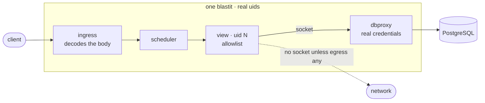

# Security model

What blastit claims, and the argument behind each claim. Prove the view boundary on your machine
first; the rest follows.

## Prove it

```console
$ blastit dev
  blastit dev · single-uid simulation · http://127.0.0.1:8080
  Not a sandbox. Production `blastit` refuses to run like this.
  http · scheduler · dbproxy · 1 route
$ curl -s -o /dev/null -w '%{http_code}\n' localhost:8080/products/9
500
```

That request landed in `products`, which is not granted its statement: PostgreSQL
answers `42501` and the log names the view (`sql.denied products db parse …`),
while every other view is untouched. One view per compromise is the claim; what
that buys, and what it does not, is the rest of this page.



A compromise at request time gets one view: its own allowlist, its uid's files,
and its share of the scheduler's budget — never the database password, never
another view's socket.

## Threat model

**In scope: compromise at request time** — RCE in a view, SQL injection, a
deserialisation bug, a vulnerable dependency reachable from a view. The question
is what the attacker is holding when that happens.

**Out of scope, deliberately:** code the app runs **at import time** (stage 1, as init, before any
view exists); **other secrets** in the environment, which every view can read (`BLASTIT_ENV_STRIP`
hides what you name); TLS and HTTP/2, which your cloud ingress terminates and forwards as plain
HTTP/1.1; per-uid **egress filtering** (`egress any` is the whole network); **parameter values** (a
grant says which statement, not which row); an attacker with root in the container, and the app's
own behaviour.

## What a compromise gets

| If this is compromised… | …the attacker gets | …and cannot |
|---|---|---|
| **a view** (request-time RCE) | that view's allowlisted statements; its scratch directory; **every file its uid can open** — the code tree, the virtualenv, `/tmp`; all the CPU and memory the container has; egress only with `egress any` | run any other statement; read the real database credentials; `ptrace` another process; connect to another view's socket or channel; hold more threads than its `RLIMIT_NPROC`; take another view's worker slot |
| **http** | the raw bytes of in-flight HTTP traffic | reach the database; run Python; spawn processes |
| **the scheduler** | it can send any request to any view; every file beneath each declared static `root` — dotfiles and symlinks included, but never a `.php`/`.phtml`/`.phar` source, which is `404` | read the real database credentials; reach another view's socket or a view's memory; go beyond what its uid and a socket-less seccomp role allow |
| **dbproxy** | the real database credentials | — it runs no app code, is not dumpable, and is kept small |
| **init** | everything | — it runs only blastit code after stage 1's imports |

!!! warning "Two lines worth reading twice"

    A view has no CPU or memory limit of its own, and it can read any file its uid
    can open. Cap the container for that; `BLASTIT_MAX_WORKERS` bounds the threads.

The sandbox comes from **uid privileges, not code isolation**: all the app's code
is mapped into every view, so a view can run another view's code — with only its
own allowlist. A misrouted request is safe because it lands in a process whose
allowlist does not fit.

## The mechanisms

* **The credential barrier.** No process *after* stage 0 holds a real secret in
  its `environ` or `argv`: stage 0 keeps it only until its own `execve`, which
  replaces that environment. The broker is `execve`'d with an empty environment
  and receives the secret over an inherited pipe.
* **uid privileges.** Each process has its own uid (`gid == uid`, no
  supplementary groups), so no uid signals, `ptrace`s or reads another's
  `/proc/<pid>/{mem,io,cwd,root}`. Another uid *can* read `/proc/<pid>/environ`
  and list fds — accepted, because no secret is in a sandboxed `environ` or
  `argv`. `SO_PEERCRED` returns the listener's own credentials, which is why
  identity is the
  [listener plus `SCM_CREDENTIALS`](how-it-works.md#identity-not-passwords) and
  socket permissions are enforced at `connect()`.
* **Capabilities and seccomp.** Every child clears every capability set it holds,
  sets `PR_SET_NO_NEW_PRIVS`, and installs a BPF refusal list after dropping
  privileges: `ptrace`, `bpf`, `keyctl`, `perf_event_open`, `io_uring`, the
  module-loading calls, `mount`, `setns` and `unshare`. Views may use `AF_UNIX`
  only, plus `AF_INET`/`AF_INET6` with `egress any`; http and the scheduler may
  not call `socket()` at all, and a PHP view refuses `execve`, `fork` and the
  other process-creating calls.
* **Filesystem and limits.** The code tree is read-only; each view gets a private
  `0700` scratch directory, `umask 077`, and that directory as `HOME` and
  `TMPDIR`; `RLIMIT_NPROC` counts threads and backs up the scheduler's budget,
  with `RLIMIT_NOFILE` and `RLIMIT_CORE=0`, and `PR_SET_PDEATHSIG(SIGKILL)`
  means no process outlives init.
* **Ingress bodies.** `json` and `form` decode and re-encode a body before the app sees it, `none`
  rejects one, and `raw` passes the bytes through. A body to a view with no `body` is a `413`;
  `check` reports it, and `raw` needs `unvalidated` **and** a gate — the production boot refuses
  it, `dev` warns and serves. A file upload travels as `raw`.

## Static files

A `static` mount serves files from one declared `root`, answered by the scheduler
as its own uid (`UID_BASE+2`): no new process, socket or uid.

| What arrives | Answer |
|---|---|
| `..` (plain or percent-encoded), NUL, control bytes, an absolute or backslash path, invalid UTF-8, a malformed escape, a segment over 255 bytes, a path over 4096 bytes | `400` |
| a dotfile such as `.env` or `.git`, a symlink, a FIFO, socket or device, an unreadable or oversize file — and, on a mount with no `fallback` and no app, any path that is no file | `404` |

`/.well-known/` is the one dotfile exception, and a refusal is final: never the
app, never `index.html`. The boundary is structural — one dirfd per root at boot,
then `openat2(…, RESOLVE_BENEATH|RESOLVE_NO_SYMLINKS|RESOLVE_NO_MAGICLINKS)` and an
`fstat` match on a regular file
([ADR-0007](https://github.com/OffworldNexus/blastit/blob/develop/docs/decisions/ADR-0007-static-asset-serving-and-rewriting.md)).

## PHP front controllers

`public/index.php` runs in its own unprivileged view worker with the host's NTS
`libphp` embedded, so the three CGI surfaces are absent: no CGI binary and no argv,
so a query string cannot become `-d` flags (`php2shell`, CVE-2012-1823,
CVE-2024-4577); `$_SERVER`, `SCRIPT_FILENAME` and `DOCUMENT_ROOT` are built in C
from the request and the manifest, so `PHP_VALUE`, `PHP_ADMIN_VALUE` and
`REDIRECT_STATUS` cannot arrive and a `Proxy:` header is dropped before it becomes
`HTTP_PROXY` (`httpoxy`); and the seccomp role refuses `execve`, `execveat`,
`fork`, `vfork` and a process-creating `clone`. INI is rendered once; `exec`,
`shell_exec`, `proc_open`, `dl` and the `pcntl`/`posix` calls are disabled.

The front controller is pinned at boot by inode, size and status-change time and
re-checked before every request, so a script replaced **or rewritten in place** is
refused (`500`) until a restart records the tree. `.php`/`.phtml`/`.phar` under a
static root is `404`; an upload is `raw`, hence the pinned
`phar.readonly`/`phar.require_hash`
([§2.6](https://github.com/OffworldNexus/blastit/blob/develop/ARCHITECTURE.md#26-php-embedded)).
`libphp` is the host's: opened, `(st_dev, st_ino)`-verified, passed as a descriptor
and `dlopen`ed through `/proc/self/fd/<n>`, or the boot refuses naming the package
or `BLASTIT_LIBPHP`.

## Dev mode is not a sandbox

`blastit dev` shares one uid between every role. The process topology, the
credential barrier and the grants are real, so a misconfiguration is caught
locally, but no uid boundary keeps a compromise inside its view. The banner says
so, the `boot` event reports `"privilege": "unprivileged-dev"`, and production
`blastit` **fails closed**: without root, the capability set or seccomp it exits
instead of serving.

`REMOTE_ADDR` and `wsgi.url_scheme` come from one resolver that believes a header
only from a peer in `BLASTIT_TRUSTED_PROXIES`; both presets name `*`,
`compose-traefik` reading the rightmost `X-Forwarded-For` entry and
`digitalocean-paas` `do-connecting-ip`
([client address](reference/settings.md#client-address)).

## The full harness

The end-to-end tests drive a Django app over HTTP, run the same raw SQL from views
with different grants, and assert the denials name the right view and the password
appears nowhere in the log — `uv run e2e/run.py` in Docker as root,
`uv run e2e/rootless/run.py --local` for the rootless path that checks `/proc` too.

## Where next

* [How it works](how-it-works.md) — the same machine, role by role.
* [Deployments](deploy/index.md) — real uids, capabilities and the trust boundary in production.
* [Troubleshooting](troubleshooting.md) — the symptom each refusal prints.
